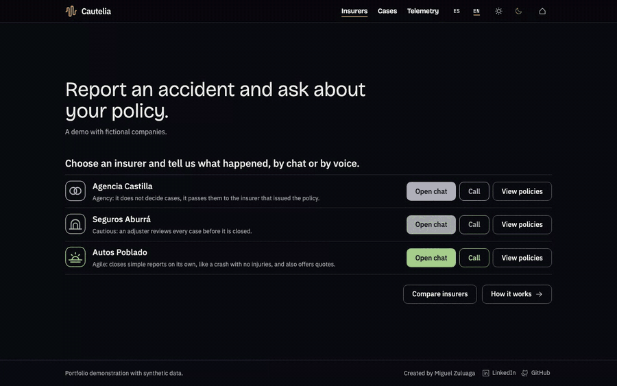
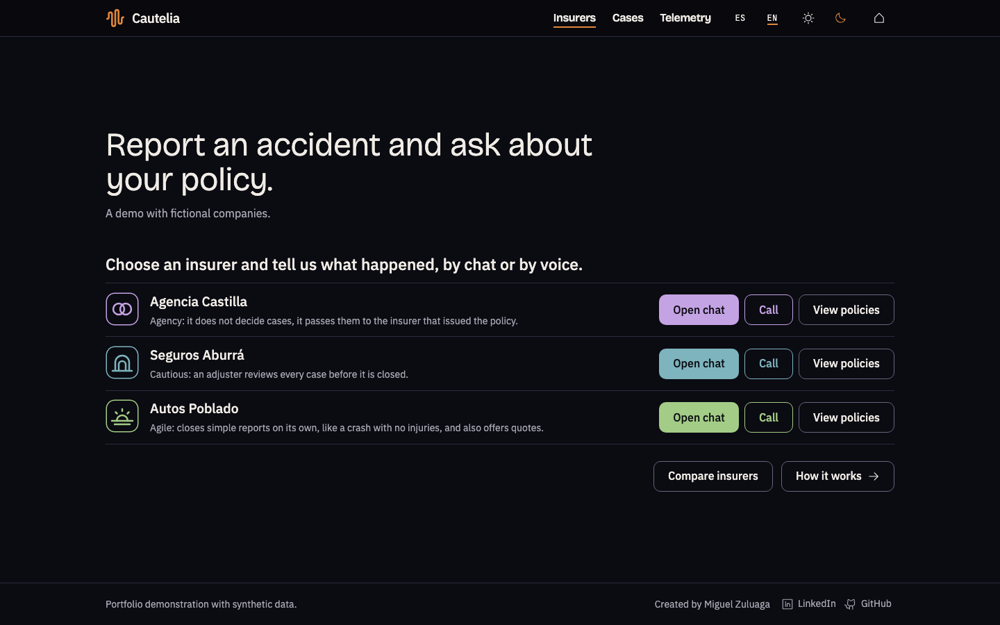
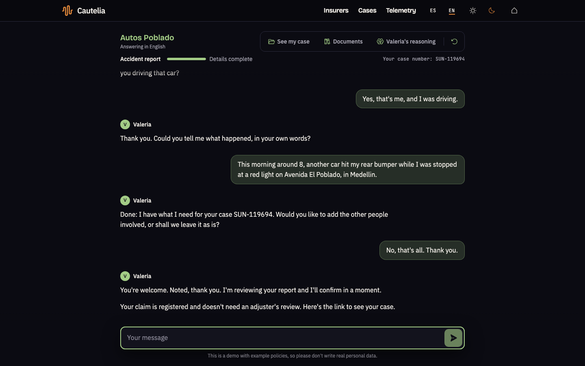
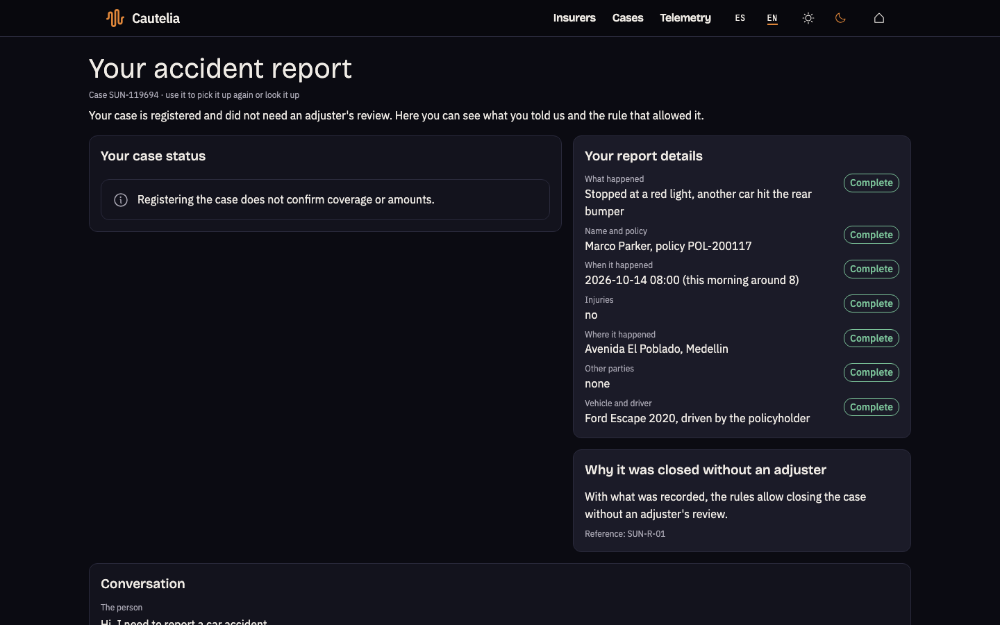
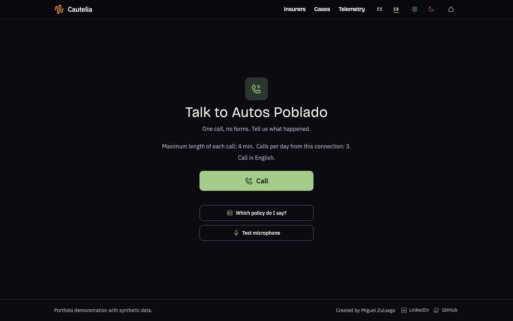
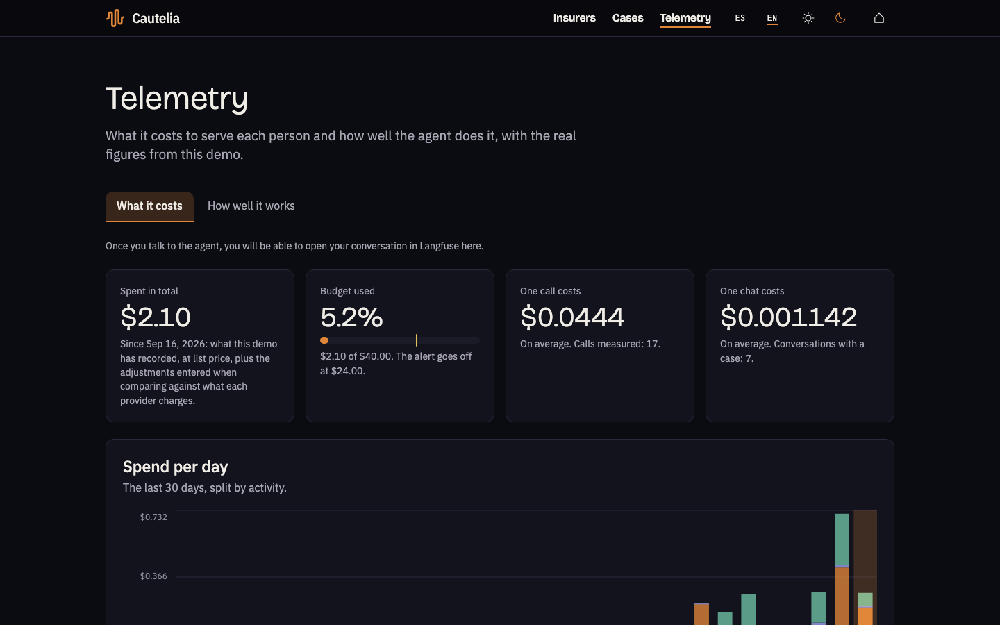
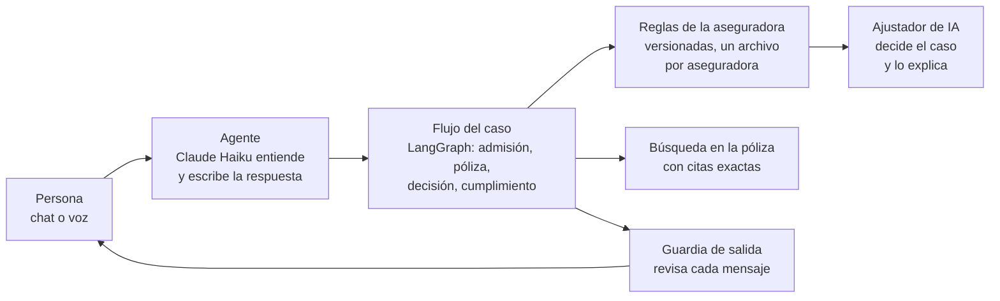

# Cautelia

[English](README.md) · **Español**


**Cautelia es una agente de inteligencia artificial que toma el reporte de un accidente de carro y responde dudas sobre la póliza de auto, por chat o por teléfono, en español y en inglés.** Pregunta solo lo que falta, verifica la póliza, cita la cláusula exacta en la que se apoya y cierra sola los casos sencillos. Todo lo que toca cobertura o dinero pasa a un ajustador de IA, aparte de la agente, que decide el caso y explica cada paso con sus fuentes.

Es una demostración de portafolio: las tres aseguradoras, sus pólizas y todas las personas que aparecen son ficticias.

- **Pruébala:** [cautelia.app](https://cautelia.app) (chat y llamadas desde el navegador, con un límite diario de llamadas).
- **Mírala:** el recorrido de 60 segundos de abajo, o el [video completo (MP4)](docs/assets/readme/demo.mp4).



## Qué hace

**1. Eliges una aseguradora.** Tres compañías ficticias, cada una con sus propias reglas: una agencia que pasa cada caso a la compañía que emitió la póliza, una aseguradora prudente cuyo ajustador revisa todos los casos y una ágil que cierra sola los reportes sencillos.



**2. Cuentas qué pasó, por chat o por voz.** La agente hace una pregunta a la vez y solo sobre lo que todavía falta. Cuando das tu nombre y tu número de póliza, busca la póliza en los registros de la aseguradora y te pide confirmar que es tuya. Puedes cambiar entre español e inglés en medio de la conversación.



**3. Recibes un resultado claro.** Con el reporte completo, las reglas de la aseguradora deciden qué sigue: un caso sencillo (sin heridos y sin nadie más involucrado) se registra sin ajustador; cualquier otro pasa al ajustador de IA con todo ya capturado, para que no tengas que repetir nada. En ambos casos recibes un número de caso y una página que muestra lo que quedó registrado y qué regla decidió.



**4. Puedes preguntar por tu póliza.** "¿Mi póliza cubre un carro de reemplazo?" La respuesta cita la cláusula de la que sale. Si ninguna cláusula lo cubre, la agente lo dice en vez de adivinar, y si no pudo verificarlo, también lo dice: son dos respuestas distintas.

Cuando la pregunta es sobre un dato escrito en la propia póliza (las fechas de vigencia, los vehículos asegurados, los conductores declarados, las condiciones especiales), la agente lo lee directamente del registro de la póliza con código simple: sin búsqueda de cláusulas y sin un modelo que escriba la respuesta, así que es exacto y no gasta tokens. Solo una pregunta que necesita interpretar las cláusulas pasa por la búsqueda con citas.

**5. Un ajustador de IA decide el caso y muestra cómo.** Cuando un caso pasa a un ajustador, otra IA, aparte de la agente, lee el reporte, la póliza y las reglas de la aseguradora, busca en la web el valor de referencia del vehículo y decide. La página del caso muestra sus pasos a medida que llegan y, al terminar, la decisión con los seis pasos y las fuentes de cada uno: las cláusulas que cita, las reglas y la página web. Dice que la explicación la escribió una IA. Quien visita ya no decide ni anota nada: la conversación sigue con un aviso de que el caso ya tiene una decisión.

**6. Puedes llamar.** La misma agente responde por voz en el navegador: se presenta como una inteligencia artificial, avisa que la llamada se transcribe y al final te da el número de caso.



**7. Puedes ver cuánto cuesta y qué tan bien funciona.** La página de Telemetría muestra el gasto por proveedor, por día y por caso, y los resultados de la última evaluación. Desde ahí puedes abrir tu propia conversación en [Langfuse](https://langfuse.com), paso a paso: qué modelo corrió, cuánto tardó y cuánto costó.



## Qué no hace

- **La agente con la que hablas nunca decide coberturas ni pagos.** No dice "estás cubierto", no da montos ni asigna culpas. Un ajustador de IA aparte decide el caso y deja escrito cómo; la agente solo se lo pasa.
- **No está conectada a ninguna aseguradora real.** No hay pólizas reales, ni sistema real de reclamaciones, ni pagos.
- **No escribas datos personales reales.** La conversación se guarda tal como la escribiste, y los datos de los visitantes se borran cada noche.
- **La voz funciona solo en el navegador,** con un límite de llamadas por visitante y por día. No hay número de teléfono.
- **Las cotizaciones son solo por chat.** Por voz, la agente lo dice y ofrece el chat.
- **No es asesoría legal ni de seguros,** y no afirma cumplir ninguna norma: sus controles están inspirados en ellas.

## Cómo falla

La evaluación es un conjunto de situaciones escritas de antemano, las mismas en español y en inglés: reportes de choques, preguntas sobre la póliza e intentos de engañar a la agente. Un programa hace de persona, habla con la agente real y revisa el resultado con código.

El resultado de la última corrida completa se genera automáticamente y se publica solo en inglés, para que nunca haya dos versiones distintas: [ver "How it fails"](README.md#how-it-fails).

## Arquitectura



En palabras: la persona habla con la agente; un modelo de lenguaje (Claude Haiku) lee cada mensaje y escribe la respuesta, y solo puede **proponer** acciones de una lista cerrada (anotar un dato, buscar la póliza, pasar el caso a un ajustador, cerrar el reporte). El código valida cada acción contra el caso antes de ejecutarla, siguiendo un flujo fijo. Son las reglas de la aseguradora, no el modelo, las que deciden a dónde va un caso. Cada mensaje pasa por una guardia de salida antes de que la persona lo vea. Cuando un caso pasa a un ajustador lo toma un proceso aparte en segundo plano, el ajustador de IA: lee el reporte, la póliza y las reglas con código, busca en la web el valor de referencia del vehículo (hasta tres búsquedas) y toma una decisión con salida estructurada. El código valida la acción y cada cláusula que cita antes de cerrar el caso, y la página del caso muestra los pasos con sus fuentes.

| Pieza | Qué usa |
| --- | --- |
| Pantallas | React, Vite, TanStack Router y Query, Tailwind CSS |
| Servidor y flujo | Python, FastAPI, LangGraph |
| Modelos de lenguaje | Claude Haiku (conversación y citas), Gemini (los demás pasos y la búsqueda en las pólizas) |
| Voz | Deepgram (voz a texto), Cartesia (texto a voz), con Deepgram como voz de respaldo |
| Datos | PostgreSQL con pgvector, seguridad a nivel de fila por aseguradora |
| Hosting y trazas | Google Cloud Run, Neon, Langfuse |

## Principios, controles y evidencia

- **Una persona firma cada decisión sobre cobertura y dinero.** La guardia de salida revisa cada mensaje, en los dos idiomas, buscando cualquier cosa que afirme o niegue cobertura, dé montos, asigne culpas o dé asesoría legal, y lo reemplaza.
- **Las citas salen solo de cláusulas recuperadas,** y un verificador exacto comprueba que cada una exista, pertenezca a esa aseguradora y a esa póliza, y esté vigente.
- **Los datos personales se enmascaran en logs, trazas y reportes de evaluación,** con dos detectores que funcionan de forma distinta, en español y en inglés. La conversación en sí se guarda y se muestra tal como se escribió.
- **Las aseguradoras están aisladas en la base de datos** con seguridad a nivel de fila y un único punto de entrada que fija la aseguradora antes de cualquier consulta. Una prueba falla si alguna tabla no la tiene.
- **Las reglas son archivos, no ramas en el código.** Cada aseguradora tiene sus propias reglas versionadas, cada regla con su propia prueba.
- **El gasto tiene límites firmes:** saldos prepagados con los proveedores y la recarga automática apagada, un tope de gasto en la aplicación y límites diarios por visitante.
- **Cada cambio se revisa en GitHub:** búsqueda de secretos, lint, revisión de tipos, más de 4.000 pruebas automáticas con un piso de cobertura del 80 % y una revisión de accesibilidad de cada pantalla en tres navegadores.

## Reporte de evaluación

También se genera automáticamente desde la línea base vigente y se publica solo en inglés: [ver "Evaluation report"](README.md#evaluation-report).

## Servidor MCP

Los mismos datos de la póliza que la agente lee para esas preguntas se publican como un servidor de solo lectura de [Model Context Protocol](https://modelcontextprotocol.io), de modo que cualquier cliente MCP (Claude Desktop, otra agente) puede consultar las pólizas de ejemplo sintéticas. Está hecho con el SDK oficial de Python, habla por stdio, pasa por el mismo punto único de entrada a la base de datos que el resto de la aplicación (la aseguradora se fija antes de cualquier consulta y la seguridad a nivel de fila hace el resto) y no importa nada de casos, visitantes, el chat ni los proveedores de modelos: un contrato de importación lo comprueba.

| Herramienta | Qué devuelve |
| --- | --- |
| `get_policy_summary` | titular, emisor, periodo y si la póliza está vigente en una fecha |
| `get_limits` | los límites de responsabilidad civil, gastos médicos de ocupantes y accidentes personales del conductor, en pesos colombianos |
| `get_deductibles` | los deducibles de pérdida parcial por daño y por hurto |
| `get_insured_vehicles` | marca, modelo y año (sin placa ni VIN) |
| `get_listed_drivers` | los conductores que la póliza declara, el titular primero |
| `get_endorsements` | las condiciones especiales y qué cláusulas modifica cada una |
| `get_clause` | una cláusula por su id, solo si pertenece a esa póliza |

Cada herramienta recibe un `tenant_id` (`stonecroft`, `sunmeadow` o `knotwell`) y un `policy_number` (las pólizas de ejemplo están en la página de Pólizas). Devuelven lo que la póliza declara; ninguna dice si algo está cubierto.

Necesita la base de datos local con los datos de ejemplo cargados (`mise run services:up` y `mise run synthetic:seed`) y `UNTANGLE_DATABASE_URL` en `.env`. Para correrlo en una terminal:

```bash
mise run mcp
```

Para conectarlo a Claude Desktop, agrega esto a `claude_desktop_config.json` (Settings, Developer, Edit config) con la ruta absoluta de tu clon, y reinicia la aplicación:

```json
{
  "mcpServers": {
    "cautelia-policy-facts": {
      "command": "uv",
      "args": [
        "run",
        "--env-file", "/ABSOLUTE/PATH/TO/cautelia/.env",
        "--project", "/ABSOLUTE/PATH/TO/cautelia/app/backend",
        "python", "-m", "untangle.policy_mcp"
      ]
    }
  }
}
```

Luego pregunta, por ejemplo: "What is the deductible on policy POL-21 of sunmeadow?".

## Atribuciones

- Iconos: [Phosphor Icons](https://phosphoricons.com) (MIT) y [Lucide](https://lucide.dev) (ISC) en la página de inicio.
- Fuentes: IBM Plex Sans, Bricolage Grotesque y JetBrains Mono (SIL Open Font License), servidas desde el propio sitio.
- La licencia de cada dependencia queda registrada y se revisa en cada cambio: [licencias de terceros](docs/reference/licencias-de-terceros.md).
- Las aseguradoras, pólizas, personas y cláusulas son originales y sintéticas. Las pólizas siguen la estructura de una póliza voluntaria de autos colombiana (responsabilidad civil, gastos médicos de ocupantes, accidentes personales del conductor, pérdida por daño y por hurto, obligaciones tras un siniestro, condiciones generales, con el SOAT y la Guía de Valores de Fasecolda como referencia) sin copiar el texto del clausulado de ninguna aseguradora. Ver `docs/reference/estructura-poliza-autos-colombia.md`.

Creado por [Miguel Zuluaga](https://www.linkedin.com/in/miguelzuluaga/).

## Ejecutarlo

Necesitas [mise](https://mise.jdx.dev) y Docker.

```bash
mise install
```

```bash
cp .env.example .env
```

Llena en `.env` las llaves que tengas (el archivo explica cada una). Sin llaves de modelos, el chat usa sus respuestas por reglas; sin llaves de voz, la pantalla de llamada dice que la voz no está disponible.

```bash
mise run services:up
```

```bash
mise run migrate
```

```bash
mise run corpus:ingest
```

Las pólizas se buscan por significado, así que cargarlas necesita la llave de Gemini.

```bash
mise run synthetic:seed
```

```bash
mise run web:build
```

```bash
mise run dev
```

Abre la dirección que imprime. Para correr el subconjunto de la evaluación que no necesita llaves:

```bash
mise run bootstrap
```
