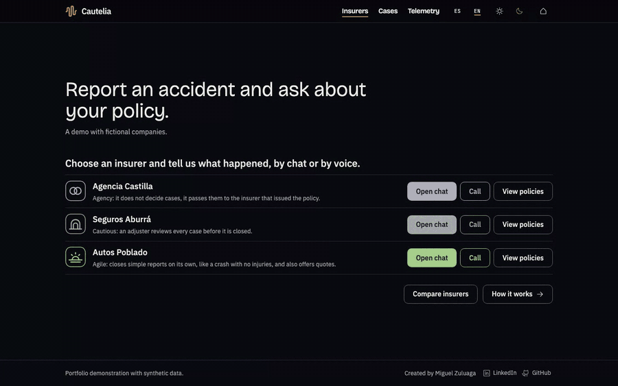
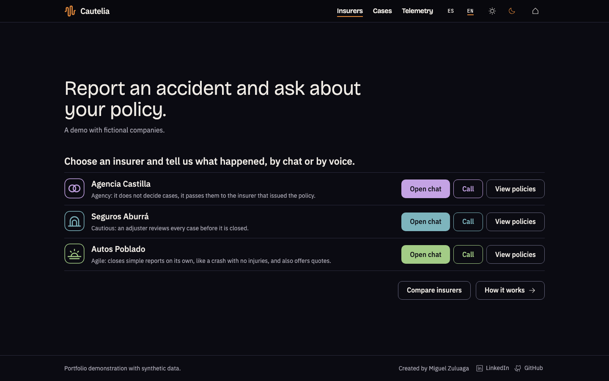
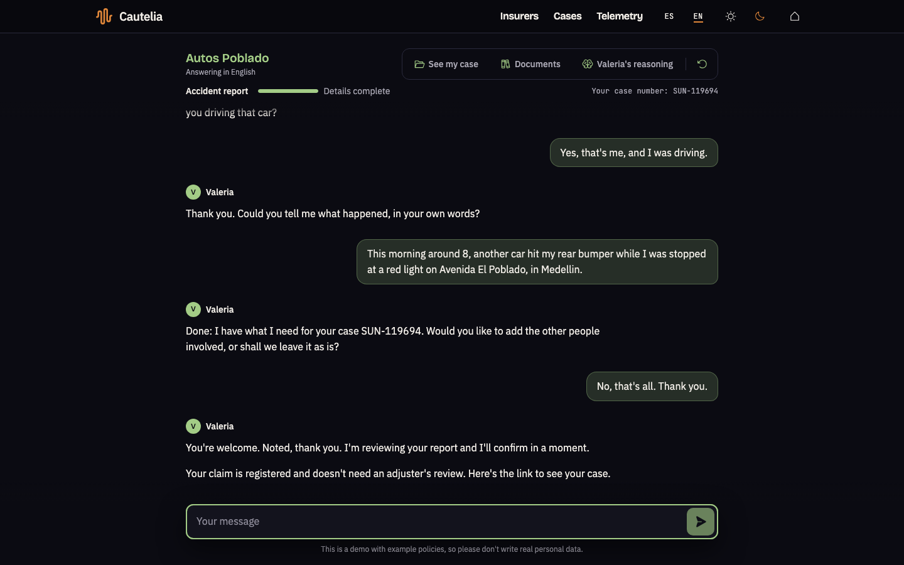
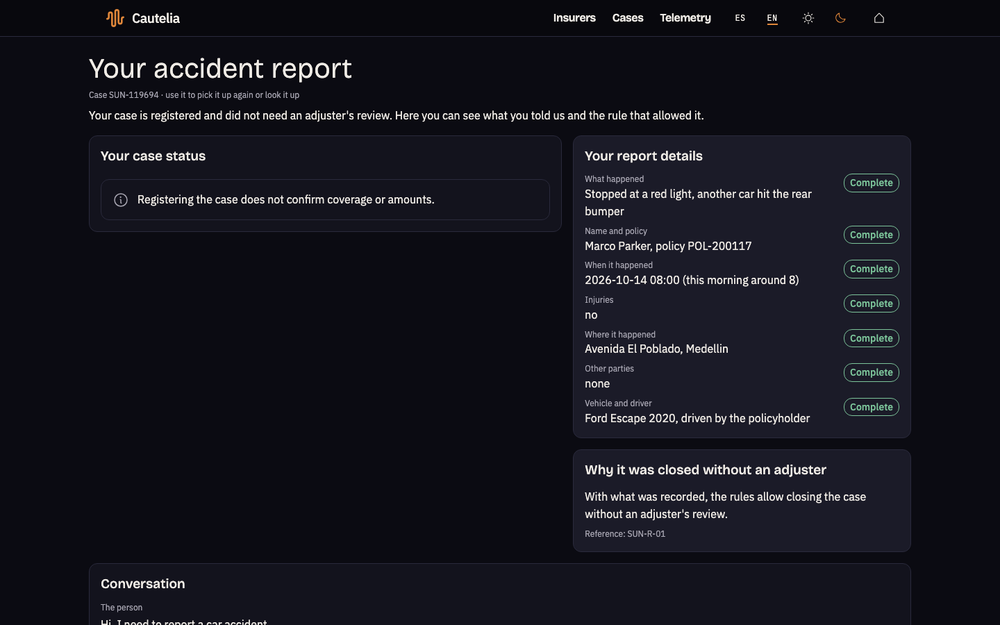
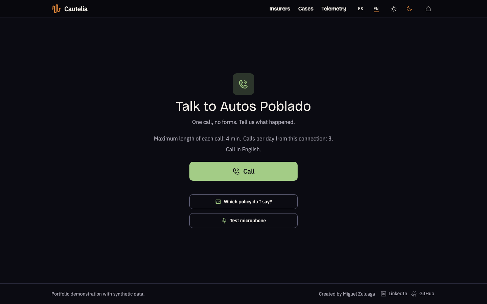
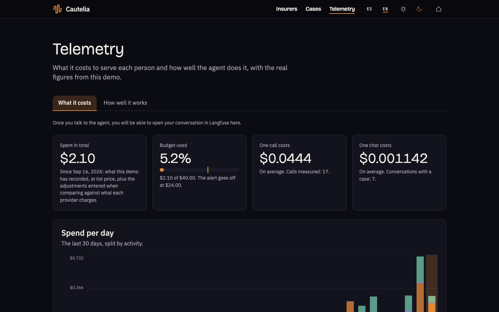
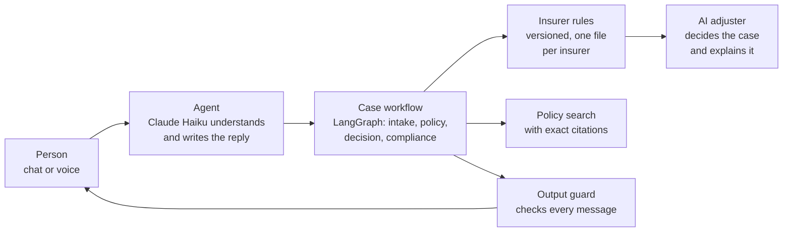

# Cautelia

**English** · [Español](README.es.md)


**Cautelia is an AI agent that takes car-accident reports and answers questions about your auto policy, by chat or by phone, in Spanish and English.** It asks only what is missing, checks your policy, cites the exact clause it relies on, and closes the simple cases on its own. Anything about coverage or money goes to an AI adjuster, separate from the agent, that decides the case and explains each step with its sources.

It is a portfolio demonstration: the three insurers, their policies and every person in them are fictional.

- **Try it:** [cautelia.app](https://cautelia.app) (chat and in-browser calls, with a daily limit on calls).
- **Watch it:** the 60-second walkthrough below, or the [full video (MP4)](docs/assets/readme/demo.mp4).



## What it does

**1. You pick an insurer.** Three fictional companies, each with its own rules: an agency that passes every case to the company that issued the policy, a cautious insurer whose adjuster reviews every case, and an agile one that closes simple reports on its own.



**2. You tell it what happened, by chat or by voice.** The agent asks one question at a time and only for what is still missing. When you give your name and policy number, it finds the policy in the insurer's records and asks you to confirm it is yours. You can switch between Spanish and English in the middle of the conversation.



**3. You get a clear outcome.** With the report complete, the insurer's rules decide what happens next: a simple case (no injuries, nobody else involved) is registered without an adjuster; anything else goes to the AI adjuster with everything already captured, so you never repeat yourself. Either way you get a case number and a page that shows what was recorded and which rule decided.



**4. You can ask about your policy.** "Does my policy cover a rental car?" The answer quotes the clause it comes from. If no clause covers it, the agent says so instead of guessing, and if it could not check, it says that too: those are two different answers.

When the question is about a fact written in the policy itself (the validity dates, the insured vehicles, the listed drivers, the special conditions), the agent reads it straight from the policy record with plain code: no clause search and no model writing the answer, so it is exact and costs no tokens. Only a question that needs interpreting the clauses goes through the search with citations.

**5. An AI adjuster decides the case, and shows how.** When a case goes to an adjuster, a second AI, separate from the agent, reads the report, the policy and the insurer's rules, looks up the vehicle's reference value on the web and decides. The case page shows its steps as they arrive and, when it finishes, the decision with the six steps and the sources of each one: the clauses it cites, the rules and the web page. It says the explanation was written by an AI. A visitor no longer decides or notes anything: the conversation continues with a notice that the case has a decision.

**6. You can call.** The same agent answers by voice in the browser: it introduces itself as an AI, says the call is transcribed, and hands you the case number at the end.



**7. You can see what it costs and how well it works.** The Telemetry page shows the money spent per provider, per day and per case, and the results of the latest evaluation. From there you can open your own conversation in [Langfuse](https://langfuse.com), step by step: which model ran, how long it took and what it cost.



## What it does not do

- **The agent you talk to never decides coverage or payments.** It does not say "you are covered", give amounts or assign fault. A separate AI adjuster decides the case and writes down how; the agent only passes the case to it.
- **It is not connected to any real insurer.** No real policies, no real claims system, no payments.
- **Do not type real personal data.** The conversation is stored as you wrote it, and visitor data is deleted every night.
- **Voice works in the browser only,** with a limit of calls per visitor and per day. There is no phone number.
- **Quotes are by chat only.** By voice the agent says so and offers the chat.
- **It is not legal or insurance advice,** and it does not claim to comply with any regulation: its controls are inspired by them.

## How it fails

The evaluation is a set of situations written in advance, the same ones in Spanish and English: crash reports, policy questions and attempts to trick the agent. A program plays the person, talks to the real agent and checks the result with code. The section below is generated from the latest full run and is never edited by hand.

The 13 failures of the 2026-10-14 run were in the evaluation itself, not in the agent: it read each case while the agent was still waiting, for up to two minutes, for an answer to its last offer, and one script never reached the attack it measures. Both are fixed; the next full run replaces this section.

<!-- generated:how-it-fails:begin -->
_Generated from the current baseline and the last full run by `mise run readme:gen`. Do not edit by hand: `mise run readme:check` fails when this differs from what they produce._

Last full run `run-20275e512642`, commit `c7afffaa8eb1b3a75e0034187705914488c3d810`, recorded 2026-10-15.

No case failed in this run (258 cases recorded).
<!-- generated:how-it-fails:end -->

## Architecture



In words: the person talks to the agent; a language model (Claude Haiku) reads each message and writes the reply, and can only **propose** actions from a closed list (note a detail, look up the policy, pass the case to an adjuster, close the report). Code validates every action against the case before it runs, along a fixed workflow. The insurer's rules, not the model, decide where a case goes. Every message passes an output guard before the person sees it. When a case goes to an adjuster, a separate background process, the AI adjuster, takes it: it reads the report, the policy and the rules with plain code, searches the web for the vehicle's reference value (up to three searches) and makes one structured decision. Code validates the action and every clause it cites before the case closes, and the case page shows the steps with their sources.

| Piece | What it uses |
| --- | --- |
| Screens | React, Vite, TanStack Router and Query, Tailwind CSS |
| Server and workflow | Python, FastAPI, LangGraph |
| Language models | Claude Haiku (conversation and citations), Gemini (other steps and the policy search) |
| Voice | Deepgram (speech to text), Cartesia (text to speech), with Deepgram as the backup voice |
| Data | PostgreSQL with pgvector, row-level security per insurer |
| Hosting and traces | Google Cloud Run, Neon, Langfuse |

## Principles, controls and evidence

- **A person signs every decision on coverage and money.** The output guard checks every message, in both languages, for anything that asserts or denies coverage, gives amounts, assigns fault or gives legal advice, and replaces it.
- **Citations come only from retrieved clauses**, and an exact verifier checks that each one exists, belongs to that insurer and that policy, and is in force.
- **Personal data is masked in logs, traces and evaluation reports**, by two detectors that work differently, in Spanish and English. The conversation itself is stored and shown as it was written.
- **Insurers are isolated in the database** with row-level security and a single entry point that sets the insurer before any query. A test fails if any table lacks it.
- **The rules are files, not code branches.** Each insurer has its own versioned rules, each rule with its own test.
- **Spending has hard limits:** prepaid provider balances with automatic top-up turned off, a spending ceiling in the application, and daily limits per visitor.
- **Every change is checked on GitHub:** secret scanning, lint, type checking, more than 4,000 automated tests with an 80% coverage floor, and an accessibility check of every screen in three browsers.

## Evaluation report

<!-- generated:evaluation-report:begin -->
_Generated from the current baseline and the last full run by `mise run readme:gen`. Do not edit by hand: `mise run readme:check` fails when this differs from what they produce._

Baseline `2026-10-15-c7afffa`, commit `c7afffa`, published 2026-10-15.

- **Case completeness**
  - Spanish: not measured (no criterion measures this yet)
  - English: not measured (no criterion measures this yet)
- **Citation precision**
  - Spanish: not measured (no criterion measures this yet)
  - English: not measured (no criterion measures this yet)
- **Latency**
  - voice: `speech_end` to `first_audio` on DS-5, p50 and p95: not measured (measured per milestone against real providers, not on every delivery)
  - chat: `message_sent` to `first_word` on DS-2, DS-4, DS-6, p50 and p95: measured in the evaluation run, from the moment the server receives the message (the visitor's network is not included)
    - Spanish: p50 1.6 s, p95 2.3 s, over 87 turns
    - English: p50 1.5 s, p95 2.2 s, over 85 turns
    - source: baseline `2026-10-15-c7afffa`, commit `c7afffa`, run `run-20275e512642`, 2026-10-15
- **Cost per case**
  - not measured (not recorded in the baseline; the live panel shows it)
- **Cases per insurer**
  - not measured (not recorded in the baseline; the live panel shows it)
<!-- generated:evaluation-report:end -->

## MCP server

The same policy facts the agent reads for those questions are published as a read-only [Model Context Protocol](https://modelcontextprotocol.io) server, so any MCP client (Claude Desktop, another agent) can query the synthetic sample policies. It is built with the official Python SDK, speaks over stdio, goes through the same single database entry point as the rest of the application (the insurer is set before any query, and row-level security does the rest) and does not import anything about cases, visitors, the chat or the model providers: an import contract checks that.

| Tool | What it returns |
| --- | --- |
| `get_policy_summary` | holder, issuer, period and whether the policy is in force on a date |
| `get_limits` | the civil liability, occupant medical-expense and driver personal-accident limits, in Colombian pesos |
| `get_deductibles` | the partial-loss-by-damage and partial-loss-by-theft deductibles |
| `get_insured_vehicles` | make, model and year (no plate, no VIN) |
| `get_listed_drivers` | the drivers the policy declares, holder first |
| `get_endorsements` | the special conditions and which clauses each one changes |
| `get_clause` | one clause by id, only if it belongs to that policy |

Every tool takes a `tenant_id` (`stonecroft`, `sunmeadow` or `knotwell`) and a `policy_number` (the sample policies are listed on the Policies page). They return what the policy declares; none of them says whether something is covered.

It needs the local database with the sample data loaded (`mise run services:up` and `mise run synthetic:seed`) and `UNTANGLE_DATABASE_URL` in `.env`. To run it in a terminal:

```bash
mise run mcp
```

To plug it into Claude Desktop, add this to `claude_desktop_config.json` (Settings, Developer, Edit config) with the absolute path of your clone, and restart the app:

```json
{
  "mcpServers": {
    "cautelia-policy-facts": {
      "command": "uv",
      "args": [
        "run",
        "--env-file", "/ABSOLUTE/PATH/TO/cautelia/.env",
        "--project", "/ABSOLUTE/PATH/TO/cautelia/app/backend",
        "python", "-m", "untangle.policy_mcp"
      ]
    }
  }
}
```

Then ask, for example, "What is the deductible on policy POL-21 of sunmeadow?".

## Attributions

- Icons: [Phosphor Icons](https://phosphoricons.com) (MIT) and [Lucide](https://lucide.dev) (ISC) on the landing page.
- Fonts: IBM Plex Sans, Bricolage Grotesque and JetBrains Mono (SIL Open Font License), served from the site itself.
- The license of every dependency is recorded and checked on every change: [third-party licenses](docs/reference/licencias-de-terceros.md).
- Insurers, policies, people and clauses are original and synthetic. The policies follow the structure of a Colombian voluntary auto policy (civil liability, occupant medical expenses, driver personal accident, loss by damage and by theft, duties after a loss event, general conditions, with the SOAT and the Fasecolda Value Guide as reference) without copying the text of any insurer's wording. See `docs/reference/estructura-poliza-autos-colombia.md`.

Created by [Miguel Zuluaga](https://www.linkedin.com/in/miguelzuluaga/).

## Run it

You need [mise](https://mise.jdx.dev) and Docker.

```bash
mise install
```

```bash
cp .env.example .env
```

Fill in the keys you have in `.env` (the file explains each one). Without model keys the chat falls back to its rule-based answers; without voice keys the call screen says the voice is unavailable.

```bash
mise run services:up
```

```bash
mise run migrate
```

```bash
mise run corpus:ingest
```

The policies are searched by meaning, so loading them needs the Gemini key.

```bash
mise run synthetic:seed
```

```bash
mise run web:build
```

```bash
mise run dev
```

Open the address it prints. To run the evaluation subset that needs no keys:

```bash
mise run bootstrap
```
