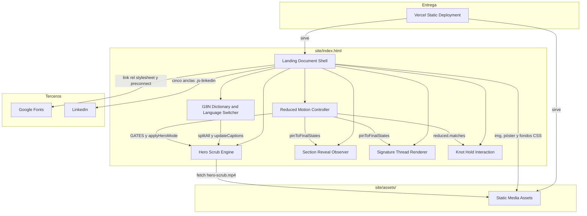
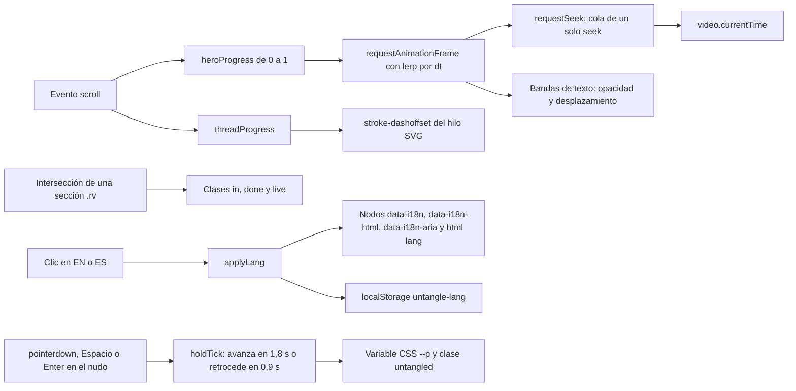
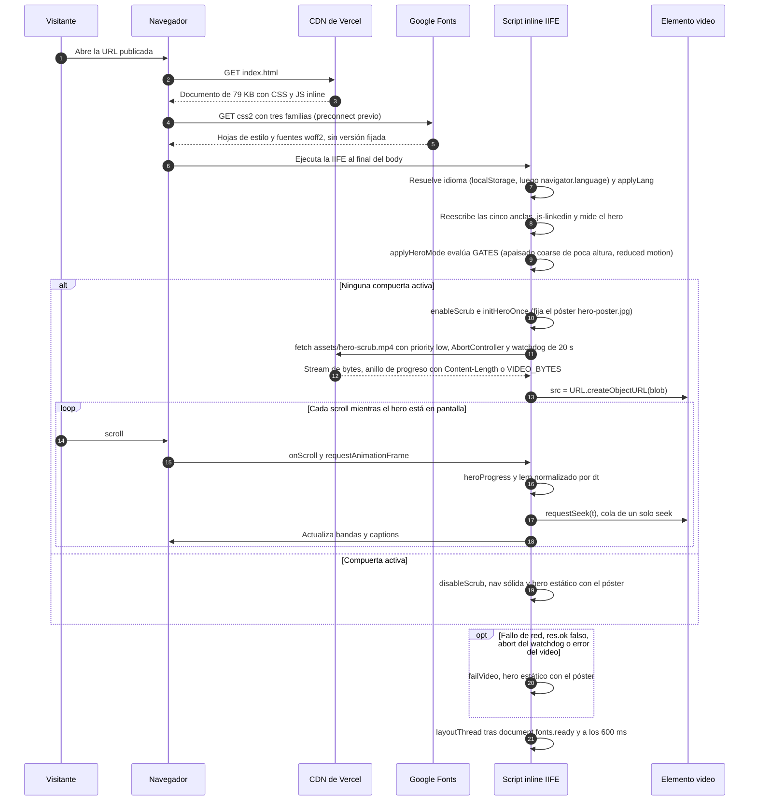
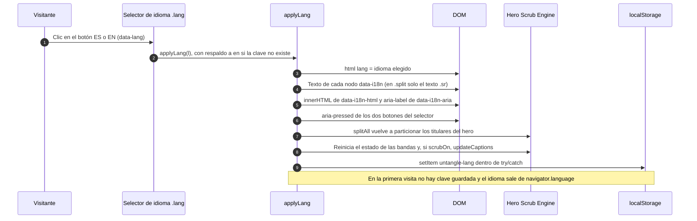
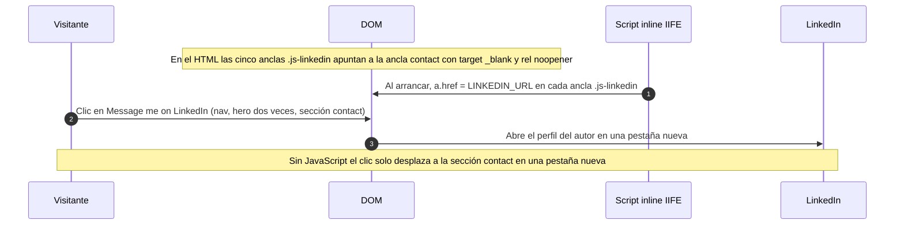
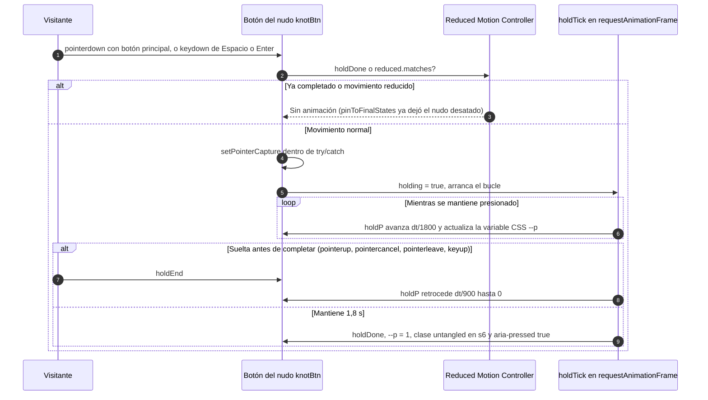
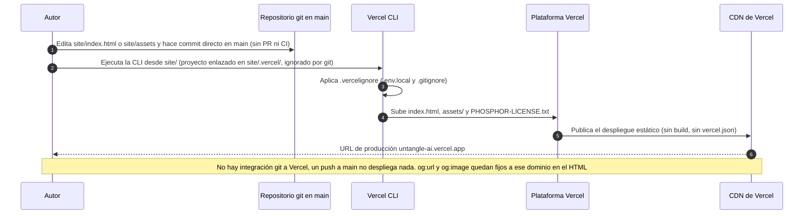
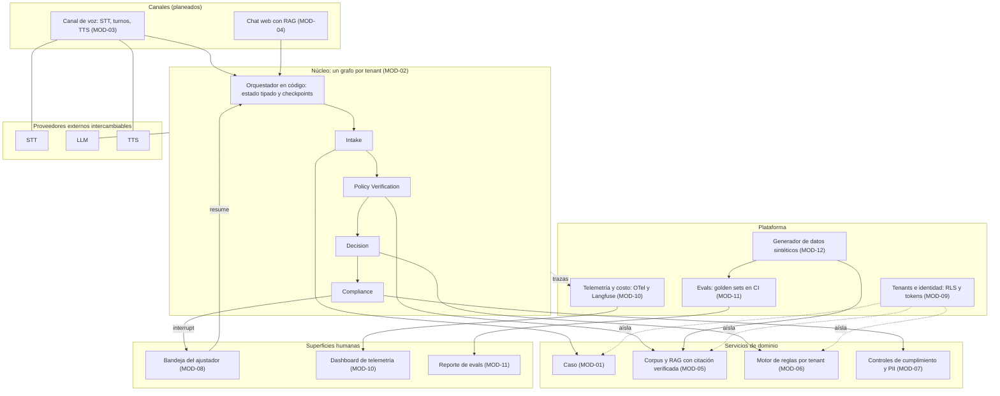

# Architecture — repositorio `untangle`

Artefacto 2 de 9 del code knowledge base. Describe la arquitectura de lo que **existe** en el commit `3736ad364d8d83526b2d7148e9d3ed8b76851757`: una landing estática de una sola página en `site/`. La arquitectura del aplicativo Untangle **no existe todavía** y **no se deriva** de la landing (D-005, D-013); el último apartado resume la arquitectura objetivo que fija el PRD, marcada como planeada. Inventario de componentes con responsabilidades en `component-inventory.md`; mapa de líneas del archivo en `code-structure.md`.

## Architecture Analysis

### System Overview

El sistema existente es un único documento HTML (`site/index.html`, 1.011 líneas, 79 KB) que lleva inline sus estilos, su marcado y su script, más seis archivos de medios en `site/assets/` y una licencia. Se sirve tal cual desde el CDN de Vercel, sin servidor de aplicación, sin build y sin API propia. Todo el comportamiento ocurre en el navegador del visitante: scrub del video del hero, entradas de secciones, hilo SVG "firma", interacción del nudo, cambio de idioma y persistencia de esa elección en `localStorage`. Los únicos terceros son Google Fonts (tres familias tipográficas) y LinkedIn (destino del único CTA).

### Architectural Style

**Sitio estático monolítico de un solo archivo, con mejora progresiva parcial.** Evidencia: no hay bundler ni framework (sin `package.json`, sin `vercel.json`, sin `node_modules`); el script es una IIFE en modo estricto que expone cero globales; los módulos lógicos se separan por comentarios de sección y comparten el mismo ámbito léxico; el estado vive en variables de módulo (`lang`, `scrubOn`, `holdP`, `threadPinned`) y en clases CSS sobre el DOM (`in`, `done`, `live`, `paused`, `solid`, `untangled`). La "mejora progresiva" es parcial porque sin JavaScript el hero queda vacío y las anclas del CTA no llevan a LinkedIn (deuda TD-05 en `code-quality-assessment.md`).

No aplica ninguno de los estilos del catálogo del arquitecto (monolito modular, microservicios, serverless, event-driven, CQRS, hexagonal): no hay dominio ni persistencia. Lo más cercano es "documento estático más script de presentación".

### Component Relationships

Nueve componentes, con los nombres exactos de `component-inventory.md`. Siete viven dentro de `index.html`, uno es el directorio de medios y uno es el mecanismo de entrega.

<!-- Text fallback: Vercel Static Deployment sirve el documento (Landing Document Shell) y los medios (Static Media Assets). El documento carga Google Fonts y apunta sus cinco anclas a LinkedIn; usa los medios como imágenes, póster y fondos CSS; y compone los seis módulos de script: I18N Dictionary and Language Switcher, Hero Scrub Engine, Section Reveal Observer, Signature Thread Renderer, Knot Hold Interaction y Reduced Motion Controller. El Hero Scrub Engine descarga hero-scrub.mp4 de los medios. I18N vuelve a particionar los titulares y refresca los captions del hero. El Reduced Motion Controller gobierna al hero (compuertas GATES y applyHeroMode), fija los estados finales de las secciones y del hilo (pinToFinalStates) y bloquea el nudo (reduced.matches). -->

### Data Flow

No hay datos de negocio. Los flujos son de presentación y todos nacen de eventos del navegador:

<!-- Text fallback: el scroll alimenta heroProgress, que un bucle requestAnimationFrame interpola por dt y convierte en un seek del video (cola de un solo seek) y en la opacidad y desplazamiento de las bandas; el mismo scroll alimenta threadProgress y el stroke-dashoffset del hilo SVG. La intersección de una sección .rv añade las clases in, done y live. El clic en EN o ES ejecuta applyLang, que reescribe los nodos data-i18n, data-i18n-html, data-i18n-aria y html lang, y persiste la elección en localStorage untangle-lang. Mantener presionado el nudo (pointerdown, Espacio o Enter) avanza holdTick hasta completar en 1,8 s o retrocede en 0,9 s al soltar, actualizando la variable CSS --p y la clase untangled. -->

Persistencia: una sola clave `localStorage['untangle-lang']`, leída al arrancar y escrita en cada cambio de idioma, ambas en `try/catch`. Red: una petición al mismo origen (`assets/hero-scrub.mp4`) como stream de bytes convertido en Blob; el resto son cargas declarativas del HTML y del CSS.

### Key Design Decisions

Decisiones observadas en el código y en `design-package.md`; ninguna tiene ADR porque la landing se construyó con un tutorial (D-013) y no pasó por Incepción.

| Decisión observada | Evidencia | Implicación |
| --- | --- | --- |
| Todo inline en un solo archivo, sin build | `index.html` con CSS (20-322), HTML (323-589) y JS (591-1009); sin manifiestos | Despliegue trivial; mantenimiento por edición manual y verificación a ojo (TD-06) |
| Video del hero cargado como Blob de baja prioridad tras el póster, con watchdog y degradación | `loadHeroBlob` (854-878), `failVideo` (879), `setTimeout(startBlobFetch, 4000)` | El primer render no depende del video; el visitante en escritorio y en móvil vertical descarga 5,4 MB (decisión del 2026-09-14 en `design-package.md` §5) |
| Compuertas de modo estático evaluadas en vivo | `GATES` y `MQLS` (886-887), `applyHeroMode` (903-906), `reduced.addEventListener('change')` (999) | Teléfonos apaisados de poca altura y `prefers-reduced-motion` reciben un hero estático; el cambio se aplica sin recargar en ambas direcciones |
| Copy bilingüe como diccionario en el script, no como dos páginas | `I18N` (601-729), atributos `data-i18n*` en el HTML | Una sola URL y un solo documento; el copy vive duplicado con `design-package.md` (TD-01) |
| Un único CTA inyectado por JS | `LINKEDIN_URL` (595) y reescritura de `.js-linkedin` (741) | Un solo punto de cambio del destino; sin JS las anclas caen en `#contact` (TD-05) |
| Accesibilidad como requisito del diseño | skip link, `role`, `aria-*`, texto `.sr` separado del texto animado `.vis`, teclado en el nudo | Alta calidad para una landing; no hay pruebas automáticas que la protejan |
| Despliegue manual con la CLI de Vercel desde `site/` | `site/.vercel/` ignorado, `site/.vercelignore`, sin `vercel.json` ni integración git | Un push a `main` no publica nada; el proceso vive fuera del repo (sin README) |

### Improvement Opportunities

Solo aplican a la landing y se ejecutan en la realineación D-013 (semanas 7 y 11), no en Incepción:

1. Sacar el copy a una única fuente (por ejemplo un JSON EN/ES) y generar tanto `design-package.md` como el diccionario `I18N`, o eliminar la copia del paquete de diseño.
2. Un chequeo mínimo automatizable antes de desplegar: paridad de claves EN↔ES, ausencia de claves sin uso (`hud1`), palabras prohibidas del gate de copy, enlaces vivos, `og:url` coherente con el dominio.
3. Fijar el póster y el destino del CTA en el HTML para que el documento sin JavaScript sea completo (el paquete de diseño ya pide "complete without the video").
4. Derivar `VIDEO_BYTES` del `Content-Length` o de un manifiesto generado al reemplazar el video.
5. Realinear el contenido con las decisiones del PRD (cuatro nodos, elegibilidad sin moneda, Documentos como próximo paso, latencias p50/p95, multi-tenant y citación verificada) y enlazar los tres entregables (M19).

## Interaction Diagrams

Las "transacciones de negocio" de lo que existe son interacciones del visitante y una operación del autor. Cada diagrama sigue el código de `site/index.html` con las líneas del commit escaneado.

### Carga de la landing y scrub del hero

<!-- Text fallback: el visitante abre la URL; el CDN de Vercel devuelve index.html; el navegador pide a Google Fonts las tres familias; la IIFE arranca, resuelve el idioma (localStorage y luego navigator.language), aplica applyLang, reescribe las anclas a LinkedIn, mide el hero y evalúa las compuertas GATES. Si ninguna está activa, enableScrub fija el póster y descarga hero-scrub.mp4 como stream de baja prioridad con AbortController y watchdog de 20 s, asigna el Blob al video y, en cada scroll, interpola heroProgress y pide un seek (cola de un solo seek) mientras actualiza bandas y captions. Si una compuerta está activa, disableScrub deja el hero estático con el póster. Ante fallo de red, respuesta no ok, abort o error del elemento video, failVideo degrada al póster. Al final se dibuja el hilo con layoutThread tras fonts.ready y a los 600 ms. -->

### Cambio de idioma EN/ES

<!-- Text fallback: el visitante pulsa ES o EN; applyLang valida la clave (respaldo en), fija html lang, sustituye el texto de cada nodo data-i18n (en los elementos .split solo el texto para lectores de pantalla .sr), aplica innerHTML en data-i18n-html y aria-label en data-i18n-aria, actualiza aria-pressed de los dos botones, vuelve a particionar los titulares del hero con splitAll, reinicia el estado de las bandas y refresca los captions si el scrub está activo, y persiste la elección en localStorage untangle-lang dentro de try/catch. En la primera visita el idioma se toma de navigator.language. -->

### Clic en el CTA a LinkedIn

<!-- Text fallback: en el HTML las cinco anclas .js-linkedin apuntan a la sección contact con target _blank y rel noopener; al arrancar, el script sustituye su href por LINKEDIN_URL; el clic del visitante en cualquiera de ellas (nav, dos en el hero, una en la sección contact) abre el perfil de LinkedIn del autor en una pestaña nueva. Sin JavaScript el clic solo desplaza a la sección contact. -->

### Interacción "hold to untangle"

<!-- Text fallback: el visitante presiona el botón del nudo (pointerdown con el botón principal, o Espacio/Enter); si ya se completó o hay movimiento reducido no ocurre nada, porque pinToFinalStates ya dejó el nudo desatado. En caso contrario el botón captura el puntero (try/catch) y arranca holdTick: mientras se mantiene presionado, holdP avanza dt/1800 y actualiza la variable CSS --p; si se suelta antes (pointerup, pointercancel, pointerleave o keyup) holdP retrocede dt/900 hasta cero; si se mantiene 1,8 s, holdDone fija --p en 1, añade la clase untangled a la sección s6 y marca aria-pressed true. -->

### Despliegue manual a Vercel

<!-- Text fallback: el autor edita site/index.html o site/assets y hace commit directo en main sin PR ni CI; ejecuta la CLI de Vercel desde site/ (el proyecto enlazado vive en site/.vercel/, ignorado por git); la CLI aplica .vercelignore, sube index.html, assets/ y la licencia; la plataforma publica el despliegue estático sin build ni vercel.json y el CDN sirve la URL de producción untangle-ai.vercel.app. No hay integración git a Vercel, y og:url y og:image están fijos a ese dominio. -->

## Arquitectura del aplicativo: no existe todavía

En el commit escaneado no hay ningún componente, servicio, esquema ni contrato del aplicativo Untangle. Por D-005 y D-013 la landing es "brownfield de marketing" y el aplicativo es greenfield: sus componentes se definen en `domain-design` a partir de `docs/specs/prd.md`, no se extraen de `site/`. En particular, las seis tarjetas de agentes y el diagrama SVG de la sección `#how` de la landing describen una arquitectura que el PRD ya descartó (Paso 0, decisión 1) y no deben leerse como diseño.

## Arquitectura objetivo según el PRD (planeada, no existente)

Resumen del diagrama aprobado en `docs/specs/prd.md` 9.2, anotado con los módulos de 9.4. Es un objetivo de diseño para `domain-design` y `units-generation`, no una descripción de código; las tecnologías concretas siguen pendientes de ADR salvo las fijadas en `technology-stack.md`.

<!-- Text fallback: dos canales planeados (voz con STT, turnos y TTS; chat web con RAG) entran al mismo grafo por tenant, cuyo orquestador en código recorre Intake, Policy Verification, Decision y Compliance sobre estado tipado con checkpoints. Intake escribe el Caso; Policy Verification consulta el corpus con citación verificada; Decision consulta el motor de reglas por tenant; Compliance aplica los controles y, cuando deriva, pausa el grafo con interrupt hacia la bandeja del ajustador, que lo reanuda con resume. Tenants e identidad aíslan caso, corpus y reglas; la telemetría recibe las trazas del núcleo y alimenta el dashboard; las evals producen el reporte; el generador de datos sintéticos alimenta el corpus y las evals; STT, LLM y TTS son proveedores externos intercambiables. -->

Lo que el PRD fija para esta arquitectura y que `domain-design` no debe reabrir: el orquestador es código con rutas explícitas (P3); el mismo grafo sirve a voz y chat y corre sin voz (chat y evals primero); `interrupt()` y `resume` son el contrato con la bandeja (F2.5); checkpoints por caso en Postgres tras cada turno (F2.4, M16); dos ritmos, turno y fondo (F2.3, M12); `tenant_id` con RLS en todas las tablas (M9); ninguna cita sin cláusula existente (P2, M4). Lo que queda para los ADR de Incepción: framework del grafo, framework de voz, STT y TTS, vector store, herramienta de evals y lenguaje del aplicativo (`technology-stack.md`).

## Referencias

- Código analizado: `site/index.html` (líneas citadas), `site/assets/`, `site/.vercelignore`, `site/.gitignore`, `design-package.md` §4, §5, §8.
- Especificación del aplicativo: `docs/specs/prd.md` Paso 0, Segmentos 6, 8, 9.2, 9.4 y 13; `docs/PLAN-AIDLC.md` D-005, D-013, D-014.
- Entrega del desarrollador: `aidlc/spaces/default/intents/260915-untangle-app/inception/reverse-engineering/developer-scan.md`.
