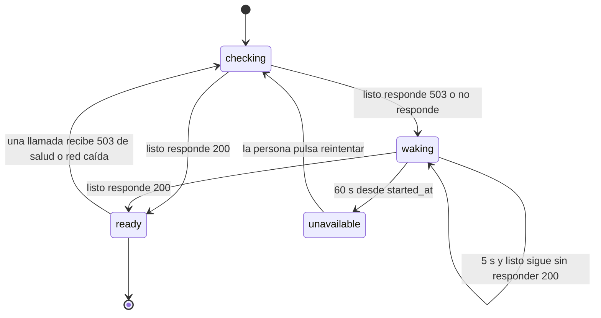
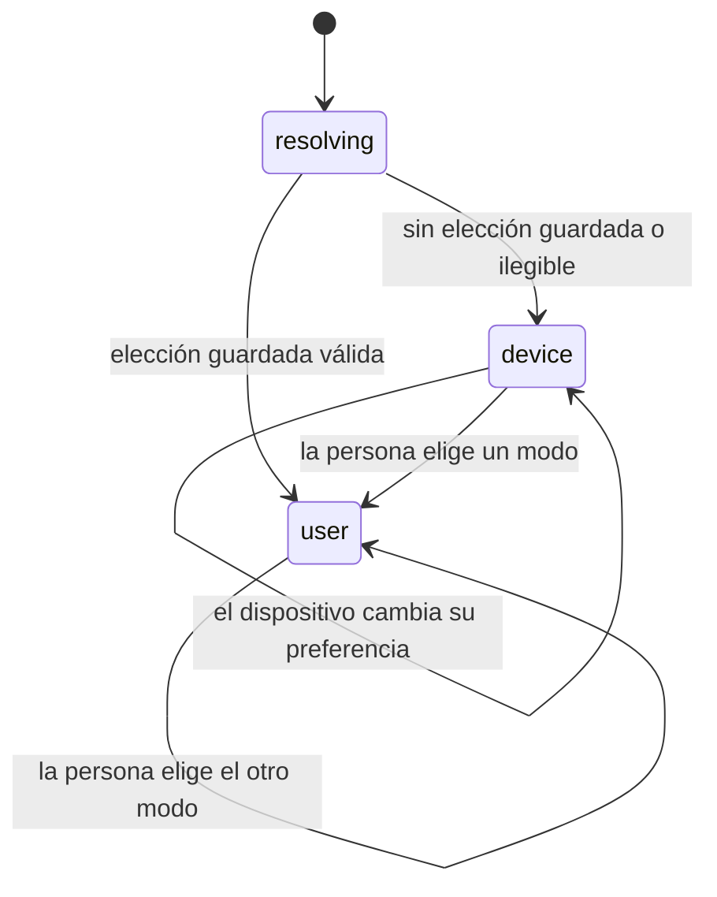
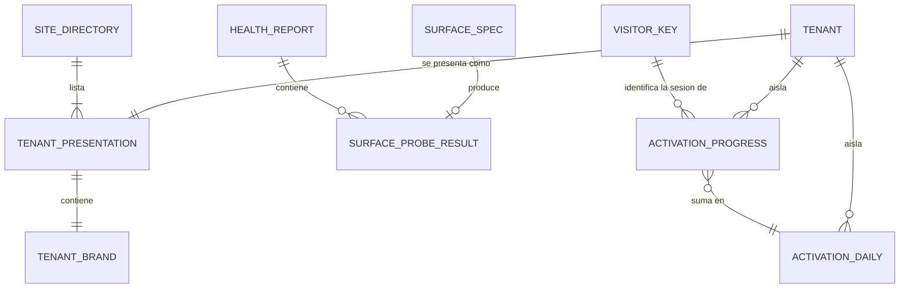

# Especificación funcional — U6 `web-shell`

Este documento es la fuente de verdad de los **flujos** y de las **máquinas de
estado** de U6. La forma de los datos está en `entities.md` y las decisiones en
`rules.md`; las secciones 4 y 5 de aquí se derivan de esos dos y no los
reemplazan. Los componentes de la interfaz, sus propiedades y su teclado están
en `frontend-components.md`.

Las respuestas de `functional-design-questions.md` se aplican tal como quedaron:
el inicio muestra solo lo construido (Q1), las páginas sin aseguradora se abren
en el idioma del dispositivo si es español y en inglés si no (Q2), y la sesión de
la telemetría de activación es la clave del navegador que ya existe (Q3).

## 1. Qué hace esta unidad

U6 deja listo el marco en el que se dibujan todas las pantallas que vienen
después, y la parte del proceso servido que las sostiene. Cuando termina, una
persona que abre el aplicativo en local ve:

- el **inicio**, en su idioma y en el modo de su dispositivo, con las tres
  aseguradoras, su carácter y su póliza de ejemplo, y una línea que dice que la
  demostración todavía no tiene canales abiertos;
- el **selector de idioma** y el **selector de modo**, en la barra superior;
- las **páginas de estado**: la demo está despertando, no disponible, enlace no
  válido, enlace vencido, datos reiniciados, página no encontrada y servicio no
  disponible.

Y quien construye las pantallas siguientes recibe, sin pedirlo:

- los **tokens** del sistema de diseño en los dos modos y las primitivas
  tematizadas;
- el **cliente tipado** de la API con su manejo de errores por catálogo;
- el **anunciador** para lectores de pantalla;
- el **registro de superficies**, con el que su pantalla aparece en el inicio y
  en el chequeo periódico en cuanto la monta;
- el **arnés de accesibilidad**, que recorre su pantalla en los dos idiomas y
  los dos modos en cada entrega;
- la **telemetría de activación**, a la que informa sus hitos.

Lo que U6 **no** hace, y quién lo hace: las pantallas de cada capacidad (U13,
U14, U16, U17, U22); el hospedaje que no se duerme y el chequeo periódico que
llama a la salud cada cinco minutos, con su alerta y su cálculo de
disponibilidad (intent `infra`, OQ4 y PA-10); el valor exacto de la política de
seguridad de contenido (NFR Design de esta unidad); y la lista de navegadores
declarados (`nfr-requirements` de esta unidad, PA-4).

## 2. Máquinas de estado

### 2.1 La espera de que el proceso esté listo (`ReadinessWatch`)

Es la conducta de AC5.16.4 vista desde la interfaz. Empieza al cargar la
aplicación y vuelve a empezar cuando cualquier llamada recibe un 503 de salud o
una red caída.

Texto alternativo: la interfaz empieza comprobando. Si el proceso está listo,
muestra la ruta pedida. Si no, muestra "la demo está despertando" y vuelve a
comprobar cada cinco segundos; si se pone listo, abre la ruta pedida sin que la
persona haga nada; si pasan sesenta segundos, muestra "no disponible". Desde
"no disponible" solo se vuelve a comprobar si la persona lo pide.

| Estado | Qué ve la persona | Qué hace la interfaz |
| --- | --- | --- |
| `checking` | Nada nuevo durante el primer segundo; después, el esqueleto de la página pedida | Consulta la salud de listo |
| `ready` | La página pedida | Nada |
| `waking` | Página de estado `waking`, con el hilo que avanza o el texto "Despertando" con movimiento reducido | Consulta cada 5 s; guarda `attempts` |
| `unavailable` | Página de estado `unavailable`, con los enlaces configurados (BR4.4) | Espera a que la persona pida reintentar |

El primer segundo sin nada nuevo es a propósito: en el caso normal el proceso
responde antes, y mostrar "despertando" para después quitarlo sería un parpadeo
que confunde.

### 2.2 El modo claro u oscuro

Texto alternativo: al cargar, el modo se resuelve antes de pintar. Sin elección
guardada, o con una ilegible, sigue al dispositivo, y si el dispositivo cambia su
preferencia con la página abierta, la página cambia con él. En cuanto la persona
elige, manda su elección, que se guarda y ya no sigue al dispositivo.

## 3. Flujos

### F1 — Primera carga de cualquier página

1. El navegador pide una ruta que no empieza por `/api`. El proceso devuelve la
   página de entrada sin caché y con el conjunto de cabeceras de seguridad
   (BR6.1, BR6.2, BR6.3).
2. Antes de cargar la aplicación, un paso mínimo resuelve el modo (BR1.1, BR1.4)
   y lo aplica al documento (BR1.2).
3. La aplicación resuelve el idioma inicial: el de la aseguradora si la ruta es
   de una (BR2.2); si no, el del dispositivo según BR2.1. Declara el idioma del
   documento (BR2.4).
4. Arranca `ReadinessWatch` en `checking` (sección 2.1).
5. Con el proceso listo, el enrutador dibuja la pantalla pedida o, si la ruta no
   existe, la página de estado `not_found` (BR5.5).
6. El primer elemento que recibe el foco con Tab es "Saltar al contenido"
   (BR7.4).

### F2 — El inicio

1. La página pide `GET /api/site`, sin credencial.
2. El servidor responde con `SiteDirectory`: las aseguradoras leídas de su
   configuración, las superficies **públicas y montadas** del registro de la
   raíz de composición, y los enlaces externos solo si están configurados.
3. Mientras llega, se ve el esqueleto de las tres filas con el título de la
   página ya puesto (M1, estado "Cargando").
4. Con la respuesta:
   1. Si hay chat o consola de voz montados, se dibujan el título, "Cómo
      funciona" y "Qué puedes probar", con solo los pasos y las acciones de las
      superficies montadas (BR4.1). Si no hay ninguno, se dibuja la línea
      `home.no_channels` y esas tres secciones no existen (BR4.3).
   2. Cada aseguradora se dibuja como una fila, no como tarjeta: monograma con
      su acento del modo actual, nombre, carácter del catálogo, póliza de
      ejemplo completa con su ayuda (BR4.5) y los botones de las superficies por
      aseguradora que estén montadas. Lo que su configuración no trae no aparece
      (BR4.2).
   3. La comparación y los paneles aparecen como enlaces solo si están montados.
5. Si `GET /api/site` falla, el error se resuelve por BR3.2 a BR3.4 y la página
   muestra el mensaje del catálogo con "Reintentar", sin filas inventadas.

### F3 — Cambiar de modo

1. La persona pulsa "Claro" u "Oscuro" en la barra superior.
2. Todo el documento cambia de inmediato, sin transición (BR1.3); el acento de
   la aseguradora, si la página tiene una, pasa a su variante del modo (BR1.6).
3. La elección se guarda como `ThemePreference` (BR1.1). Si el almacenamiento no
   está disponible, el cambio vale para la pestaña y no hay error visible
   (BR1.4).
4. El foco se queda en el botón pulsado.

### F4 — Cambiar de idioma

1. La persona elige "Español" o "English".
2. Todos los textos de la página se vuelven a resolver por el catálogo en el
   idioma nuevo, y el documento declara el idioma nuevo (BR2.3, BR2.4).
3. El anunciador dice el cambio una vez (BR2.5, BR7.5); el foco se queda en el
   selector.
4. La elección dura la pestaña; solo se guarda entre visitas donde el
   componente lo pide (BR2.5). En una página de aseguradora, el cambio de idioma
   de la agente lo coordina la unidad del canal, no U6.

### F5 — Un error del servidor

1. Una llamada del cliente generado recibe un error.
2. Si es un error de C-01, se toma su `code`; si no lo es (red, tiempo, cuerpo
   ilegible), el `code` es `unknown` (BR3.4).
3. Una única tabla traduce `code` a clave del catálogo; un `code` que no está en
   la tabla usa la rama por defecto de servicio no disponible (BR3.3).
4. Se muestra el texto del catálogo con su acción; `title`, `detail` y
   `trace_id` van solo a la consola del navegador (BR3.2).
5. Si el error es un 503 de la salud o una red caída, `ReadinessWatch` vuelve a
   `checking` (sección 2.1).

### F6 — Una ruta de caso que no sirve

1. La vista por enlace (U14) recibe del servidor `link_invalid`, `not_found` o
   un vencimiento.
2. La interfaz muestra `link_invalid` para los dos primeros, con el mismo texto
   (BR5.6), y `link_expired` para el vencimiento.
3. Si el caso ya no existe porque pasó el reinicio nocturno, la página es
   `data_reset`.

U6 construye las páginas y la regla; la ruta que las dispara llega con U14.

### F7 — La salud del proceso

1. `GET /api/health/live` responde 200 mientras el proceso corre, sin tocar la
   base ni los proveedores (BR5.1).
2. `GET /api/health/ready`:
   1. comprueba que la base responde y que la configuración de aseguradoras
      está cargada;
   2. corre en paralelo la sonda de cada superficie montada, cada una con su
      tiempo máximo (BR5.2);
   3. marca `down` la superficie cuya sonda falla o se pasa de tiempo (BR5.3);
   4. responde 200 con `HealthReport` si la base y la configuración están bien,
      o 503 con el error de C-01 si no; una superficie caída se informa pero no
      vuelve 503 el proceso entero, porque el chequeo periódico tiene que
      distinguir "no despierta" de "el chat está caído".
3. Nada en este flujo llama a un proveedor, gasta dinero, consume un límite de
   visitante ni registra un hito de activación (BR5.2, BR8.4).
4. Todo en 1 segundo (C-02).

### F8 — Montar una superficie (lo que hará cada unidad con pantallas)

1. La unidad agrega su módulo a la raíz de composición declarando la capacidad
   de superficie: su `SurfaceSpec` con su sonda.
2. Si la declara sin sonda, el proceso no arranca y el error nombra el módulo
   (BR5.2).
3. Desde ese arranque, su acción aparece en el inicio (F2) y su sonda entra al
   reporte de listo (F7) sin tocar ningún archivo de U6.
4. La unidad agrega sus pantallas al registro del arnés (F9); si no lo hace, la
   comprobación de completitud falla (BR7.1).

### F9 — El arnés de accesibilidad en cada entrega

1. El guion de verificación compila la interfaz y levanta el proceso con los
   datos sembrados que declara cada ruta registrada.
2. La comprobación de completitud compara las rutas del enrutador con el
   registro y falla si falta alguna (BR7.1).
3. Para cada ruta registrada, en español y en inglés, en modo claro y en oscuro:
   1. corre el analizador automático; un hallazgo serio o crítico en una
      pantalla de visitante falla el paso (BR7.2);
   2. a 360 × 640 px comprueba que no hay desplazamiento horizontal y que los
      controles miden al menos 44 × 44 (BR7.3);
   3. recorre la pantalla con Tab y comprueba foco visible, orden y salida
      (BR7.4);
   4. con movimiento reducido emulado, comprueba que no hay desplazamientos ni
      escalas (BR7.6).
4. El reporte nombra pantalla, idioma, modo, regla y elemento de cada hallazgo.
5. Los recorridos de teclado de extremo a extremo de AC1.33.3 (reportar por
   chat, expandir una cláusula, llamar y colgar, decidir por enlace) los agrega
   cada unidad dueña sobre este arnés.

### F10 — Un hito de activación

1. El chat (U13) informa `first_message` y `third_turn`; la vista por enlace
   (U14) informa `loop_closed`. Cada uno llama a la interfaz de activación con
   la aseguradora, el resumen de la clave del navegador y el hito.
2. Si la petición viene del chequeo periódico o del corredor de evaluaciones,
   no se registra nada (BR8.4).
3. En una sola transacción: si la sesión no tenía el hito, se guarda el avance y
   se suma uno al conteo del día, la aseguradora y el hito; si ya lo tenía, no
   pasa nada (BR8.1).
4. Si la escritura falla, se emite un evento de fallo en la traza con el hito y
   el tipo de error, y el turno sigue (BR8.3).
5. En el reinicio nocturno, el purgador de U6 borra el avance de todas las
   sesiones; el conteo diario se conserva (BR8.2).

## 4. Modelo de entidades (derivado de `entities.md`)

Solo las entidades con relaciones; las que viven solas en el navegador o en una
respuesta están en `entities.md`.

Texto alternativo: cada aseguradora (U2) se presenta con su nombre, carácter,
póliza de ejemplo y marca; el directorio del sitio lista las tres. Cada
superficie montada produce un resultado de sonda en cada reporte de salud. El
avance de activación pertenece a una aseguradora y a una clave del navegador
(U2), y cada fila nueva suma uno en el conteo diario de su aseguradora.

## 5. Reglas (resumen derivado de `rules.md`)

| Familia | Reglas | Lo esencial |
| --- | --- | --- |
| Modo claro u oscuro | BR1.1 a BR1.6 | Dispositivo o elección; antes del primer pintado; inmediato; solo tokens; acento desde la configuración |
| Idioma y textos | BR2.1 a BR2.5 | Español si el dispositivo lo es, si no inglés; el de la aseguradora en sus páginas; todo por catálogo; idioma por bloque |
| Cliente de la API | BR3.1 a BR3.5 | Solo el cliente generado; error por catálogo con rama por defecto; datos de caso solo en memoria |
| Superficies e inicio | BR4.1 a BR4.5 | Solo lo montado; nada inventado; una línea honesta sin canales |
| Salud y estados | BR5.1 a BR5.7 | Vivo y listo en 1 s sin proveedores; sonda obligatoria; espera de 5 s y 60 s; siete páginas |
| Proceso servido | BR6.1 a BR6.4 | Mismo origen; cabeceras en toda respuesta; caché con huella; errores con la forma de C-01 |
| Accesibilidad | BR7.1 a BR7.7 | Toda ruta registrada; dos idiomas y dos modos; 360 px; teclado; un anunciador |
| Activación | BR8.1 a BR8.5 | Tres hitos una vez por sesión; solo sobrevive el conteo diario; nunca rompe el turno |

## 6. Decisiones de esta etapa

| # | Decisión | Por qué |
| --- | --- | --- |
| FD-U6-1 | El servidor declara las superficies montadas y la interfaz solo muestra esas acciones (Q1) | La prohibición de prometer lo no construido se cumple por construcción, y el mismo registro alimenta el chequeo periódico |
| FD-U6-2 | Español si el dispositivo lo es, si no inglés, en las páginas sin aseguradora (Q2) | Nadie tiene que buscar el selector antes de entender la página; los dos idiomas se tratan igual |
| FD-U6-3 | La sesión de activación es la clave del navegador de U2 (Q3) | No crea un identificador nuevo y su vida ya está acotada por el reinicio nocturno |
| FD-U6-4 | Las tres familias tipográficas se sirven desde el propio origen, no desde un servicio de fuentes externo | Ninguna visita revela su dirección a un tercero, la política de contenido no necesita otro origen, y la página de espera no depende de un servicio ajeno. Las tres tienen licencia SIL OFL 1.1, que lo permite; la atribución va al registro de licencias |
| FD-U6-5 | La marca de cada aseguradora (acento por modo y monograma) y la clave de su carácter se agregan a `tenant.yaml` y a su esquema | Es la sobrescritura por aseguradora "desde su configuración, sin condiciones en el código" que exige el sistema de diseño. Es aditivo a C-25, así que no sube `config_version` |
| FD-U6-6 | La salud pasa a `/api/health/live` y `/api/health/ready` (C-02); el `/health` de U1 se retira y sus indicadores de diagnóstico (tabla de precios cargada, usos con clave) pasan a `checks.providers` de listo, como nombres de uso y conteos, nunca como claves | Una sola salud, con la forma del contrato. Los indicadores de U5 siguen sin volver no apto el proceso, como decidió su diseño de fiabilidad |
| FD-U6-7 | El arnés recorre cada pantalla en los dos modos, no solo en uno | El contraste se mide contra el fondo de cada modo, y los dos son modos completos del aplicativo: revisar uno solo deja la mitad sin revisar. Duplica el tiempo del paso; el presupuesto se fija en `nfr-requirements` |
| FD-U6-8 | La telemetría de activación se crea en un paquete nuevo, `app/backend/src/untangle/telemetry/activation/`, dentro de MOD-10 | Es telemetría, y US5.16 nombra MOD-10. El catálogo de unidades solo lista `server/` como parte servida de U6; se registra como desviación en el diario de la etapa |
| FD-U6-9 | La ruta de datos del inicio es `GET /api/site`, sin credencial, y entra al esquema OpenAPI con su cliente regenerado | Cambio aditivo dentro de `/api` (C-01); el inicio no pertenece a ninguna aseguradora, así que no cuelga de `/tenants/{tenant}` |

## 7. Lo que esta unidad pide a otras

| A quién | Qué | Cuándo |
| --- | --- | --- |
| U13, U14, U16, U17 y U22 | Montar cada superficie con su `SurfaceSpec` y su sonda; registrar cada pantalla en el arnés con sus datos sembrados | Al construir cada pantalla |
| U13 | Informar `first_message` y `third_turn` a la activación | Al construir el chat |
| U14 | Informar `loop_closed` a la activación; disparar `link_invalid`, `link_expired` y `data_reset` desde la vista por enlace | Al construir la bandeja |
| U2 (esquema de C-25) | Aceptar en `tenant.schema.json` los campos `brand` y `character_key` | Lo hace U6 en su generación de código, como cambio aditivo al esquema de U2 |
| Intent `infra` | Hospedaje que no se duerme para los estáticos (OQ4); el chequeo cada cinco minutos, su alerta tras dos fallos y el cálculo de disponibilidad mensual (PA-10); el checklist del segundo día | Semanas 3 y 4 del plan de `infra` |
| NFR Design de U6 | El valor de la política de seguridad de contenido | Tercera etapa de esta unidad |
| NFR Requirements de U6 | La lista de navegadores declarados con el dato de WebRTC (PA-4) y el presupuesto de tiempo del arnés | Segunda etapa de esta unidad |

## Sources

- `../../../inception/units-generation/unit-of-work.md` — sección U6: contenido,
  responsabilidades, notas y ubicación en el código.
- `../../../inception/units-generation/unit-of-work-story-map.md` — US1.33 y
  US5.16, y las comprobaciones de extremo a extremo con U13, U14 y U16.
- `../../../inception/user-stories/stories.md` — AC1.33.1 a AC1.33.6 y AC5.16.1
  a AC5.16.6.
- `../../../inception/requirements-analysis/requirements.md` — FR4.1, FR3.1 y
  NFR16.
- `../../../inception/domain-design/components.md` — WebClient; ADR-002 en
  `decisions.md`.
- `../../../inception/contract-design/contract-summary.md` — C-01, C-02, C-21,
  C-24, C-25 y C-28.
- `../../../inception/refined-mockups/` — `mockups.md` (M1 y M11),
  `design-system-mapping.md`, `interaction-spec.md` y
  `accessibility-checklist.md`.
- Código existente: `app/backend/src/untangle/server/composition.py` (registro
  de módulos y de purgadores, `/health` de U1), `app/backend/src/untangle/tenancy/`
  (clave del navegador), `app/frontend/` (solo el módulo tipado de claves de U1).

## Assumptions & Open Questions

- **PA-4 sigue abierta.** La lista de navegadores declarados necesita el dato de
  WebRTC que el experimento 1 no midió en el navegador; se fija en
  `nfr-requirements` de esta unidad y, si el dato sigue sin existir, se declara
  con esa razón en vez de inventarse.
- **La mitad de AC5.16.4 depende del hospedaje.** U6 construye la página de
  espera y su conducta; que aparezca en menos de 3 segundos con la instancia
  dormida exige que los estáticos vivan en un hospedaje que no se duerme, y eso
  lo decide el intent `infra` (OQ4).
- **Los enlaces al README y al video no existen todavía.** El repositorio es
  privado hasta la decisión de la semana 12 y el video llega después (US4.2);
  con BR4.4 la página de no disponible simplemente no los muestra mientras no
  estén configurados.
- **El titular y el vehículo de las pólizas de ejemplo llegan con U7.** Hasta
  entonces, las filas del inicio muestran solo el número de póliza (BR4.2).
