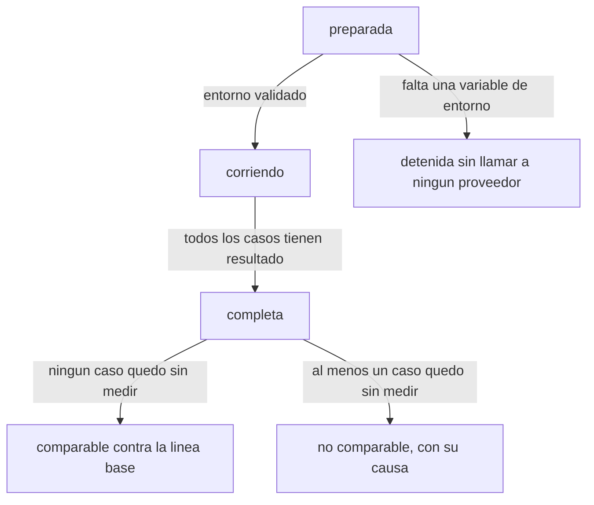
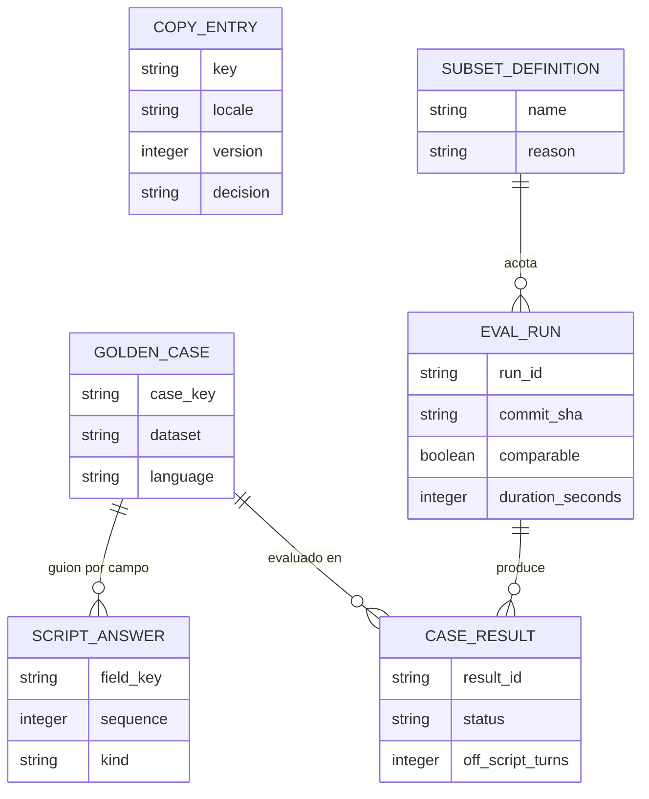

# Especificación funcional — U1 `workspace`

Qué hace la unidad base, paso a paso: el corredor de evaluaciones, el asegurado
simulado y el catálogo de textos. Este documento es la fuente de verdad de los
**flujos** y de los **estados**; el modelo de datos vive en `entities.md` y las
reglas en `rules.md`, y aquí aparecen solo como vistas derivadas para poder leer
todo junto.

**Fuentes consumidas.** `../../../inception/units-generation/unit-of-work.md`
(qué contiene U1 y qué deja a U21),
`../../../inception/units-generation/unit-of-work-story-map.md` (US4.4, US4.7 y
US5.8 con sus quince criterios),
`../../../inception/requirements-analysis/requirements.md` (FR11.1, FR11.3,
NFR17 y NFR21), `../../../inception/domain-design/components.md` (CopyCatalog y
la parte de Evaluation asignada a U1) y
`../../../inception/contract-design/contract-summary.md` (C-21 catálogo, C-22
registro de objetivos y conductores, C-27 casos y líneas base).

## Alcance

U1 construye tres comportamientos y el andamiaje que los sostiene:

| Comportamiento | Historia | Qué queda fuera |
| --- | --- | --- |
| Correr las evaluaciones con un solo comando y producir el reporte | US4.4 | El contenido del reporte con regresión y juez calibrado, que es de U21 |
| Responder como asegurado simulado, por guion y sin modelo | US4.7 | Los casos en sí, que los escriben las unidades que miden cada conducta |
| Mantener el catálogo de textos con sus chequeos | US5.8 | Las frases de cada capacidad, que agrega la unidad dueña de esa frase |

El andamiaje del primer commit (manifiesto, lockfile, herramientas con su
alcance, archivo de tareas, guion de verificación, flujo de integración continua,
árbol de módulos y raíz de composición) no tiene comportamiento de negocio: se
especifica como criterio de terminado en el plan de Bolts, no como flujo aquí.

## Flujo 1 — Correr las evaluaciones

El comando único, desde que alguien lo invoca hasta que existe el reporte.

1. **Validar el entorno.** Comprobar que están las variables requeridas. Si
   falta alguna, terminar con código distinto de cero nombrando la variable, sin
   haber llamado a ningún proveedor (BR1.2).
2. **Cargar el manifiesto de conjuntos** y validarlo: cada conjunto declarado
   existe con su recuento, y un conjunto declarado como no construido trae su
   razón (BR1.9).
3. **Resolver qué casos se corren.** Sin subconjunto, todos los casos de los
   conjuntos que corren por entrega. Con subconjunto, exactamente los
   identificadores de su lista versionada, en su orden (BR1.6, BR1.7).
4. **Abrir la corrida**: registrar el commit, los identificadores exactos de
   modelo y el hash de cada prompt, el nombre del subconjunto si lo hay, y la
   hora de inicio.
5. **Ejecutar cada caso** por el conductor de su canal (Flujo 2 para los casos de
   conversación). Cada caso produce un resultado.
6. **Cerrar la corrida**: registrar la hora de fin y la duración (BR1.8). Si
   algún resultado quedó sin medir, marcar la corrida como no comparable con su
   causa (BR1.5).
7. **Generar el reporte**: por caso, por criterio y por idioma, con enlace a la
   traza de cada caso. Si el backend de trazas no estaba disponible, los enlaces
   quedan marcados como no disponibles y el reporte se genera igual (BR1.3).
8. **Devolver el código de salida**: distinto de cero si algún caso falló. Un
   caso no medido no produce por sí solo un código de fallo, pero sí marca la
   corrida como no comparable. **Qué no decide U1:** si una compuerta dura
   bloquea la entrega, si hubo regresión contra la línea base y si el veredicto
   del juez cuenta son decisiones de U21; U1 entrega los resultados por caso y el
   código de salida de la ejecución, no el juicio de la compuerta.

**Qué pasa cuando falla.** Un caso que no se puede ejecutar por causa ajena al
código —el proveedor responde con error, se agota la cuota o el presupuesto, o
se acaba el tiempo del corredor— se registra como no medido con su causa y la
corrida sigue con el siguiente (BR1.4). Nunca se cuenta como fallo de calidad.

## Flujo 2 — Ejecutar un caso de conversación

Cómo corre un caso de varios turnos sin que ningún modelo simule al asegurado.

1. El conductor del canal abre una conversación para el caso, en su idioma y su
   aseguradora.
2. El sistema produce un turno. Si ese turno pide un campo, lo declara como dato
   del turno.
3. **El asegurado simulado responde**:
   - Si el turno declara un campo que el guion tiene y aún no entregó, responde
     con esa respuesta (BR2.1).
   - Si el turno lee la confirmación de un bloque que tiene una corrección sin
     entregar, responde con la corrección y la marca como entregada; si ya la
     entregó, confirma sin corregir (BR2.3).
   - Si el turno pide un campo que el guion no tiene, responde con la frase de
     desconocimiento del catálogo en el idioma del caso, y el resultado suma un
     desvío (BR2.2).
4. Los pasos 2 y 3 se repiten hasta que el caso llega a su condición de fin: el
   registro esperado está completo, el sistema cierra la conversación, o se
   alcanza el tope de turnos del caso.
5. **Comparar** el registro producido contra el registro esperado y, cuando el
   caso los declara, los veredictos por criterio.
6. **Registrar el resultado** con su estado, sus desvíos y su enlace de traza.

**Determinismo.** Ante la misma secuencia de campos pedidos, el respondedor
entrega la misma secuencia de respuestas, sin ninguna fuente de azar (BR2.4). Es
lo que permite comparar dos corridas del mismo commit.

## Flujo 3 — Validar el catálogo de textos

Corre dentro del guion de verificación, en cada entrega.

1. Cargar todas las entradas del catálogo de los dos idiomas.
2. **Paridad**: toda clave existe en español y en inglés (BR3.1).
3. **Consumidores**: cada clave aparece literalmente al menos una vez en el
   código del aplicativo (BR3.2).
4. **Nada en línea**: ningún archivo de código contiene una cadena visible para
   una persona (BR3.3).
5. **Claves literales**: ninguna clave se construye concatenando en tiempo de
   ejecución (BR3.4).
6. **Versión con su razón**: toda entrada con versión mayor que uno declara el
   identificador de la decisión que la cambió (BR3.5).
7. **Formas prohibidas**: ninguna frase coincide con la lista versionada de
   formas prohibidas (BR3.6).
8. Si algún paso falla, el chequeo termina con código distinto de cero y nombra
   la clave o el archivo.
9. Generar la **lista de cambios pendientes** de llevar a la guía de voz: las
   entradas con decisión declarada. Es una salida derivada del catálogo, no un
   archivo que alguien mantiene a mano.

## Estados de una corrida

<!-- Text fallback: una corrida empieza preparada. Si falta una variable de entorno se detiene sin llamar a ningún proveedor. Con el entorno validado pasa a corriendo, y cuando todos los casos tienen resultado pasa a completa. Desde completa, si ningún caso quedó sin medir la corrida es comparable contra la línea base; si al menos uno quedó sin medir, la corrida queda no comparable con su causa. -->

Y el estado de un caso dentro de la corrida:

| Estado | Cuándo | Qué significa para la compuerta |
| --- | --- | --- |
| `passed` | El registro producido coincide con el esperado y ningún criterio falló | Cuenta como aprobado |
| `failed` | El registro no coincide, o falló un criterio | Bloquea si el criterio es de compuerta dura |
| `not_measured` | El caso no se pudo ejecutar por causa ajena al código | No cuenta como fallo; marca la corrida como no comparable |

## Vista derivada: entidades

Derivada de `entities.md`, que es la fuente de verdad.

<!-- Text fallback: seis entidades. CopyEntry es independiente y guarda cada frase por clave e idioma, con su versión y la decisión que la cambió. GoldenCase tiene muchas ScriptAnswer (el guion, una respuesta por campo) y muchos CaseResult (uno por corrida que lo evalúa). EvalRun produce muchos CaseResult. SubsetDefinition acota muchas EvalRun. -->

## Vista derivada: reglas

Derivada de `rules.md`, que es la fuente de verdad.

| Regla | Qué exige |
| --- | --- |
| BR1.1 | Un solo comando, invocado igual desde el archivo de tareas, el README y la tubería |
| BR1.2 | Sin la clave del modelo, se detiene antes de la primera llamada y nombra la variable |
| BR1.3 | Sin backend de trazas, el reporte se genera con los enlaces marcados como no disponibles |
| BR1.4 | Un caso no medible se registra como no medido con su causa y la corrida sigue |
| BR1.5 | Una corrida con casos no medidos queda no comparable |
| BR1.6 | El subconjunto es una lista versionada con nombre y razón, y el reporte lo declara |
| BR1.7 | Mismo commit y mismo subconjunto, mismos casos en el mismo orden |
| BR1.8 | La duración se mide siempre y se publica |
| BR1.9 | Los ocho conjuntos existen con su recuento; uno no construido declara su razón |
| BR1.10 | Del audio se versiona el guion, nunca el audio, y cada voz registra su consentimiento |
| BR1.11 | El corredor nunca invoca un modelo para responder como asegurado |
| BR2.1 | El respondedor contesta el campo que el turno declara, en cualquier orden |
| BR2.2 | Campo que el guion no tiene: dice que no sabe y se registra el desvío |
| BR2.3 | Una corrección se entrega una sola vez |
| BR2.4 | Misma secuencia de campos, misma secuencia de respuestas |
| BR3.1 | Toda clave existe en los dos idiomas |
| BR3.2 | Toda clave tiene consumidor literal en el código |
| BR3.3 | Ningún texto visible escrito en línea |
| BR3.4 | Claves jerárquicas y siempre literales |
| BR3.5 | Versión mayor que uno declara su decisión; la lista de pendientes se deriva |
| BR3.6 | Ninguna forma prohibida en el catálogo |

## Escenarios de punta a punta

| Escenario | Camino | Resultado esperado |
| --- | --- | --- |
| Máquina limpia, todo presente | Flujo 1 completo sobre el subconjunto declarado | Reporte con fecha y commit en menos de 15 minutos, cronometrado (NFR21) |
| Falta la clave del modelo | Flujo 1 paso 1 | Se detiene nombrando la variable, sin gastar cuota |
| El backend de trazas está apagado | Flujo 1 pasos 5 a 7 | Reporte completo con enlaces marcados como no disponibles |
| El proveedor falla a mitad de la corrida | Flujo 1 paso 5 | Los casos afectados quedan no medidos con su causa; la corrida termina y se marca no comparable |
| La agente pregunta en otro orden | Flujo 2 paso 3 | Cada respuesta corresponde al campo pedido; el registro esperado se produce igual |
| La agente pregunta algo fuera del guion | Flujo 2 paso 3 | El respondedor dice que no sabe y el resultado suma un desvío |
| Una frase nueva sin traducir | Flujo 3 paso 2 | El chequeo falla nombrando la clave |
| Una frase cambiada sin decisión | Flujo 3 paso 6 | El chequeo falla nombrando la clave |

## Lo que esta unidad deja abierto

| Pregunta | Dónde se resuelve |
| --- | --- |
| Qué casos entran en el subconjunto declarado de la compuerta (PA-11) | `nfr-requirements` de U21 |
| El comando que agrega la cobertura de los dos lenguajes | `nfr-requirements` de U1 |
| El contenido del reporte con regresión, juez y segundo detector | U21 |
| Los conductores de chat y de audio que registran en el corredor | U13 y U16 |
