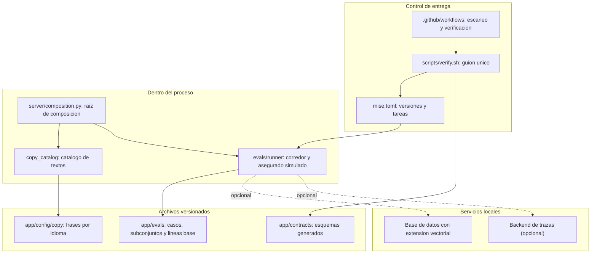

# Componentes lógicos — U1 `workspace`

Qué piezas construye esta unidad, dónde están sus fronteras, qué se lleva por
delante el fallo de cada una y qué comparte con las demás. Es el puente entre las
decisiones no funcionales de esta etapa y el diseño de infraestructura de la
siguiente.

**Fuentes consumidas.** `../nfr-requirements/tech-stack-decisions.md` (lo que U1
instala), `../functional-design/functional-spec.md` (los tres flujos),
`../../../inception/units-generation/unit-of-work.md` (el árbol de módulos y qué
contiene U1), `../../../inception/domain-design/components.md` (CopyCatalog y la
parte de Evaluation asignada a U1) y
`../../../inception/contract-design/contract-summary.md` (C-21, C-22, C-24, C-27,
C-28).

## Mapa

<!-- Text fallback: cuatro grupos. Control de entrega tiene el archivo de versiones y tareas, el guion único de verificación y el flujo de GitHub Actions; el flujo invoca el guion y el guion invoca las tareas. Dentro del proceso están la raíz de composición, el catálogo de textos y el corredor de evaluaciones; la raíz construye el catálogo y el corredor. Los archivos versionados son las frases por idioma que lee el catálogo, los casos y subconjuntos que lee el corredor, y los esquemas generados que comprueba el guion. Los servicios locales son la base de datos con su extensión vectorial y el backend de trazas, y el corredor depende de los dos de forma opcional. -->

## Inventario

| Componente | Dónde vive | Qué es | Quién lo consume |
| --- | --- | --- | --- |
| Archivo de versiones y tareas | `mise.toml` | Versiones ancladas de los dos runtimes y el nombre de cada acción del proyecto | Toda persona y la tubería |
| Guion único de verificación | `scripts/verify.sh` | Los nueve pasos, en orden, con su código de salida | La tubería y quien quiera correrlo antes de empujar |
| Flujo de verificación | `.github/workflows/` | Dos trabajos: escaneo de secretos y el resto | GitHub Actions |
| Raíz de composición | `app/backend/src/untangle/server/composition.py` | El único lugar que construye adaptadores y fábricas | El proceso servido y el corredor |
| Catálogo de textos | `app/backend/src/untangle/copy_catalog/` | `t(key, locale)` y sus chequeos (C-21) | Todas las unidades y la interfaz |
| Corredor de evaluaciones | `app/backend/src/untangle/evals/runner/` | El comando único, el registro de objetivos y conductores, y el asegurado simulado (C-22) | Cada unidad evaluada, U13, U16, U21 |
| Frases por idioma | `app/config/copy/` | Los archivos del catálogo, uno por idioma | El catálogo |
| Casos y subconjuntos | `app/evals/` | Un archivo por caso, las listas de subconjunto, las líneas base (C-27) | El corredor y U21 |
| Contratos generados | `app/contracts/` | Esquemas y documento de la API, generados y versionados (C-28) | La interfaz y el guion |
| Reglas de importación | Configuración en la raíz | Los contratos que hacen comprobables las cuatro reglas de dirección de dependencias | El guion |

## Fronteras, y qué las hace fronteras de verdad

Una frontera que solo vive en la intención no es una frontera. Estas tres son
comprobables por herramienta:

| Frontera | Qué prohíbe | Cómo se comprueba |
| --- | --- | --- |
| El código de producción no importa `untangle.evals` | Que el corredor se cuele en el camino del turno | Contrato `forbidden` de las reglas de importación |
| Solo la raíz de composición construye adaptadores y fábricas | Que un módulo se fabrique su propio cliente y se salte la separación de claves por uso | Contrato `protected` sobre la raíz |
| Ninguna cadena visible se escribe en línea | Que una frase nazca fuera del catálogo y escape a la paridad y a la guardia de salida | Chequeo de contenido del guion (Flujo 3, pasos 3 y 4) |

**Por qué la primera importa tanto:** los conductores de evaluación viven en
`evals/drivers/` e importan la interfaz pública del canal, no al revés. Si el
código de producción pudiera importar el corredor, el arnés de pruebas terminaría
dentro del producto, y lo que se evalúa dejaría de ser lo que se despliega.

## Dominios de fallo

No son dominios de despliegue —no hay nada desplegado—, pero sí son **ámbitos de
daño**: cuando esta pieza falla, esto deja de funcionar y esto sigue.

| Pieza | Si falla | Qué sigue vivo | Radio |
| --- | --- | --- | --- |
| Escaneo de secretos | Todo el flujo se detiene en el acto | Nada de la corrida | **Todo**, a propósito |
| Un paso del guion que no es el escaneo | Ese paso queda rojo; el guion sigue y reporta al final | Los otros ocho pasos | El paso |
| Catálogo: una clave sin pareja | La compuerta falla nombrando la clave | Todo lo demás; en ejecución se devuelve la clave misma y se registra el evento, nunca una cadena vacía | El chequeo |
| Base de datos local ausente | El registro de corridas en base no ocurre | **El reporte se genera igual**; es un oyente opcional | El historial local |
| Backend de trazas ausente | Los enlaces salen marcados como no disponibles | El reporte completo, y la corrida sigue siendo comparable | Los enlaces |
| Proveedor del modelo caído | Los casos afectados quedan no medidos con su causa | La corrida termina y se marca no comparable | Los casos afectados, o la corrida entera si se abre el cortacircuitos |
| Falta una variable de entorno | La corrida se detiene antes de la primera llamada, nombrando la variable | Nada de la corrida; y no se gastó cuota | Toda la corrida, sin costo |
| Raíz de composición: un módulo sin su función declarada | Falla al arrancar con el nombre del módulo | Nada; y **falla al arrancar, no en la primera petición**, que es la mitad del valor de tenerla |

**El patrón que se repite:** cada fallo tiene un radio escrito y un mensaje que
nombra la pieza. Ninguno es silencioso, y ninguno de los opcionales se disfraza
de fallo de calidad.

## Aislamiento

| Qué se aísla | Cómo |
| --- | --- |
| El arnés de evaluaciones del producto | Contrato `forbidden` de importación |
| Las claves de proveedor entre usos | Una fábrica por uso, construida en un único lugar; una cuota agotada en evaluaciones no tumba el chat |
| El alcance de las herramientas | Formatter, linter, tipos, runner y cobertura declaran el prefijo del aplicativo, y solo ese. `site/`, `docs/`, `.claude/` y `aidlc/` quedan fuera **por construcción**, no por una lista de excepciones que crece |
| Las pruebas entre sí | Cada prueba es independiente del orden y del estado compartido, y se puede correr sola |
| El trabajo del escaneo | Corre sin secretos: es el primero y el de mayor superficie |

## Recursos compartidos, y quién los posee

Esto es lo que la siguiente etapa necesita saber, porque un recurso compartido
sin dueño es donde aparecen los conflictos:

| Recurso | Dueño | Quién más lo toca |
| --- | --- | --- |
| `mise.toml` | U1 | **Todas**: cada unidad añade el nombre de sus acciones. Es el archivo con más manos encima del proyecto |
| `scripts/verify.sh` | U1 | Todas las que añaden un chequeo; el intent `infra` lo **invoca**, no lo reescribe |
| Raíz de composición | U1 | Cada unidad añade su línea cuando se construye; la raíz no importa unidades que todavía no existen |
| Catálogo de textos | U1 (el mecanismo) | Cada unidad añade **sus** frases; U1 entrega el catálogo vacío con sus chequeos |
| `app/evals/` | U1 (formato) y U21 (línea base) | Cada unidad evaluada añade sus casos |
| Base de datos local | U2 (el punto único de sesión) | U1 solo la usa para el registro local de corridas, y de forma opcional |
| Migraciones | Una sola historia | Cada unidad añade las de sus tablas; por eso hay un contrato de migraciones (C-30) |

**El riesgo que esta tabla hace visible:** `mise.toml` y `verify.sh` los toca
todo el mundo. La mitigación no es un proceso: es que los dos sean listas de
nombres, sin lógica, de modo que dos unidades añadiendo su línea no se pisen.

## Lo que esta unidad deja preparado para Infrastructure Design

| Pieza | Qué necesita la siguiente etapa |
| --- | --- |
| Servicios locales | Base de datos con extensión vectorial y backend de trazas, **anclados por versión exacta de imagen**, no por etiqueta móvil |
| Flujo de verificación | Dos trabajos, el escaneo primero, permisos vacíos por defecto, acciones fijadas por commit |
| Medición de los 15 minutos | Un trabajo semanal y por hito, en entorno limpio y **sin caché**, que publica su tiempo por paso |
| Variables de entorno | La plantilla `.env.example` con nombres agrupados por uso; ningún valor |
| Artefactos de la corrida | El reporte y el resumen por caso se publican como artefacto, con su commit y su fecha |

## Lo que no es de esta unidad

La tubería de despliegue, el aprovisionamiento de entornos y la observabilidad de
plataforma son del intent `infra`, y ese intent **invoca el mismo guion** en lugar
de crear un segundo juego de chequeos. La landing (`site/`) se sigue publicando a
mano y no comparte tubería con el aplicativo.
