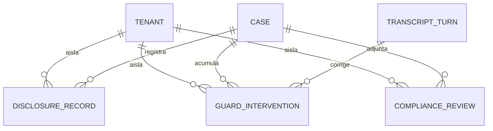

# Especificación funcional — U10 `compliance`

Fuente de verdad de los **flujos** de U10. La forma de los datos está en
`entities.md` y las decisiones en `rules.md`. Respuestas aplicadas de
`functional-design-questions.md`: controles del turno por reglas deterministas en
los dos idiomas (Q1), reemplazo frase por frase una vez por categoría (Q2) y
revisión de cierre sin modelo (Q3).

## 1. Qué hace esta unidad

U10 entrega una biblioteca y un nodo:

- **Tres controles del turno** (D22), baratos y deterministas: la **guardia de
  salida** sobre cada frase hacia el asegurado; la detección de **petición de
  persona**, que incluye la pregunta de si la agente es una persona; y la
  detección de **emergencia**.
- **El registro de la divulgación** cuando sale la apertura.
- **La revisión completa** de los cuatro controles al cierre o en la derivación.
- **El nodo `compliance`**, que cierra o deriva el caso con su motivo.
- **La delimitación del texto externo** antes de que entre a un prompt.

No hace, y quién lo hace: el punto único de salida que llama a la guardia en cada
turno, la derivación en el turno siguiente y la persistencia desde el grafo
(U12); la relectura con juez calibrado (U21); correr DS-6 contra el despliegue
público en cada hito (pasada de publicación, DP-14).

## 2. Flujos

### F1 — Controles sobre lo que dijo la persona (en el turno)

1. Llega un turno de la persona, ya redactado por U3.
2. Se normaliza el texto y se aplican los patrones de **los dos idiomas** (BR1.3).
3. Salen tres señales: `human_request`, `identity_question` y `emergency`, con
   los patrones negativos aplicados a la emergencia (BR3.2).
4. U12 decide con ellas: emergencia → la primera frase del turno es la indicación
   de emergencia (BR3.1, BR3.3); pregunta de identidad → la frase fija del
   catálogo y la conversación sigue (BR2.4); petición de persona → derivación en
   el turno siguiente con motivo `human_request` y prioridad alta (BR2.2).

### F2 — La guardia sobre cada frase de salida (en el turno)

1. Una frase está lista para salir, sea del modelo, del catálogo o de degradación
   (BR1.1).
2. Se normaliza y se le aplican los patrones de las siete categorías en los dos
   idiomas (BR1.2, BR1.3); la revelación de configuración se detecta por forma,
   con los identificadores de las otras aseguradoras leídos de su configuración
   (BR1.7). Las plantillas aprobadas de respuesta verificada no intervienen
   (BR1.8).
3. Sin coincidencia, la frase sale igual.
4. Con coincidencia: si es la primera de su categoría en el turno, sale la frase
   permitida del catálogo; si no, se descarta (BR1.4). Se registra la
   intervención y un evento en la traza, sin la frase original (BR1.6).
5. Si la evaluación falla, la frase no sale y sale la clave de degradación
   (BR1.5).

### F3 — La divulgación

1. Sale la apertura con la divulgación.
2. Se registra canal, idioma, clave y hora; un segundo registro del mismo caso y
   canal no crea otra fila (BR4.1, BR4.2).

### F4 — Revisión completa y cierre (ritmo de fondo)

1. El runtime ejecuta el nodo `compliance` cuando el caso llega a cierre o
   derivación.
2. El nodo pide la revisión completa hasta el último turno, o hasta el de la
   derivación si la hubo (BR5.2).
3. La revisión comprueba los cuatro controles leyendo el caso: divulgación, ruta
   a persona, datos personales con el detector de U3, y adjuntos (BR5.1). No
   llama al modelo (BR5.3).
4. El nodo devuelve su decisión (BR6.3):
   - **close**, si todo pasó y la categoría lo permite;
   - **refer** con su motivo, si la categoría o un control lo exigen (BR6.2);
   - **refused** con lo que falta, si se intenta cerrar sin los controles
     (BR6.1).
5. El módulo de capacidad guarda la revisión con clave (caso, turno revisado),
   así que la reejecución al reanudar no la duplica (BR6.3). El texto de cierre
   sale del catálogo y pasa por la guardia (BR6.4).

### F5 — Texto externo hacia un prompt

1. Un nodo necesita poner en un prompt algo que dijo la persona, un fragmento del
   corpus o un adjunto.
2. Lo pasa por la función de delimitación, que lo marca como dato y neutraliza sus
   delimitadores (BR7.1). Nunca se concatena al prompt de sistema.

### F6 — Los casos de evaluación, antes del código (rama evaluada)

1. Se escriben los casos por idioma: en DS-6, RT-1, RT-2, RT-3, RT-5, RT-6, RT-8 y
   RT-15; en DS-2, petición de persona (incluidas las formas indirectas), heridos
   graves y los negativos (BR9.1).
2. Cada caso apunta a un archivo de frases de prueba por idioma y declara el
   veredicto esperado de su comprobación, como hizo U3 con RT-14 y RT-15.
3. Se corren y se comprueba que fallan; se implementa; se corren hasta que pasan.
4. Las comprobaciones que no necesitan proveedor entran al subconjunto de
   arranque, un caso por comprobación y por idioma, así que corren en cada
   entrega.
5. La mitad de punta a punta —"en el turno siguiente", "antes de cualquier dato"—
   la verifica U12 con el grafo y U13 con el conductor de texto, como lista el
   mapa de historias.

## 3. Modelo de entidades (derivado de `entities.md`)

Texto alternativo: las tres tablas pertenecen a una aseguradora y cuelgan de un
caso (U4); cada intervención de la guardia corrige la salida de un turno de la
transcripción.

## 4. Reglas (resumen derivado de `rules.md`)

| Familia | Reglas | Lo esencial |
| --- | --- | --- |
| Guardia | BR1.1 a BR1.8 | Cada frase, siete categorías, dos idiomas, reemplazo una vez, falla cerrado |
| Persona e identidad | BR2.1 a BR2.5 | Petición en cualquier turno, derivación siguiente, frase fija de identidad |
| Emergencia | BR3.1 a BR3.3 | Antes de cualquier dato, sin falsas alarmas, frase pública por omisión |
| Divulgación | BR4.1 a BR4.2 | Registrada e idempotente |
| Revisión | BR5.1 a BR5.3 | Cuatro controles deterministas, sin modelo |
| Cierre | BR6.1 a BR6.4 | No cierra sin controles, nodo puro |
| Texto externo | BR7.1 | Solo como dato delimitado |
| Datos | BR8.1 a BR8.2 | Aislamiento y sin texto libre |
| Evaluación | BR9.1 a BR9.2 | Casos antes; ataque exitoso, caso nuevo |

## 5. Decisiones de esta etapa

| # | Decisión | Por qué |
| --- | --- | --- |
| FD-U10-1 | Controles del turno por reglas deterministas en los dos idiomas (Q1) | Reproducible, cabe en el turno, y AC1.11.6 pide que el detector por reglas bloquee siempre |
| FD-U10-2 | Reemplazo frase por frase, una vez por turno y categoría (Q2) | Compatible con el streaming |
| FD-U10-3 | Revisión de cierre determinista, sin modelo (Q3) | La relectura con juez calibrado es de U21 |
| FD-U10-4 | C-20 gana dos funciones, como cambio aditivo de su dueño: `detect_identity_question` y `delimit_untrusted` | La pregunta de identidad es parte de la familia de petición de persona, no un cuarto control; la delimitación es responsabilidad de U10 según su catálogo |
| FD-U10-5 | U10 no crea configuración por aseguradora | Ningún criterio de sus historias distingue aseguradoras; la carpeta se crea el día que exista una diferencia, no antes |
| FD-U10-6 | La frase de emergencia la elige una opción del despliegue, pública por omisión | D14: la demo pública no puede enviar ayuda, y lo seguro por omisión es decirlo |
| FD-U10-7 | Casos de golden set sobre frases de prueba por idioma, y la verificación de punta a punta en U12 y U13 | Es el patrón que dejó U3; la conversación completa necesita el grafo |
| FD-U10-8 | Correr DS-6 contra el despliegue en vivo pasa a la pasada de publicación | DP-14: no hay despliegue público hasta entonces |

## 6. Lo que esta unidad pide a otras

| A quién | Qué |
| --- | --- |
| U12 | Llamar a la guardia en el punto único de salida para cada frase; aplicar las tres señales; derivar en el turno siguiente; persistir con clave idempotente |
| U13 | Correr DS-6 por el conductor de texto |
| U14 | Mostrar el resultado de los controles y las intervenciones en la vista de caso |
| U21 | Releer con el juez calibrado lo que las reglas no ven |

## Sources

- `../../../inception/units-generation/unit-of-work.md` — sección U10 y D22.
- `../../../inception/user-stories/stories.md` — US1.6, US1.9, US1.10, US1.11,
  US4.15 y US1.16.
- `../../../inception/requirements-analysis/requirements.md` — FR7.1 a FR7.7,
  FR1.7, NFR9 y NFR12.
- `../../../inception/domain-design/components.md` — ComplianceControls y
  ComplianceNode.
- `../../../inception/contract-design/contract-summary.md` — C-04, C-15 y C-20.
- `../../../inception/delivery-planning/pasada-de-publicacion.md` — lo diferido.

## Assumptions & Open Questions

- **Las paráfrasis son el riesgo de las reglas.** Un fallo en evaluación se
  corrige con su patrón y su caso (BR9.2), nunca bajando la compuerta.
- **El presupuesto de latencia de los controles en el turno** es de U12 (PA-7);
  U10 mide su propia evaluación en sus requisitos de calidad.
