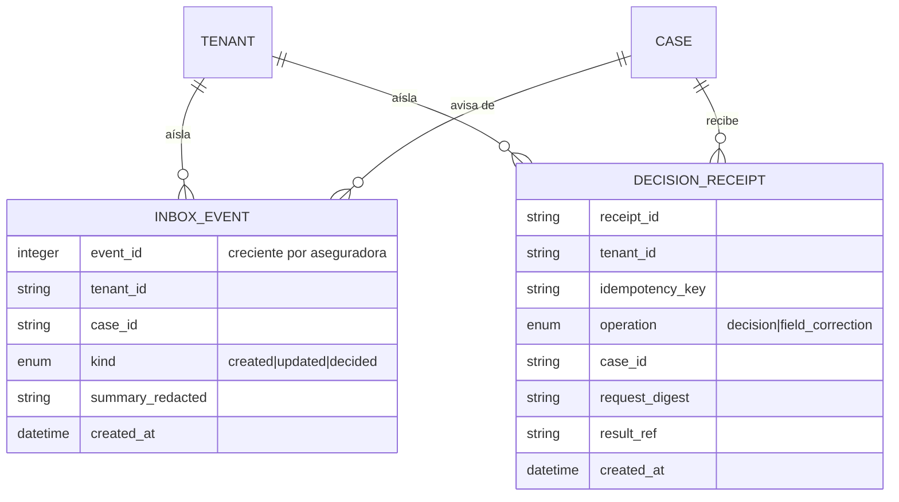

# Especificación funcional — U14 `inbox`

La persona en el ciclo. Todo lo que este proyecto afirma sobre cobertura, montos
o culpa pasa por aquí antes de llegar a alguien: la bandeja es donde una persona
lo firma. De ahí que la unidad se mida por dos cosas que no son la pantalla —que
una credencial nunca vea casos de otra aseguradora, y que un enlace abra solo su
caso— y por una que sí: que decidir un caso tome menos de tres minutos.

## Sources

- `inception/units-generation/unit-of-work.md` — definición de U14, sus ocho historias y sus dependencias
- `inception/user-stories/stories.md` — US3.1 a US3.8 con sus criterios de aceptación
- `inception/requirements-analysis/requirements.md` — FR8.1 a FR8.7, FR9.4, FR6.4, FR1.6, FR1.7, FR7.4, FR2.5, NFR10, NFR13
- `inception/domain-design/components.md` — el componente `Inbox` y su entidad `InboxEvent`
- `inception/contract-design/contract-summary.md` — C-05 (bandeja), C-06 (flujo), C-07 (enlace firmado), y los contratos que consume: C-12, C-14, C-18, C-19, C-20, C-23
- `inception/refined-mockups/interaction-spec.md` — F5 (decidir con credencial), F6 (acción de la agencia), regla U-07 (sin jerga en pantallas de visitante)
- `functional-design-questions.md` — las cuatro decisiones de Miguel del 2026-09-28

## Assumptions & Open Questions

None.

Las cuatro preguntas de esta etapa se respondieron antes de escribir estos
artefactos y sus respuestas están en `functional-design-questions.md`. No queda
ninguna suposición sin confirmar: lo que no tenía criterio —la tercera decisión
del contrato— se resolvió dejándolo fuera con su razón, en vez de inventarle una
conducta.

---

## Flujo 1 — Atender la cola y decidir un caso (F5)

El recorrido de Diana, ajustadora de Stonecroft Mutual.

1. Entra con su credencial. La aseguradora **sale de la credencial**, nunca de la
   dirección (BR1.4).
2. Pide la cola. El servidor devuelve las filas de su aseguradora, ordenadas por
   prioridad y, dentro de cada una, por espera más larga primero (BR1.1). Cada
   fila lleva sus seis datos (BR1.2).
3. Filtra por estado, canal, idioma o prioridad. Si nada coincide, la pantalla lo
   dice y ofrece quitar los filtros (BR1.3).
4. Abre un caso. La vista pide su evidencia a quien la guarda: el caso y sus
   campos a U4, las citas a U8, la regla a U9, los controles a U10 y el resumen
   de traza a U5. La bandeja **no guarda copia** de ninguna.
5. Lee el encabezado —motivo, categoría, completitud— con las acciones al lado
   (BR2.1), y los tres bloques abiertos: completitud por campo, transcripción y
   cláusulas (BR2.2).
6. Si un campo está mal capturado, lo corrige. U4 escribe el campo y su entrada
   de historial en una sola transacción; la transcripción no cambia (BR3.1,
   BR3.2). Un valor inválido se rechaza nombrando el formato y conserva el
   anterior (BR3.3).
7. Decide con comentario. Sin comentario la acción se rechaza sin perder lo
   escrito (BR4.1). Con él, la bandeja registra la decisión, responde `202` y
   **no espera**: la reanudación del grafo corre de fondo (BR4.2).
8. La cola y la vista de quien las tenga abiertas se actualizan por el flujo de
   eventos (BR6.1).

**Caminos de error**

| Qué pasa | Qué se ve |
| --- | --- |
| Otra persona decidió antes | La decisión que ya existe; la acción no se aplica (BR4.4) |
| El caso espera al asegurado | Sin acciones, con el porqué y los campos que faltan (BR4.3) |
| Valor inválido en la corrección | El mensaje del catálogo con el campo y el formato; el valor anterior se conserva (BR3.3) |
| El caso está cerrado | La corrección no se ofrece, y la petición directa se rechaza (BR3.4) |
| Credencial de otra aseguradora | Rechazo sin devolver ningún dato (BR1.4) |

## Flujo 2 — La acción de la agencia (F6)

El recorrido de Priya Raman, en Knotwell.

1. Abre un caso. Ve **qué aseguradora emitió la póliza** y las cláusulas de esa
   emisora (BR2.6).
2. Su única acción es marcar el caso como enviado a la aseguradora: no ve
   aprobar ni rechazar, porque eso sale de la configuración de su aseguradora y
   no de una condición en el código (BR4.5).
3. Confirma con comentario. El caso queda cerrado con resolución *enviado a la
   aseguradora*, sigue en Knotwell y no aparece en la bandeja de la emisora.
   Nada de lo que ve el asegurado promete que la emisora lo llame (BR4.6).

Una petición directa a la API para aprobarlo con su credencial se rechaza sin
cambiar el caso: la pantalla que no ofrece la acción es cortesía, y el rechazo
del servidor es lo que la impide.

## Flujo 3 — El visitante decide su propio caso con un enlace

El recorrido de Jordan, que es quien evalúa el proyecto. Corre sobre **una
pantalla propia**, no sobre la del ajustador (decisión de Miguel, 2026-09-28).

1. Recibe el enlace al cerrar su reporte en el chat o en la consola. El enlace lo
   emite U2; la bandeja lo canjea.
2. Lo abre. El canje cambia el token por una cookie de caso y **limpia la
   dirección**; la página declara su política de referente (BR5.6).
3. Entra directo a su caso. La cola le responde igual que a quien no tiene
   credencial: su sesión autoriza un caso, no una aseguradora (BR5.1).
4. La pantalla le dice, sin jerga, qué está viendo y hasta cuándo vale el enlace.
   Ve las acciones que su aseguradora permite: aprobar y rechazar en las que
   emiten, marcar como enviado en la agencia (BR4.5).
5. Decide con comentario. La decisión queda a nombre de **un visitante con enlace
   de demostración**, con su hora, y nunca a nombre de una persona de la
   aseguradora (BR5.5).
6. Al confirmar, la pantalla muestra que el caso se reanudó, el mensaje que
   recibe el asegurado y un enlace de vuelta a su conversación.

**Caminos de error**

| Qué pasa | Qué se ve |
| --- | --- |
| Firma alterada, o caso que no existe | El mismo mensaje de enlace no válido, sin confirmar si el caso existe (BR5.2) |
| Emitido antes del reinicio nocturno | Que los datos de la demostración se borran cada noche (BR5.2) |
| Vencido, caso todavía guardado | Que venció, que el caso sigue guardado y cómo pedir uno nuevo en su conversación (BR5.7) |
| Vence mientras escribe el comentario | Que venció, con **el comentario todavía en pantalla para copiarlo** (BR5.4) |
| A los 59:59 y a los 60:01 | La primera da acceso; la segunda dice que caducó (BR5.3) |

## Flujo 4 — El caso que espera al asegurado

1. Un caso cortado a mitad aparece en la cola bajo *esperando al asegurado*, con
   su completitud y su último bloque confirmado (BR1.5).
2. Al abrirlo se ve el motivo del corte registrado y su hora.
3. No se puede decidir: la vista dice por qué y qué campos faltan, y la petición
   directa se rechaza sin cambiar el caso (BR4.3).
4. Cuando el asegurado lo retoma y lo completa, deja de aparecer así (BR1.5).

## Máquina de estados — lo que la bandeja puede hacer según el estado del caso

El caso y sus estados son de U4; esta tabla dice **qué ofrece la bandeja** en
cada uno. No introduce estados nuevos.

| Estado del caso | Aparece en la cola | Corregir campos | Decidir |
| --- | --- | --- | --- |
| `open`, `capturing` | No (todavía en conversación) | No | No |
| `verifying`, `deciding` | Sí | Sí | No (el grafo no ha pausado) |
| `derived` | Sí, con su motivo | Sí | **Sí**, con comentario |
| `awaiting_insured` | Sí, con completitud y último bloque | Sí | No (BR4.3) |
| `closed` | Sí | No (BR3.4) | No (BR4.4) |

La transición que la bandeja provoca es una sola: `derived → closed` con su
resolución, y la hace U4 por su contrato. La reanudación del grafo la hace U12.

## Modelo de entidades (vista derivada)

La fuente de verdad es `entities.md`.

`CASE` y `TENANT` se dibujan para situar las dos entidades propias; son de U4 y
de U2 y esta unidad no las define.

## Resumen de reglas (vista derivada)

La fuente de verdad es `rules.md`.

| Familia | Reglas | Qué asegura |
| --- | --- | --- |
| La cola | BR1.1 – BR1.6 | Orden, contenido, filtros vacíos, **aislamiento `[bloquea]`**, casos a medias, idioma |
| La vista | BR2.1 – BR2.6 | Qué se ve primero, seis bloques (tres y tres), transcripción etiquetada, explicación, dos resultados distintos, emisora |
| La corrección | BR3.1 – BR3.4 | Rastro, transcripción intacta, validación, caso cerrado |
| La decisión | BR4.1 – BR4.7 | Comentario, reanudación, quién se puede decidir, concurrencia, acciones por configuración, sin promesa, y la acción que no se construye |
| El enlace | BR5.1 – BR5.7 | **Solo su caso `[bloquea]`**, **una sola vía de rechazo `[bloquea]`**, la hora, el comentario que no se pierde, la atribución, el token, el vencido |
| El aviso | BR6.1 – BR6.3 | Se actualiza solo, reanuda sin perder, va redactado |

## Lo que esta unidad no construye

- **La emisión y validación de enlaces y credenciales** es de U2 (C-07). La
  bandeja los canjea y los consume.
- **El enlace que entrega el chat o la consola al cerrar** es de U13 y U17.
- **La decisión de una solicitud de cotización** la agrega U19.
- **El traspaso real a la aseguradora emisora** está fuera de esta versión (W1).
- **La tercera decisión de C-05** (`request_more`) queda fuera con su razón
  escrita (BR4.7).
