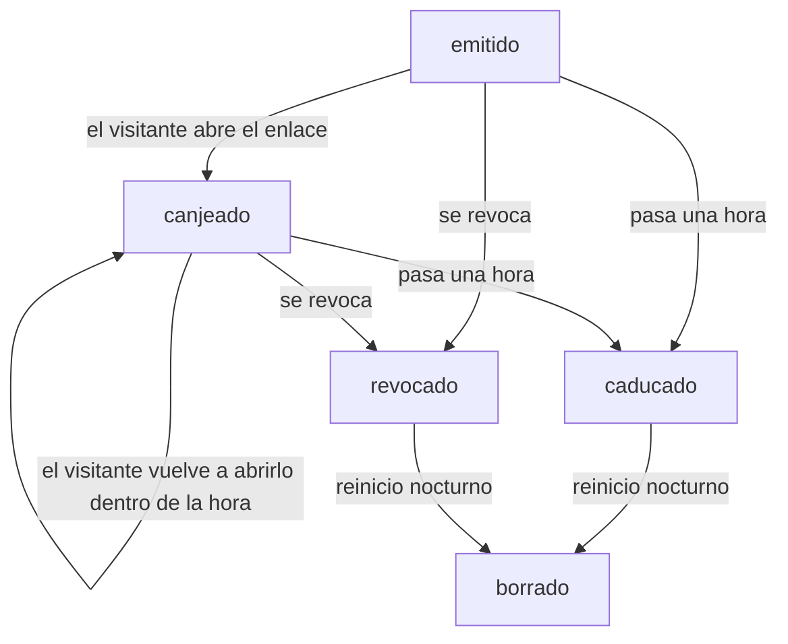
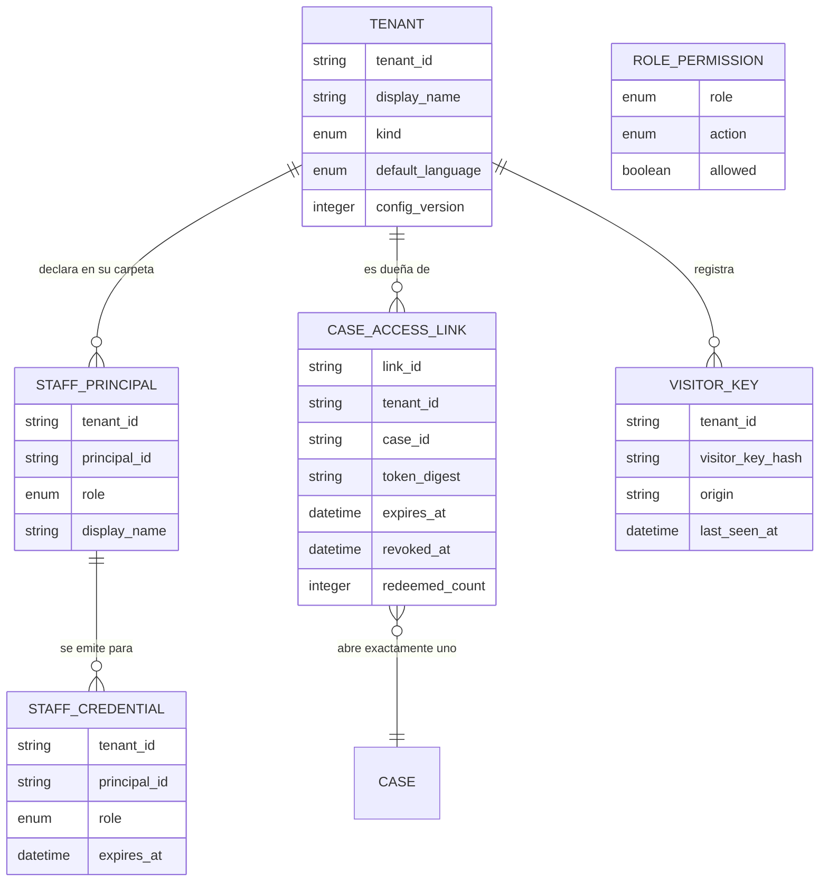

# Especificación funcional — U2 `tenancy`

Qué hace la unidad de aseguradoras e identidad, paso a paso. Este documento es
la fuente de verdad de los **flujos** y de los **estados**; el modelo de datos
vive en `entities.md` y las reglas en `rules.md`, y aquí aparecen solo como
vistas derivadas para poder leer todo junto.

**Fuentes consumidas.** `../../../inception/units-generation/unit-of-work.md`
(qué contiene U2 y qué deja a U14 y a U20),
`../../../inception/units-generation/unit-of-work-story-map.md` (US4.11 y US5.7
con sus nueve criterios),
`../../../inception/requirements-analysis/requirements.md` (FR8.7, FR9.1 a
FR9.6, NFR10), `../../../inception/domain-design/components.md`
(`TenantIdentity`) y
`../../../inception/contract-design/contract-summary.md` (C-07, C-10, C-11,
C-25 y C-30).

## Alcance

U2 construye cuatro comportamientos y la convención de migraciones que los
sostiene:

| Comportamiento | Historia | Qué queda fuera |
| --- | --- | --- |
| Aislar cada consulta por aseguradora en la base de datos, y probarlo | US4.11 | Las tablas de las otras veinte unidades, que cada una crea con su aislamiento |
| Emitir y verificar credenciales de la bandeja con aseguradora y rol | US5.7 | Las pantallas de la bandeja, que son de U14 |
| Emitir y canjear enlaces firmados hacia un solo caso | — (contrato C-07) | La ruta que los usa y la pantalla del visitante, que son de U14 y U6 |
| Declarar qué es un dato de visitante y cómo se borra | — (contrato C-11) | El reinicio nocturno que lo ejecuta, que es de U20 |

Los dos últimos no tienen criterio de aceptación propio en las historias de U2:
los construye porque es la dueña del contrato, y quien los ejercita en pantalla
es otra unidad.

**U2 es la primera unidad con tablas.** U1 decidió no crear ninguna (CG-1), así
que esta unidad instala también la historia de migraciones y la aserción que la
vigila. Desde aquí, cada unidad que cree una tabla escribe su propia revisión
dentro de esa historia.

## Flujo 1 — Obtener una sesión de base de datos

El único camino hacia la base, desde que un módulo la pide hasta que la suelta.

1. **Resolver la aseguradora.** Buscar el identificador en la configuración
   cargada. Si no existe, terminar con un error que lo nombre, **sin abrir
   transacción** (BR1.5).
2. **Abrir la transacción** contra la conexión del aplicativo, con el rol que no
   puede saltarse el aislamiento (BR1.7).
3. **Fijar la aseguradora** en la variable de sesión, dentro de esa misma
   transacción.
4. **Entregar la sesión** a quien la pidió. A partir de aquí, toda consulta que
   haga ve solo las filas de esa aseguradora, con filtro o sin él (BR1.3).
5. **Cerrar la transacción** al terminar, con confirmación o con reversión, y
   limpiar la variable de sesión antes de devolver la conexión.

**Qué pasa cuando falla.** Si la variable de sesión quedara vacía o ausente, las
políticas no ven ninguna fila y la consulta devuelve vacío; se registra el
evento y nunca se devuelven filas de otra aseguradora (BR1.4). Es la diferencia
entre fallar cerrado y fallar abierto, y aquí se falla cerrado siempre.

**Lo que este flujo no hace.** No decide qué puede ver quien pidió la sesión:
eso lo deciden la credencial y la tabla de permisos (Flujo 3). Una sesión fijada
en una aseguradora es necesaria para leer sus datos, y no es suficiente.

## Flujo 2 — Comprobar que el esquema está aislado

Corre en cada corrida del guion de verificación y al arrancar el proceso.

1. **Preguntarle a la base** qué tablas tiene el esquema del aplicativo. No se
   lee ninguna lista escrita a mano (BR1.2).
2. **Descontar la lista de exclusión** versionada, donde cada entrada lleva su
   razón. Hoy tiene una sola: la tabla de versiones de migraciones, que no
   guarda datos del aplicativo.
3. **Para cada tabla restante**, comprobar las tres cosas: aislamiento
   habilitado, aislamiento forzado y al menos una política de aseguradora.
4. **Componer el resultado**: las tablas revisadas, las excluidas con su razón y
   una entrada por cada fallo, con el nombre de la tabla y qué le falta.
5. **Devolver el código de salida**: distinto de cero si hay algún fallo, con el
   mensaje nombrando tabla y carencia.

**Por qué se le pregunta a la base y no a un archivo.** Una lista escrita a mano
solo cubre las tablas que alguien se acordó de añadir. La tabla que nadie añadió
pasa la compuerta en verde sin estar aislada, y nadie va a buscarla porque el
archivo se ve bien. Es la misma forma de fallo que apareció el 2026-09-20 con
los ajustes de cadena de suministro: un control escrito en un sitio que la
herramienta no lee es peor que no tenerlo.

## Flujo 3 — Emitir y verificar una credencial de la bandeja

**Emisión** (un comando, para Miguel, el despliegue local y las pruebas):

1. Comprobar que la persona existe en la configuración de su aseguradora.
2. Componer el contenido: aseguradora, persona, rol, instante de emisión y
   caducidad a las doce horas (BR2.1, BR2.2).
3. Firmarlo con la clave de firma del entorno y entregarlo por la salida del
   comando. **Nunca** se escribe en un archivo del repositorio (BR2.6).

**Verificación** (en cada petición a la bandeja, no solo al entrar):

1. Leer la credencial de su cookie. Si no hay, responder como si el recurso no
   existiera.
2. Comprobar la firma. Comprobar la caducidad. Comprobar que la aseguradora de
   la credencial es la de los datos que se piden (BR2.3).
3. Si cualquiera de las tres falla, responder exactamente igual en las tres y
   sin devolver ningún dato: no se distingue una credencial caducada de una
   alterada ni de una de otra aseguradora (BR2.4).
4. Consultar la tabla de permisos con la pareja (rol, acción). Si la pareja no
   aparece declarada como permitida, rechazar la acción y no cambiar el caso
   (BR2.5).
5. Obtener la sesión de base de datos para esa aseguradora (Flujo 1) y seguir.

**El paso 4 no es opcional en ninguna ruta.** Una petición directa a la interfaz
programática recorre los mismos cinco pasos que una que venga de la pantalla; la
pantalla no es donde se comprueba nada.

## Flujo 4 — Emitir y canjear un enlace de caso

**Emisión** (cuando un visitante crea su caso en el enlace público):

1. Crear la fila del enlace con su aseguradora, su caso, el instante de creación
   y la caducidad a la hora (BR3.1).
2. Generar el token, guardar solo su resumen en la fila y devolver el token una
   sola vez a quien lo va a entregar.
3. El enlace se arma de modo que el token viaje en el fragmento de la dirección
   y no en la petición: así no aparece en la barra, ni en la cabecera de
   procedencia, ni en los registros del servidor.

**Canje** (cada vez que el visitante abre el enlace):

1. La pantalla lee el token del fragmento, lo envía y limpia la dirección.
2. Buscar la fila por el resumen del token.
3. Comprobar que existe, que no ha caducado y que no está revocada. Si algo
   falla, responder **exactamente igual** que ante un caso inexistente, sin
   decir cuál de las cuatro causas fue (BR3.3).
4. Subir el contador de canjes. El enlace **no se quema**: mientras no caduque
   ni esté revocado, se puede volver a canjear (BR3.2).
5. Entregar una credencial limitada a ese caso, con el tiempo que le quede al
   enlace y nunca más (BR3.4).

**Qué abre y qué no.** Con esa credencial se ve el caso propio y se puede
decidir sobre él. Pedir la lista de casos de la aseguradora responde como si no
existiera: mostrarla expondría los casos de otros visitantes (BR3.1).

## Flujo 5 — Reconocer un navegador visitante

1. Al llegar una petición pública, leer la clave del navegador de su cookie.
2. Si no hay, generar una clave nueva, guardar su resumen en la fila de **esa
   aseguradora** con el origen y los instantes, y entregarla en la cookie
   (BR3.5).
3. Si la hay, buscar su fila dentro de la aseguradora de la petición y
   actualizar el instante de último uso. Una clave usada en otra aseguradora no
   encuentra fila aquí: crea la suya, y las dos quedan separadas.
4. La clave no identifica a nadie: no se guarda nombre, ni correo, ni dirección
   de red. Sirve para que el chat, la consola y los resúmenes de traza se
   limiten a quien los produjo.

## Flujo 6 — Cargar las aseguradoras al arrancar

1. Recorrer las carpetas de configuración.
2. Validar cada una contra su esquema.
3. Una carpeta que no valida **no** impide arrancar a las demás: su aseguradora
   queda no disponible y el mensaje nombra el archivo y la clave rota (BR4.1).
4. Una configuración de voz rota apaga la voz de esa aseguradora y deja vivo su
   chat.
5. Dejar la configuración cargada en memoria; es lo que consulta el paso 1 del
   Flujo 1 para resolver una aseguradora.

## Flujo 7 — Borrar los datos de visitante

U2 declara el contrato; U20 lo ejecuta cada noche.

1. Recorrer el **registro explícito** de purgadores: una lista escrita a mano en
   la raíz de composición, nunca un descubrimiento automático (BR3.6).
2. Pedirle a cada uno que borre lo anterior a un instante, con la opción de
   ensayar sin borrar.
3. Cada purgador devuelve cuántas filas borró y cuántas conservó a propósito.
4. Un purgador que falle no detiene a los demás: el reinicio queda parcial con
   el nombre del que falló.
5. Una prueba compara el registro contra las tablas que guardan datos de
   visitante y falla si alguna no tiene purgador.

En U2, los dos dueños de datos de visitante son los enlaces de caso y las claves
de navegador, y cada uno trae su purgador con su prueba.

## Estados de un enlace de caso

<!-- Text fallback: un enlace nace emitido. Cuando el visitante lo abre pasa a canjeado, y puede volver a canjearse cuantas veces quiera mientras siga dentro de su hora. Desde emitido o desde canjeado, al pasar una hora queda caducado, y en cualquier momento puede quedar revocado. Tanto caducado como revocado terminan borrados por el reinicio nocturno. -->

Los cuatro caminos que no dan acceso —token inválido, caducado, revocado y de
otro caso— responden exactamente igual, así que desde fuera los estados
`caducado` y `revocado` son indistinguibles de un enlace que nunca existió.

## Vista derivada: entidades

Derivada de `entities.md`, que es la fuente de verdad.

<!-- Text fallback: una aseguradora declara muchas personas de bandeja en su carpeta, es dueña de muchos enlaces de caso y registra muchas claves de navegador. Para una persona de bandeja se emiten muchas credenciales a lo largo del tiempo. Cada enlace de caso abre exactamente un caso, que es una entidad de la unidad U4. La tabla de permisos por rol y acción no se relaciona con ninguna de las otras: es una tabla versionada que se consulta por rol. -->

`ROLE_PERMISSION` aparece sin línea de relación a propósito: no cuelga de
ninguna aseguradora, y ese es justo su diseño (decisión Q4).

## Vista derivada: reglas

Derivada de `rules.md`, que es la fuente de verdad.

| Grupo | Reglas | De qué responden |
| --- | --- | --- |
| BR1.x | BR1.1 a BR1.11 | El aislamiento en la base: punto único de sesión, la aserción sobre el catálogo vivo, qué pasa sin aseguradora y con una inexistente, el rol sin privilegio de salto, las pruebas por entrega y por hito, y las migraciones |
| BR2.x | BR2.1 a BR2.6 | La credencial de la bandeja: qué lleva, doce horas, verificación por petición, rechazo indistinguible, permisos por rol y nunca publicada |
| BR3.x | BR3.1 a BR3.6 | El acceso del visitante: enlace de una hora hacia un solo caso, reutilizable, rechazo indistinguible, clave de navegador y contrato de borrado |
| BR4.x | BR4.1 a BR4.4 | La configuración por aseguradora: validación aislada, ningún identificador literal, carpeta nueva sin código y evolución del esquema |

## Decisiones de este diseño

| ID | Decisión | Por qué | Origen |
| --- | --- | --- | --- |
| FD-U2-1 | La aserción de aislamiento lee el catálogo vivo de la base, con una lista de exclusión corta y razonada | Una lista escrita a mano deja fuera la tabla que nadie añadió, y esa tabla pasa en verde sin estar aislada | Respuesta Q1 |
| FD-U2-2 | La credencial de la bandeja caduca a las doce horas | Cubre una sesión de trabajo o una demostración sin renovar, y una credencial filtrada muere el mismo día | Respuesta Q2 |
| FD-U2-3 | El enlace de caso es reutilizable mientras no caduque ni esté revocado | Quemarlo al primer canje deja fuera a quien recargue la página, y la hora de vida ya acota el riesgo | Respuesta Q3 |
| FD-U2-4 | Una tabla versionada de rol y acción decide los permisos; lo no declarado se deniega | Los permisos no son una diferencia entre aseguradoras: en su carpeta, una podría concederse la aprobación | Respuesta Q4 |
| FD-U2-5 | Pedir sesión para una aseguradora inexistente falla en el acto | Devolver una sesión vacía convertiría un error del código en "no hay datos" | Respuesta Q5 |
| FD-U2-6 | La clave de navegador lleva aseguradora; su identidad es la pareja aseguradora + resumen | Sin ese campo sería la única tabla fuera de la aserción de aislamiento, y un navegador compartiría fila entre dos demostraciones | FR9.1; precisa `components.md` |
| FD-U2-7 | La aseguradora vive en su carpeta de configuración y no en una tabla | FR9.3 exige que añadir una cuarta sea añadir una carpeta; una tabla obligaría además a una migración | FR9.3, C-25 |
| FD-U2-8 | Del token del enlace se guarda solo su resumen, y la fila se consulta para caducidad y revocación | El token sigue siendo firmado, y quien lea la tabla no puede reconstruir ningún enlace | C-07 |

Las cinco primeras son tus respuestas de hoy. Las tres últimas las resuelve este
diseño aplicando un requisito aprobado, así que quedan registradas sin pedir
visto bueno.

## Escenarios de punta a punta

Cada uno se verifica en `build-and-test`, no aquí, y se nombra para que exista el
enganche.

1. **Colisión entre aseguradoras.** Dos aseguradoras tienen una póliza con el
   mismo número. Una sesión fijada en la primera consulta sin filtro y obtiene
   solo la suya; una sesión sin aseguradora fijada no obtiene ninguna
   (AC4.11.3).
2. **Tabla nueva sin aislamiento.** Se crea una tabla del aplicativo sin su
   política. La aserción la nombra y la compuerta se pone roja (AC4.11.1).
3. **Credencial de otra aseguradora.** La credencial de Marcus Webb, de
   Sunmeadow, se usa contra la bandeja de Stonecroft desde la pantalla y desde
   una petición directa. Las dos veces se rechaza igual que una caducada y que
   una alterada (AC5.7.2).
4. **Agente de cuenta intentando decidir.** Priya Raman pide aprobar un caso
   desde la pantalla y con una petición directa. Las dos se rechazan y el caso
   no cambia (AC5.7.3).
5. **Enlace reabierto.** El visitante canjea su enlace, cierra la pestaña y lo
   vuelve a abrir a los diez minutos: entra. Lo abre a las dos horas: recibe la
   misma respuesta que si el caso no existiera (FD-U2-3, BR3.3).
6. **Borrado nocturno.** Tras el reinicio, ninguna clave de navegador ni ningún
   enlace del día anterior sobrevive, y el registro nombra a los dos purgadores
   con sus recuentos (BR3.6).

## Lo que esta unidad deja abierto

- **El aislamiento de las tablas de puntos de control del grafo.** El contrato
  lo deja explícitamente a la unidad del runtime del grafo (U12), que elegirá
  entre un pool por aseguradora y un almacén propio con transacción. En los dos
  casos con columna de aseguradora, aislamiento habilitado y forzado, así que la
  aserción de U2 los cubrirá sin cambiar.
- **Las pantallas que usan todo esto.** La bandeja, la vista del caso del
  visitante y la página de "enlace vencido" son de U14 y U6. U2 entrega el
  contrato y la verificación; nadie dibuja nada aquí.
- **El reinicio nocturno.** U2 declara el contrato de borrado y sus dos
  purgadores; la tarea que los llama cada noche es de U20.
- **Los identificadores de las acciones de la bandeja.** La tabla de permisos
  nace con las cinco acciones que las historias de U2 y U14 ya nombran. Una
  acción nueva la añade la unidad que la introduce, con su fila y su prueba.
