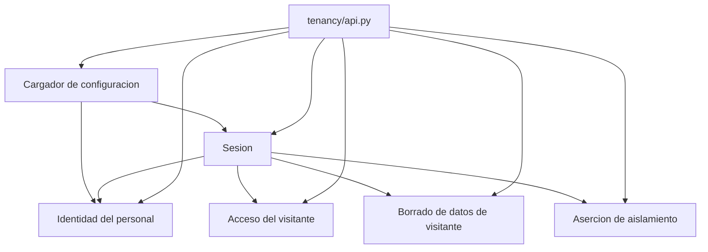

# Componentes lógicos — U2 `tenancy`

Cómo se reparte por dentro el módulo `tenancy`, y qué expone hacia fuera. Es la
estructura que hace comprobables las reglas de dependencia: las fronteras de
abajo son las que vigila el contrato de importación.

**Fuentes consumidas.** `./security-design.md` (las cuatro capas),
`../functional-design/functional-spec.md` (los siete flujos),
`../functional-design/entities.md` (las ocho entidades) y
`../../../inception/contract-design/contract-summary.md` (C-07, C-10, C-11,
C-25).

## Las seis piezas

| Pieza | Qué hace | Qué expone hacia fuera |
| --- | --- | --- |
| **Cargador de configuración** | Lee y valida las carpetas por aseguradora; deja la configuración en memoria | La configuración de una aseguradora, de solo lectura |
| **Sesión** | Punto único: resuelve la aseguradora, abre transacción, fija la variable de sesión, cierra | `session_for(tenant_id)` y `current_tenant()` |
| **Aserción de aislamiento** | Pregunta al catálogo vivo y al rol vivo; compone el informe | `assert_rls_complete()` |
| **Identidad del personal** | Emite y verifica la credencial de bandeja; consulta la tabla de permisos | Verificación de credencial y comprobación de permiso |
| **Acceso del visitante** | Emite y canjea enlaces de caso; emite y reconoce claves de navegador | Canje de enlace y resolución de clave de navegador |
| **Borrado de datos de visitante** | Declara el contrato y aporta los dos purgadores de U2 | El `Protocol` del purgador y el registro explícito |

## Cómo dependen entre sí

<!-- Text fallback: el cargador de configuración no depende de nada y alimenta a la sesión y a la identidad del personal. La sesión depende del cargador y alimenta a la identidad del personal, al acceso del visitante, al borrado de datos de visitante y a la aserción de aislamiento. La superficie pública del módulo depende de las seis piezas y es lo único que ven las demás unidades. -->

Tres reglas de dirección, todas comprobables por el contrato de importación:

1. **El cargador no depende de nada del módulo.** Es la raíz: si dependiera de
   la sesión, arrancar requeriría base de datos y la validación de
   configuración dejaría de poder correr sola.
2. **Todo lo que toca la base pasa por la pieza de sesión.** Ninguna otra pieza
   del módulo, ni de ningún otro módulo, construye un motor o una sesión.
3. **Solo la superficie pública sale del módulo.** Las demás unidades importan
   esa superficie y nunca una pieza interna; el contrato de importación falla si
   alguien lo intenta.

## Lo que ve el resto del aplicativo

Una sola superficie, tal como fija el contrato C-10: tipos congelados y firmas,
no un documento aparte. Las veinte unidades que vienen detrás consumen esto y
nada más:

- La sesión con la aseguradora ya fijada.
- La aserción de aislamiento, que corre en la verificación y al arrancar.
- La verificación de credencial y la comprobación de permiso.
- El canje de enlace y la resolución de clave de navegador.
- El `Protocol` del purgador y el registro donde cada dueño de datos se apunta.

## Dónde vive en el código

| Pieza | Ruta |
| --- | --- |
| Superficie pública | `app/backend/src/untangle/tenancy/api.py` |
| Las seis piezas | `app/backend/src/untangle/tenancy/` |
| Migraciones de esta unidad | `app/backend/migrations/` |
| Configuración por aseguradora | `app/config/tenants/<aseguradora>/` |
| Pruebas | `app/backend/tests/unit/tenancy/`, `app/backend/tests/integration/u2/` |

El árbol de los quince módulos ya existe vacío desde U1, con sus contratos de
importación escritos: U2 añade código dentro de un directorio que ya está
vigilado, en vez de crear el directorio y la regla a la vez.
