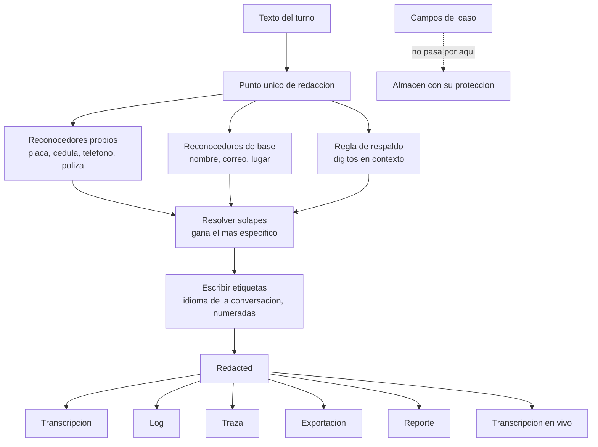

# Especificación funcional — U3 `pii-redaction`

Cómo se comporta la redacción, paso a paso. `entities.md` fija la forma de los
datos y `rules.md` las reglas; aquí está el orden en que ocurren las cosas.

**Esta unidad no tiene máquina de estados y no debería tenerla.** Nada en ella
tiene ciclo de vida: entra un texto, sale un texto tapado, y no queda nada. Se
dice explícitamente porque la plantilla de la etapa pide la máquina de estados
cuando la hay, y una inventada aquí sería ruido que alguien intentaría
implementar.

## Flujo 1 — Redactar un turno antes de guardarlo

El camino principal. Lo recorre cada turno del asegurado, por chat o por voz.

1. El punto único de salida del turno recibe el texto final y el idioma de la
   conversación (C-14).
2. Llama a `redact(text, language=...)`.
3. El detector carga **los dos juegos de reconocedores**, el español y el
   inglés. Si no puede cargarlos, va al Flujo 4.
4. Corren los reconocedores propios **de los dos idiomas** (placa, cédula,
   teléfono, póliza), que son por formato, y los del detector de base (nombre,
   correo, lugar) **solo en el idioma del turno**, porque vienen de un modelo de
   lenguaje. El idioma de la conversación no elige qué **formatos** se buscan:
   elige qué modelo se consulta y en qué idioma se escribe la etiqueta. Si solo corriera el juego del turno, una cédula dictada en español
   dentro de un turno en inglés saldría en claro y BR2.3, que es compuerta dura,
   fallaría siempre (BR2.9).
5. Corre la **regla de respaldo**: secuencias largas de dígitos junto a una
   frase de contexto declarada, que ningún reconocedor haya reclamado.
6. Los hallazgos que se solapan se resuelven quedándose con el más específico:
   un número de póliza dentro de una secuencia que el respaldo también reclamó
   se tapa como póliza, no como `unclassified`. El respaldo nunca gana.
7. Cada hallazgo se sustituye por su etiqueta, escrita en el idioma de la
   conversación y numerada por tipo (BR3.2, BR3.3). **La numeración vale dentro
   de este texto y empieza de nuevo en la siguiente llamada**: el mismo valor
   repetido aquí conserva su número, pero el mismo teléfono en otro turno puede
   llevar otro. Mantenerlo entre turnos exigiría guardar la correspondencia
   entre el valor real y su número, que es la bóveda que BR1.6 prohíbe.
8. Vuelve un `Redacted`.
9. El punto de salida escribe: transcripción, traza y log llevan el texto
   tapado; **los campos estructurados del caso no pasan por aquí** y guardan el
   dato en claro (BR1.5).

**Lo que hace que este flujo importe** no es ninguno de sus nueve pasos, sino el
paso 8: `Redacted` es lo único que los puntos de salida aceptan. Ojo con cómo se
enuncia eso, porque es donde la revisión encontró el hueco: el tipo **señala** la
obligación, pero quien la **impone** es el chequeo de BR1.8, porque `NewType` no
existe en tiempo de ejecución.

## Flujo 2 — La transcripción en vivo de la consola

La consola muestra transcripción parcial mientras el asegurado habla. Un
teléfono llega dígito a dígito, así que un fragmento puede contener media
cédula que todavía no tiene forma de cédula.

1. Llega un fragmento parcial.
2. Se acumula con lo anterior de la misma frase.
3. Se redacta **lo acumulado**, no el fragmento suelto: un reconocedor necesita
   el dato entero para reconocerlo.
4. La consola muestra la porción de lo acumulado que ya está a salvo, es decir,
   hasta el último punto donde ningún hallazgo quedaría cortado por la mitad.
5. Al cerrar la frase, el texto final vuelve a pasar por el Flujo 1.

La regla que gobierna este flujo es **BR3.5**, y su prueba alimenta un teléfono
dígito a dígito exigiendo que ningún fotograma intermedio de la salida contenga
dos dígitos consecutivos del número sembrado.

**Los dígitos nunca se muestran y luego se tapan.** AC4.12.3 dice "nunca con sus
dígitos", y una consola que enseñe el número y lo cubra medio segundo después ya
lo enseñó: cualquiera que estuviera mirando lo leyó, y la captura de pantalla lo
conserva. El costo aceptado es que la transcripción en vivo va un poco por
detrás de la voz cuando se está dictando un dato.

## Flujo 3 — El informe de medición

Separado del tapado a propósito: medir no puede obligar a conservar lo medido.

1. Se llama a `redaction_report(text, language=...)`.
2. Devuelve el conteo por tipo de entidad, el conteo por reconocedor y la cifra
   del respaldo, **aparte**.
3. El reporte de evaluaciones lo publica por idioma y por tipo, lado a lado y
   sin promedio combinado (BR4.1).
4. Un tipo con cero hallazgos aparece con su cero. Un tipo **ausente** del
   informe es otra cosa y significa que su reconocedor no cargó.

## Flujo 4 — Cuando el detector no carga

1. El detector no puede cargar sus reconocedores, o la ejecución falla.
2. `redact` **no devuelve texto**. Levanta el fallo.
3. El punto de salida responde con la clave de degradación del catálogo, en el
   idioma de la conversación.
4. Queda un valor distinguible en el caso y un evento en la traza con la causa.

No hay camino en el que un fallo del detector produzca texto sin tapar. Fallar
cerrado es la única opción admitida (BR1.7, C-13).

## Flujo 5 — Cómo se comprueba que no existe salida sin redacción

Esto no es conducta del sistema en ejecución, es la comprobación que sostiene
AC4.12.2, y se describe aquí porque sin ella las reglas del grupo 1 serían una
declaración.

1. El registro de puntos de salida declara los seis, con su superficie y su
   unidad dueña.
2. La regla de importación prohíbe que cualquier módulo fuera de ese registro
   escriba hacia una superficie de salida.
3. Un segundo chequeo, de análisis estático, prohíbe invocar el constructor de
   `Redacted` fuera de `compliance/redaction/api.py` (BR1.8). **Hace falta
   porque el tipo por sí solo no garantiza nada**: `NewType` no existe en tiempo
   de ejecución, así que `Redacted(texto_sin_tapar)` es una llamada legal que el
   comprobador de tipos acepta. Sin este chequeo, "imposible por construcción"
   sería "improbable por costumbre".
4. Una prueba **planta un escritor que no pasa por la redacción**, y otra planta
   esa llamada al constructor, y ambas exigen que el chequeo falle. Una regla
   que nunca se ha visto fallar no es una regla comprobada: es una regla que se
   supone que funciona.
5. Una prueba más comprueba que el árbol correcto pasa, para que un fallo del
   andamiaje no se confunda con un chequeo que funciona.

## Cómo encajan las piezas

**El mismo diagrama en palabras**, para quien no vea la imagen: el texto del
turno entra por un único punto de redacción. Ese punto corre tres cosas en
paralelo —los cuatro reconocedores propios del dominio, los del detector de base
y la regla de respaldo—, resuelve los solapes quedándose con el hallazgo más
específico, y escribe las etiquetas en el idioma de la conversación, numeradas
por tipo. El resultado es un `Redacted`, y es lo único que aceptan las seis
superficies de salida: transcripción, log, traza, exportación, reporte y
transcripción en vivo. Los campos estructurados del caso **no** pasan por este
camino: van directos a su almacén, donde su protección es la que fija la tabla
de almacenes.

## Resumen de reglas

Derivado de `rules.md`, que es la fuente.

| Grupo | Reglas | De qué responden |
| --- | --- | --- |
| El punto único de salida | BR1.1 – BR1.8 | Que no se pueda escribir hacia afuera sin pasar por aquí, y que un fallo no produzca texto |
| Los reconocedores | BR2.1 – BR2.9 | Cuatro tipos, dos idiomas, tres formas de escribir cada dato, y el turno mixto |
| Las etiquetas | BR3.1 – BR3.5 | Qué lee una persona en lugar del dato |
| La medición | BR4.1 – BR4.6 | Que el número publicado no esconda un reconocedor roto |

## Decisiones de esta etapa

| # | Decisión | Por qué | Quién |
| --- | --- | --- | --- |
| FD-U3-1 | La unidad no tiene máquina de estados, y se dice explícitamente | Nada aquí tiene ciclo de vida. Una máquina inventada sería ruido que alguien intentaría implementar | Claude |
| FD-U3-2 | El tapado es irreversible: sin bóveda de tokens ni correspondencia guardada | Una vía de vuelta sería el único sitio del sistema con todos los datos personales juntos. El dato que el caso necesita ya vive en sus campos estructurados | Claude |
| FD-U3-3 | Un reconocedor es configuración versionada con cinco campos obligatorios, no código | Añadir un formato no debe ser un cambio de lógica, y el mecanismo declarado es lo que permite a U21 comprobar que su detector no comparte mecanismo con este | Claude |
| FD-U3-4 | El respaldo se cuenta en su propia cifra, nunca sumado a un tipo | Un respaldo que dispara mucho es la señal de que un reconocedor se rompió; sumarlo la borraría | Claude |
| FD-U3-5 | En un solape gana el hallazgo más específico; el respaldo nunca gana | Sin esta regla, una póliza dentro de una secuencia larga se etiquetaría como dato sin clasificar y la medición por tipo perdería un acierto real | Claude |
| FD-U3-6 | La consola retrasa el fragmento en vez de mostrarlo y taparlo después | AC4.12.3 dice "nunca con sus dígitos". Un número mostrado medio segundo ya se leyó, y la captura de pantalla lo conserva | Claude |
| FD-U3-7 | La etiqueta se escribe en el idioma de la conversación y se guarda ya escrita | Un `[PHONE]` dentro de prosa en español se lee peor que un `[TELÉFONO]`, y un renglón de log se lee fuera del aplicativo, sin catálogo que resolver | Miguel (norma de legibilidad), aplicada por Claude |
| FD-U3-8 | Los reconocedores apuntan a formatos reales de Colombia y EE. UU. | Por el chat público entran datos de personas reales; un reconocedor que solo conozca un formato inventado los deja pasar | Miguel (Q2) |
| FD-U3-9 | Existe una regla de respaldo por contexto | Cubre el formato que nadie previó, que es por donde se escapan las cosas. El costo aceptado es alguna redacción de más | Miguel (Q3) |
| FD-U3-10 | La numeración de etiquetas vale dentro de una llamada, no de la conversación | Mantenerla entre turnos exige guardar la correspondencia entre el valor real y su número, que es la bóveda que BR1.6 prohíbe. Donde de verdad sirve —distinguir el teléfono del asegurado del del testigo— es dentro del mismo turno | Claude, tras el hallazgo R-01 |
| FD-U3-11 | El control del punto único no es el tipo, es un chequeo de análisis estático | `NewType` no existe en tiempo de ejecución y no impide fabricar un `Redacted` falso. Dejar la garantía apoyada en el tipo sería escribir un control que no existe | Claude, tras el hallazgo R-02 |
| FD-U3-12 | La configuración de reconocedores vive en `compliance/redaction/recognizers/<idioma>.yaml`, y U21 la lee como archivo | U21 necesita esa configuración para AC4.14.1 pero no puede importar este módulo (BR4.6). Un archivo versionado satisface las dos cosas | Claude, tras los hallazgos R-05 y R-06 |
| FD-U3-13 | Los reconocedores de los dos idiomas corren siempre; el idioma del turno solo decide la etiqueta | Cargar solo el juego del turno haría que BR2.3, la compuerta dura contra evadir cambiando de idioma, fallara por construcción y no por un error de configuración | Claude, en la revisión a fondo |

## Lo que esta unidad no hace

- **El segundo detector** (U21). Mecanismo distinto a propósito, y no importa
  este módulo. U21 necesita la configuración de reconocedores de esta unidad
  para comprobar `AC4.14.1` —que los dos detectores no comparten mecanismo ni
  reconocedores— y la lee **como archivo versionado** en
  `compliance/redaction/recognizers/<idioma>.yaml`, sin pasar por ninguna
  interfaz de U3. **La ficha de U21 en `unit-of-work.md` no declara esta
  dependencia** (lista U1, U5, U7 y U9); queda anotado aquí para su etapa de
  diseño, porque corregir la ficha de otra unidad aprobada no es trabajo de
  esta.
- **Las pantallas** que muestran la transcripción (U6, U14, U16); esta unidad
  entrega el texto tapado, no lo dibuja.
- **Guardar** cualquier cosa. Ni el texto, ni los hallazgos, ni el informe.
- **Decidir qué es un punto de salida nuevo**: lo declara la unidad que lo crea,
  en el registro que esta unidad define.
