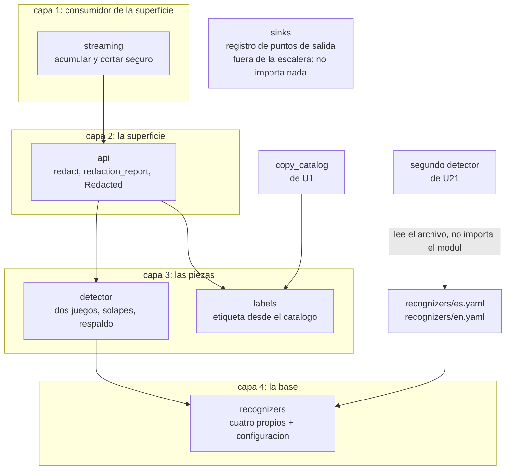

# Componentes lógicos — U3 `pii-redaction`

En qué piezas se reparte el módulo y qué puede importar cada una. Todo vive bajo
`app/backend/src/untangle/compliance/redaction/`.

## Las seis piezas

| Pieza | De qué responde | Qué **no** hace |
| --- | --- | --- |
| `api` | La superficie del módulo: `redact()`, `redaction_report()` y el tipo `Redacted`. Es el **único** sitio que construye `Redacted` | No detecta ni escribe etiquetas; delega |
| `detector` | Cargar los dos juegos, correr los reconocedores y el respaldo, resolver solapes | No conoce el catálogo de textos ni las superficies de salida |
| `recognizers` | Los cuatro reconocedores propios y la carga de su configuración versionada por idioma | No decide cuándo corren |
| `labels` | Escribir la etiqueta desde el catálogo, en el idioma de la conversación, y numerarla por tipo | No sabe qué se detectó ni por qué |
| `streaming` | La acumulación del fragmento parcial y el corte seguro | No redacta: llama a `api` con lo acumulado |
| `sinks` | El registro de los seis puntos de salida, con su superficie y su unidad dueña | No escribe en ninguno; solo los declara |

## Qué puede importar qué

```
compliance.redaction.streaming
compliance.redaction.api
compliance.redaction.detector | compliance.redaction.labels
compliance.redaction.recognizers
```

Cuatro capas, de arriba abajo. Una pieza puede importar las de abajo y nunca las
de arriba ni las de su mismo renglón. El contrato de importación lo hace
cumplir, con la misma forma que el contrato interno de `tenancy` en U2.

**`streaming` va arriba de `api`, y esto es una corrección de la revisión.** La
primera versión de este documento ponía `api` en la cima y `streaming` en la
capa de en medio, pero el Flujo 2 exige que `streaming` llame a `redact()`: la
regla escrita y el flujo obligatorio no podían cumplirse a la vez, y el contrato
habría bloqueado la llamada el día de implementarlo. `streaming` es un
**consumidor** de la superficie que vive dentro del mismo paquete, no una pieza
interna por debajo de ella.

**`sinks` queda fuera de la escalera**, con su propio contrato prohibido: **no
importa ninguna otra pieza del módulo**. Colocarlo en una capa le habría dado
permiso para importar las de abajo, y el registro que declara los puntos de
salida no puede llamar a la redacción: sería un séptimo punto de salida
encubierto.

**Y `labels` no puede importar `detector`**, por estar en su mismo renglón.
Escribir la etiqueta no puede depender de por qué se detectó algo, que es lo que
impide que un día la etiqueta lleve "una pista" del valor original para ayudar a
depurar.

## Cómo se ve entero



**El mismo diagrama en palabras**, para quien no vea la imagen: la superficie del
módulo (`api`) llama a `detector` para encontrar los datos y a `labels` para
escribir las etiquetas. `streaming` está **por encima** de la superficie: acumula el
fragmento parcial y llama a `api` con lo acumulado, y por eso ocupa la capa
superior y no la de en medio. `sinks` queda fuera de la escalera: solo declara
los seis puntos de salida y tiene prohibido importar cualquier otra pieza. Abajo, `detector` se apoya en
`recognizers`, que carga su configuración de dos archivos por idioma, y `labels`
se apoya en el catálogo de textos que construyó U1. El segundo detector, que es
de U21, **lee esos archivos de configuración y no importa ninguna pieza de este
módulo**.

## Dónde encaja cada control

| Pieza | Controles que sostiene |
| --- | --- |
| `api` | SEC-U3.1, SEC-U3.2, SEC-U3.7, SEC-U3.8, SEC-U3.10 |
| `detector` | SEC-U3.4, SEC-U3.6, SEC-U3.9, SEC-U3.12 |
| `recognizers` | SEC-U3.5, SEC-U3.15 |
| `labels` | SEC-U3.13, SEC-U3.14 |
| `streaming` | SEC-U3.11 |
| `sinks` | SEC-U3.1, SEC-U3.3 |

## Lo que este módulo no contiene

- **El segundo detector** (U21), con mecanismo distinto a propósito.
- **Las pantallas** que muestran el texto tapado (U6, U14, U16). Esta unidad
  entrega el texto y el aviso de que viene más; dibujarlo es de ellas.
- **Los puntos de salida en sí**: cada unidad dueña implementa el suyo exigiendo
  `Redacted`. Aquí solo vive el registro que los declara.
- **Cualquier cliente de red o de modelo de lenguaje** (ADR-013). El contrato de
  importación lo prohíbe dentro de este módulo.
