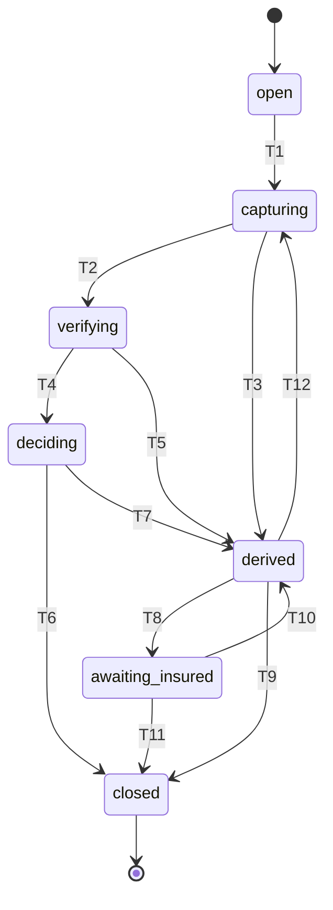
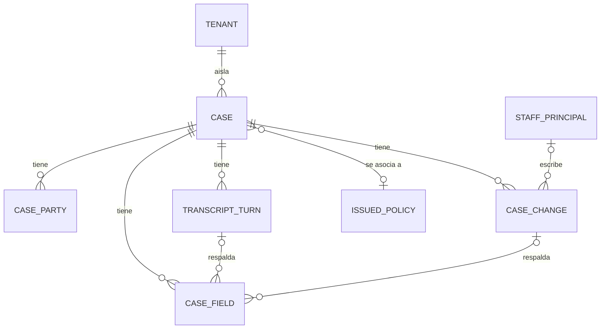

# Especificación funcional — U4 `case-record`

Este documento es la **fuente de verdad de los flujos y del modelo de estados**
de la unidad: la tabla de transiciones y las secuencias numeradas de cada caso de
uso viven aquí y en ningún otro sitio. El modelo de datos vive en
[`entities.md`](entities.md) y las reglas en [`rules.md`](rules.md); lo que este
documento muestra de esos dos —el diagrama de entidades y el resumen de reglas—
es **derivado** y se corrige allí, no aquí.

## 1. Qué hace esta unidad

Guarda el caso y lo defiende. Tres cosas, en orden de importancia:

1. **Nada se anota sin evidencia.** Cada campo dice qué se sabe, cuán seguro
   está y qué turno o qué persona lo respalda.
2. **Ningún caso llega a un estado por un camino que nadie diseñó.** Las
   transiciones viven en una tabla versionada y todo lo demás se rechaza dejando
   escrito el intento.
3. **Ningún caso se cierra a ciegas.** Cerrar exige los cinco adjuntos, y lo que
   se comprobó queda guardado con el caso.

Lo que **no** hace: no decide cuándo transitar —eso lo aplica U12 `graph-runtime`
recorriendo esta tabla—, no evalúa reglas de la aseguradora (U9), no redacta
(U3, que esta unidad consume) y no aporta el esquema de la solicitud de
cotización (U19).

## 2. Modelo de estados

### La tabla de transiciones

Es la fuente de verdad. El diagrama que va después se genera desde ella y se
compara con lo versionado; si divergen, falla (enmienda de ADR-005).

| # | Desde | Hacia | Cuándo | Condición |
| --- | --- | --- | --- | --- |
| T1 | `open` | `capturing` | Llega el primer turno de la persona | — |
| T2 | `capturing` | `verifying` | La captura cierra un bloque y el ritmo de fondo va a verificar la póliza | — |
| T3 | `capturing` | `derived` | Cumplimiento deriva durante la captura | Motivo declarado (BR3.7) |
| T4 | `verifying` | `deciding` | La verificación terminó y las reglas evalúan | — |
| T5 | `verifying` | `derived` | Cumplimiento deriva durante la verificación | Motivo declarado |
| T6 | `deciding` | `closed` | Las reglas resuelven y cumplimiento cierra | Resolución y los cinco adjuntos (BR3.4, BR6.3) |
| T7 | `deciding` | `derived` | Las reglas piden que lo revise una persona | Motivo declarado |
| T8 | `derived` | `awaiting_insured` | El ajustador necesita un dato que solo el asegurado tiene | — |
| T9 | `derived` | `closed` | El ajustador decide desde la bandeja | Resolución y los cinco adjuntos |
| T10 | `awaiting_insured` | `derived` | El asegurado respondió y el caso vuelve a la bandeja | — |
| T11 | `awaiting_insured` | `closed` | Se cierra sin más respuesta del asegurado | Resolución y los cinco adjuntos |
| T12 | `derived` | `capturing` | La persona retoma una llamada cortada por el límite de la demostración | Las cuatro a la vez (BR3.3) |

Cualquier pareja que no esté en esta tabla se rechaza: el caso no cambia y se
anexa una entrada de tipo transición rechazada con los dos estados (BR3.2). El
estado `closed` es terminal: ninguna fila sale de él.

### Qué significa "única vuelta atrás"

ADR-005 dice que la única vuelta atrás es de `derived` a `capturing`. Esta etapa
lo interpreta como **volver a poner el caso en manos de la persona para seguir
capturando**, que es de lo que habla el contexto de esa decisión: la llamada se
cortó por el límite de tres minutos y la persona vuelve a llamar dentro de
quince minutos.

T10 (`awaiting_insured` → `derived`) no es una vuelta atrás en ese sentido: el
caso no sale de la bandeja ni vuelve a la captura, solo deja de esperar. Sin esa
fila, un caso que espera un dato del asegurado no tendría manera de volver a
decidirse, que es justo la cifra que AC1.14.4 quiere en cero.

### Diagrama del ciclo de vida (derivado de la tabla)

**En texto, por si el diagrama no se dibuja.** El caso nace en `open` y pasa a
`capturing` con el primer turno. Desde `capturing` sigue a `verifying`, y de ahí
a `deciding`, y de ahí a `closed`. Desde cualquiera de esos tres puede salir a
`derived` si cumplimiento deriva. Un caso `derived` puede cerrarse, puede pasar a
`awaiting_insured` mientras se espera un dato del asegurado, o —única vuelta a la
captura— volver a `capturing` con las cuatro condiciones del límite de la
demostración. Desde `awaiting_insured` se vuelve a `derived` o se cierra.
`closed` es terminal.

### Resoluciones

Un caso `closed` lleva exactamente una: `registered` (quedó registrado),
`approved` (aprobado), `rejected` (rechazado) o `sent_to_insurer` (enviado a la
aseguradora emisora, que es lo que hace siempre Knotwell). La etiqueta que ve una
persona sale del catálogo de textos en su idioma; el valor del enum no se imprime
nunca (BR3.6).

## 3. Flujos

### F1 — Crear un caso

1. El llamador pide un caso con: tipo de registro, canal, origen e idioma.
2. Se comprueba que el tipo esté entre los tres declarados (BR1.1) y que el
   esquema versionado declare al menos un campo para él (BR1.6).
3. Se comprueba que el canal y el origen estén en sus conjuntos (BR4.4, BR4.5).
4. Se lee el prefijo de tres letras de la configuración de la aseguradora de la
   sesión; si no lo declara, el arranque ya había fallado (BR4.1).
5. Se genera un número de seis dígitos que no exista en esa aseguradora y se
   compone el número de caso (BR4.3).
6. El caso nace en `open`, con prioridad `normal`, sin resolución, sin motivo de
   derivación y sin evidencia de cierre.
7. Se crea un campo en estado `not_stated` por cada campo que el esquema declara
   para el tipo.
8. Se devuelve la vista del caso, con completitud 0 sobre el total de su tipo.

**Si falla:** el tipo desconocido, el esquema vacío, el canal o el origen fuera
de su conjunto rechazan la creación nombrando qué se pidió y qué es válido. No se
crea un caso a medias.

### F2 — Anotar un campo desde la conversación

1. El llamador pide escribir un campo con: clave, valor, estado pedido (`stated`
   o `confirmed`) y el turno que lo respalda.
2. Se comprueba que la clave esté declarada para el tipo del caso (BR1.3).
3. Se comprueba que el turno exista y pertenezca a este caso (BR2.4).
4. Si el estado pedido es `confirmed` y el campo es `injuries`, `location` o
   `vehicle_and_driver`, se exige la marca de lectura de confirmación; sin ella
   el campo se queda en `stated` (BR2.2).
5. Si el valor es una negación explícita —"ninguno", "cero"— se exige que venga
   de un turno; nunca se escribe por omisión (BR2.3).
6. Se escribe el valor, el estado y el identificador del turno como evidencia, y
   se deja vacía la evidencia del historial.
7. Se anexa una entrada de historial con el valor anterior, el nuevo, el actor y
   el canal (BR5.1).
8. Se recalcula la completitud y se devuelve.

### F3 — Registrar las otras partes

1. El llamador pide añadir una parte con su rol —lesionado, testigo, otro
   conductor u otro vehículo— y los atributos que se sepan.
2. Los atributos que no se sepan quedan vacíos: no se rellena ninguno con un
   valor supuesto (BR1.8).
3. La parte se guarda colgando del caso y se devuelve su identificador.
4. Cuando el bloque de otras partes se cierra, el campo `other_parties` se anota
   por F2 con el turno que lo respalda: con las partes registradas, o con
   "ninguno" si la persona dijo que no hubo otro vehículo ni lesionados
   (AC1.8.4).
5. Recuperar el caso devuelve todas sus partes con todos sus atributos (BR1.7).

**Por qué el paso 4 es aparte.** Un caso con cero partes y un caso donde la
persona dijo que no hubo otras partes son distintos. El primero no cuenta como
completo; el segundo sí, porque tiene evidencia.

### F4 — Aplicar una transición

1. El llamador pide llevar el caso a un estado, con su actor.
2. Se busca la pareja (estado actual, estado pedido) en la tabla de
   transiciones.
3. **Si no está:** el caso no cambia, se anexa una entrada de tipo transición
   rechazada con los dos estados y el actor, y se lanza el error propio de
   transición inválida. El llamador no lo captura para seguir adelante (BR3.2,
   convención 8b del equipo).
4. **Si está y lleva condición**, se evalúa; si no se cumple, el paso 3 otra vez.
5. **Si está y la condición se cumple:** se escribe el estado nuevo y se anexa
   una entrada de tipo transición aplicada.
6. Si el destino es `derived`, se exige motivo del conjunto cerrado (BR3.7), y si
   el motivo es `person_requested` la prioridad pasa a `high` (BR3.8). Ningún
   campo, parte ni turno se toca (BR3.9).
7. Si el destino es `closed`, se aplica F7 antes de escribir el estado.

### F5 — Retomar un caso derivado por el límite de la demostración

Es la transición T12 y la única que devuelve el caso a la captura.

1. El llamador pide la vuelta de `derived` a `capturing`, con la clave del
   navegador y el momento actual.
2. Se comprueban las cuatro condiciones, **todas**: el motivo de derivación es
   `demo_limit`; han pasado quince minutos o menos desde el fin de la llamada; la
   clave del navegador es la misma que abrió el caso; y no hay decisión iniciada.
3. Si falta cualquiera, se rechaza dejando entrada, y el caso sigue en `derived`.
4. Si se cumplen las cuatro, el caso vuelve a `capturing` conservando todo lo
   capturado, y U12 `graph-runtime` retira la pausa de la bandeja.

**Los bordes se prueban con reloj inyectado en 14:59 y en 15:01** (ADR-005): a
los 14:59 se retoma, a los 15:01 no. Un borde que solo se prueba "por dentro"
no prueba el borde.

### F6 — Corregir un campo desde la bandeja

1. Una persona de la aseguradora, identificada, pide cambiar el valor de un
   campo.
2. Se comprueba que la clave esté declarada para el tipo del caso.
3. Se anexa primero la entrada del historial, con el valor anterior, el nuevo, el
   identificador de la persona y sin canal —una corrección de la bandeja no viene
   de una conversación (BR5.2).
4. Se escribe el campo en estado `confirmed`, con esa entrada del historial como
   evidencia, la evidencia de turno vacía y la marca de confirmación en voz alta
   vacía (BR2.5).
5. Se recalcula la completitud.

**Por qué el historial va primero.** La entrada es la evidencia del campo. Si se
escribiera el campo antes, existiría un instante con un campo confirmado que no
apunta a nada.

### F7 — Cerrar un caso

1. El llamador pide cerrar con una resolución y la evidencia de cierre que le
   entrega el nodo de cumplimiento.
2. Se comprueba que la resolución esté en el conjunto cerrado (BR3.4).
3. Se comprueban los cinco adjuntos. Cada uno está en `present`, `empty` o
   `not_evaluated`:
   - `present` y `empty` dejan cerrar.
   - `not_evaluated` **no**: el cierre se rechaza dejando entrada con el nombre
     del adjunto que faltaba (BR6.3, BR5.4).
4. Se escribe el estado `closed`, la resolución, el momento del cierre y la
   evidencia de cierre, que a partir de ahí no cambia (BR6.4).

**La diferencia entre vacío y no evaluado.** Una consulta de cobertura que no
disparó ninguna regla tiene el adjunto de reglas en `empty`: se miró y no había.
Un caso cuyo nodo de reglas falló lo tiene en `not_evaluated`: nadie miró.
Colapsarlos dejaría cerrar casos que nadie revisó, que es exactamente lo que
FR1.7 quiere impedir.

### F8 — Borrar los casos de visitante en el reinicio nocturno

1. El reinicio nocturno de U20 llama al purgador que esta unidad registra.
2. El purgador recorre las aseguradoras una por una, porque la política de fila
   sigue aplicándose para borrar.
3. Borra los casos cuyo origen es `public_chat` o `public_voice_console` y
   anteriores al corte, con sus campos, partes, turnos e historial (BR4.6).
4. Conserva los de origen `local_deployment` y `generator`, y los reporta como
   conservados.
5. Las cinco tablas llevan la marca de dato de visitante, así que la prueba de U2
   que interroga al catálogo de la base falla si alguna quedara sin purgador
   (BR7.2).

## 4. Modelo de entidades (derivado de `entities.md`)

**En texto, por si el diagrama no se dibuja.** Una aseguradora aísla muchos
casos. Un caso tiene muchos campos, muchas partes, muchos turnos de
transcripción y muchas entradas de historial, y se asocia a lo sumo a una póliza
emitida. Un campo lo respalda un turno o una entrada del historial, nunca los
dos. Una persona de la bandeja escribe entradas del historial.

`TENANT`, `ISSUED_POLICY` y `STAFF_PRINCIPAL` son de otras unidades —U2, U8 y
U2— y aparecen solo para mostrar por dónde sale el caso hacia ellas.

## 5. Reglas (resumen derivado de `rules.md`)

Cuarenta y dos reglas en siete familias:

| Familia | Cuántas | De qué responde |
| --- | --- | --- |
| BR1 | 8 | Esquema por tipo de registro, campos declarados y grupos repetibles |
| BR2 | 8 | Estado de cada campo, su evidencia y el cálculo de la completitud |
| BR3 | 9 | Modelo cerrado de estados, transiciones, resoluciones y derivación |
| BR4 | 6 | Número de caso legible, canal y origen |
| BR5 | 4 | Historial de cambios, incluidos los rechazos |
| BR6 | 4 | Transcripción redactada y los cinco adjuntos del cierre |
| BR7 | 3 | Aislamiento por aseguradora y borrado de datos de visitante |

Las que más peso cargan: **BR2.4** (todo campo dicho lleva exactamente una
evidencia), **BR3.2** (transición no declarada se rechaza dejando evento) y
**BR6.3** (cerrar exige los cinco adjuntos y vacío no es lo mismo que no
evaluado).

## 6. Decisiones de esta etapa

Las cuatro primeras las respondió Miguel; las cinco siguientes las resuelve esta
etapa aplicando un requisito aprobado o una práctica afirmada, según la regla del
proyecto que reserva el visto bueno para lo que tiene dos respuestas legítimas y
cambia lo que se ve.

| ID | Decisión | Por qué | Origen |
| --- | --- | --- | --- |
| FD-U4-1 | El prefijo del número de caso es de tres letras que no se confunden: `STO`, `SUN` y `KNO` | Las maquetas usaban `SMU` y `SMA`, que se diferencian en una letra y nombran aseguradoras distintas; la agente los dicta por teléfono | Q1, Miguel |
| FD-U4-2 | Un campo cuenta como completo al alcanzar el estado que ese campo exige | Es la única lectura que hace verdaderas a la vez a ADR-005, que solo exige confirmar tres campos, y a AC1.8.4 | Q2, Miguel |
| FD-U4-3 | Un campo corregido desde la bandeja queda `confirmed`, con la entrada del historial como evidencia | Una persona identificada que teclea un valor es la evidencia más fuerte que hay, y el historial deja ver que fue ella | Q3, Miguel |
| FD-U4-4 | Los cinco adjuntos se exigen siempre; un adjunto vacío cuenta como presente | "Ninguna regla disparó" es un valor, distinto de "no se evaluaron las reglas": la misma distinción que la convención 8c del equipo ya obliga a mantener | Q4, Miguel |
| FD-U4-5 | El tipo de registro se escribe `coverage_inquiry`, no `coverage_question` | Dos documentos aprobados se contradecían. Manda ADR-005, que es donde se **decidió** el conjunto cerrado; el contrato C-12 solo lo reexpresaba. Es un valor de enum, nunca visible: la etiqueta sale del catálogo | ADR-005, contradicción con C-12 |
| FD-U4-6 | El motivo de derivación es un conjunto cerrado y versionado de tres valores | La regla de la vuelta atrás **lee** ese motivo. Un motivo en texto libre haría que un modelo declarado cerrado dependiera de una cadena que nadie controla | ADR-005, AC1.9.1, FR6.1 |
| FD-U4-7 | La consulta de cobertura declara dos campos: identidad y póliza, y la pregunta que se hizo | AC1.3.6 dice que se abre pidiendo identidad y póliza sin la pregunta de seguridad; sin el segundo campo su completitud sería 1/1 desde que la persona se identifica, y AC2.4.3 exige que se calcule según su tipo | AC1.3.6, AC2.4.3 |
| FD-U4-8 | "Única vuelta atrás" significa volver a la captura, no cualquier arista hacia un estado anterior de la lista | Sin la vuelta de `awaiting_insured` a `derived`, un caso que espera un dato del asegurado no podría decidirse nunca, y AC1.14.4 quiere esa cifra en cero | ADR-005, AC1.14.4 |
| FD-U4-9 | El caso guarda su evidencia de cierre en vez de comprobarla y olvidarla | FR1.7 exige que un caso derivado **exponga** los cinco adjuntos; comprobándolos solo en el momento del cierre, después nadie podría decir qué se comprobó | FR1.7 |

## 7. Lo que esta unidad pide a otras

| A quién | Qué | Por qué aquí no |
| --- | --- | --- |
| U2 `tenancy` | `case_number_prefix` en la configuración de cada aseguradora, con `STO`, `SUN` y `KNO` | El prefijo es dato de la aseguradora; escribirlo en el código sería la ramificación por inquilino que el proyecto prohíbe |
| U1 `workspace` | Claves del catálogo de textos para los siete estados, las cuatro resoluciones, los tres tipos de registro y los tres motivos de derivación, en los dos idiomas | Ninguna pantalla imprime el valor del enum (BR3.6) |
| U19 `quote` | La lista de campos de la solicitud de cotización | El tipo existe aquí; su esquema es de esa unidad (BR1.6) |
| U20 `demo-operations` | Llamar al purgador de esta unidad en el reinicio nocturno | El reinicio es de esa unidad; el purgador y la marca son de esta (BR7.2) |

## Sources

- `<record>/inception/requirements-analysis/requirements.md` — FR1.1 a FR1.7,
  FR9.1, NFR10, NFR18, NFR19
- `<record>/inception/user-stories/stories.md` — US1.8, US1.14, US4.10 con sus
  trece criterios; AC1.3.6, AC1.9.1, AC1.9.4, AC2.4.3, AC1.20.1, AC1.20.4,
  AC5.12.2; decisión D18
- `<record>/inception/domain-design/decisions.md` — ADR-005 y su enmienda del
  2026-09-17
- `<record>/inception/domain-design/components.md` — componente `CaseRecord` con
  sus cinco entidades
- `<record>/inception/contract-design/contract-summary.md` — C-12 (superficie de
  esta unidad), C-11 (borrado de datos de visitante), C-13 (redacción), C-25
  (configuración por aseguradora)
- `<record>/inception/units-generation/unit-of-work.md` — ficha de U4 y decisión
  UG-3
- `<record>/construction/u4-case-record/functional-design/functional-design-questions.md`
  — las cuatro respuestas de Miguel

## Assumptions & Open Questions

- El momento del "fin de la llamada" que arranca los quince minutos de la vuelta
  atrás lo aporta quien deriva por límite de la demostración; esta unidad lo
  guarda y lo compara, no lo mide. Confirmarlo al diseñar U17
  `voice-public-link`.
- El corte del reinicio nocturno —cuántas horas atrás borra— lo fija U20
  `demo-operations`; esta unidad expone el purgador y acepta el corte.
- El mecanismo de cifrado en reposo de los campos del caso queda para
  `nfr-requirements` de esta misma unidad (PA-8, C-12).
