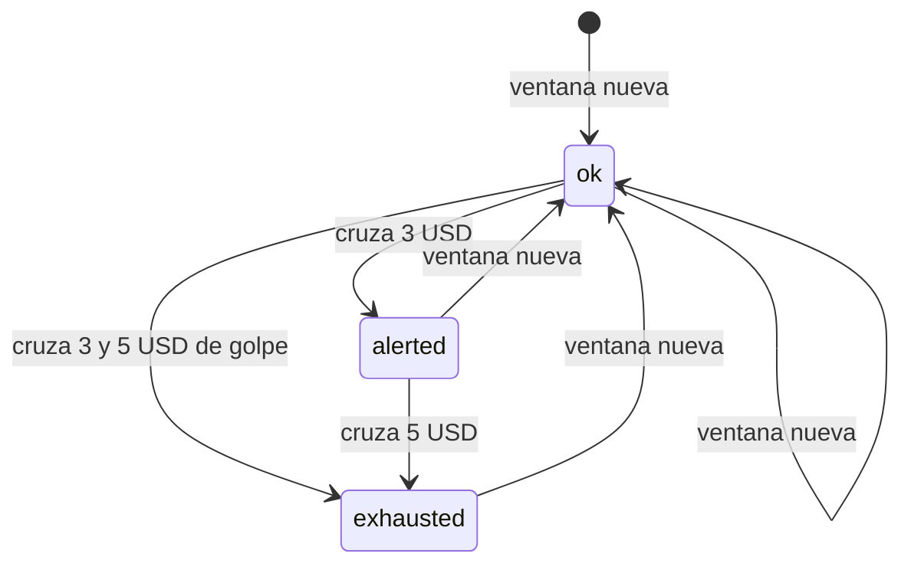
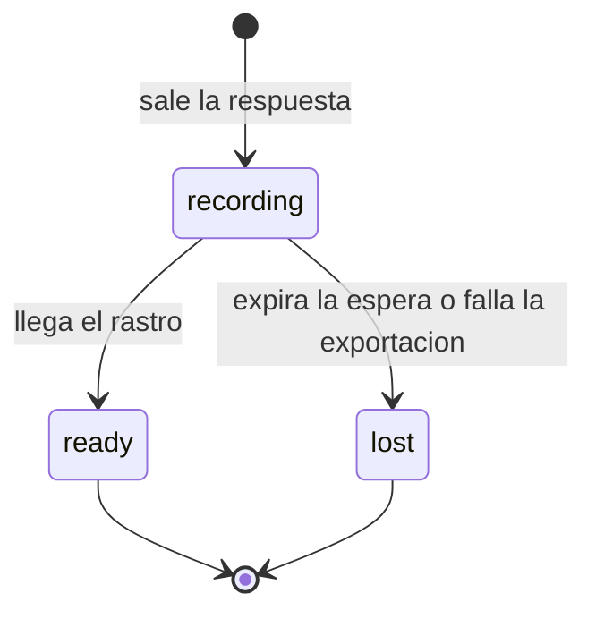
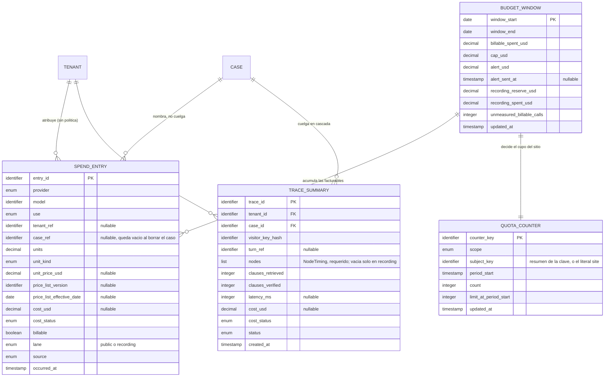

# Especificación funcional — U5 `provider-platform`

Esta unidad es la frontera con todo lo que está fuera y cuesta dinero. Por aquí
pasa cada llamada a un modelo, cada dólar que se gasta y cada rastro de lo que
pasó dentro de un turno.

Tiene una propiedad que ninguna otra unidad tiene: **su fallo no produce un
error, produce una factura**. Un corte que no corta no rompe ninguna pantalla,
no levanta ninguna excepción y no hace fallar ninguna prueba de funcionamiento;
se nota cuando llega el cobro. Por eso el corte se diseña con una fila única que
se bloquea, se incrementa en la misma transacción que el gasto y no depende de
que la observación funcione.

## 1. Qué hace esta unidad

**Hace tres cosas.**

1. **Habla con los proveedores de modelo.** Define los puertos que usa el
   núcleo, implementa el adaptador de Gemini detrás de ellos y construye un
   cliente por uso, cada uno con su clave y su proyecto. Traduce los errores del
   proveedor a cuatro tipos y se detiene sin reintentar cuando se acaba un saldo.
2. **Lleva la contabilidad.** Una fila por llamada con su costo a precio de
   lista, el acumulado de la ventana de noventa días, la alerta en 3 USD, el
   corte en 5 USD, la reserva intocable para grabar el video final y los
   contadores de cuota de la demostración.
3. **Deja rastro.** Tramos por turno, por nodo y por llamada, con las
   convenciones GenAI, exportados siempre por la redacción, y el resumen de
   traza que cada respuesta del chat enseña de sí misma.

**No hace estas.** La transcripción y la síntesis son de U15 `speech-providers`,
que construye sus adaptadores sobre estos mismos puertos. Las pantallas de gasto
y de cifras son de U22 `public-evidence`, y el resumen de traza que se ve junto a
una respuesta lo dibuja U13 `chat`. Aquí están los datos y las decisiones, no las
vistas.

**Una historia ajena pasa por aquí.** El mapa de historias asigna a U5 la
comprobación de punta a punta de US4.12 —el punto único de redacción— por el
camino de las trazas exportadas. La historia es de U3 `pii-redaction` y ahí se
queda; lo que esta unidad aporta es su mitad: toda exportación y todo resumen
pasan por la redacción antes de salir o de guardarse (BR6.5). Dos de sus cinco
criterios no son de aquí —la consola de voz es de U16 y el reporte de
evaluaciones es de U21—, y la trazabilidad lo dice en vez de reclamarlos.

**Lo que esta unidad no decide.** Qué sustituye al tope por clave donde el
proveedor no lo tiene (PA-9) se resuelve en `nfr-requirements` de esta misma
unidad; aquí se declara que el caso existe y se le da forma en la tabla de topes
(`ProviderCap.cap_kind = none_available`). El canal por el que sale la alerta lo
fija el intent `infra` (PA-10); aquí se emite el evento.

## 2. Los dos ciclos de vida

Dos cosas de esta unidad cambian de estado con el tiempo. Ninguna es un caso ni
un turno: son el presupuesto y el rastro.

### 2.1 La ventana de presupuesto

Tres estados y dos umbrales. El estado no se guarda: se **deriva** del acumulado
y de la marca de alerta, porque guardarlo abriría la posibilidad de que el
estado y el número se contradigan.

Los tres describen el **carril público**, que es el que ve un visitante. El
techo aparta una porción —la reserva de grabación— que el enlace público no
puede tocar (BR4.9), así que el presupuesto público restante es el techo menos
esa reserva menos lo que el carril público lleva gastado.

| Estado | Condición | Qué cambia para quien mira |
| --- | --- | --- |
| `ok` | Acumulado facturable menor que la alerta | Todo disponible |
| `alerted` | Acumulado igual o mayor que la alerta y menor que el techo | Igual, y la alerta ya salió una vez |
| `exhausted` | Presupuesto público restante en cero o menos | El enlace público rechaza llamadas nuevas; el chat sigue, y las llamadas de grabación siguen mientras quede reserva |

| Transición | Qué la dispara | Efecto |
| --- | --- | --- |
| `ok` → `alerted` | Una fila facturable lleva el acumulado a la alerta o por encima | Se emite la alerta **una vez** y se escribe la marca, en la misma transacción (BR4.3) |
| `alerted` → `exhausted` | Una fila facturable lleva el acumulado al techo o por encima | El cupo del sitio pasa a cero y la disponibilidad de la voz responde `budget_exhausted` (BR4.4) |
| `ok` → `exhausted` | Una sola fila cruza los dos umbrales de golpe | Se emite la alerta y se corta, en ese orden y en la misma transacción |
| cualquiera → `ok` | Empieza una ventana nueva | Acumulado en cero y marca de alerta vacía; la ventana anterior se conserva |

**No hay vuelta atrás dentro de una ventana.** El acumulado solo sube, así que
`exhausted` es terminal hasta que empieza otra ventana. Eso es deliberado: un
camino de vuelta sería un camino para desbloquear el gasto sin decidirlo.

**La reserva de grabación corre aparte.** FR3.11 —enmendada el mismo día que
FR3.9— aparta una porción del techo para grabar el video final y para la sesión
de escucha, y exige que una llamada marcada como grabación se siga atendiendo
con el cupo público agotado. Por eso `exhausted` con reserva disponible es un
estado normal y no una contradicción: el carril público está cerrado y el de
grabación no. Quién puede pedir ese carril es la otra mitad de la decisión, y no
es el visitante: la marca solo la pone quien entra con credencial de la
aseguradora (BR4.10). Una marca que el visitante pudiera poner convertiría la
reserva en presupuesto público con otro nombre. **Cuánto vale la reserva** lo
fija `nfr-requirements` de esta unidad, con los minutos que el video y la sesión
de escucha necesiten; aquí se decide que existe, dónde vive y quién la gasta.

### 2.2 El resumen de traza

| Estado | Qué significa | Qué se ve |
| --- | --- | --- |
| `recording` | La respuesta ya salió; su rastro todavía no llegó | "Registrándose" |
| `ready` | El rastro llegó completo | Nodos, cláusulas, latencia y costo |
| `lost` | El rastro no llegó y se dejó de esperar | Se dice que se perdió, y nada más se detiene |

`lost` es un **valor**, no un fallo (BR6.7). Es la misma distinción que la
convención 8c del equipo obliga a mantener entre "no hay cláusula" y "no pude
verificar": un resumen que falta por una caída del panel de trazas es distinto de
uno que nunca existió, y colapsarlos contaminaría la medición de latencias con
fallos de infraestructura.

## 3. Flujos

### F1 — Una llamada al modelo, de punta a punta

1. El nodo pide el puerto que necesita; lo recibió inyectado de la raíz de
   composición y no construye nada (BR1.1).
2. La fábrica devuelve el cliente **de ese uso**, con su clave y su proyecto
   (BR1.3).
3. Si el uso es de pago, se consulta el presupuesto **antes** de llamar. Si está
   agotado, sale la señal de parada y no hay llamada ni reintento (BR2.3, BR4.5).
4. El adaptador arma la petición con el prompt versionado de ese nodo y ese
   idioma, y anota su identificador y su hash (BR1.7).
5. Se abre el tramo de la llamada, anidado dentro del tramo del nodo, que está
   dentro del tramo del turno (BR6.1).
6. Llega la respuesta. Si se pidió salida estructurada, se valida aquí dentro; un
   fallo de validación es `invalid_response` y el objeto crudo no sale (BR1.5).
7. Si falló, el error se traduce a uno de los cuatro tipos y se emite el evento
   del intento con su número (BR2.1, BR2.5). Reintentar o no lo decide la
   política del nodo, no el adaptador (BR2.4).
8. Se cierra el tramo con modelo, tokens de entrada y de salida, latencia y
   costo (BR6.3).
9. El adaptador reporta el uso: proveedor, modelo, unidades, tipo de unidad y de
   dónde salió el recuento.
10. Se escribe la fila de gasto (F2). Ocurre **también cuando la llamada falló**,
    si consumió unidades (BR3.1).

### F2 — Registrar un gasto y cruzar un umbral

1. Llega el reporte de uso con su caso y su aseguradora, si los tiene.
2. Se busca el precio en la tabla versionada para ese proveedor, modelo y tipo
   de unidad.
3. **Si hay precio:** el costo es unidades por precio, y la fila guarda el
   precio, la versión de la lista y su fecha (BR3.2).
   **Si no lo hay:** el estado del costo es `not_measured` y las cuatro columnas
   de precio quedan vacías. Nunca cero (BR3.3).
4. La marca de facturable sale del plan del uso, que está en configuración
   (BR3.6).
5. **En una sola transacción** (BR4.6):
   - se escribe la fila de gasto;
   - si es facturable, se incrementa el acumulado de la ventana, tomando el
     bloqueo de esa fila única;
   - si es facturable y no se midió, se incrementa también el conteo de no
     medidas.
6. Todavía dentro de la transacción, se miran los umbrales:
   - si el acumulado cruzó la alerta y la marca está vacía, se emite la alerta
     una vez y se escribe la marca (BR4.3);
   - si cruzó el techo, no hace falta escribir nada más: el estado se deriva, y
     la siguiente consulta de disponibilidad ya responderá que no (BR4.4).
7. Se emite el evento de observación. **Fuera** de la transacción: si falla, el
   gasto ya está escrito y el corte ya funciona (BR4.8).

### F3 — Abrir una llamada de voz

1. La consola pregunta por la disponibilidad antes de pedir el micrófono.
2. Se resuelve primero el **carril**: `recording` si quien abre presenta
   credencial de la aseguradora y lo pide, `public` en cualquier otro caso
   (BR4.10). El enlace público siempre es `public`.
3. Se evalúan cuatro cosas, en este orden, y la primera que niegue decide:
   1. **el presupuesto del carril** — agotado, motivo `budget_exhausted`;
   2. **el cupo del sitio de hoy** — motivo `rate_limited_site`;
   3. **la llamada del día del visitante** — motivo `rate_limited_daily`;
   4. la salud del proveedor — motivo `provider_unavailable`.
4. El presupuesto va primero a propósito: es el único motivo que no tiene un
   "vuelve más tarde", y decirlo el último haría esperar a alguien que nunca va
   a poder llamar. En el carril de grabación, lo que se mira es la reserva y no
   el resto público, así que el cupo del sitio y el del visitante no aplican.
5. Si todo pasa, se decide el modo de voz: principal si el presupuesto del
   carril cubre la reserva de una llamada completa, de respaldo si no (BR5.7).
   Queda fijado.
6. Al crear la sesión, **en una sola transacción**: se incrementa el contador del
   visitante, se incrementa el del sitio y se crea la sesión (BR5.4). Dos
   pestañas que lo intenten a la vez compiten por la misma fila y una pierde.
7. La consola recibe el modo, la duración máxima y el transporte.

### F4 — Cerrar la llamada y devolver el cupo si no se gastó

1. La sesión termina, por cierre, por caída o por llegar a la duración máxima.
2. Se pregunta al registro de gasto si esa sesión dejó alguna fila de audio con
   unidades mayores que cero.
3. **Si no dejó ninguna:** se decrementa el contador del visitante y el del
   sitio. La llamada no costó nada, así que no gastó cupo (BR5.5).
4. **Si dejó alguna:** los contadores no se tocan.
5. La comprobación se hace contra el registro de gasto y no contra lo que diga
   la consola, porque la consola es de quien llama.

### F5 — El resumen de traza de una respuesta del chat

1. Sale la respuesta al visitante. El resumen se crea en `recording` con el
   identificador de la traza, el caso, el resumen de la clave del navegador y
   nada más (BR7.3).
2. La interfaz ya puede pedirlo: recibe "registrándose", que es una respuesta y
   no un hueco.
3. Cuando llega el rastro, se completan los nodos con su duración y su costo, las
   cláusulas recuperadas y verificadas, la latencia y el costo total con su
   estado.
4. Todo lo que sea texto pasa por la redacción **antes** de guardarse (BR6.5).
5. El resumen pasa a `ready`. Si el rastro no llega antes de que expire la
   espera, pasa a `lost` y nada más ocurre (BR6.7).
6. Al pedirlo, se compara el resumen de la clave del navegador que pide con el
   que guarda la fila. Si no coinciden, la respuesta es la misma que si no
   existiera (BR6.6).

### F6 — Recalcular el cupo del sitio cada día

1. Al abrir el periodo diario del alcance del sitio —lo abre la primera consulta
   del día, no un trabajo programado—, se calcula el cupo.
2. Cupo del día = el menor entre quince y el piso de dividir el presupuesto
   **público** restante —techo menos reserva de grabación menos lo gastado en el
   carril público— entre los días que faltan de la ventana multiplicados por la
   reserva por llamada (BR5.6).
3. Si el presupuesto público restante es cero o menos, el cupo es cero. Ese es
   el corte del enlace público, expresado como cupo; la reserva de grabación
   sigue intacta.
4. El cupo calculado se escribe en el contador del día, para que un rechazo se
   pueda explicar meses después con el número que de verdad regía entonces.

**Comprobación del criterio.** Con el presupuesto a la mitad y la ventana a la
mitad, el cociente da lo mismo que el primer día: el cupo alcanza para llegar al
día noventa, que es lo que pide FR3.9.

### F7 — El reinicio nocturno, visto desde esta unidad

1. U20 `demo-operations` llama al purgador que esta unidad registra en el
   contrato de borrado (C-11).
2. **Se borran:** los resúmenes de traza de los casos borrados, y se pide el
   borrado en el backend de trazas (BR7.4). Los contadores de cuota de
   visitantes y de sesiones (BR7.6).
3. **No se borran:** las filas de gasto, el acumulado de la ventana ni el
   contador del sitio (BR4.7, BR7.6).
4. Las filas de gasto que nombraban un caso borrado quedan con esa columna vacía
   y todo lo demás intacto (BR7.5). Es la única tabla de esta unidad que sobrevive
   al borrado de aquello que nombra, y por eso es la única que no cuelga en
   cascada de nada.

## 4. Modelo de entidades (derivado de `entities.md`)

Los quince objetos de valor no aparecen en el diagrama porque no se guardan.
`NodeTiming` vive dentro del resumen de traza; `Money`, `SpendTotal`,
`BudgetState` y `QuotaDecision` son lo que devuelven las operaciones; el resto
son la forma de lo que entra y sale de un adaptador.

## 5. Reglas (resumen derivado de `rules.md`)

| Familia | Reglas | De qué responde |
| --- | --- | --- |
| BR1 | 7 | Los puertos, los adaptadores, la fábrica por uso y los prompts versionados |
| BR2 | 5 | Cuatro tipos de error, ningún tipo del proveedor en el núcleo, y la parada sin reintento |
| BR3 | 9 | El precio de lista, el costo, "no medido" y lo que devuelve cada suma |
| BR4 | 10 | El techo acumulado, la alerta única, el corte, la reserva de grabación y de qué no depende |
| BR5 | 9 | Los cuatro alcances de cuota, el cupo del sitio, la reserva de la voz y los topes del proveedor |
| BR6 | 7 | Los tres niveles de traza, la grafía de los nodos y los resúmenes por navegador |
| BR7 | 6 | Por qué tres tablas no llevan aseguradora y qué se paga a cambio |

Cincuenta y tres reglas en total. `rules.md` es la fuente de verdad; esta tabla
se deriva de ella.

## 6. Decisiones de esta etapa

Las seis primeras son las preguntas del diseño funcional. Miguel delegó las seis
en la recomendación ("me voy por las recomendaciones que haces, analiza lo
lógico y vete por ello", 2026-09-21), así que quedan escritas con su razón para
poder discutirse después. Las siete siguientes las resuelve esta etapa
aplicando un requisito aprobado o una práctica afirmada; las tres últimas nacen
de los hallazgos de la revisión y llevan su identificador al lado.

| ID | Decisión | Por qué | Origen |
| --- | --- | --- | --- |
| FD-U5-1 | El dinero y las cuotas son dato del proyecto: sus tres tablas entran en la lista de exclusión del aislamiento, y a cambio una aserción nueva comprueba que ninguna tabla excluida tiene columnas de texto ni de dato personal | El techo es uno solo y AC5.14.1 pide agregaciones de todas las aseguradoras a la vez; una tabla con política no se puede sumar entera. La exclusión se paga con una prohibición más fuerte y comprobable | Q1, delegada |
| FD-U5-2 | El costo se guarda con su estado en dos columnas que viajan juntas, y toda agregación devuelve el par medido / no medidas | Una columna de dinero que admite nulos se suma sin avisar: el total sale más bajo y nadie lo nota. El tipo lleva el conteo dentro, así que ignorarlo hay que escribirlo a propósito | Q2, delegada |
| FD-U5-3 | El precio de lista se registra siempre; el techo suma solo las facturables | NFR14 publica el costo a precio de lista y ADR-006 dice que el chat gratuito no gasta el techo. Colapsar las dos cifras haría que una de las dos mintiera | Q3, delegada |
| FD-U5-4 | El cupo diario del sitio es `min(15, piso(presupuesto restante ÷ (días restantes × reserva por llamada)))` | Es la única fórmula que cumple el criterio escrito de FR3.9, y se recalcula cada día, así que un día flojo devuelve su cupo a los siguientes | Q4, delegada |
| FD-U5-5 | La llamada del día se consume al abrir, y se devuelve solo si la sesión no dejó audio facturable | Contar al terminar dejaría pasar diez pestañas a la vez (RT-13); no devolver nunca le quitaría el día a quien se le cae la red antes del primer turno | Q5, delegada |
| FD-U5-6 | La fila de gasto nombra el caso y no cuelga de él; al borrarse el caso, esa columna queda vacía | Con borrado en cascada, el reinicio nocturno vaciaría el registro de costos cada noche, contra AC5.14.4 | Q6, delegada |
| FD-U5-7 | El estado del presupuesto se deriva del acumulado y de la marca de alerta; no se guarda | Un estado guardado junto al número que lo produce puede contradecirlo, y entonces hay que decidir cuál manda | BR4.1, ADR-005 (mismo criterio) |
| FD-U5-8 | `BudgetExhausted` no es uno de los cuatro tipos de error del proveedor | Los cuatro admiten política de reintento; este es el único que significa "para". Meterlo en la misma lista invitaría a reintentar lo que no se debe | C-16, regla de cero renovaciones |
| FD-U5-9 | El orden de evaluación de la disponibilidad de la voz pone el techo primero | Es el único motivo sin un "vuelve más tarde"; decirlo el último haría esperar a alguien que nunca va a poder llamar | C-08, FR10.4 |
| FD-U5-10 | El cupo vigente se escribe en el contador del día, además de calcularse | El cupo del sitio cambia cada día; sin ese número, un rechazo de hace un mes no se puede explicar | FR3.9, BR5.6 |
| FD-U5-11 | El presupuesto tiene dos carriles: el público y el de grabación, con una reserva intocable para el segundo | FR3.11, enmendada el mismo día que FR3.9, exige que una llamada de grabación se siga atendiendo con el cupo público agotado. Un techo binario no deja sitio para eso | FR3.11, hallazgo R-03 |
| FD-U5-12 | El carril de grabación solo lo pide quien entra con credencial de la aseguradora; el enlace público nunca | Una marca que el visitante pudiera poner convertiría la reserva en presupuesto público con otro nombre, y la vaciaría el primer día | FR3.11, C-08 |
| FD-U5-13 | La lista de nombres de columna considerados dato personal vive en el manifiesto, al lado de la lista de exclusión que paga | Sin decir dónde vive y cómo se compara, BR7.2 sería una promesa y no una aserción. Estar al lado de la exclusión hace que las dos se lean juntas en una revisión | BR7.2, hallazgo R-04 |

## 7. Lo que esta unidad pide a otras

| A quién | Qué | Por qué aquí no |
| --- | --- | --- |
| U2 `tenancy` | Añadir a la lista de exclusión versionada de la aserción de aislamiento las tres tablas de esta unidad, cada una con su razón escrita | La lista es de la aserción, y la aserción es de U2; la razón la aporta esta unidad (BR7.1) |
| U1 `workspace` | Claves del catálogo para el mensaje de corte de la voz, los cuatro motivos de rechazo de cuota y el estado "registrándose" del resumen, en los dos idiomas | Ninguna superficie imprime un valor de enum; la etiqueta sale del catálogo |
| U20 `demo-operations` | Llamar al purgador de esta unidad en el reinicio nocturno | El reinicio es de esa unidad; el purgador y la marca de qué sobrevive son de esta (BR7.4, BR7.6) |
| U16 `voice-call` | Cerrar la sesión siempre, también cuando la llamada se cae, para que el cupo se pueda devolver | La devolución se decide aquí contra el registro de gasto, pero alguien tiene que decir que la sesión terminó (BR5.5) |
| U15 `speech-providers` | Construir sus adaptadores de transcripción y síntesis sobre los puertos de esta unidad, y reportar su uso por la misma vía | Los puertos y la contabilidad son de esta unidad; los proveedores de voz son de aquella (C-16) |
| U16 `voice-call` y U17 `voice-public-link` | Pedir el carril de grabación solo con la credencial de la aseguradora, y nunca desde el enlace público | El carril se decide aquí con el presupuesto; quién lo puede pedir se comprueba donde se abre la llamada (BR4.10) |
| U2 `tenancy` | Alojar en el manifiesto, junto a la lista de exclusión, la lista versionada de nombres de columna considerados dato personal, con su razón por entrada | La aserción que la usa es de U2; las entradas y el motivo los aporta esta unidad (BR7.2) |
| Intent `infra` | El canal por el que sale la alerta de los 3 USD | PA-10 se lo asigna; aquí se emite el evento y se escribe la marca |

## Sources

- `<record>/inception/requirements-analysis/requirements.md` — FR3.7, FR3.8,
  FR3.9, FR3.10, FR3.11, FR4.6, FR10.1 a FR10.5, FR9.1, NFR14, NFR15
- `<record>/inception/user-stories/stories.md` — US4.8 y US5.14 con sus once
  criterios propios, y los cinco de US4.12, que esta unidad atraviesa por sus
  trazas exportadas; US5.11 (el modo de voz no cambia a mitad); decisiones D7 y
  D11
- `<record>/inception/domain-design/decisions.md` — ADR-006 (modelo y planes por
  uso), ADR-018 con su enmienda del 2026-09-17 (puertos, adaptadores y fábrica),
  ADR-019 (por qué no hay function calling)
- `<record>/inception/domain-design/components.md` — componentes
  `ProviderGateway`, `UsageBudget` y `Telemetry` con sus tres entidades
- `<record>/inception/contract-design/contract-summary.md` — C-16 (puertos de
  proveedor), C-17 (gasto, cuotas y techo), C-23 (telemetría), C-08 (límites de
  la voz), C-13 (redacción), C-11 (borrado de datos de visitante)
- `<record>/inception/units-generation/unit-of-work.md` — ficha de U5,
  decisiones UG-3 y UG-5, y las asignaciones PA-9 y PA-10
- `<record>/construction/u5-provider-platform/functional-design/functional-design-questions.md`
  — las seis decisiones delegadas
- `app/backend/src/untangle/tenancy/rls_assertion.py` y
  `app/backend/pyproject.toml` — la aserción de aislamiento viva y su lista de
  exclusión, que hoy tiene una sola entrada

## Assumptions & Open Questions

- Qué sustituye al tope por clave donde el proveedor no lo tiene queda para
  `nfr-requirements` de esta unidad (PA-9). Aquí se le da forma en la tabla de
  topes, con el valor `none_available` y su columna de qué lo sustituye, para
  que la ausencia se declare en vez de esconderse.
- **Cuánto vale la reserva de grabación** no lo fija ningún documento aprobado:
  FR3.11 dice que existe y para qué, no cuánto. Se fija en `nfr-requirements` de
  esta unidad, calculándola desde los minutos que el video final y la sesión de
  escucha necesitan y el precio por minuto de la voz. Aquí queda decidido que
  existe, dónde vive y quién la gasta.
- El canal por el que sale la alerta de los 3 USD lo fija el intent `infra`
  (PA-10). Esta unidad emite el evento y escribe la marca de enviada; quién lo
  entrega no es suyo.
- La **reserva por llamada** que divide el presupuesto para sacar el cupo del
  sitio depende del precio de lista del minuto de la voz principal, que hoy no
  está medido: el experimento 1 lo fija. Mientras tanto vive como valor de
  configuración con el precio de lista publicado del proveedor, y su prueba usa
  un valor sembrado. Confirmarlo al diseñar U15 y U16.
- El corte del reinicio nocturno —cuántas horas atrás borra— lo fija U20
  `demo-operations`; esta unidad expone el purgador y acepta el corte.
- La espera antes de declarar un resumen de traza `lost` no está fijada por
  ningún documento aprobado. Se propone tratarla como presupuesto de latencia en
  `nfr-requirements` de esta unidad, junto con los demás.
