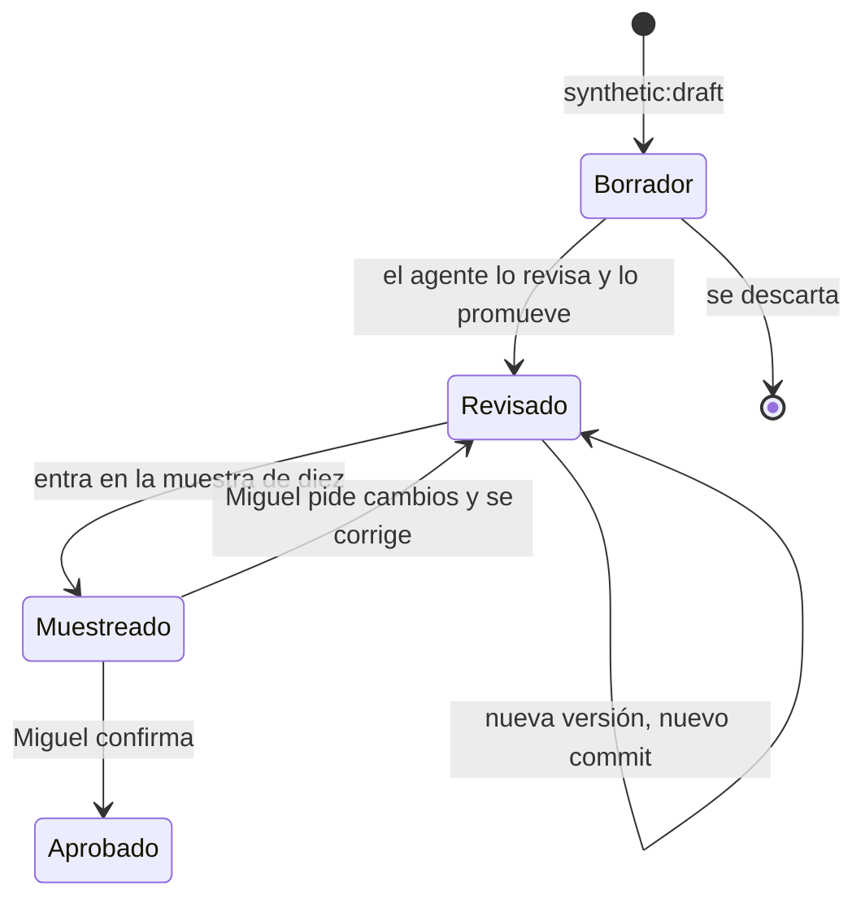
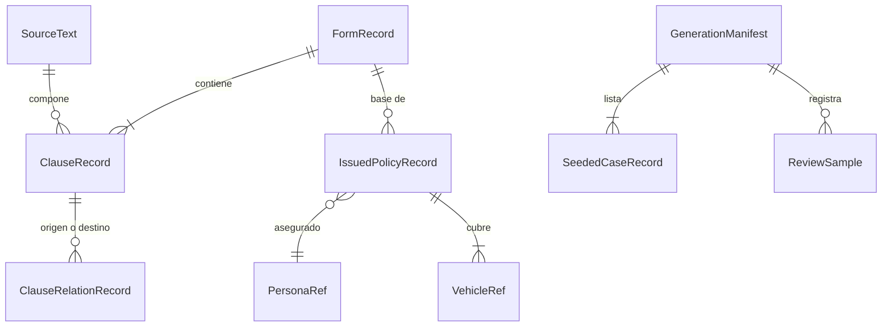

# Especificación funcional — U7 `synthetic-data`

Fuente de verdad de los flujos de U7. La forma de los datos está en
`entities.md` y las decisiones en `rules.md`. Respuestas aplicadas:
- **Q1:** redacción una vez con Gemini, con revisión antes de versionar.
- **Q2:** formulario completo, cinco endosos y ocho distractores por emisora.
- **Q3:** huellas de los specimens públicos, guardadas solo como hashes.
- **Q4:** casos sembrados como archivos, cargados por la API de U4.

## 1. Qué hace esta unidad

U7 compone todos los datos del proyecto a partir de textos revisados:
- un corpus por emisora: Stonecroft Mutual en español y Sunmeadow Auto en
  inglés;
- las copias de Knotwell;
- pólizas emitidas con personas y vehículos ficticios;
- un caso sembrado en cada estado;
- las colisiones de DS-8;
- la lista de valores personales ficticios para los canarios.

Todo sale de un comando determinista y queda versionado en `app/data/`.

Además deja tres comandos a mano: redactar borradores con el modelo, sacar las
huellas de los formularios de terceros y cargar los casos sembrados en la base.

**Lo que U7 no hace, y quién lo hace:**
- **U8** ingiere el corpus en la base y construye el índice.
- **U20** aprovisiona una aseguradora y reinicia cada noche los datos de
  visitantes, devolviendo los sembrados a su estado. U20 va a la pasada de
  publicación.
- **Cada unidad evaluada** escribe sus propios casos de golden set con los datos
  de U7: DS-3 en U8, DS-2 en U11. ADR-016 incluía los guiones de los golden sets
  en el generador; se precisa en FD-U7-5.

## 2. Flujos

### F1 — Redactar un borrador (a mano, una vez por parte)

1. Miguel o el agente corre
   `mise run synthetic:draft -- --tenant <emisora> --part <parte>` (tarea nueva).
2. El comando arma el prompt desde la referencia de estructura y una plantilla
   versionada, sin ningún texto de tercero (BR2.3).
3. Pide el texto a Gemini con la clave del uso `operations`, pasando por la
   fábrica, el techo y el registro de gasto de U5 (BR2.1).
4. Escribe el borrador en `tmp/synthetic-drafts/`, que git ignora. Nada del
   generador lee esa carpeta.

### F2 — Revisar y promover

1. El agente de código revisa cada borrador:
   - contra las partes y numerales de la referencia;
   - contra P8: redacción propia, sin giros reconocibles de un formulario;
   - contra lo que pide cada criterio, como el endoso de transporte o los
     distractores.
2. Lo promueve a `app/data/sources/` (carpeta nueva) con `reviewed_by: conductor`, la fecha y
   el modelo que lo redactó, y lo commitea (BR2.2).
3. Tras la primera generación, un comando elige diez cláusulas por emisora con
   una semilla registrada y escribe la muestra en `app/data/sources/reviews/`
   (BR5.4).
4. Miguel lee la muestra y anota su veredicto. El siguiente generar lo copia al
   manifiesto con la fecha y el commit.

### F3 — Generar (el comando determinista)

1. `mise run synthetic:generate` (tarea nueva) lee los `SourceText`. Si alguno no tiene marca
   de revisión, se detiene sin escribir nada (BR2.2).
2. Compone, en este orden y con el azar sembrado por salida (BR1.2):
   1. los formularios base y los endosos de cada emisora (BR3.1 a BR3.3);
   2. los distractores y las relaciones entre cláusulas (BR3.4 y BR3.5);
   3. las copias de Knotwell desde el original (BR4.1 y BR4.2);
   4. las personas y los vehículos ficticios (BR7.1);
   5. las pólizas emitidas, incluidas las tres `example_policy` de
      `tenant.yaml` (BR3.6 y BR4.3);
   6. los casos sembrados (BR6.1 y BR6.2);
   7. DS-8 (BR7.3);
   8. la lista de valores personales (BR7.2).
3. Valida todo antes de escribir. Si algo falla, no escribe nada.
4. Escribe los archivos en forma canónica (BR1.1) y al final el manifiesto,
   con los hashes de entradas y salidas, las diferencias declaradas, los casos y
   las muestras (BR1.4 y BR3.7).
5. No llama a ningún modelo ni lee ninguna clave (BR1.5).

### F4 — Sacar las huellas de terceros (a mano, una vez)

1. Miguel deja los specimens públicos del PP 00 01 en `tmp/specimens/`, que git
   ignora.
2. `mise run synthetic:fingerprints` (tarea nueva) los normaliza, quita encabezados y
   numeración, corta secuencias de ocho palabras y guarda solo sus hashes, con
   la edición y el hash de cada archivo de origen (BR5.1).
3. El archivo de huellas se commitea; los specimens no.

### F5 — Comprobar el texto propio (en cada entrega)

1. `content:check` normaliza cada cláusula de `app/data/tenants/` (carpeta nueva) igual que las
   huellas.
2. Una sola secuencia compartida falla la compuerta y nombra la cláusula
   (BR5.2).
3. Sin archivo de huellas, el chequeo queda "no medido" y falla (BR5.3).

### F6 — Sembrar en la base

1. `mise run synthetic:seed` (tarea nueva) lee `cases/` y crea cada caso por la API de U4
   con origen `generator`, siguiendo sus transiciones hasta el estado sembrado
   (BR6.3).
2. En las pruebas, la fixture hace lo mismo dentro de la transacción de la
   prueba y la revierte al terminar (BR6.4).

### Estado de un texto fuente

Texto: un borrador pasa a revisado cuando el agente lo promueve con su marca. Si
cae en la muestra, Miguel lo aprueba o pide cambios. Una versión nueva de un
texto revisado es un cambio deliberado con su commit.

### Relaciones entre las salidas

Texto: cada cláusula sale de un texto fuente y pertenece a un formulario. Las
relaciones unen cláusulas. Las pólizas emitidas parten de un formulario y llevan
una persona y sus vehículos. El manifiesto lista los casos sembrados y las
muestras revisadas.

## 3. Reglas (resumen derivado de `rules.md`)

| Familia | Reglas | Qué protegen |
| --- | --- | --- |
| Determinismo | BR1.1 a BR1.5 | Mismos bytes, un solo comando, sin modelo |
| Redacción y revisión | BR2.1 a BR2.3 | El modelo nunca escribe directo en el corpus |
| Estructura | BR3.1 a BR3.7 | Partes, identificadores, endosos, distractores, pólizas y diferencias |
| Knotwell | BR4.1 a BR4.3 | Copias exactas y emisora declarada |
| Texto propio | BR5.1 a BR5.4 | Huellas sin texto, umbral cero y muestra humana |
| Casos sembrados | BR6.1 a BR6.4 | Cobertura de estados y pruebas aisladas |
| Datos ficticios | BR7.1 a BR7.3 | Datos personales ficticios, canarios y DS-8 |
| Fronteras | BR8.1 | El corredor no invoca el generador |

## 4. Decisiones de esta etapa

| # | Decisión | Por qué |
| --- | --- | --- |
| FD-U7-1 | Los identificadores de formulario usan el prefijo de los números de caso: `STO-PAP-2026` y `SUN-PAP-2026` | El ejemplo de C-26 (`SM-PAP-2026`) era ilustrativo, y `SM` ya había sido Stonecroft y Sunmeadow en documentos distintos. El prefijo de `case_number_prefix` es uno por aseguradora y no se repite |
| FD-U7-2 | Los valores del enum de relaciones van en inglés: `endorsement_modifies`, `defines`, `refers_to` | Convención 4 de `team.md`: enums en inglés. El comentario de C-26 los nombraba en español |
| FD-U7-3 | Los textos fuente viven en `app/data/sources/`, junto a la salida, y el manifiesto los cuenta como entradas | Una sola carpeta de datos; el manifiesto distingue entradas de salidas |
| FD-U7-4 | La semilla es 20260916, la misma que DS-8 | DS-8 ya la fijó en U2; una segunda semilla obligaría a regenerar DS-8 distinto |
| FD-U7-5 | U7 entrega los datos; cada unidad evaluada escribe sus casos de golden set con esos datos | La práctica pide escribir el caso antes de implementar la conducta que mide; si el generador los escribiera, lo haría antes de que existiera esa conducta. Precisa ADR-016 |
| FD-U7-6 | La restauración nocturna de los sembrados se difiere a la pasada de publicación con U20 (AC5.6.4) | DP-14: U20 va completa a esa pasada. El núcleo, el origen `generator` que el borrado no toca, ya existe en U4 |
| FD-U7-7 | Los turnos de los casos sembrados son un tipo más de texto fuente, `case_turns`, escrito a mano | Enmienda del 2026-09-21, al construir: CG-U7-2 los pedía a mano y `entities.md` no tenía un tipo para ellos |
| FD-U7-8 | Los valores personales ficticios salen en su propio archivo, `app/data/personal_values.json` (nuevo), con su hash en el manifiesto | Enmienda del 2026-09-21: BR7.2 los ponía en el manifiesto, pero el manifiesto describe la generación y no los datos; un archivo aparte lo leen U3 y U21 sin cargar el manifiesto |
| FD-U7-9 | La siembra en la base vive en `untangle.server`, junto al comando de redacción, y no en `synthetic_data` | Enmienda del 2026-09-21: el contrato de capas deja `synthetic_data` por debajo de `case_record`, para que U8 lea los modelos del corpus sin ciclos. La raíz de composición es la capa que puede usar la API de U4 |

## Sources

- `../../../inception/units-generation/unit-of-work.md` — sección U7.
- `../../../inception/user-stories/stories.md` — US5.3 a US5.6.
- `../../../inception/requirements-analysis/requirements.md` — FR5.1, FR5.2,
  FR11.2, FR12.1, FR12.2 y FR12.3.
- `../../../inception/contract-design/contract-summary.md` — C-16, C-25 y C-26.
- `../../../inception/domain-design/decisions.md` — ADR-010, ADR-013 y ADR-016.
- `../../../inception/domain-design/components.md` — SyntheticData, SourceText y
  GenerationManifest.
- `docs/reference/estructura-poliza-iso-pap.md` — partes y numeración de la
  póliza de referencia.
- `app/data/fixtures/ds8_isolation.json` — DS-8 escrita a mano en U2.
- `app/backend/src/untangle/case_record/models.py` — los siete estados, las
  cuatro resoluciones y el origen `generator`.

## Assumptions & Open Questions

- **Los specimens públicos los descarga Miguel**, o autoriza la descarga, antes
  de la generación de código. Sin ellos, F5 queda "no medido" y la compuerta no
  pasa, como debe.
- **El plan gratuito de Gemini alcanza** para las llamadas de redacción: una por
  parte, aseguradora e idioma, unas veinte en total. Si una cuota se agota, la
  redacción se detiene y se reanuda otro día, sin cambiar de plan.
- **La traducción no se detecta por huellas.** Una cláusula en español calcada
  de un formulario en inglés no comparte secuencias; ese riesgo lo cubre la
  muestra de Miguel.
