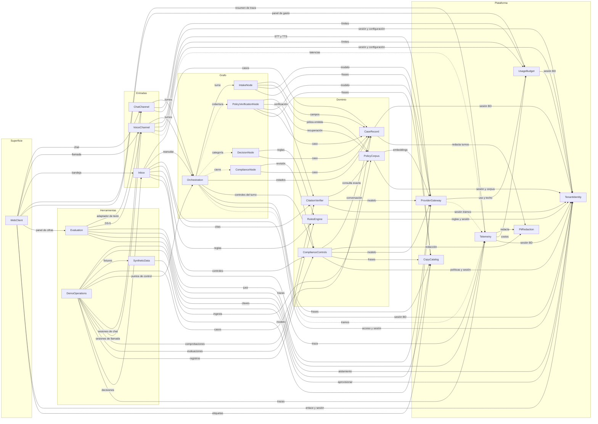

# Componentes — Untangle

Catálogo de los bloques lógicos del aplicativo: el software que se escribe, de
qué datos es dueño cada uno y cómo se llaman entre sí. No decide cómo se
agrupan para desplegarse, que es trabajo de Units Generation. Las decisiones de
arquitectura con su contexto y sus alternativas están en `decisions.md`, y la
trazabilidad de cada historia, en `traceability.json`.

**Fuentes consumidas.**

- **Requisitos** (`../requirements-analysis/requirements.md`): los grupos
  funcionales FR1 a FR14 por módulo del PRD, los veintiún NFR y las preguntas
  abiertas OQ2 y OQ3 que esta etapa resuelve.
- **Historias** (`../user-stories/stories.md`): las 87 historias, sus
  convenciones (tres controles dentro del turno, dónde vive cada dato personal,
  estados del caso) y las preguntas PA-1 a PA-5 asignadas a esta etapa.
- **Mapa del código existente**
  (`aidlc/spaces/default/codekb/untangle/architecture.md` y
  `aidlc/spaces/default/codekb/untangle/component-inventory.md`): el repositorio
  solo tiene la landing de `site/`, con nueve componentes que quedan fuera de
  este catálogo; no hay componentes del aplicativo que preservar ni integrar.
- **Prácticas del equipo** (`../practices-discovery/team-practices.md`): cada
  módulo del PRD es un módulo del árbol, una sola grafía para los cuatro nodos,
  las cuatro reglas de dirección de dependencias, el conjunto de escritura por
  nodo, el punto único de sesión de base de datos, la taxonomía cerrada de
  errores, la configuración por aseguradora y el catálogo de textos.
- **Maquetas aprobadas** (`../refined-mockups/mockups.md`), las respuestas Q1 a
  Q5 de `domain-design-questions.md` y los resultados de los experimentos 02, 03
  y 04 en `spikes/`.

Los nombres de componente van en inglés porque son identificadores; en el
código cada nodo usa su token de la convención 3 (`intake`,
`policy_verification`, `decision`, `compliance`) y cada módulo del PRD tiene su
directorio, que fija Units Generation.

## Catálogo

Este bloque es la fuente de verdad; las secciones siguientes se derivan de él.

```yaml
components:
  - name: CaseRecord
    summary: "Registro estructurado del caso: fuente de verdad del siniestro, la consulta de cobertura o la solicitud de cotización."
    behaviour: >
      Valida el esquema por tipo de registro (siniestro, consulta de cobertura, solicitud de cotización)
      con los siete campos centrales y los grupos repetibles de lesionados, testigos, otras partes y
      vehículos. Cada campo guarda su estado (no dicho, dicho o confirmado en voz alta) y el turno que lo
      respalda, así que 'sin lesiones' o '0 otras partes' solo existen si la persona lo dijo. Calcula la
      completitud por campo y total según el tipo. Aplica el modelo cerrado de siete estados y rechaza
      toda transición no declarada dejando un evento; la única vuelta desde 'derivado' es a 'en captura',
      solo con el motivo 'límite de la demostración', dentro de los 15 minutos y sin decisión iniciada. Un
      caso cerrado lleva exactamente una resolución (registrado, aprobado, rechazado o enviado a la
      aseguradora). Genera el número legible con el prefijo de la aseguradora y seis dígitos. Registra
      cada cambio con autor, momento y canal. Guarda la transcripción ya redactada y no cierra un caso sin
      la evidencia de sus adjuntos que le entrega el nodo de cumplimiento. Los datos personales
      estructurados quedan cifrados en reposo y bajo aislamiento por aseguradora.
    responsibilities:
      - "Esquema del caso por tipo de registro y correspondencia entre bloques de la conversación y campos, en un archivo versionado"
      - "Estado de cada campo con su evidencia y la marca de confirmación en voz alta"
      - "Completitud por campo y total"
      - "Modelo cerrado de estados, resoluciones y origen del caso"
      - "Número de caso legible"
      - "Historial de cambios con autor, momento y canal"
      - "Transcripción redactada del caso"
      - "Cierre solo con la evidencia de los adjuntos completa"
    depends_on:
      - component: TenantIdentity
        interaction: "obtiene la sesión de base de datos con la aseguradora ya fijada"
        style: sync
      - component: PiiRedaction
        interaction: "redacta cada turno antes de guardarlo en la transcripción"
        style: sync
    dependents:
      - component: Orchestration
        interaction: "crea el caso y aplica las transiciones del runtime: pausa, reanudación y retiro de la pausa"
      - component: IntakeNode
        interaction: "lee y escribe campos, partes y confirmaciones del caso"
      - component: PolicyVerificationNode
        interaction: "anota la consulta y el resultado en el caso"
      - component: DecisionNode
        interaction: "escribe la categoría y la explicación en el caso"
      - component: ComplianceNode
        interaction: "cierra o deriva el caso con su motivo y la evidencia de adjuntos"
      - component: ComplianceControls
        interaction: "lee la conversación completa para la revisión al cierre"
      - component: Inbox
        interaction: "lista, vista de caso y corrección de campos"
      - component: DemoOperations
        interaction: "siembra casos y borra los de visitantes"
    external_dependencies:
      - name: "PostgreSQL"
        kind: database
        purpose: "casos, campos, partes, transcripción e historial, con RLS y cifrado en reposo"
    entities:
      - name: Case
        identifier: "case_id"
        attributes: [tenant_id, case_number, record_type, state, resolution, channel, origin, language, policy_ref, derivation_reason, priority, completeness, created_at, updated_at, closed_at]
        references:
          - entity: IssuedPolicy
            owned_by: PolicyCorpus
            relationship: "cada caso se asocia a lo sumo a una póliza emitida, la que se confirmó al identificarse"
          - entity: Tenant
            owned_by: TenantIdentity
            relationship: "cada caso pertenece a una sola aseguradora"
      - name: CaseField
        identifier: "case_id + field_key"
        attributes: [value, status, evidence_turn_id, confirmed_aloud_at, updated_at]
      - name: CaseParty
        identifier: "party_id"
        attributes: [case_id, role, name, contact, injury_status, vehicle_description, plate, statement_version]
      - name: TranscriptTurn
        identifier: "turn_id"
        attributes: [case_id, speaker, channel, language, text_redacted, started_at, ended_at, interrupted]
      - name: CaseChange
        identifier: "change_id"
        attributes: [case_id, field_key, previous_value, new_value, actor_type, actor_id, channel, changed_at]
        references:
          - entity: StaffPrincipal
            owned_by: TenantIdentity
            relationship: "un cambio hecho con credencial apunta a la persona de la bandeja que lo hizo"
  - name: Orchestration
    summary: "Runtime del grafo: estado tipado, transición pura, ejecución de nodos con su política de fallo, puntos de control, pausa hacia la bandeja y los dos ritmos."
    behaviour: >
      Arma el grafo con los nodos intake, policy_verification, decision y compliance y decide la
      transición con una función pura que solo lee campos del estado tipado y devuelve un nombre de nodo
      de un conjunto cerrado; ningún cliente de modelo está en su cadena de llamadas. Ejecuta cada nodo
      con la política de fallo que el nodo declara como dato (tiempo máximo, un reintento y texto de
      degradación) y deja cada fallo como valor distinguible en el estado y como evento en la traza.
      Responde el turno de inmediato y lanza de fondo, con precarga, la verificación de póliza, las reglas
      y la revisión de cumplimiento; si el turno necesita un resultado que no llegó, emite la frase de
      espera del catálogo antes de dos segundos de silencio. Guarda un punto de control por caso después
      de cada turno y reanuda desde él sin repetir preguntas confirmadas. Pausa el grafo hacia la bandeja
      cuando cumplimiento deriva, lo reanuda con la decisión y su comentario, y retira la pausa cuando una
      llamada cortada por el límite de la demostración se retoma dentro de su ventana. Todo texto hacia la
      persona sale por un único punto de salida que aplica los tres controles del turno, incluidos los
      mensajes de degradación y de error. Es el mismo grafo para chat y voz: los canales le entregan
      turnos y reciben salidas.
    responsibilities:
      - "Estado tipado y conjunto de escritura declarado por nodo"
      - "Función de transición pura con enumeración cerrada de nodos"
      - "Ejecutor común de la política de fallo de cada nodo"
      - "Ritmo del turno y ritmo de fondo con precarga y frase de espera"
      - "Puntos de control por caso y reanudación"
      - "Pausa hacia la bandeja, reanudación con decisión y retiro de la pausa"
      - "Punto único de salida hacia la persona"
    depends_on:
      - component: IntakeNode
        interaction: "ejecuta la captura del turno de la persona"
        style: sync
      - component: PolicyVerificationNode
        interaction: "ejecuta de fondo la verificación de póliza y las respuestas de cobertura"
        style: async
      - component: DecisionNode
        interaction: "ejecuta de fondo la evaluación de la categoría"
        style: async
      - component: ComplianceNode
        interaction: "ejecuta de fondo la revisión completa y el cierre o la derivación"
        style: async
      - component: CaseRecord
        interaction: "crea el caso y aplica las transiciones del runtime: pausa, reanudación y retiro de la pausa"
        style: sync
      - component: ComplianceControls
        interaction: "aplica en el punto único de salida la guardia, la detección de petición de persona y la de emergencia"
        style: sync
      - component: CopyCatalog
        interaction: "resuelve frases de espera, degradación y error por idioma"
        style: sync
      - component: TenantIdentity
        interaction: "obtiene la sesión de base de datos con la aseguradora ya fijada para los puntos de control y lee la configuración de la aseguradora"
        style: sync
      - component: Telemetry
        interaction: "emite tramos por turno y por nodo"
        style: async
    dependents:
      - component: VoiceChannel
        interaction: "entrega turnos, retoma casos y emite sus mensajes por el punto único de salida"
      - component: ChatChannel
        interaction: "entrega turnos de texto, retoma casos y recibe salidas"
      - component: Inbox
        interaction: "reanuda el grafo con la decisión y su comentario"
      - component: DemoOperations
        interaction: "borra puntos de control y pausas de visitantes"
    external_dependencies:
      - name: "LangGraph"
        kind: other
        purpose: "framework del grafo con estado tipado, puntos de control e interrupciones"
      - name: "PostgreSQL"
        kind: database
        purpose: "puntos de control y pausas, con RLS"
    entities:
      - name: GraphCheckpoint
        identifier: "checkpoint_id"
        attributes: [thread_id, tenant_id, case_id, step, created_at]
        references:
          - entity: Case
            owned_by: CaseRecord
            relationship: "cada punto de control pertenece a un caso"
          - entity: Tenant
            owned_by: TenantIdentity
            relationship: "cada punto de control queda aislado por aseguradora"
      - name: HumanReviewRequest
        identifier: "request_id"
        attributes: [case_id, reason, status, created_at, resolved_at, withdrawn_at]
        references:
          - entity: Case
            owned_by: CaseRecord
            relationship: "cada pausa hacia la bandeja pertenece a un caso"
      - name: NodeRun
        identifier: "node_run_id"
        attributes: [case_id, node, rhythm, attempt, max_attempts, outcome, error_type, latency_ms, lease_owner, lease_expires_at, heartbeat_at, idempotency_key, started_at, finished_at]
        references:
          - entity: Case
            owned_by: CaseRecord
            relationship: "cada ejecución de nodo pertenece a un caso"
  - name: IntakeNode
    summary: "Nodo intake: identifica a la persona, extrae solo lo dicho, sigue el orden fijo de la guía y lee la confirmación de cada bloque."
    behaviour: >
      Identifica a la persona contra la póliza emitida con nombre y número de póliza sin revelar datos
      ajenos. Extrae solo lo dicho en el turno, con el texto de la persona como campo delimitado y nunca
      en la posición de instrucción del prompt. Normaliza fechas relativas, placas, pólizas, cédulas y
      teléfonos, y limpia los separadores dichos que la transcripción pega a los códigos. Pregunta una
      idea por turno en el orden fijo de la guía de voz, empezando por la seguridad. Lee en voz alta la
      confirmación de cada bloque; lesiones, conductor y lugar se confirman siempre antes de anotarse y
      las letras confundibles se deletrean con una palabra. Registra dos versiones de lo que pasó sin
      juzgar y atiende con calma a quien está alterado. Nunca afirma cobertura, montos ni culpa. Su
      conjunto de escritura son los campos y partes del caso y la siguiente pregunta.
    responsibilities:
      - "Identificación de la persona contra la póliza emitida"
      - "Extracción con estado por campo y evidencia del turno"
      - "Normalización de datos dictados"
      - "Orden de preguntas, apertura con divulgación y confirmación por bloque"
    depends_on:
      - component: CaseRecord
        interaction: "lee y escribe campos, partes y confirmaciones del caso"
        style: sync
      - component: PolicyCorpus
        interaction: "busca la póliza emitida para identificar a la persona"
        style: sync
      - component: ProviderGateway
        interaction: "extracción y redacción de la respuesta con el modelo"
        style: sync
      - component: CopyCatalog
        interaction: "apertura, preguntas y lecturas de confirmación por idioma"
        style: sync
    dependents:
      - component: Orchestration
        interaction: "ejecuta la captura del turno de la persona"
    entities: []
  - name: PolicyVerificationNode
    summary: "Nodo policy_verification: responde cobertura solo con cláusulas recuperadas y verificadas, o dice que no encuentra cláusula."
    behaviour: >
      Recupera cláusulas filtradas por la aseguradora y por la póliza vigente (formulario, versión y
      endosos) y redacta la respuesta restringida a identificadores recuperados. Pide al verificador que
      confirme cada cita antes de emitirla. Distingue el resultado verificado 'no encuentro una cláusula
      que lo cubra' del fallo 'no pude verificar' y nunca los colapsa. En el chat entrega la cláusula
      completa en su idioma original con la explicación en el idioma de la conversación, marcada como
      resumen; en voz, el nombre de la parte y un resumen de una frase. En la agencia cita la póliza de la
      emisora. El texto recuperado entra como dato delimitado, nunca como instrucción. Es un nodo puro
      (enmienda del 2026-09-17): devuelve la actualización del estado y no escribe en la base de datos;
      CitationVerifier guarda la respuesta de cobertura con clave idempotente, porque LangGraph vuelve a
      ejecutar el nodo completo al reanudar tras interrupt().
    responsibilities:
      - "Respuesta de cobertura restringida a cláusulas recuperadas"
      - "Resultados distintos: citada, sin cláusula, no verificable"
      - "Forma de la cita por canal y por idioma"
    depends_on:
      - component: PolicyCorpus
        interaction: "recuperación híbrida filtrada por aseguradora y póliza"
        style: sync
      - component: CitationVerifier
        interaction: "verifica cada cita antes de emitirla"
        style: sync
      - component: ProviderGateway
        interaction: "redacción de la respuesta y del resumen con el modelo"
        style: sync
      - component: CaseRecord
        interaction: "anota la consulta y el resultado en el caso"
        style: sync
      - component: CopyCatalog
        interaction: "frases de 'no encuentro cláusula' y 'no pude verificar'"
        style: sync
    dependents:
      - component: Orchestration
        interaction: "ejecuta de fondo la verificación de póliza y las respuestas de cobertura"
  - name: DecisionNode
    summary: "Nodo decision: obtiene del motor de reglas la categoría del caso con sus reglas disparadas; nunca decide cobertura."
    behaviour: >
      Arma los insumos de las reglas desde los campos del caso y las cláusulas verificadas, obtiene la
      categoría (cierre directo, revisión estándar o derivación; en cotización, elegible, no elegible o
      derivación con banda) y escribe la categoría y su explicación en el caso. No invoca al modelo en
      ningún camino. La agencia deriva siempre por su regla, sin rama de código.
    responsibilities:
      - "Insumos de las reglas desde el estado del caso"
      - "Escritura de la categoría y su explicación"
    depends_on:
      - component: RulesEngine
        interaction: "evalúa la categoría con las reglas de la aseguradora"
        style: sync
      - component: CaseRecord
        interaction: "escribe la categoría y la explicación en el caso"
        style: sync
    dependents:
      - component: Orchestration
        interaction: "ejecuta de fondo la evaluación de la categoría"
    entities: []
  - name: ComplianceNode
    summary: "Nodo compliance: revisa los cuatro controles sobre la conversación completa y cierra o deriva el caso con su motivo."
    behaviour: >
      Pide la revisión completa de los cuatro controles (divulgación registrada, ruta a persona, datos
      personales redactados y explicabilidad) sobre la conversación entera. Reúne desde el estado la
      evidencia de los adjuntos (divulgación, citas, reglas, traza y revisión) y la entrega al cierre.
      Cuando la categoría o un control lo exige, deriva con motivo y devuelve al runtime la instrucción de
      pausa hacia la bandeja. Ninguna salida afirma o niega cobertura ni menciona montos sin pasar por la
      bandeja.
    responsibilities:
      - "Revisión completa al cierre"
      - "Cierre o derivación con motivo"
      - "Evidencia de adjuntos para cerrar el caso"
    depends_on:
      - component: ComplianceControls
        interaction: "revisión completa de los cuatro controles"
        style: sync
      - component: CaseRecord
        interaction: "cierra o deriva el caso con su motivo y la evidencia de adjuntos"
        style: sync
    dependents:
      - component: Orchestration
        interaction: "ejecuta de fondo la revisión completa y el cierre o la derivación"
    entities: []
  - name: VoiceChannel
    summary: "Canal de voz: llamada desde el navegador con transcripción, detección de turno, interrupciones, síntesis y límites de la demo pública."
    behaviour: >
      Conecta la llamada del navegador con la librería de voz, que se elige con el experimento 1 entre
      LiveKit Agents y Pipecat, y convierte el audio en turnos para el grafo. Detecta el fin del turno y,
      si la interrumpen, calla en menos de 300 ms y retoma sin repetir. Maneja los silencios con las
      frases del catálogo. Cambia de idioma cuando la persona lo pide o se detecta, con la misma voz.
      Decide antes de cada llamada entre la voz principal y la de respaldo según la reserva de presupuesto
      y nunca cambia de voz por presupuesto a mitad de llamada; si la síntesis falla, sigue con la de
      respaldo; si la transcripción cae, guarda el caso y termina con el mensaje del catálogo. Aplica los
      límites de la demo (3 minutos por llamada, 1 llamada al día desde la conexión, 15 al día en el
      sitio) con aviso a los 30 segundos, derivación al límite y retoma dentro de 15 minutos sin contar
      como llamada del día. Emite los eventos de fin del habla, primer audio, parada e interrupción, y
      recuperación tras corte. No guarda audio y sus propios mensajes salen por el punto único de salida
      del grafo.
    responsibilities:
      - "Sesión de llamada y paso de audio a turnos"
      - "Detección de turno, interrupciones y silencios"
      - "Cambio y detección de idioma con la misma voz"
      - "Elección de voz principal o de respaldo antes de cada llamada"
      - "Límites de la llamada pública y ventana de retoma"
      - "Eventos de latencia de la llamada"
    depends_on:
      - component: Orchestration
        interaction: "entrega turnos, retoma casos y emite sus mensajes por el punto único de salida"
        style: sync
      - component: ProviderGateway
        interaction: "transcripción y síntesis en streaming por sus interfaces"
        style: sync
      - component: UsageBudget
        interaction: "límites de llamada, reserva de la voz principal y techo de gasto"
        style: sync
      - component: TenantIdentity
        interaction: "clave de visitante, configuración de voz de la aseguradora y obtiene la sesión de base de datos con la aseguradora ya fijada"
        style: sync
      - component: Telemetry
        interaction: "eventos de latencia de la llamada"
        style: async
    dependents:
      - component: WebClient
        interaction: "prepara, conecta y sigue la llamada desde la consola"
      - component: Evaluation
        interaction: "corre DS-5 por hito"
      - component: DemoOperations
        interaction: "borra sesiones de llamada de visitantes"
    external_dependencies:
      - name: "LiveKit Agents o Pipecat"
        kind: other
        purpose: "librería de voz en tiempo real; se elige con el experimento 1"
      - name: "Transporte WebRTC"
        kind: other
        purpose: "audio entre el navegador y la agente; proveedor o servidor según el experimento 1"
    entities:
      - name: CallSession
        identifier: "call_id"
        attributes: [tenant_id, case_id, visitor_key, language, voice_mode, started_at, ended_at, end_reason, resume_until]
        references:
          - entity: Case
            owned_by: CaseRecord
            relationship: "cada llamada trabaja sobre un caso"
          - entity: VisitorKey
            owned_by: TenantIdentity
            relationship: "cada llamada pública se liga a la clave del navegador que la hizo"
  - name: ChatChannel
    summary: "Canal de texto: chat público por aseguradora, adaptador de texto del grafo y vista de comparación."
    behaviour: >
      Expone la conversación de texto sobre el mismo grafo con respuestas en streaming. El primer mensaje
      trae la divulgación, avisa que es una demostración con pólizas de ejemplo y, antes de cualquier
      texto del visitante, pide no escribir datos reales porque el chat público usa el plan gratuito del
      modelo. Responde en el idioma del mensaje con selector visible. Entrega cada cita con identificador,
      versión, texto expandible y enlace al resumen de traza de esa respuesta. Aplica los límites de
      mensajes por sesión y por día con mensaje de degradación honesto. Retoma un caso solo con la sesión
      del navegador que lo creó o con su enlace firmado, y responde igual ante un caso ajeno que ante uno
      inexistente. Muestra en la conversación la decisión del ajustador. Corre la misma pregunta en las
      tres aseguradoras para la vista de comparación. Es el adaptador de texto que usa el corredor de
      evaluaciones.
    responsibilities:
      - "Conversación de texto en streaming sobre el grafo"
      - "Sesión del chat, retoma por navegador y actualización de decisiones"
      - "Límites de mensajes y modo degradado"
      - "Vista de comparación entre aseguradoras"
      - "Adaptador de texto para las evaluaciones"
    depends_on:
      - component: Orchestration
        interaction: "entrega turnos de texto, retoma casos y recibe salidas"
        style: sync
      - component: UsageBudget
        interaction: "límites de mensajes por sesión y por día y modo degradado"
        style: sync
      - component: TenantIdentity
        interaction: "clave de visitante, póliza de ejemplo y obtiene la sesión de base de datos con la aseguradora ya fijada"
        style: sync
    dependents:
      - component: WebClient
        interaction: "envía mensajes y recibe respuestas en streaming"
      - component: Evaluation
        interaction: "corre las conversaciones por el adaptador de texto"
      - component: DemoOperations
        interaction: "borra sesiones de chat de visitantes"
    entities:
      - name: ChatSession
        identifier: "session_id"
        attributes: [tenant_id, visitor_key, case_id, language, message_count, created_at, last_seen_at]
        references:
          - entity: Case
            owned_by: CaseRecord
            relationship: "cada sesión de chat trabaja sobre a lo sumo un caso abierto"
          - entity: VisitorKey
            owned_by: TenantIdentity
            relationship: "cada sesión pública se liga a la clave del navegador"
  - name: WebClient
    summary: "Interfaz web en React y TypeScript: inicio, chat, consola de llamada, comparación, bandeja, vistas de caso, paneles y páginas de estado."
    behaviour: >
      Implementa las doce pantallas de las maquetas aprobadas con los tokens del sistema de diseño y los
      modos claro y oscuro con selector. Se compila a archivos estáticos que se sirven desde el mismo
      origen que la API. Toda etiqueta sale del catálogo de textos por idioma y toda llamada al backend
      usa el cliente tipado generado desde la API. La consola usa los componentes de React de la librería
      de voz elegida y muestra antes del micrófono los límites y la disponibilidad. Cumple la línea base
      de accesibilidad en las pantallas a las que llega un visitante (chat, consola, comparación y vista
      de caso por enlace). No guarda datos de casos en el navegador más allá de la sesión. Ante la
      instancia dormida o la base de datos caída muestra la página de estado del catálogo.
    responsibilities:
      - "Doce pantallas con tokens, modos de tema y estados"
      - "Cliente tipado de la API y manejo de sesiones del navegador"
      - "Consola de llamada con los componentes de la librería de voz"
      - "Línea base de accesibilidad y uso en teléfono"
      - "Páginas de estado y de espera"
    depends_on:
      - component: ChatChannel
        interaction: "envía mensajes y recibe respuestas en streaming"
        style: sync
      - component: VoiceChannel
        interaction: "prepara, conecta y sigue la llamada desde la consola"
        style: sync
      - component: Inbox
        interaction: "lista, vista de caso, corrección y decisión"
        style: sync
      - component: Telemetry
        interaction: "resumen de traza de cada respuesta"
        style: sync
      - component: UsageBudget
        interaction: "datos del panel de gasto"
        style: sync
      - component: Evaluation
        interaction: "cinco cifras publicadas con su fecha y su commit"
        style: sync
      - component: TenantIdentity
        interaction: "canje del enlace firmado y sesión del visitante"
        style: sync
      - component: CopyCatalog
        interaction: "etiquetas por idioma con claves tipadas"
        style: sync
    dependents: []
    external_dependencies:
      - name: "React, Vite, TanStack Router y Query, shadcn/ui"
        kind: other
        purpose: "framework de interfaz, compilación, rutas tipadas, datos y componentes accesibles"
      - name: "Componentes de React de la librería de voz"
        kind: other
        purpose: "controles, transcripción y visualizador de la consola"
    entities: []
  - name: PolicyCorpus
    summary: "Corpus por aseguradora: formularios, cláusulas con identificador y versión, pólizas emitidas y recuperación híbrida filtrada."
    behaviour: >
      Ingiere cada corpus con una cláusula por fragmento, identificador estable y versión, en el idioma de
      su aseguradora: Stonecroft Mutual en español, Sunmeadow Auto en inglés y Knotwell con las copias de
      cada emisora en el idioma de la emisora, etiquetadas por emisora. Mantiene las pólizas emitidas con
      formulario, versión, endosos vigentes y declaraciones (asegurado, conductores y vehículos). Recupera
      con un índice híbrido léxico y vectorial, con embeddings multilingües para preguntas en el otro
      idioma, siempre filtrado por aseguradora y por póliza. Incluye el documento de jurisdicción y los
      distractores declarados. Nunca devuelve una cláusula de otra aseguradora y entrega el texto
      recuperado como dato.
    responsibilities:
      - "Ingesta de formularios, endosos, jurisdicción y distractores con identificador y versión"
      - "Pólizas emitidas con sus declaraciones"
      - "Índice híbrido por aseguradora y recuperación filtrada por póliza"
      - "Idioma de cada cláusula y etiqueta de emisora"
    depends_on:
      - component: ProviderGateway
        interaction: "embeddings de ingesta y de consulta"
        style: sync
      - component: TenantIdentity
        interaction: "obtiene la sesión de base de datos con la aseguradora ya fijada y lee la carpeta del corpus de la aseguradora"
        style: sync
    dependents:
      - component: IntakeNode
        interaction: "busca la póliza emitida para identificar a la persona"
      - component: PolicyVerificationNode
        interaction: "recuperación híbrida filtrada por aseguradora y póliza"
      - component: CitationVerifier
        interaction: "consulta exacta de cláusula y póliza"
      - component: DemoOperations
        interaction: "ingiere el corpus de la aseguradora"
    external_dependencies:
      - name: "PostgreSQL con pgvector"
        kind: database
        purpose: "cláusulas, pólizas emitidas e índice léxico y vectorial, con RLS"
    entities:
      - name: PolicyForm
        identifier: "form_id"
        attributes: [tenant_id, version, language, issuer_tenant_id, effective_from, superseded_by]
        references:
          - entity: Tenant
            owned_by: TenantIdentity
            relationship: "cada formulario pertenece al corpus de una aseguradora"
      - name: Clause
        identifier: "clause_id"
        attributes: [tenant_id, form_id, form_version, clause_key, part, language, text, is_distractor, issuer_label]
      - name: IssuedPolicy
        identifier: "policy_id"
        attributes: [tenant_id, policy_number, form_id, form_version, endorsement_keys, issuer_tenant_id, named_insured, national_id, phone, drivers, vehicles, effective_from, effective_to, origin]
        references:
          - entity: Tenant
            owned_by: TenantIdentity
            relationship: "cada póliza emitida pertenece a una aseguradora"
      - name: ClauseIndexEntry
        identifier: "clause_id + embedding_model"
        attributes: [lexical_vector, embedding, indexed_at]
      - name: ClauseRelation
        identifier: "relation_id"
        attributes: [tenant_id, src_clause_id, dst_clause_id, rel_type, form_version]
        references:
          - entity: Clause
            owned_by: PolicyCorpus
            relationship: "cada relación une dos cláusulas del mismo corpus: un endoso que modifica, reabre, restringe o reemplaza una cláusula, o una definición que otra usa (enmienda del 2026-09-17, ADR-010)"
  - name: CitationVerifier
    summary: "Verificador exacto de citas: existencia, pertenencia a la aseguradora y a la póliza, vigencia y respaldo de la afirmación."
    behaviour: >
      Solo acepta identificadores que estén en el conjunto recuperado para esa respuesta. Comprueba por
      consulta exacta que la cláusula exista, pertenezca a la aseguradora y a la póliza (formulario,
      versión y endosos vigentes) y esté vigente, y que su texto sostenga la afirmación con una segunda
      pasada del modelo más reglas. Devuelve un resultado de conjunto cerrado: verificada, rechazada, sin
      cláusula o no verificable. Una cita inexistente es compuerta dura. Registra cada comprobación con su
      motivo. Rechaza la cita cuando un endoso vigente de la póliza modifica la cláusula citada y la
      respuesta no lo considera, siguiendo las relaciones entre cláusulas de PolicyCorpus (decisión de
      Miguel del 2026-09-17). Guarda la respuesta de cobertura del nodo con clave idempotente por caso y
      turno, así que reanudar el grafo no la duplica.
    responsibilities:
      - "Comprobación exacta de existencia, pertenencia y vigencia"
      - "Comprobación de endosos vigentes que modifican la cláusula citada"
      - "Comprobación de respaldo de la afirmación"
      - "Resultado cerrado y registro de cada comprobación"
      - "Registro idempotente de la respuesta de cobertura"
    depends_on:
      - component: PolicyCorpus
        interaction: "consulta exacta de cláusula y póliza"
        style: sync
      - component: ProviderGateway
        interaction: "segunda pasada de respaldo con el modelo"
        style: sync
      - component: TenantIdentity
        interaction: "obtiene la sesión de base de datos con la aseguradora ya fijada"
        style: sync
    dependents:
      - component: PolicyVerificationNode
        interaction: "verifica cada cita antes de emitirla y guarda la respuesta de cobertura"
      - component: Inbox
        interaction: "lee las citas verificadas y las respuestas de cobertura del caso"
      - component: DemoOperations
        interaction: "borra comprobaciones de citas y respuestas de cobertura de visitantes"
    entities:
      - name: CitationCheck
        identifier: "check_id"
        attributes: [tenant_id, case_id, clause_id, clause_version, claim_redacted, outcome, reasons, checked_at]
        references:
          - entity: Clause
            owned_by: PolicyCorpus
            relationship: "cada comprobación apunta a una cláusula"
          - entity: Case
            owned_by: CaseRecord
            relationship: "cada comprobación pertenece a un caso"
      - name: CoverageAnswer
        identifier: "answer_id"
        attributes: [case_id, turn_id, question_redacted, outcome, citation_check_ids, answer_language, clause_language, created_at]
        references:
          - entity: Case
            owned_by: CaseRecord
            relationship: "cada respuesta de cobertura pertenece a un caso"
          - entity: TranscriptTurn
            owned_by: CaseRecord
            relationship: "cada respuesta contesta un turno de la persona"
          - entity: CitationCheck
            owned_by: CitationVerifier
            relationship: "cada respuesta enlaza las comprobaciones de sus citas"
  - name: RulesEngine
    summary: "Motor de reglas por aseguradora: reglas versionadas en archivos que dan la categoría con sus reglas disparadas e insumos."
    behaviour: >
      Carga de la configuración de cada aseguradora entre 10 y 20 reglas de triage versionadas, cada una
      con su prueba unitaria, y las evalúa de forma determinista sin invocar al modelo. Devuelve
      categoría, reglas disparadas, insumos usados y una explicación con clave del catálogo. La política
      de la agencia (derivar siempre) es una regla de su configuración. Incluye las reglas de elegibilidad
      y la banda indicativa de cotización, sin montos. Un cambio de reglas dispara la compuerta de
      evaluación antes de desplegarse.
    responsibilities:
      - "Carga y validación de reglas versionadas por aseguradora"
      - "Evaluación determinista con reglas disparadas e insumos"
      - "Reglas de elegibilidad y banda de cotización"
    depends_on:
      - component: TenantIdentity
        interaction: "lee las reglas de la aseguradora y obtiene la sesión de base de datos con la aseguradora ya fijada"
        style: sync
    dependents:
      - component: DecisionNode
        interaction: "evalúa la categoría con las reglas de la aseguradora"
      - component: Inbox
        interaction: "lee la evaluación de reglas con sus insumos"
      - component: DemoOperations
        interaction: "borra evaluaciones de reglas de visitantes"
    entities:
      - name: RuleEvaluation
        identifier: "evaluation_id"
        attributes: [tenant_id, case_id, ruleset_version, category, fired_rules, inputs_snapshot, explanation_key, evaluated_at]
        references:
          - entity: Case
            owned_by: CaseRecord
            relationship: "cada evaluación pertenece a un caso"
  - name: ComplianceControls
    summary: "Controles de cumplimiento: divulgación registrada, ruta a persona, guardia de salida, detección de emergencia y revisión completa al cierre."
    behaviour: >
      En el turno corre solo tres controles baratos, cada uno con presupuesto de latencia declarado: la
      guardia de salida (promesas de cobertura o montos, culpa y consejo legal, que corrige o sustituye
      por la frase permitida del catálogo), la detección de petición de persona en cualquier idioma y la
      detección de emergencia. Registra la divulgación con hora, idioma y canal cuando sale la apertura.
      Al cierre revisa los cuatro controles sobre la conversación completa y adjunta el resultado. Las
      políticas viven en la configuración de cada aseguradora y el texto de la persona entra como dato
      delimitado.
    responsibilities:
      - "Guardia de salida en cada texto hacia la persona"
      - "Detección de petición de persona y de emergencia en el turno"
      - "Registro de la divulgación"
      - "Revisión completa de los cuatro controles al cierre"
    depends_on:
      - component: CaseRecord
        interaction: "lee la conversación completa para la revisión al cierre"
        style: sync
      - component: PiiRedaction
        interaction: "comprueba que lo exportable de la conversación esté redactado"
        style: sync
      - component: ProviderGateway
        interaction: "clasificación de la revisión completa cuando las reglas no bastan"
        style: sync
      - component: CopyCatalog
        interaction: "frases permitidas de sustitución y derivación"
        style: sync
      - component: TenantIdentity
        interaction: "lee las políticas de la aseguradora y obtiene la sesión de base de datos con la aseguradora ya fijada"
        style: sync
    dependents:
      - component: Orchestration
        interaction: "aplica en el punto único de salida la guardia, la detección de petición de persona y la de emergencia"
      - component: ComplianceNode
        interaction: "revisión completa de los cuatro controles"
      - component: Inbox
        interaction: "lee el resultado de los controles"
      - component: DemoOperations
        interaction: "borra registros de cumplimiento de visitantes"
    entities:
      - name: DisclosureRecord
        identifier: "disclosure_id"
        attributes: [case_id, channel, language, catalog_key, disclosed_at]
        references:
          - entity: Case
            owned_by: CaseRecord
            relationship: "cada divulgación queda registrada en un caso"
      - name: GuardIntervention
        identifier: "intervention_id"
        attributes: [case_id, turn_id, category, action, catalog_key, occurred_at]
        references:
          - entity: Case
            owned_by: CaseRecord
            relationship: "cada intervención de la guardia pertenece a un caso"
          - entity: TranscriptTurn
            owned_by: CaseRecord
            relationship: "cada intervención corrige la salida de un turno"
      - name: ComplianceReview
        identifier: "review_id"
        attributes: [case_id, disclosure_ok, human_route_ok, pii_ok, explainability_ok, findings, reviewed_at]
        references:
          - entity: Case
            owned_by: CaseRecord
            relationship: "cada revisión completa se adjunta a un caso"
  - name: PiiRedaction
    summary: "Punto único de redacción de datos personales en cada salida: transcripción, logs, trazas, exportaciones y reporte."
    behaviour: >
      Detecta y reemplaza cada dato personal por una etiqueta de su tipo con Presidio en español e inglés
      y reconocedores propios para placa, cédula, teléfono y número de póliza. Es la única forma de
      escribir hacia una salida (transcripción, log, traza, exportación, reporte de evaluación y
      transcripción en vivo de la consola), de modo que una salida sin redacción no se puede construir. No
      depende de modelos de lenguaje ni de la red. Se mide por idioma y por tipo de entidad.
    responsibilities:
      - "Reconocedores por idioma y por tipo de entidad"
      - "Redacción en el punto único de salida"
    depends_on: []
    dependents:
      - component: CaseRecord
        interaction: "redacta cada turno antes de guardarlo en la transcripción"
      - component: ComplianceControls
        interaction: "comprueba que lo exportable de la conversación esté redactado"
      - component: Telemetry
        interaction: "redacta antes de exportar y de guardar resúmenes"
    external_dependencies:
      - name: "Presidio con spaCy"
        kind: other
        purpose: "detección de entidades en español e inglés"
    entities: []
  - name: Inbox
    summary: "Bandeja: cola de casos por aseguradora, vista con toda la evidencia, corrección con rastro y decisión que reanuda el grafo."
    behaviour: >
      Lista solo casos de la aseguradora de la credencial, con filtros por estado, canal, idioma y
      prioridad, incluidos los que esperan al asegurado con su punto de reanudación. Arma la vista de caso
      con completitud por campo, transcripción, cláusulas expandibles, regla con insumos, resultado de
      controles y traza por nodo con costo y latencia. Registra correcciones de campo con autor y momento.
      Exige comentario para aprobar o rechazar y reanuda el grafo desde su punto de control. En la agencia
      solo permite marcar 'enviado a la aseguradora'. Un caso que espera al asegurado no se decide. Con el
      enlace firmado de un visitante abre solo la vista de ese caso, para decidirlo o de solo lectura en
      un cierre directo, y nunca la lista.
    responsibilities:
      - "Cola por aseguradora con filtros"
      - "Vista de caso con toda la evidencia"
      - "Corrección de campos con rastro"
      - "Decisión con comentario que reanuda el grafo"
      - "Acceso por enlace firmado a un solo caso"
    depends_on:
      - component: CaseRecord
        interaction: "lista, vista de caso y corrección de campos"
        style: sync
      - component: Orchestration
        interaction: "reanuda el grafo con la decisión y su comentario"
        style: sync
      - component: TenantIdentity
        interaction: "valida credencial y enlace firmado y obtiene la sesión de base de datos con la aseguradora ya fijada"
        style: sync
      - component: CitationVerifier
        interaction: "lee las citas verificadas y las respuestas de cobertura del caso"
        style: sync
      - component: RulesEngine
        interaction: "lee la evaluación de reglas con sus insumos"
        style: sync
      - component: ComplianceControls
        interaction: "lee el resultado de los controles"
        style: sync
      - component: Telemetry
        interaction: "lee la traza por nodo con costo y latencia"
        style: sync
    dependents:
      - component: WebClient
        interaction: "lista, vista de caso, corrección y decisión"
      - component: DemoOperations
        interaction: "borra decisiones sobre casos de visitantes"
    entities:
      - name: AdjusterDecision
        identifier: "decision_id"
        attributes: [tenant_id, case_id, decision, comment, decider_kind, decider_id, decided_at]
        references:
          - entity: Case
            owned_by: CaseRecord
            relationship: "cada decisión resuelve un caso"
          - entity: HumanReviewRequest
            owned_by: Orchestration
            relationship: "cada decisión resuelve una pausa hacia la bandeja"
          - entity: StaffPrincipal
            owned_by: TenantIdentity
            relationship: "una decisión con credencial apunta a la persona de la bandeja"
          - entity: CaseAccessLink
            owned_by: TenantIdentity
            relationship: "una decisión por enlace apunta al enlace firmado usado"
      - name: InboxEvent
        identifier: "event_id"
        attributes: [tenant_id, case_id, kind, summary_redacted, created_at]
        references:
          - entity: Case
            owned_by: CaseRecord
            relationship: "cada evento avisa un cambio de un caso a la bandeja en tiempo real por SSE, con identificador creciente para reanudar (enmienda del 2026-09-17, ADR-021)"
  - name: TenantIdentity
    summary: "Aseguradoras e identidad: configuración versionada, sesión única de base de datos con aislamiento, credenciales, enlaces firmados y claves de visitante."
    behaviour: >
      Carga y valida la carpeta de configuración de cada aseguradora (nombre, idioma, voz, reglas,
      políticas, corpus, póliza de ejemplo y personas de la bandeja). Es el único punto que abre sesiones
      de base de datos y fija la aseguradora antes de devolverlas, con RLS en todas las tablas y una
      aserción de esquema que falla si alguna tabla carece de política. Emite y valida tokens firmados con
      aseguradora y rol para Miguel, el despliegue local y las pruebas. Emite enlaces firmados de una hora
      ligados a un solo caso, que abren su vista y nunca la lista. Emite la clave de sesión del navegador,
      en cookie segura, que limita chat, consola y resúmenes de traza a su dueño. Ningún `tenant_id`
      literal existe fuera de su cargador y de las fixtures.
    responsibilities:
      - "Carga y validación de la configuración por aseguradora"
      - "Punto único de sesión de base de datos con la aseguradora fijada"
      - "Aserción de RLS sobre el esquema"
      - "Tokens firmados por aseguradora y rol"
      - "Enlaces firmados de un caso"
      - "Clave de sesión del navegador"
    depends_on: []
    dependents:
      - component: CaseRecord
        interaction: "obtiene la sesión de base de datos con la aseguradora ya fijada"
      - component: Orchestration
        interaction: "obtiene la sesión de base de datos con la aseguradora ya fijada para los puntos de control y lee la configuración de la aseguradora"
      - component: VoiceChannel
        interaction: "clave de visitante, configuración de voz de la aseguradora y obtiene la sesión de base de datos con la aseguradora ya fijada"
      - component: ChatChannel
        interaction: "clave de visitante, póliza de ejemplo y obtiene la sesión de base de datos con la aseguradora ya fijada"
      - component: WebClient
        interaction: "canje del enlace firmado y sesión del visitante"
      - component: PolicyCorpus
        interaction: "obtiene la sesión de base de datos con la aseguradora ya fijada y lee la carpeta del corpus de la aseguradora"
      - component: CitationVerifier
        interaction: "obtiene la sesión de base de datos con la aseguradora ya fijada"
      - component: RulesEngine
        interaction: "lee las reglas de la aseguradora y obtiene la sesión de base de datos con la aseguradora ya fijada"
      - component: ComplianceControls
        interaction: "lee las políticas de la aseguradora y obtiene la sesión de base de datos con la aseguradora ya fijada"
      - component: Inbox
        interaction: "valida credencial y enlace firmado y obtiene la sesión de base de datos con la aseguradora ya fijada"
      - component: Telemetry
        interaction: "obtiene la sesión de base de datos con la aseguradora ya fijada"
      - component: UsageBudget
        interaction: "obtiene la sesión de base de datos con la aseguradora ya fijada"
      - component: Evaluation
        interaction: "fixtures de aislamiento DS-8 y sesiones por aseguradora"
      - component: DemoOperations
        interaction: "aprovisiona la aseguradora y borra enlaces y claves de visitante"
    external_dependencies:
      - name: "PostgreSQL"
        kind: database
        purpose: "sesiones con la aseguradora fijada y políticas RLS"
      - name: "Variables de entorno o gestor de secretos"
        kind: other
        purpose: "claves de firma y de conexión"
    entities:
      - name: Tenant
        identifier: "tenant_id"
        attributes: [display_name, kind, default_language, jurisdiction, config_version]
      - name: StaffPrincipal
        identifier: "principal_id"
        attributes: [tenant_id, role, display_name]
      - name: CaseAccessLink
        identifier: "link_id"
        attributes: [tenant_id, case_id, access, expires_at, created_at, revoked_at]
        references:
          - entity: Case
            owned_by: CaseRecord
            relationship: "cada enlace firmado abre un solo caso"
      - name: VisitorKey
        identifier: "visitor_key_hash"
        attributes: [origin, created_at, last_seen_at]
  - name: Telemetry
    summary: "Telemetría: trazas OpenTelemetry por turno, nodo y proveedor, eventos de latencia y resúmenes de traza públicos redactados."
    behaviour: >
      Emite trazas con las convenciones GenAI de OpenTelemetry por turno, por nodo y por llamada a
      proveedor, con modelo, tokens, latencia, costo y precio de lista. Registra los eventos de voz.
      Exporta al backend de trazas solo a través de la redacción. Genera el resumen de traza de cada
      respuesta del chat (nodos, cláusulas recuperadas y verificadas, latencia y costo), visible solo para
      el navegador que la produjo y con estado 'registrándose' mientras llega. Expone la traza por nodo de
      un caso para la bandeja.
    responsibilities:
      - "Trazas por turno, nodo y proveedor con las convenciones GenAI"
      - "Eventos de latencia de voz"
      - "Exportación redactada al backend de trazas"
      - "Resúmenes de traza públicos por navegador"
    depends_on:
      - component: PiiRedaction
        interaction: "redacta antes de exportar y de guardar resúmenes"
        style: sync
      - component: UsageBudget
        interaction: "costo por caso y por respuesta para los resúmenes"
        style: sync
      - component: TenantIdentity
        interaction: "obtiene la sesión de base de datos con la aseguradora ya fijada"
        style: sync
    dependents:
      - component: Orchestration
        interaction: "emite tramos por turno y por nodo"
      - component: VoiceChannel
        interaction: "eventos de latencia de la llamada"
      - component: WebClient
        interaction: "resumen de traza de cada respuesta"
      - component: Inbox
        interaction: "lee la traza por nodo con costo y latencia"
      - component: Evaluation
        interaction: "lee las trazas exportadas para latencias y compuertas"
      - component: ProviderGateway
        interaction: "emite un tramo por llamada a proveedor"
      - component: DemoOperations
        interaction: "borra resúmenes de traza y pide el borrado en el backend de trazas"
    external_dependencies:
      - name: "OpenTelemetry SDK"
        kind: other
        purpose: "instrumentación con convenciones GenAI"
      - name: "Langfuse"
        kind: other
        purpose: "backend de trazas y panel, local con docker compose"
    entities:
      - name: TraceSummary
        identifier: "trace_id"
        attributes: [tenant_id, case_id, visitor_key, nodes, clauses_retrieved, clauses_verified, latency_ms, cost_usd, status, created_at]
        references:
          - entity: Case
            owned_by: CaseRecord
            relationship: "cada resumen pertenece a un caso"
          - entity: VisitorKey
            owned_by: TenantIdentity
            relationship: "cada resumen público solo se muestra al navegador que lo produjo"
  - name: UsageBudget
    summary: "Gasto y límites: registro de gasto por proveedor, caso y ventana, techo con corte, cuotas de la demo y reserva de la voz principal."
    behaviour: >
      Calcula el costo de cada uso con la tabla versionada de precios de lista y lo acumula por proveedor,
      por caso y en la ventana de 90 días que empieza el 2026-09-16. Avisa en 3 USD y, al llegar a 5 USD,
      la voz rechaza llamadas nuevas con mensaje honesto mientras el chat sigue en el plan gratuito. El
      registro de gasto sobrevive al reinicio nocturno. Lleva las cuotas de la demo por conexión, por
      sesión y por sitio, con reloj y zona horaria configurables. Calcula si el crédito de la voz
      principal cubre la reserva de una llamada completa. Mantiene la tabla versionada de topes
      configurados en cada proveedor con su última comprobación. El techo no depende de los límites por
      visitante.
    responsibilities:
      - "Registro de gasto con precio de lista"
      - "Alerta y techo con corte de la voz"
      - "Cuotas de la demo por conexión, sesión y sitio"
      - "Reserva de la voz principal"
      - "Tabla de topes configurados en cada proveedor"
    depends_on:
      - component: TenantIdentity
        interaction: "obtiene la sesión de base de datos con la aseguradora ya fijada"
        style: sync
    dependents:
      - component: VoiceChannel
        interaction: "límites de llamada, reserva de la voz principal y techo de gasto"
      - component: ChatChannel
        interaction: "límites de mensajes por sesión y por día y modo degradado"
      - component: WebClient
        interaction: "datos del panel de gasto"
      - component: Telemetry
        interaction: "costo por caso y por respuesta para los resúmenes"
      - component: ProviderGateway
        interaction: "registra el uso y consulta el techo antes de un uso de pago"
    external_dependencies:
      - name: "PostgreSQL"
        kind: database
        purpose: "registro de gasto y contadores de cuota"
    entities:
      - name: SpendEntry
        identifier: "entry_id"
        attributes: [provider, use, case_id, units, unit_kind, unit_price_usd, cost_usd, source, occurred_at]
        references:
          - entity: Case
            owned_by: CaseRecord
            relationship: "un gasto puede atribuirse a un caso"
      - name: QuotaCounter
        identifier: "counter_key"
        attributes: [scope, subject_key, period_start, count]
  - name: Evaluation
    summary: "Evaluación: golden sets por caso, corredor de un comando, compuertas duras, regresión por caso, juez calibrado y reporte por idioma."
    behaviour: >
      Lee los ocho conjuntos versionados como archivos por caso con identificador estable. Corre DS-2,
      DS-3 y DS-6 por el adaptador de texto con el respondedor del asegurado por reglas, y DS-5 por hito.
      Fija temperatura, semilla, modelo anclado y prompts versionados. Aplica las compuertas duras por
      caso: citas inexistentes, respuestas fuera de alcance, datos personales en trazas con un segundo
      detector de mecanismo distinto al de la redacción, y aislamiento. Cuenta la regresión por caso en
      los conjuntos pequeños y por puntos en los grandes contra la línea base versionada. El juez es
      propio, con prompts versionados por criterio, y solo cuenta mientras su tasa de fallos detectados
      (TNR) y de aciertos confirmados (TPR), medidas por criterio y por idioma sobre la partición de
      prueba de DS-7 y con intervalo de confianza, están en su umbral (enmienda del 2026-09-17, ADR-014).
      Marca corridas no comparables y casos
      inestables sin borrarlos. Publica el reporte con los dos idiomas lado a lado, la sección 'Cómo
      falla' del README y las cinco cifras con su fecha y su commit.
    responsibilities:
      - "Golden sets por caso y corredor de un comando"
      - "Compuertas duras y segundo detector de datos personales"
      - "Regresión contra la línea base"
      - "Calibración del juez"
      - "Reporte por idioma, sección 'Cómo falla' y cinco cifras publicadas"
    depends_on:
      - component: ChatChannel
        interaction: "corre las conversaciones por el adaptador de texto"
        style: sync
      - component: VoiceChannel
        interaction: "corre DS-5 por hito"
        style: sync
      - component: ProviderGateway
        interaction: "modelo juez con rúbrica calibrada"
        style: sync
      - component: Telemetry
        interaction: "lee las trazas exportadas para latencias y compuertas"
        style: sync
      - component: TenantIdentity
        interaction: "fixtures de aislamiento DS-8 y sesiones por aseguradora"
        style: sync
      - component: CopyCatalog
        interaction: "compara las claves del catálogo esperadas"
        style: sync
    dependents:
      - component: WebClient
        interaction: "cinco cifras publicadas con su fecha y su commit"
    external_dependencies:
      - name: "pytest"
        kind: other
        purpose: "ejecución de casos y reporte base"
    entities:
      - name: GoldenCase
        identifier: "case_key"
        attributes: [dataset, language, axes, script, expected_record, expected_verdicts]
      - name: EvalRun
        identifier: "run_id"
        attributes: [commit_sha, subset, model_ids, comparable, non_comparable_cause, started_at, finished_at]
      - name: CaseResult
        identifier: "result_id"
        attributes: [run_id, case_key, criteria_results, status, root_cause, trace_ref]
        references:
          - entity: TraceSummary
            owned_by: Telemetry
            relationship: "cada resultado enlaza la traza del caso evaluado"
      - name: Baseline
        identifier: "baseline_id"
        attributes: [run_id, commit_sha, published_at]
      - name: JudgeCalibration
        identifier: "calibration_id"
        attributes: [judge_model, rubric_version, agreement_rate, measured_at]
      - name: UnstableCase
        identifier: "case_key"
        attributes: [reason, marked_at, run_ids]
      - name: MetricsSnapshot
        identifier: "snapshot_id"
        attributes: [run_id, commit_sha, report_date, completeness, citation_precision, latency_by_language, cost_per_case, cases_by_tenant]
  - name: SyntheticData
    summary: "Generador sintético determinista: textos fuente revisados, corpus, pólizas emitidas, casos sembrados y guiones de los golden sets."
    behaviour: >
      Compone con semilla fija, a partir de textos fuente escritos una vez con el modelo en plan gratuito
      y revisados a mano, los corpus por aseguradora con estructura inspirada y texto propio, los
      distractores, las pólizas emitidas con datos ficticios, un caso en cada estado y los guiones de los
      golden sets. Dos corridas con la misma semilla producen bytes idénticos y la salida se versiona.
      Solo regenera con un comando explícito, registra el manifiesto con los hashes de sus salidas y su
      salida pasa los chequeos de contenido.
    responsibilities:
      - "Textos fuente revisados"
      - "Composición determinista y sembrada de corpus, pólizas, casos y guiones"
      - "Manifiesto de salidas con hashes"
    depends_on:
      - component: ProviderGateway
        interaction: "redacción única de textos fuente con el modelo en plan gratuito"
        style: sync
    dependents:
      - component: DemoOperations
        interaction: "lee las fixtures y los casos sembrados"
    entities:
      - name: SourceText
        identifier: "source_id"
        attributes: [kind, tenant_id, language, text, reviewed_at]
        references:
          - entity: Tenant
            owned_by: TenantIdentity
            relationship: "cada texto fuente pertenece a una aseguradora"
      - name: GenerationManifest
        identifier: "manifest_id"
        attributes: [seed, generator_version, outputs, content_hashes, generated_at]
  - name: ProviderGateway
    summary: "Adaptadores de proveedores: modelo de lenguaje, embeddings, transcripción y síntesis detrás de interfaces propias, con clientes por uso."
    behaviour: >
      Define las interfaces que usa el núcleo (generar texto, calcular embeddings, transcribir en
      streaming, sintetizar y transmitir) e implementa un adaptador por proveedor, único lugar donde se
      importa su SDK. Construye cada cliente en una fábrica por uso (voz, chat, evaluaciones y operación)
      con su clave y su tope. Traduce los errores a timeout, rate_limited, unavailable e invalid_response,
      y se detiene sin reintentar ante saldo o cuota agotados. Lee proveedor, modelo, voz y parámetros de
      configuración versionada. Reporta el uso de cada llamada para su costo. Cada proveedor tiene prueba
      de contrato de formato y latencia.
    responsibilities:
      - "Interfaces propias de modelo, embeddings, transcripción y síntesis"
      - "Un adaptador por proveedor con taxonomía cerrada de errores"
      - "Fábrica de clientes por uso con claves separadas"
      - "Reporte de uso y pruebas de contrato"
    depends_on:
      - component: UsageBudget
        interaction: "registra el uso y consulta el techo antes de un uso de pago"
        style: sync
      - component: Telemetry
        interaction: "emite un tramo por llamada a proveedor"
        style: async
    dependents:
      - component: IntakeNode
        interaction: "extracción y redacción de la respuesta con el modelo"
      - component: PolicyVerificationNode
        interaction: "redacción de la respuesta y del resumen con el modelo"
      - component: VoiceChannel
        interaction: "transcripción y síntesis en streaming por sus interfaces"
      - component: PolicyCorpus
        interaction: "embeddings de ingesta y de consulta"
      - component: CitationVerifier
        interaction: "segunda pasada de respaldo con el modelo"
      - component: ComplianceControls
        interaction: "clasificación de la revisión completa cuando las reglas no bastan"
      - component: Evaluation
        interaction: "modelo juez con rúbrica calibrada"
      - component: SyntheticData
        interaction: "redacción única de textos fuente con el modelo en plan gratuito"
    external_dependencies:
      - name: "API de Gemini"
        kind: third-party-api
        purpose: "modelo de lenguaje y embeddings"
      - name: "Deepgram"
        kind: third-party-api
        purpose: "transcripción en streaming"
      - name: "Cartesia"
        kind: third-party-api
        purpose: "síntesis de la voz principal"
      - name: "Voz de respaldo"
        kind: third-party-api
        purpose: "síntesis de respaldo; se elige con el experimento 1"
    entities: []
  - name: CopyCatalog
    summary: "Catálogo de textos por idioma: una sola fuente de claves en español e inglés para la agente, los mensajes del sistema y la interfaz."
    behaviour: >
      Guarda cada texto visible como clave con su versión en español y en inglés: apertura con
      divulgación, frases de espera, derivación, degradación, errores y etiquetas de pantallas. Las frases
      fijas aprobadas se copian literal de su criterio. Comprueba la paridad de claves entre idiomas y las
      claves sin consumidor, y genera para la interfaz un módulo tipado de claves. Ninguna cadena visible
      se escribe en línea en un nodo, un adaptador o una pantalla, y la etiqueta de un enum se resuelve
      por el catálogo.
    responsibilities:
      - "Claves por idioma con paridad comprobada"
      - "Frases fijas aprobadas copiadas literal"
      - "Módulo tipado de claves para la interfaz"
    depends_on: []
    dependents:
      - component: Orchestration
        interaction: "resuelve frases de espera, degradación y error por idioma"
      - component: IntakeNode
        interaction: "apertura, preguntas y lecturas de confirmación por idioma"
      - component: PolicyVerificationNode
        interaction: "frases de 'no encuentro cláusula' y 'no pude verificar'"
      - component: WebClient
        interaction: "etiquetas por idioma con claves tipadas"
      - component: ComplianceControls
        interaction: "frases permitidas de sustitución y derivación"
      - component: Evaluation
        interaction: "compara las claves del catálogo esperadas"
    entities:
      - name: CopyEntry
        identifier: "key"
        attributes: [locale, text, version, surface]
  - name: DemoOperations
    summary: "Operación de la demo: aprovisionar una aseguradora, sembrar datos y reiniciar cada noche los datos de visitantes."
    behaviour: >
      Aprovisiona una aseguradora desde su carpeta de configuración e ingiere su corpus con un comando.
      Siembra un caso en cada estado para las pruebas. Cada noche, a la hora configurada, borra por origen
      los datos de visitantes (casos, campos, partes, transcripciones, puntos de control, pausas, sesiones
      de chat y de llamada, respuestas de cobertura, comprobaciones de citas, evaluaciones de reglas,
      registros de cumplimiento, decisiones, enlaces, claves de visitante y resúmenes de traza, también en
      el backend de trazas) y conserva el registro de gasto. Deja un registro de cada reinicio.
    responsibilities:
      - "Aprovisionamiento de aseguradoras"
      - "Siembra de casos para pruebas"
      - "Reinicio nocturno de datos de visitantes"
    depends_on:
      - component: TenantIdentity
        interaction: "aprovisiona la aseguradora y borra enlaces y claves de visitante"
        style: sync
      - component: PolicyCorpus
        interaction: "ingiere el corpus de la aseguradora"
        style: sync
      - component: SyntheticData
        interaction: "lee las fixtures y los casos sembrados"
        style: sync
      - component: CaseRecord
        interaction: "siembra casos y borra los de visitantes"
        style: sync
      - component: Orchestration
        interaction: "borra puntos de control y pausas de visitantes"
        style: sync
      - component: ChatChannel
        interaction: "borra sesiones de chat de visitantes"
        style: sync
      - component: VoiceChannel
        interaction: "borra sesiones de llamada de visitantes"
        style: sync
      - component: CitationVerifier
        interaction: "borra comprobaciones de citas y respuestas de cobertura de visitantes"
        style: sync
      - component: RulesEngine
        interaction: "borra evaluaciones de reglas de visitantes"
        style: sync
      - component: ComplianceControls
        interaction: "borra registros de cumplimiento de visitantes"
        style: sync
      - component: Inbox
        interaction: "borra decisiones sobre casos de visitantes"
        style: sync
      - component: Telemetry
        interaction: "borra resúmenes de traza y pide el borrado en el backend de trazas"
        style: sync
    dependents: []
    external_dependencies:
      - name: "Disparador programado"
        kind: other
        purpose: "ejecución nocturna; su origen lo fija el intent infra (PA-10)"
    entities:
      - name: ResetRun
        identifier: "run_id"
        attributes: [started_at, finished_at, purged_counts, status]
```

## Diagrama de componentes (Component Diagram)

Las flechas continuas son llamadas síncronas; las punteadas, trabajo de fondo o tramos de telemetría.



<!-- Text fallback: 23 componentes en seis capas y 83 dependencias (enmienda del 2026-09-17: la bandeja pasa a la capa de entradas y las respuestas de cobertura las guarda CitationVerifier). WebClient llama a ChatChannel, VoiceChannel, Inbox, Telemetry, UsageBudget, Evaluation, TenantIdentity y CopyCatalog. ChatChannel y VoiceChannel entregan turnos a Orchestration, que ejecuta IntakeNode en el turno y PolicyVerificationNode, DecisionNode y ComplianceNode de fondo, escribe estados en CaseRecord y pasa toda salida por ComplianceControls. Los nodos usan CaseRecord, PolicyCorpus, CitationVerifier, RulesEngine, ComplianceControls, ProviderGateway y CopyCatalog. Casi todos obtienen su sesión de base de datos de TenantIdentity, que no depende de nadie, igual que PiiRedaction y CopyCatalog. ProviderGateway reporta uso a UsageBudget y tramos a Telemetry; Telemetry redacta con PiiRedaction. Evaluation corre las conversaciones por ChatChannel y VoiceChannel. DemoOperations aprovisiona, siembra y borra datos de visitantes en los dueños de esos datos. Las flechas punteadas son llamadas de fondo. -->

## Resumen de componentes (Component Summary)

| Componente | Propósito | Depende de | Dependientes | Entidades que posee |
| --- | --- | --- | --- | --- |
| CaseRecord | Registro estructurado del caso: fuente de verdad del siniestro, la consulta de cobertura o la solicitud de cotización. | TenantIdentity, PiiRedaction | Orchestration, IntakeNode, PolicyVerificationNode, DecisionNode, ComplianceNode, ComplianceControls, Inbox, DemoOperations | Case, CaseField, CaseParty, TranscriptTurn, CaseChange |
| Orchestration | Runtime del grafo: estado tipado, transición pura, ejecución de nodos con su política de fallo, puntos de control, pausa hacia la bandeja y los dos ritmos. | IntakeNode, PolicyVerificationNode, DecisionNode, ComplianceNode, CaseRecord, ComplianceControls, CopyCatalog, TenantIdentity, Telemetry | VoiceChannel, ChatChannel, Inbox, DemoOperations | GraphCheckpoint, HumanReviewRequest, NodeRun |
| IntakeNode | Nodo intake: identifica a la persona, extrae solo lo dicho, sigue el orden fijo de la guía y lee la confirmación de cada bloque. | CaseRecord, PolicyCorpus, ProviderGateway, CopyCatalog | Orchestration | — |
| PolicyVerificationNode | Nodo policy_verification: responde cobertura solo con cláusulas recuperadas y verificadas, o dice que no encuentra cláusula. | PolicyCorpus, CitationVerifier, ProviderGateway, CaseRecord, CopyCatalog | Orchestration | — |
| DecisionNode | Nodo decision: obtiene del motor de reglas la categoría del caso con sus reglas disparadas; nunca decide cobertura. | RulesEngine, CaseRecord | Orchestration | — |
| ComplianceNode | Nodo compliance: revisa los cuatro controles sobre la conversación completa y cierra o deriva el caso con su motivo. | ComplianceControls, CaseRecord | Orchestration | — |
| VoiceChannel | Canal de voz: llamada desde el navegador con transcripción, detección de turno, interrupciones, síntesis y límites de la demo pública. | Orchestration, ProviderGateway, UsageBudget, TenantIdentity, Telemetry | WebClient, Evaluation, DemoOperations | CallSession |
| ChatChannel | Canal de texto: chat público por aseguradora, adaptador de texto del grafo y vista de comparación. | Orchestration, UsageBudget, TenantIdentity | WebClient, Evaluation, DemoOperations | ChatSession |
| WebClient | Interfaz web en React y TypeScript: inicio, chat, consola de llamada, comparación, bandeja, vistas de caso, paneles y páginas de estado. | ChatChannel, VoiceChannel, Inbox, Telemetry, UsageBudget, Evaluation, TenantIdentity, CopyCatalog | — | — |
| PolicyCorpus | Corpus por aseguradora: formularios, cláusulas con identificador y versión, pólizas emitidas y recuperación híbrida filtrada. | ProviderGateway, TenantIdentity | IntakeNode, PolicyVerificationNode, CitationVerifier, DemoOperations | PolicyForm, Clause, IssuedPolicy, ClauseIndexEntry, ClauseRelation |
| CitationVerifier | Verificador exacto de citas: existencia, pertenencia a la aseguradora y a la póliza, vigencia y respaldo de la afirmación. | PolicyCorpus, ProviderGateway, TenantIdentity | PolicyVerificationNode, Inbox, DemoOperations | CitationCheck, CoverageAnswer |
| RulesEngine | Motor de reglas por aseguradora: reglas versionadas en archivos que dan la categoría con sus reglas disparadas e insumos. | TenantIdentity | DecisionNode, Inbox, DemoOperations | RuleEvaluation |
| ComplianceControls | Controles de cumplimiento: divulgación registrada, ruta a persona, guardia de salida, detección de emergencia y revisión completa al cierre. | CaseRecord, PiiRedaction, ProviderGateway, CopyCatalog, TenantIdentity | Orchestration, ComplianceNode, Inbox, DemoOperations | DisclosureRecord, GuardIntervention, ComplianceReview |
| PiiRedaction | Punto único de redacción de datos personales en cada salida: transcripción, logs, trazas, exportaciones y reporte. | — | CaseRecord, ComplianceControls, Telemetry | — |
| Inbox | Bandeja: cola de casos por aseguradora, vista con toda la evidencia, corrección con rastro y decisión que reanuda el grafo. | CaseRecord, Orchestration, TenantIdentity, CitationVerifier, RulesEngine, ComplianceControls, Telemetry | WebClient, DemoOperations | AdjusterDecision, InboxEvent |
| TenantIdentity | Aseguradoras e identidad: configuración versionada, sesión única de base de datos con aislamiento, credenciales, enlaces firmados y claves de visitante. | — | CaseRecord, Orchestration, VoiceChannel, ChatChannel, WebClient, PolicyCorpus, CitationVerifier, RulesEngine, ComplianceControls, Inbox, Telemetry, UsageBudget, Evaluation, DemoOperations | Tenant, StaffPrincipal, CaseAccessLink, VisitorKey |
| Telemetry | Telemetría: trazas OpenTelemetry por turno, nodo y proveedor, eventos de latencia y resúmenes de traza públicos redactados. | PiiRedaction, UsageBudget, TenantIdentity | Orchestration, VoiceChannel, WebClient, Inbox, Evaluation, ProviderGateway, DemoOperations | TraceSummary |
| UsageBudget | Gasto y límites: registro de gasto por proveedor, caso y ventana, techo con corte, cuotas de la demo y reserva de la voz principal. | TenantIdentity | VoiceChannel, ChatChannel, WebClient, Telemetry, ProviderGateway | SpendEntry, QuotaCounter |
| Evaluation | Evaluación: golden sets por caso, corredor de un comando, compuertas duras, regresión por caso, juez calibrado y reporte por idioma. | ChatChannel, VoiceChannel, ProviderGateway, Telemetry, TenantIdentity, CopyCatalog | WebClient | GoldenCase, EvalRun, CaseResult, Baseline, JudgeCalibration, UnstableCase, MetricsSnapshot |
| SyntheticData | Generador sintético determinista: textos fuente revisados, corpus, pólizas emitidas, casos sembrados y guiones de los golden sets. | ProviderGateway | DemoOperations | SourceText, GenerationManifest |
| ProviderGateway | Adaptadores de proveedores: modelo de lenguaje, embeddings, transcripción y síntesis detrás de interfaces propias, con clientes por uso. | UsageBudget, Telemetry | IntakeNode, PolicyVerificationNode, VoiceChannel, PolicyCorpus, CitationVerifier, ComplianceControls, Evaluation, SyntheticData | — |
| CopyCatalog | Catálogo de textos por idioma: una sola fuente de claves en español e inglés para la agente, los mensajes del sistema y la interfaz. | — | Orchestration, IntakeNode, PolicyVerificationNode, WebClient, ComplianceControls, Evaluation | CopyEntry |
| DemoOperations | Operación de la demo: aprovisionar una aseguradora, sembrar datos y reiniciar cada noche los datos de visitantes. | TenantIdentity, PolicyCorpus, SyntheticData, CaseRecord, Orchestration, ChatChannel, VoiceChannel, CitationVerifier, RulesEngine, ComplianceControls, Inbox, Telemetry | — | ResetRun |

## Propiedad de entidades (Entity Ownership)

Cada entidad tiene un solo dueño. Aquí solo van nombres de atributos; tipos, validaciones y cardinalidades van en Functional Design.

| Entidad | Componente dueño | Identificador | Atributos | Referencias |
| --- | --- | --- | --- | --- |
| Case | CaseRecord | `case_id` | tenant_id, case_number, record_type, state, resolution, channel, origin, language, policy_ref, derivation_reason, priority, completeness, created_at, updated_at, closed_at | IssuedPolicy (PolicyCorpus): cada caso se asocia a lo sumo a una póliza emitida, la que se confirmó al identificarse; Tenant (TenantIdentity): cada caso pertenece a una sola aseguradora |
| CaseField | CaseRecord | `case_id + field_key` | value, status, evidence_turn_id, confirmed_aloud_at, updated_at | — |
| CaseParty | CaseRecord | `party_id` | case_id, role, name, contact, injury_status, vehicle_description, plate, statement_version | — |
| TranscriptTurn | CaseRecord | `turn_id` | case_id, speaker, channel, language, text_redacted, started_at, ended_at, interrupted | — |
| CaseChange | CaseRecord | `change_id` | case_id, field_key, previous_value, new_value, actor_type, actor_id, channel, changed_at | StaffPrincipal (TenantIdentity): un cambio hecho con credencial apunta a la persona de la bandeja que lo hizo |
| GraphCheckpoint | Orchestration | `checkpoint_id` | thread_id, tenant_id, case_id, step, created_at | Case (CaseRecord): cada punto de control pertenece a un caso; Tenant (TenantIdentity): cada punto de control queda aislado por aseguradora |
| HumanReviewRequest | Orchestration | `request_id` | case_id, reason, status, created_at, resolved_at, withdrawn_at | Case (CaseRecord): cada pausa hacia la bandeja pertenece a un caso |
| NodeRun | Orchestration | `node_run_id` | case_id, node, rhythm, attempt, max_attempts, outcome, error_type, latency_ms, lease_owner, lease_expires_at, heartbeat_at, idempotency_key, started_at, finished_at | Case (CaseRecord): cada ejecución de nodo pertenece a un caso |
| CoverageAnswer | CitationVerifier | `answer_id` | case_id, turn_id, question_redacted, outcome, citation_check_ids, answer_language, clause_language, created_at | Case (CaseRecord): cada respuesta de cobertura pertenece a un caso; TranscriptTurn (CaseRecord): cada respuesta contesta un turno de la persona; CitationCheck (CitationVerifier): cada respuesta enlaza las comprobaciones de sus citas |
| CallSession | VoiceChannel | `call_id` | tenant_id, case_id, visitor_key, language, voice_mode, started_at, ended_at, end_reason, resume_until | Case (CaseRecord): cada llamada trabaja sobre un caso; VisitorKey (TenantIdentity): cada llamada pública se liga a la clave del navegador que la hizo |
| ChatSession | ChatChannel | `session_id` | tenant_id, visitor_key, case_id, language, message_count, created_at, last_seen_at | Case (CaseRecord): cada sesión de chat trabaja sobre a lo sumo un caso abierto; VisitorKey (TenantIdentity): cada sesión pública se liga a la clave del navegador |
| PolicyForm | PolicyCorpus | `form_id` | tenant_id, version, language, issuer_tenant_id, effective_from, superseded_by | Tenant (TenantIdentity): cada formulario pertenece al corpus de una aseguradora |
| Clause | PolicyCorpus | `clause_id` | tenant_id, form_id, form_version, clause_key, part, language, text, is_distractor, issuer_label | — |
| IssuedPolicy | PolicyCorpus | `policy_id` | tenant_id, policy_number, form_id, form_version, endorsement_keys, issuer_tenant_id, named_insured, national_id, phone, drivers, vehicles, effective_from, effective_to, origin | Tenant (TenantIdentity): cada póliza emitida pertenece a una aseguradora |
| ClauseIndexEntry | PolicyCorpus | `clause_id + embedding_model` | lexical_vector, embedding, indexed_at | — |
| ClauseRelation | PolicyCorpus | `relation_id` | tenant_id, src_clause_id, dst_clause_id, rel_type, form_version | Clause (PolicyCorpus): cada relación une dos cláusulas del mismo corpus (enmienda del 2026-09-17) |
| CitationCheck | CitationVerifier | `check_id` | tenant_id, case_id, clause_id, clause_version, claim_redacted, outcome, reasons, checked_at | Clause (PolicyCorpus): cada comprobación apunta a una cláusula; Case (CaseRecord): cada comprobación pertenece a un caso |
| RuleEvaluation | RulesEngine | `evaluation_id` | tenant_id, case_id, ruleset_version, category, fired_rules, inputs_snapshot, explanation_key, evaluated_at | Case (CaseRecord): cada evaluación pertenece a un caso |
| DisclosureRecord | ComplianceControls | `disclosure_id` | case_id, channel, language, catalog_key, disclosed_at | Case (CaseRecord): cada divulgación queda registrada en un caso |
| GuardIntervention | ComplianceControls | `intervention_id` | case_id, turn_id, category, action, catalog_key, occurred_at | Case (CaseRecord): cada intervención de la guardia pertenece a un caso; TranscriptTurn (CaseRecord): cada intervención corrige la salida de un turno |
| ComplianceReview | ComplianceControls | `review_id` | case_id, disclosure_ok, human_route_ok, pii_ok, explainability_ok, findings, reviewed_at | Case (CaseRecord): cada revisión completa se adjunta a un caso |
| AdjusterDecision | Inbox | `decision_id` | tenant_id, case_id, decision, comment, decider_kind, decider_id, decided_at | Case (CaseRecord): cada decisión resuelve un caso; HumanReviewRequest (Orchestration): cada decisión resuelve una pausa hacia la bandeja; StaffPrincipal (TenantIdentity): una decisión con credencial apunta a la persona de la bandeja; CaseAccessLink (TenantIdentity): una decisión por enlace apunta al enlace firmado usado |
| InboxEvent | Inbox | `event_id` | tenant_id, case_id, kind, summary_redacted, created_at | Case (CaseRecord): cada evento avisa un cambio de un caso a la bandeja en tiempo real (enmienda del 2026-09-17) |
| Tenant | TenantIdentity | `tenant_id` | display_name, kind, default_language, jurisdiction, config_version | — |
| StaffPrincipal | TenantIdentity | `principal_id` | tenant_id, role, display_name | — |
| CaseAccessLink | TenantIdentity | `link_id` | tenant_id, case_id, access, expires_at, created_at, revoked_at | Case (CaseRecord): cada enlace firmado abre un solo caso |
| VisitorKey | TenantIdentity | `visitor_key_hash` | origin, created_at, last_seen_at | — |
| TraceSummary | Telemetry | `trace_id` | tenant_id, case_id, visitor_key, nodes, clauses_retrieved, clauses_verified, latency_ms, cost_usd, status, created_at | Case (CaseRecord): cada resumen pertenece a un caso; VisitorKey (TenantIdentity): cada resumen público solo se muestra al navegador que lo produjo |
| SpendEntry | UsageBudget | `entry_id` | provider, use, case_id, units, unit_kind, unit_price_usd, cost_usd, source, occurred_at | Case (CaseRecord): un gasto puede atribuirse a un caso |
| QuotaCounter | UsageBudget | `counter_key` | scope, subject_key, period_start, count | — |
| GoldenCase | Evaluation | `case_key` | dataset, language, axes, script, expected_record, expected_verdicts | — |
| EvalRun | Evaluation | `run_id` | commit_sha, subset, model_ids, comparable, non_comparable_cause, started_at, finished_at | — |
| CaseResult | Evaluation | `result_id` | run_id, case_key, criteria_results, status, root_cause, trace_ref | TraceSummary (Telemetry): cada resultado enlaza la traza del caso evaluado |
| Baseline | Evaluation | `baseline_id` | run_id, commit_sha, published_at | — |
| JudgeCalibration | Evaluation | `calibration_id` | judge_model, rubric_version, agreement_rate, measured_at | — |
| UnstableCase | Evaluation | `case_key` | reason, marked_at, run_ids | — |
| MetricsSnapshot | Evaluation | `snapshot_id` | run_id, commit_sha, report_date, completeness, citation_precision, latency_by_language, cost_per_case, cases_by_tenant | — |
| SourceText | SyntheticData | `source_id` | kind, tenant_id, language, text, reviewed_at | Tenant (TenantIdentity): cada texto fuente pertenece a una aseguradora |
| GenerationManifest | SyntheticData | `manifest_id` | seed, generator_version, outputs, content_hashes, generated_at | — |
| CopyEntry | CopyCatalog | `key` | locale, text, version, surface | — |
| ResetRun | DemoOperations | `run_id` | started_at, finished_at, purged_counts, status | — |

## Dependencias externas (External Dependencies)

| Componente | Dependencia | Tipo | Propósito |
| --- | --- | --- | --- |
| CaseRecord | PostgreSQL | database | casos, campos, partes, transcripción e historial, con RLS y cifrado en reposo |
| Orchestration | LangGraph | other | framework del grafo con estado tipado, puntos de control e interrupciones |
| Orchestration | PostgreSQL | database | puntos de control y pausas, con RLS |
| VoiceChannel | LiveKit Agents o Pipecat | other | librería de voz en tiempo real; se elige con el experimento 1 |
| VoiceChannel | Transporte WebRTC | other | audio entre el navegador y la agente; proveedor o servidor según el experimento 1 |
| WebClient | React, Vite, TanStack Router y Query, shadcn/ui | other | framework de interfaz, compilación, rutas tipadas, datos y componentes accesibles |
| WebClient | Componentes de React de la librería de voz | other | controles, transcripción y visualizador de la consola |
| PolicyCorpus | PostgreSQL con pgvector | database | cláusulas, pólizas emitidas e índice léxico y vectorial, con RLS |
| PiiRedaction | Presidio con spaCy | other | detección de entidades en español e inglés |
| TenantIdentity | PostgreSQL | database | sesiones con la aseguradora fijada y políticas RLS |
| TenantIdentity | Variables de entorno o gestor de secretos | other | claves de firma y de conexión |
| Telemetry | OpenTelemetry SDK | other | instrumentación con convenciones GenAI |
| Telemetry | Langfuse | other | backend de trazas y panel, local con docker compose |
| UsageBudget | PostgreSQL | database | registro de gasto y contadores de cuota |
| Evaluation | pytest | other | ejecución de casos y reporte base |
| ProviderGateway | API de Gemini | third-party-api | modelo de lenguaje y embeddings |
| ProviderGateway | Deepgram | third-party-api | transcripción en streaming |
| ProviderGateway | Cartesia | third-party-api | síntesis de la voz principal |
| ProviderGateway | Voz de respaldo | third-party-api | síntesis de respaldo; se elige con el experimento 1 |
| DemoOperations | Disparador programado | other | ejecución nocturna; su origen lo fija el intent infra (PA-10) |

## Justificación (Rationale)

| Componente | Por qué es un bloque aparte |
| --- | --- |
| CaseRecord | Es la fuente de verdad que leen la bandeja, las evaluaciones y el cierre; su esquema y su modelo de estados cambian por razones de dominio, no de conversación, y es módulo crítico con piso de cobertura propio. |
| Orchestration | Separa el mecanismo del grafo (transición, fallos, puntos de control, ritmos, salida única) de lo que hace cada nodo; es lo que un evaluador inspecciona para comprobar que el orquestador es código y cambia a otro ritmo que los nodos. |
| IntakeNode | Concentra la captura, que tiene su propio golden set de extracción (DS-2) y cambia con cada ajuste de prompt; separarlo del runtime deja su conjunto de escritura y su evaluación a la vista. |
| PolicyVerificationNode | Es donde se gana o se pierde la precisión de citación, con su golden set DS-3; aislarlo del corpus y del verificador permite medir la respuesta sin cambiar la recuperación ni la compuerta. |
| DecisionNode | Mantiene el motor de reglas libre de cualquier tipo del grafo y deja en un solo lugar la garantía de que la categoría nunca pasa por el modelo. |
| ComplianceNode | Separa la decisión de cerrar o derivar, que depende del grafo, de los controles en sí, que se usan también en cada turno y deben poder probarse sin grafo. |
| VoiceChannel | Tiene su propio ritmo, sus proveedores y su librería, que aún no se elige; mantenerlo como adaptador impide que el grafo dependa de la voz (P3) y deja cambiar la librería sin tocar el núcleo. |
| ChatChannel | Es la superficie pública que recibe personas reales y a la vez el adaptador de texto de las evaluaciones; separarlo del canal de voz deja que cada uno cambie sin tocar el otro (P12 exige la misma conducta, no el mismo código de transporte). |
| WebClient | Es un solo artefacto compilado, con su propio lenguaje y sus herramientas; dentro de él las pantallas se agrupan por el módulo del PRD al que sirven, pero comparten sistema de diseño, cliente de la API y catálogo. |
| PolicyCorpus | Guarda los datos que más cambian por versión y los que más exigen aislamiento; la recuperación se prueba sola contra DS-3 con distractores, sin redactar respuestas. |
| CitationVerifier | Es la compuerta de cero citas inexistentes y módulo crítico con piso de cobertura propio; debe cambiar solo cuando cambia la regla de verificación, no cuando cambia la recuperación o el prompt. |
| RulesEngine | Las reglas cambian por aseguradora y por versión, con prueba por regla; es módulo crítico con piso de cobertura propio y no debe conocer ni el grafo ni el modelo. |
| ComplianceControls | Es el veto del sector y la compuerta de cero respuestas fuera de alcance; se usa en dos ritmos (turno y cierre) y debe probarse sin grafo contra DS-6. |
| PiiRedaction | Es la compuerta de cero datos personales en trazas y la usan casi todos los demás; debe quedar sin dependencias para que ninguna salida la esquive y su segundo detector de verificación viva en otro componente. |
| Inbox | Es la persona en el ciclo: lee la evidencia de varios dueños sin escribir en ellos y decide; concentra los permisos por aseguradora y por enlace que prueban RT-4. |
| TenantIdentity | Todo lo demás depende de él para aislarse; debe ser una hoja sin dependencias para que el punto único de sesión y la aserción de RLS no puedan saltarse por un ciclo. |
| Telemetry | Observa sin decidir: si el backend de trazas cae, nada del caso ni del gasto se detiene; su exportación pasa por la redacción y sus resúmenes públicos tienen reglas de acceso propias. |
| UsageBudget | Es un mecanismo de corte, no de observación: debe funcionar aunque la telemetría falle y ser la única fuente del gasto que ven el panel, la voz y las alertas. |
| Evaluation | Es la señal de contratación más fuerte y la compuerta de cada entrega; corre fuera del proceso servido y su segundo detector debe ser independiente del código que verifica. |
| SyntheticData | Todo dato del proyecto sale de aquí y cambia a otro ritmo que el aplicativo; separar la redacción con el modelo de la composición determinista es lo que hace reproducible el corpus. |
| ProviderGateway | Aísla lo que más cambia y lo que cuesta dinero: cambiar de proveedor, de modelo o de voz es cambiar configuración y un adaptador, nunca el núcleo (P3, P9, M21). |
| CopyCatalog | Un solo espacio de claves para backend e interfaz hace comprobables la paridad por idioma y las frases fijas; repartirlo por componente reproduciría el fallo de claves huérfanas de la landing (TD-01 y TD-02). |
| DemoOperations | Coordina operaciones que tocan a casi todos los dueños de datos; mantenerlas fuera de ellos evita que cada componente decida por su cuenta qué es un dato de visitante y deja un solo registro del reinicio. |

### Opciones de frontera: dónde viven los cuatro nodos

La convención 3 de las prácticas dice que el token de cada nodo nombra "el
directorio del módulo", y la convención 2 pide que cada módulo del PRD sea un
módulo del árbol. MOD-02 contiene el runtime y los cuatro nodos, y cada nodo usa
un módulo de dominio distinto. Hay tres descomposiciones viables:

- **Opción A — Nodos como componentes propios, runtime aparte.** Pros: cada nodo
  declara su conjunto de escritura y su política de fallo en un solo lugar y
  tiene su propia evaluación (DS-2 en intake, DS-3 en policy_verification); los
  componentes de dominio no conocen ningún tipo del grafo; el runtime es lo que
  un evaluador revisa para comprobar P3. Contras: cinco componentes para un solo
  módulo del PRD y más llamadas entre componentes. Reversibilidad: alta, fusionar
  nodos en el runtime es mover archivos sin cambiar dependencias hacia el
  dominio.
- **Opción B — Nodos dentro de Orchestration.** Pros: menos componentes y un
  solo dueño para MOD-02. Contras: un componente grande que mezcla el mecanismo
  del grafo con la captura, la cobertura, la decisión y el cierre, que cambian a
  ritmos distintos; el conjunto de escritura por nodo queda como convención
  interna y no como frontera. Reversibilidad: media.
- **Opción C — Cada nodo dentro de su módulo de dominio.** Pros: la lógica de
  cobertura junto al corpus, la de decisión junto a las reglas. Contras: el
  corpus, las reglas y los controles importarían el estado tipado del grafo, así
  que no podrían probarse sin él y la regla de que el núcleo no depende de
  canales ni de proveedores se debilita; intake no tiene módulo de dominio
  natural. Reversibilidad: baja, porque el acoplamiento se extiende.

**Recomendación: Opción A**, porque separa lo que cambia con cada ajuste de
prompt o de flujo (los nodos) de lo que cambia con el dominio (caso, corpus,
reglas, controles) y del mecanismo del grafo, y deja cada evaluación pegada al
nodo que mide. Es la descomposición de este catálogo; la decides en la
aprobación.

**Alternativas rechazadas en esta etapa.** Opción B y Opción C, por las razones
de arriba. También se descartaron: la redacción de datos personales dentro de
ComplianceControls (dependería de modelos y de la red, y la usan casi todos los
componentes), las pantallas repartidas por componente de dominio (hay un solo
artefacto compilado con su propio lenguaje), el gasto y los límites dentro de
Telemetry (el corte tiene que funcionar aunque la observación falle), y un
componente para el servidor HTTP que monta las rutas y sirve la interfaz (es
pegamento de composición sin reglas de negocio; su forma la fijan Units
Generation y Contract Design).

## Módulos del PRD y componentes

| Módulo del PRD | Componentes | Nota |
| --- | --- | --- |
| MOD-01 | CaseRecord | Incluye el esquema de solicitud de cotización (F1.7) como tipo de registro. |
| MOD-02 | Orchestration, IntakeNode, PolicyVerificationNode, DecisionNode, ComplianceNode | El runtime y los cuatro nodos con la grafía de la convención 3. |
| MOD-03 | VoiceChannel, WebClient (consola) | La librería de voz se elige con el experimento 1 (ADR-009). |
| MOD-04 | ChatChannel, WebClient (chat y comparación) | El canal también es el adaptador de texto de las evaluaciones. |
| MOD-05 | PolicyCorpus, CitationVerifier, PolicyVerificationNode | Recuperación, verificación y respuesta separadas. |
| MOD-06 | RulesEngine, DecisionNode | Incluye elegibilidad y banda de cotización (F6.5). |
| MOD-07 | ComplianceControls, PiiRedaction, ComplianceNode | La redacción es un punto único separado de los controles. |
| MOD-08 | Inbox, WebClient (bandeja y vistas de caso), DemoOperations | El reinicio nocturno de F8.7 vive en DemoOperations. |
| MOD-09 | TenantIdentity, DemoOperations | El aprovisionamiento con un comando vive en DemoOperations para no crear un ciclo. |
| MOD-10 | Telemetry, UsageBudget, WebClient (paneles) | El gasto y los límites se separan de la observación. |
| MOD-11 | Evaluation | Incluye el segundo detector de datos personales. |
| MOD-12 | SyntheticData | Textos fuente revisados y composición determinista (ADR-016). |
| MOD-13 | IntakeNode, DecisionNode, RulesEngine, CaseRecord, Inbox | Should S1: sin componente propio, porque reutiliza los mismos nodos. |
| MOD-14 | — | Could C1: fuera del MVP; ningún componente. |
| MOD-15 | Evaluation (secciones generadas del README) | README, video y landing son entregables, no componentes; la landing queda fuera del aplicativo. |

## Historias por componente

El dueño principal de cada historia; `traceability.json` tiene la misma asignación. Muchas historias usan además otros componentes, según las dependencias del catálogo.

| Componente | Historias que realiza como dueño principal |
| --- | --- |
| CaseRecord | US1.8, US1.14, US4.10 |
| Orchestration | US1.19, US1.25, US2.4, US2.10, US4.9 |
| IntakeNode | US1.3, US1.4, US1.5, US1.7, US1.12, US1.13, US6.1 |
| PolicyVerificationNode | US2.5, US2.6, US2.7 |
| DecisionNode | US1.17, US6.2 |
| ComplianceNode | US1.16 |
| VoiceChannel | US1.21, US1.22, US1.23, US1.24, US1.26, US1.27, US1.28, US1.29, US1.30, US1.31, US1.32, US5.11 |
| ChatChannel | US1.1, US1.2, US1.18, US1.20, US2.9 |
| WebClient | US1.33, US2.3, US4.17, US5.16 |
| PolicyCorpus | US2.1, US2.8, US5.2 |
| CitationVerifier | US2.2 |
| RulesEngine | US1.15 |
| ComplianceControls | US1.6, US1.9, US1.10, US1.11, US4.15 |
| PiiRedaction | US4.12, US4.13 |
| Inbox | US3.1, US3.2, US3.3, US3.4, US3.5, US3.6, US3.7, US6.3 |
| TenantIdentity | US3.8, US4.11, US5.7 |
| Telemetry | US4.8 |
| UsageBudget | US5.12, US5.13, US5.14 |
| Evaluation | US4.1, US4.4, US4.5, US4.6, US4.7, US4.14, US4.16, US5.9 |
| SyntheticData | US5.3, US5.4, US5.5, US5.6 |
| ProviderGateway | US5.10 |
| CopyCatalog | US5.8 |
| DemoOperations | US5.1, US5.15 |
| Sin componente | US4.2, US4.3 (entregables de MOD-15) |

## Decisiones de esta etapa

- **Q1, idioma de las pólizas (PA-1):** cada aseguradora escribe en su idioma
  por defecto y Knotwell guarda las copias en el idioma de la emisora
  (ADR-010). PolicyCorpus etiqueta el idioma de cada cláusula y
  PolicyVerificationNode muestra el original con el resumen en el idioma de la
  conversación.
- **Q2, retomar tras el límite de tres minutos (PA-5):** al retomar dentro de la
  ventana, el caso sale de la bandeja y vuelve a "en captura"; si ya se decidió,
  la agente cuenta la decisión (ADR-005). Lo aplican CaseRecord, con la única
  transición de vuelta declarada, y Orchestration, que retira la pausa.
- **Q3, pantallas:** React y TypeScript con Vite, compiladas a archivos
  estáticos que se sirven desde el mismo origen que la API (ADR-002). Es
  WebClient.
- **Q4, librería de voz:** se elige con el experimento 1 antes de construir la
  voz (ADR-009); VoiceChannel no cambia de frontera con la elección.
- **Q5, plan del modelo del chat público:** el chat público y la vista de
  comparación usan el plan gratuito de Gemini con un aviso, antes de cualquier
  texto del visitante, de no escribir datos reales (ADR-006). Es un riesgo que
  Miguel aceptó sabiendo que en ese plan Google puede usar y leer lo enviado; lo
  aplican ChatChannel y CopyCatalog.
- **Del experimento 2:** el modelo candidato es `gemini-3.1-flash-lite`, cada
  campo del caso distingue "no dicho" de "dicho que no" y los campos de
  seguridad se confirman en voz alta (ADR-005 y ADR-006).
- **Del experimento 3:** Deepgram `nova-3` en modo `multi` para los dos idiomas
  (ADR-007), con normalización de separadores dichos dentro de los códigos.
- **Del experimento 4:** Catalina de Cartesia como voz principal provisional,
  hasta la sesión de escucha con personas de Medellín (ADR-008).

## Lo que queda abierto

- **Librería de voz y transporte:** LiveKit Agents o Pipecat, y dónde corre el
  audio en tiempo real; lo responde el experimento 1 antes de construir la voz
  (ADR-009).
- **Voz de respaldo:** Deepgram Aura-2, que tiene voces en español con acento
  colombiano y usa el mismo crédito que la transcripción, o Kokoro en el propio
  servidor; se elige con el experimento 1 porque depende de la CPU del
  hospedaje (ADR-008).
- **Aislamiento de los puntos de control (PA-3):** el checkpointer oficial de
  LangGraph toma conexiones en autocommit, así que la aseguradora fijada por
  transacción en el punto único de sesión no lo cubre. Functional Design de U12
  elige entre un pool por aseguradora que fija la variable de sesión o un
  checkpointer propio que envuelve cada operación en una transacción, con una
  prueba que intenta leer un checkpoint de otra aseguradora (ADR-003, enmienda
  del 2026-09-17).
- **Página de espera con la instancia dormida (AC5.16.4):** servir la interfaz
  desde el mismo proceso que la API no permite mostrarla mientras ese proceso
  duerme; servir los archivos estáticos desde un hospedaje que no se duerme sí.
  Es una decisión de hospedaje del intent `infra` (OQ4), y en los dos casos hay
  un solo proceso del aplicativo (ADR-002).
- **Backend de trazas en el despliegue público:** Langfuse corre en local; si el
  despliegue público exporta trazas y a dónde lo decide el intent `infra`. Los
  resúmenes públicos y el registro de gasto no dependen de él (ADR-015).
- **Duración de las evaluaciones en el plan gratuito (PA-11):** con la pausa que
  exigió el experimento 2, la corrida completa de DS-2, DS-3 y DS-6 puede no
  caber en diez minutos; `nfr-requirements` fija el subconjunto declarado
  (ADR-014).
- **Cobertura con dos lenguajes:** el piso del 80 % agregado suma Python y
  TypeScript; el comando que lo calcula lo fija `nfr-requirements` (ADR-002).
- **Latencia del turno de voz en el plan de pago:** medirla es un gasto que
  decide Miguel cuando se construya la voz (ADR-006).
- **Precio de lista de Deepgram `multi` en streaming:** las fuentes públicas no
  coinciden; se toma de la consola al construir el adaptador (ADR-007).
- **Chequeo periódico y alertas de la demo (US5.16):** su origen y su canal son
  del intent `infra` (PA-10); la página de espera la cubre WebClient.

## Enmiendas del 2026-09-17

Antes de Contract Design, Miguel pidió investigar con fuentes cómo se construye
el aplicativo. La investigación está en
`docs/reference/arquitectura-y-tecnologia.md` y sus cuatro anexos. Lo que cambia
en este catálogo:

- **La bandeja pasa a la capa de entradas**, junto al chat y la voz. Depende del
  runtime del grafo para reanudarlo, y ADR-001 prohíbe que la capa de dominio
  importe el grafo; una persona controla el sistema desde la bandeja igual que el
  asegurado desde el chat. Las capas son superficie, entradas, grafo, dominio
  (módulos de capacidad con su persistencia), plataforma y herramientas.
- **`CoverageAnswer` pasa de PolicyVerificationNode a CitationVerifier.** El
  nodo queda puro y el verificador guarda la respuesta con clave idempotente por
  caso y turno, porque LangGraph vuelve a ejecutar el nodo completo al reanudar
  tras `interrupt()`. La entidad sigue en la unidad U8. Salen tres dependencias
  (del nodo a TenantIdentity, de la bandeja al nodo y de DemoOperations al nodo):
  quedan 83.
- **CitationVerifier rechaza la cita** cuando un endoso vigente modifica la
  cláusula citada y la respuesta no lo considera (decisión de Miguel, ADR-011).
- **Evaluation usa un juez propio** calibrado con TPR y TNR por criterio e
  idioma, sin DeepEval (decisión de Miguel, ADR-014).
- **Las dependencias de DemoOperations** que lista este catálogo son la vista de
  Domain Design; UG-3 de `unit-of-work.md` las reemplazó por el contrato de
  borrado que implementa cada dueño.
- **Entidades nuevas:** `ClauseRelation` en PolicyCorpus, para las relaciones
  entre cláusulas (ADR-010), e `InboxEvent` en Inbox, para la bandeja en tiempo
  real por SSE (ADR-021). `NodeRun` suma los campos del arrendamiento con latido
  (ADR-004). El catálogo pasa de 39 a 41 entidades.
- **La fuente ejecutable de las dependencias** entre módulos son los contratos
  de `import-linter` que fija ADR-001; este catálogo las explica, no las hace
  cumplir.
