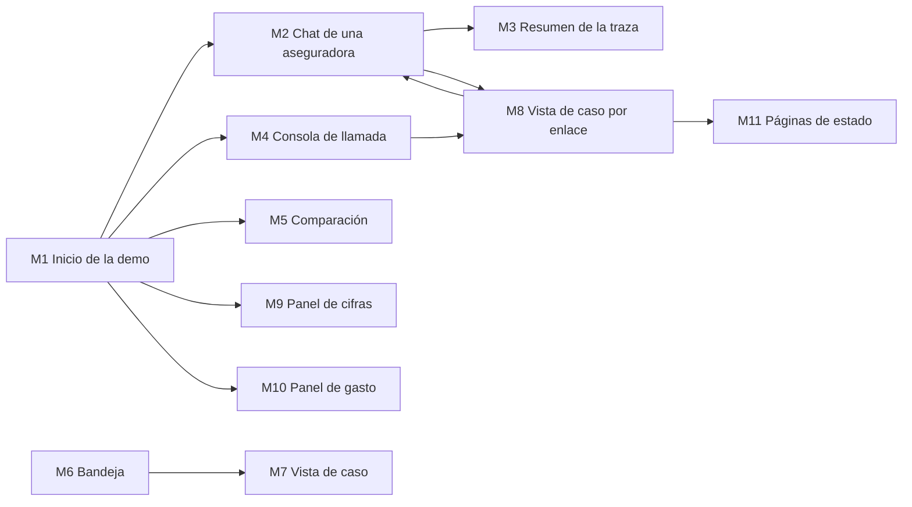

# Maquetas — Untangle

Doce pantallas del aplicativo, con su disposición en escritorio y en teléfono,
sus estados y sus textos de ejemplo. Cada pantalla nombra las historias de
`../user-stories/stories.md` que la exigen y respeta los requisitos de
`../requirements-analysis/requirements.md` y las prácticas de
`../practices-discovery/team-practices.md`: todo texto sale del catálogo por
idioma y cada decisión visible queda trazada. El scope `classic` no produjo
`wireframes.md` ni `user-flow.md`, así que estas maquetas se diseñaron
directamente desde las historias, sin inventar lo que ningún documento dice.

Los tokens, los temas y los componentes están en `design-system-mapping.md`; los
estados, el teclado y los anuncios de cada componente, en `interaction-spec.md`;
la lista de accesibilidad, en `accessibility-checklist.md`. La maqueta navegable
en HTML muestra las doce pantallas con estos mismos tokens: una barra de revisión
elige la pantalla, el estado, la aseguradora, la vista de escritorio o teléfono y
el idioma, y cada pantalla trae su propio selector de modo claro u oscuro. Sus respuestas son de ejemplo; no usa un modelo de lenguaje. Está
publicada como [página privada](https://claude.ai/artifact/71RVfbvLu4GWQygB3WGeEU)
y copiada en `maqueta/untangle-maqueta.html` para abrirla sin conexión. Los íconos
se dibujaron con el trazo de Phosphor; el aplicativo usa los de la librería.

Los esquemas usan texto en español para leerlos aquí. Cada texto visible es una
clave del catálogo con su versión en inglés, y cuando la historia fija la frase
en inglés se escribe en inglés. Los números de caso, pólizas, cifras y montos son
datos de ejemplo de la maqueta.

## Decisiones aplicadas

| Pregunta | Decisión | Dónde se ve |
| --- | --- | --- |
| Q1 | Página de inicio de la demo | M1 |
| Q2, revisada | Un sistema visual con dos modos completos, claro y oscuro, que la persona elige con un selector de tema; ninguna pantalla impone su modo (pedido de Miguel en la revisión, que reemplaza el tema por superficie) | Todas; modos de tema en `design-system-mapping.md` |
| Q2b | Las imágenes de nudos no entran al aplicativo; la landing cambia de concepto aparte | Ninguna pantalla usa fotos ni ilustraciones |
| Q3 | Tarjeta de fuente bajo la respuesta y resumen de la traza en panel lateral u hoja inferior | M2, M3 |
| Q4 | Consola con dos zonas: la conversación y "Qué está pasando" | M4 |
| Q5 | Encabezado fijo con acciones y evidencia en secciones plegables | M7, M8 |
| Q6 | Tokens y componentes con nombres genéricos | `design-system-mapping.md` |
| Q7 | Panel de cifras y panel de gasto públicos | M9, M10 |
| Revisión 1 | Recorrido de uso sin contexto con veinte correcciones (U-01 a U-20); apertura de voz "queda transcrita" (R-01, D26 de User Stories); retomar por chat un caso de voz (R-02) | Todas; tabla en `interaction-spec.md`, sección "Uso sin contexto" |
| Q8 | Estos documentos y una maqueta navegable en HTML | [Maqueta publicada](https://claude.ai/artifact/71RVfbvLu4GWQygB3WGeEU) (página privada) y copia local en `maqueta/untangle-maqueta.html` |

## Mapa de pantallas



Texto alternativo: desde el inicio se llega al chat de cada aseguradora, a la
consola de llamada, a la comparación y a los dos paneles. Desde el chat se abre
el resumen de la traza y, al cerrar un caso, la vista del caso por enlace; la
consola también entrega ese enlace. La vista por enlace vuelve a la conversación
o, si el enlace no sirve, muestra una página de estado. La bandeja con
credencial lleva a la vista de caso. La cotización (M12) vive dentro del chat y
de la bandeja.

---

## M1 — Inicio de la demo

- **Historias:** US4.17, US1.3, US2.9, US4.16, US5.14, US5.16
- **Tema:** el modo que eligió la persona
- **Propósito:** que Jordan y Taylor sepan en segundos qué pueden probar y con
  qué póliza, antes de abrir cualquier canal.

### Escritorio

```text
+------------------------------------------------------------------------+
| Untangle   Resultados medidos  Costo de la demo  Cómo está hecho       |
|                                  [Español | English]  [Claro | Oscuro] |
+------------------------------------------------------------------------+
|                                                                        |
|  Reporta un accidente, pregunta por tu póliza y                        |
|  decide el caso tú mismo.                                              |
|                                                                        |
|  Demostración con tres aseguradoras ficticias y pólizas de ejemplo.    |
|  Nada llega a una aseguradora real y los datos se borran cada noche.   |
|                                                                        |
|  (o) Voz disponible hoy: una llamada de hasta 3 minutos desde esta     |
|      conexión.                                                         |
|                                                                        |
|  Cómo funciona                                                         |
|  1 Elige una aseguradora y cuenta lo que pasó, por chat o por voz.     |
|  2 Al terminar recibes un enlace a tu caso.                            |
|  3 Con ese enlace decides tu caso, como lo haría un ajustador.         |
|                                                                        |
|  Elige una aseguradora                                                 |
|  Si es tu primera vez, empieza por el chat. Cuando Valentina te pida   |
|  la póliza, usa los datos de ejemplo de cada fila.                     |
|  ----------------------------------------------------------------------|
|  (arco) Stonecroft Mutual      Póliza SMU-4821-0937   [Abrir chat]      |
|         Conservadora; atiende  Camilo Restrepo        [Llamar]          |
|         en español primero     Mazda 3, 2019                           |
|  ----------------------------------------------------------------------|
|  (sol)  Sunmeadow Auto         Póliza SMA-7310-2264   [Abrir chat]      |
|         Flexible; atiende en   Ana Whitfield          [Llamar]          |
|         inglés primero         Toyota Corolla, 2021                    |
|  ----------------------------------------------------------------------|
|  (anillos) Knotwell Insurance  Emitida por            [Abrir chat]      |
|         Agency. Coloca pólizas Sunmeadow Auto         [Llamar]          |
|         de las dos             KIA-1188-4402                           |
|  ----------------------------------------------------------------------|
|                                                                        |
|  [Comparar las tres respuestas a una pregunta]                         |
|                                                                        |
|  Qué puedes probar                                                     |
|  - Reportar un choque por chat o por voz                               |
|  - Preguntar si tu póliza cubre algo y ver la cláusula                 |
|  - Interrumpir a la agente mientras habla                              |
|  - Decidir tu propio caso con el enlace que recibes al cerrar          |
|                                                                        |
+------------------------------------------------------------------------+
| Demostración de portafolio. Datos sintéticos.   Video   Landing        |
+------------------------------------------------------------------------+
```

### Teléfono

```text
+----------------------------------+
| Untangle                       = |
| [Español | English] [Claro|Oscuro]|
+----------------------------------+
| Reporta un accidente,            |
| pregunta por tu póliza y         |
| decide el caso tú mismo.         |
|                                  |
| Demostración con aseguradoras    |
| ficticias. Se borra cada noche.  |
|                                  |
| (o) Voz disponible hoy: 1        |
|     llamada de hasta 3 minutos.  |
|                                  |
| Cómo funciona                    |
| 1 Cuenta lo que pasó.            |
| 2 Recibe el enlace a tu caso.    |
| 3 Decide tu caso.                |
|                                  |
| Si es tu primera vez, empieza    |
| por el chat.                     |
| (arco) Stonecroft Mutual         |
| Póliza SMU-4821-0937             |
| [Abrir chat]   [Llamar]          |
| -------------------------------- |
| (sol) Sunmeadow Auto             |
| Póliza SMA-7310-2264             |
| [Abrir chat]   [Llamar]          |
| -------------------------------- |
| (anillos) Knotwell Insurance     |
| Agency                           |
| [Abrir chat]   [Llamar]          |
| -------------------------------- |
| [Comparar las tres respuestas]   |
+----------------------------------+
```

### Anotaciones

- Las aseguradoras son filas con información distinta (carácter, póliza,
  emisora), no tres tarjetas iguales. El monograma usa el acento de cada una en
  el modo elegido.
- "Cómo funciona" es una secuencia real, por eso lleva números (U-01). La
  navegación, el idioma y el tema usan palabras completas (U-03, U-04, U-20).
- La disponibilidad de la voz se consulta al cargar y se escribe en texto, no
  solo con un color. Estados: disponible; "Ya usaste tu llamada de hoy desde esta
  conexión"; "La voz llegó al límite de llamadas del sitio por hoy"; "La
  demostración de voz llegó a su presupuesto y no está recibiendo llamadas. El
  chat sigue disponible." (US5.12, US5.14). Con la voz no disponible, "Llamar"
  se reemplaza por el motivo y el enlace al chat.
- La póliza de ejemplo se muestra completa y agrupada para leerla (AC1.3.1).
- Si la instancia duerme, la visita cae primero en la página de espera (M11).

### Estados

| Estado | Qué se ve |
| --- | --- |
| Cargando | Esqueleto de las tres filas; el texto del título ya está |
| Voz no disponible | Línea de disponibilidad con el motivo; botones "Llamar" sustituidos por el motivo |
| Error al consultar disponibilidad | "No pudimos comprobar la voz. El chat funciona." y "Llamar" deshabilitado con esa razón |

---

## M2 — Chat de una aseguradora

- **Historias:** US1.1 a US1.20, US1.33, US2.1 a US2.8, US2.10, US5.13, US6.1, US6.2
- **Tema:** el modo que eligió la persona, con el acento de la aseguradora
- **Propósito:** que una persona reporte su siniestro o pregunte por su póliza
  con la divulgación y la evidencia a la vista, sin ruido para quien está
  estresado.

### Escritorio

```text
+------------------------------------------------------------------------+
| (arco) Stonecroft Mutual   con Untangle                                |
| Inicio de la demo            Idioma [Español | English] [Claro | Oscuro]|
+------------------------------------------------------------------------+
| Demostración con pólizas de ejemplo. No hay personas atendiendo en     |
| vivo: si su caso pasa a revisión, usted mismo lo decide con el enlace  |
| que le damos.                                                           |
+------------------+-----------------------------------------------------+
| Póliza de        |                                                     |
| ejemplo          |  Valentina, asistente de IA                         |
|                  |  +-----------------------------------------------+  |
| SMU-4821-0937    |  | Hola, buenas. Le habla Valentina, la           |  |
| Camilo Restrepo  |  | asistente de inteligencia artificial de        |  |
| Mazda 3, 2019    |  | Stonecroft Mutual. Esta es una demostración    |  |
|                  |  | con pólizas de ejemplo: la conversación se     |  |
| Qué puedes       |  | guarda para registrar el caso y se borra cada  |  |
| probar           |  | noche; no escriba datos personales reales.     |  |
| - Reportar un    |  | Puedo ayudarle a reportar un siniestro o a     |  |
|   choque         |  | resolver dudas sobre su póliza, y si prefiere  |  |
| - Preguntar por  |  | que una persona revise su caso, se lo paso.    |  |
|   la cobertura   |  +-----------------------------------------------+  |
| - Pedir una      |                                                     |
|   persona        |                     +-----------------------------+ |
|                  |                     | Choqué en la autopista.     | |
|                  |                     | ¿Me pagan un carro de       | |
|                  |                     | alquiler mientras reparan   | |
|                  |                     | el mío?                     | |
|                  |                     +-----------------------------+ |
|                  |                                                     |
|                  |  +-----------------------------------------------+  |
|                  |  | Primero, ¿todos están bien y en un lugar       |  |
|                  |  | seguro?                                        |  |
|                  |  +-----------------------------------------------+  |
|                  |                                                     |
|                  |                     +-----------------------------+ |
|                  |                     | Sí, todos bien.             | |
|                  |                     +-----------------------------+ |
|                  |                                                     |
|                  |  +-----------------------------------------------+  |
|                  |  | Revisé su póliza: la cláusula de gastos de     |  |
|                  |  | transporte cubre un carro de alquiler mientras |  |
|                  |  | reparan el suyo. El monto lo confirma un       |  |
|                  |  | ajustador.                                     |  |
|                  |  | +-------------------------------------------+ |  |
|                  |  | | Gastos de transporte, Parte D             | |  |
|                  |  | | SMU-PAP-D-3.2   versión 2026.1   vigente  | |  |
|                  |  | | [Ver cláusula]  [Cómo se llegó a esta     | |  |
|                  |  | |                  respuesta]               | |  |
|                  |  | +-------------------------------------------+ |  |
|                  |  +-----------------------------------------------+  |
|                  |                                                     |
|                  |  Valentina está escribiendo                         |
|                  +-----------------------------------------------------+
|                  | [Escriba su mensaje                        ] [Enviar] |
|                  | Enter envía; Mayús + Enter agrega una línea        |
+------------------+-----------------------------------------------------+
```

### Teléfono

```text
+----------------------------------+
| (arco) Stonecroft Mutual         |
| [Español|English] [Claro|Oscuro] |
| Demostración con pólizas de      |
| ejemplo. Sin personas en vivo.   |
| [Póliza de ejemplo  v]           |
+----------------------------------+
| +------------------------------+ |
| | Hola, buenas. Le habla       | |
| | Valentina, la asistente de   | |
| | inteligencia artificial...   | |
| +------------------------------+ |
|           +--------------------+ |
|           | ¿Me pagan un carro | |
|           | de alquiler?       | |
|           +--------------------+ |
| +------------------------------+ |
| | Revisé su póliza: ...        | |
| | +--------------------------+ | |
| | | Gastos de transporte     | | |
| | | SMU-PAP-D-3.2  v2026.1   | | |
| | | [Ver cláusula]           | | |
| | | [Cómo se llegó]          | | |
| | +--------------------------+ | |
| +------------------------------+ |
+----------------------------------+
| [Escriba su mensaje    ] [Enviar]|
+----------------------------------+
```

### Tipos de mensaje

| Tipo | Aspecto | Historias |
| --- | --- | --- |
| Divulgación | Primer mensaje de la agente, antes de cualquier pregunta, con el aviso de datos | US1.1 |
| Sugerencias | En una conversación nueva, tres botones bajo la divulgación: "Quiero reportar un choque", "¿Me pagan un carro de alquiler?" y "Prefiero que me atienda una persona". Desaparecen tras el primer mensaje (U-05) | US1.1, US1.5 |
| Marca de canal | En un caso retomado, cada turno lleva "por voz" o "por chat" (R-02) | US1.20 |
| Mensaje de la agente | Burbuja blanca a la izquierda, nombre "Valentina, asistente de IA" solo en el primer mensaje de cada grupo | US1.5 |
| Mensaje de la persona | Burbuja hundida a la derecha | US1.5 |
| Lectura de confirmación | Burbuja con "Anotado: autopista sur, salida 14, hoy sobre las 5:30 p. m. ¿Correcto?" y respuestas rápidas "Sí, es correcto" y "Corregir" | US1.7, US1.8 |
| Respuesta con cita | Burbuja con `SourceCard` dentro; "no encuentro una cláusula" va sin tarjeta y con la oferta de revisión humana | US2.2, US2.3, US2.5 |
| No pude revisar la póliza | Burbuja con "No puedo revisar su póliza en este momento; le paso el caso a un ajustador." | US2.6 |
| Emergencia | Bloque de ancho completo con contorno de error e ícono: "Si alguien está herido de gravedad, llame ya al número de emergencias de donde se encuentre. Esta es una demostración y no puede enviar ayuda." | US1.6 |
| Cierre del reporte | Resumen en tres frases, número de caso en mono, qué sigue y botón al enlace del caso | US1.14, US1.17 |
| Decisión del ajustador | Bloque con el resultado, el comentario y el número de caso | US1.18 |
| Aviso del sistema | Línea centrada de texto secundario: límite alcanzado, reinicio nocturno, degradación | US2.10, US5.13, US5.15 |
| Resultado de elegibilidad | Resultado, banda indicativa sin moneda y la condición en lenguaje llano | US6.2 |

### Cierre y decisión

```text
+-----------------------------------------------------------+
| Registré su choque en la autopista sur con su Mazda 3 y   |
| los datos del otro conductor.                             |
| Un ajustador revisa su caso y la actualización le         |
| aparece en esta conversación.                             |
| Caso SMU-482913                                           |
| [Ver y decidir mi caso]  El enlace vence hoy a las        |
|                                  las 6:42 p. m.           |
+-----------------------------------------------------------+
Cualquier cosa, me escribe por aquí. Que esté muy bien.

+-----------------------------------------------------------+
| Decisión del ajustador: aprobado                          |
| "Solicitar placa del tercero"                             |
| Caso SMU-482913                                           |
+-----------------------------------------------------------+
```

### Estados

| Estado | Qué se ve |
| --- | --- |
| Cargando la página | La divulgación aparece primero; el compositor queda activo cuando la conexión está lista |
| La agente escribe | "Valentina está escribiendo" bajo el último mensaje; la respuesta llega palabra a palabra y se anuncia completa una sola vez |
| Modelo sin respuesta | Mensaje de degradación del catálogo; el texto escrito por la persona sigue en el compositor |
| Límite de mensajes | Compositor deshabilitado con "Llegó al límite de la demostración" y cuándo puede seguir; el caso sigue guardado |
| Idioma no atendido | Respuesta en español e inglés con la oferta de revisión humana |
| Retomar | Tras la divulgación, "Veo que tiene un caso abierto. ¿Seguimos con ese?" |
| Retomar un caso empezado por voz | La persona escribe el número de caso y la póliza; la agente retoma y pide solo lo que falta, y los turnos anteriores llevan "por voz" (R-02, AC1.20.1 y AC1.20.4) |
| Número de caso ajeno | Un caso creado desde otro navegador o de otra aseguradora recibe la misma respuesta que un número que no existe: "No encuentro un caso con ese número. Revise que esté completo o empecemos un reporte nuevo." (AC1.20.2 y AC1.20.3) |
| Reinicio nocturno | Aviso de que la demostración se reinició y conversación nueva con la divulgación completa |
| Aseguradora que no existe | Página no encontrada (M11), sin nombres de otra aseguradora |

---

## M3 — Resumen de la traza

- **Historias:** US2.3, US4.8
- **Tema:** el mismo modo del chat sobre el que se abre
- **Propósito:** que Jordan vea, sin iniciar sesión, cómo se llegó a una
  respuesta: nodos, cláusulas verificadas, latencia y costo.

### Escritorio (panel lateral)

```text
+----------------------------- chat claro -----------+---------------------------+
|                                                    | Cómo se llegó a esta   [x]|
|                                                    | respuesta                 |
|                                                    | Los pasos que siguió el   |
|                                                    | sistema, con su tiempo y  |
|                                                    | su costo.                 |
|                                                    | respuesta                 |
|                                                    | Respuesta de las 5:31 p.m.|
|                                                    | Datos personales          |
|                                                    | redactados.               |
|                                                    |                           |
|                                                    | Ruta                      |
|                                                    | o Entendió la pregunta    |
|                                                    | | intake        180 ms    |
|                                                    | o Revisó la póliza        |
|                                                    | | policy_verification     |
|                                                    | |               640 ms    |
|                                                    | o Guardia de salida       |
|                                                    |   compliance     35 ms    |
|                                                    |                           |
|                                                    | Cláusulas                 |
|                                                    | Verificada y citada       |
|                                                    |  SMU-PAP-D-3.2  2026.1    |
|                                                    | Recuperadas, no citadas   |
|                                                    |  SMU-PAP-D-3.1  2026.1    |
|                                                    |  SMU-END-07     2025.2    |
|                                                    |                           |
|                                                    | Latencia total   1,24 s   |
|                                                    | Costo        0,00041 USD  |
+----------------------------------------------------+---------------------------+
```

### Teléfono (hoja inferior)

```text
+----------------------------------+
| chat atenuado                    |
+----------------------------------+
| ====                             |
| Cómo se llegó a esta         [x] |
| respuesta                        |
| o Entendió la pregunta   180 ms  |
| o Revisó la póliza       640 ms  |
| o Guardia de salida       35 ms  |
| Cláusula citada                  |
|   SMU-PAP-D-3.2  2026.1          |
| Latencia total 1,24 s            |
+----------------------------------+
```

### Anotaciones

- La ruta es el hilo del caso: un nodo por paso, con el nombre legible arriba y
  el nombre del nodo en mono debajo, igual que en la traza y el reporte (US4.8).
- Solo abre respuestas de la conversación de este navegador; con otro
  identificador responde como si no existiera (AC2.3.2).
- Mientras la traza se registra: "La traza se está registrando" y la vista se
  actualiza sola, nunca "no encontrado" (AC2.3.3).
- Pie: "El visor completo corre en local; este resumen lo genera el aplicativo."

---

## M4 — Consola de llamada

- **Historias:** US1.21 a US1.33, US2.7, US4.17, US5.11, US5.12, US5.14
- **Tema:** el modo que eligió la persona
- **Propósito:** que quien prueba la voz aproveche su única llamada del día y vea,
  sin explicaciones, que la agente conversa mientras trabaja de fondo.

### Antes de llamar

```text
+------------------------------------------------------------------------+
| Untangle   Llamada de voz desde el navegador                            |
|                                  [Español | English]  [Claro | Oscuro] |
+------------------------------------------------------------------------+
| Demostración con pólizas de ejemplo. El audio no se guarda.            |
+------------------------------------------------------------------------+
|                                                                        |
|  Voz disponible                                                        |
|  Tienes una llamada de hasta 3 minutos hoy desde esta conexión.        |
|                                                                        |
|  Aseguradora [Sunmeadow Auto v]   Idioma [English v]                   |
|                                                                        |
|  Policy SMA-7310-2264, Ana Whitfield, Toyota Corolla 2021              |
|                                                                        |
|  Ideas para la llamada                                                 |
|  - Reportar que un árbol cayó sobre tu carro                           |
|  - Preguntar si te pagan un carro de alquiler                          |
|  - Interrumpir a Valentina mientras habla                              |
|  - Decir "en español" para cambiar de idioma                           |
|                                                                        |
|  Cuando Valentina te pida la póliza, di: SMA-7310-2264.                |
|  Al llamar, el navegador te pide permiso para usar el micrófono. Si    |
|  cuelgas, tu caso queda guardado y recibes su enlace.                  |
|                                                                        |
|  [ Llamar ]                                                            |
+------------------------------------------------------------------------+
```

### Durante la llamada (escritorio)

```text
+------------------------------------------------------------------------+
| Untangle   Llamada con Sunmeadow Auto                        En curso   |
+--------------------------------------------+---------------------------+
| Conversación                               | Qué está pasando          |
|                                            |                           |
| Valentina  0:00                            | Valentina                 |
| Hi, this is Valentina, Sunmeadow Auto's AI | (o) Escuchando            |
| assistant. This call is transcribed so I   |                           |
| file your case correctly... First, is      | Último turno              |
| everyone okay?                             | Tiempo de respuesta del   |
| Valentina ya dijo que es una IA 0:09       | último turno: 612 ms      |
|                                            |                           |
| Tú  0:11                                   | Tu caso                   |
| Yes, everyone's fine. A tree fell on my    | * Identidad y póliza      |
| parked car.                                | * Qué pasó                |
| Valentina  0:14                            | o Fecha y hora            |
| I'm sorry to hear that. Can I have your    | . Lugar                   |
| policy number?                             | . Vehículo y conductor    |
| Tú  0:19                                   | . Otras partes            |
| It's [número de póliza]. You can reach me  | . Lesiones                |
| at [teléfono].                             |                           |
| Tú (escuchando)                            |                           |
| it was parked on Elm...                    | Trabajando en segundo     |
|                                            | plano                     |
|                                            | ~ Revisando la póliza     |
+--------------------------------------------+---------------------------+
| 2:14 restantes                                          [ Colgar ]      |
+------------------------------------------------------------------------+
```

`*` bloque confirmado, `o` bloque en curso, `.` pendiente, `~` trabajo de fondo.

### Durante la llamada (teléfono)

```text
+----------------------------------+
| Sunmeadow Auto        En curso   |
| [Conversación] [Qué está pasando]|
+----------------------------------+
| Valentina  0:14                  |
| I'm sorry to hear that. Can I    |
| have your policy number?         |
|                                  |
| Tú  0:19                         |
| It's [número de póliza]. You can |
| reach me at [teléfono].          |
|                                  |
| Tú (escuchando)                  |
| it was parked on Elm...          |
+----------------------------------+
| 2:14 restantes      [ Colgar ]   |
+----------------------------------+
```

### Aviso de límite y final de la llamada

```text
| Quedan 30 segundos. Al terminar, tu caso pasa a un ajustador   |
| y te damos el enlace.                                          |

+----------------------------------------------------------------+
| Llamada terminada: se cortó la conexión                        |
| Caso SMA-731045                                                |
| Esperando al asegurado                                         |
|                                                                |
| Tienes 15 minutos para volver a llamar desde este navegador y  |
| seguir donde quedaste, sin gastar tu llamada del día.          |
|                                                                |
| [ Volver a llamar ]   [ Pasar mi caso a un ajustador ahora ]   |
+----------------------------------------------------------------+

+----------------------------------------------------------------+
| Llamada terminada                                              |
| Caso SMA-731045, derivado a un ajustador                       |
| An adjuster reviews your case; the decision will show up on    |
| this screen.                                                   |
| [ Ver y decidir mi caso ]  Vence hoy a las 6:42 p. m.          |
+----------------------------------------------------------------+
```

### Anotaciones

- La transcripción etiqueta con texto quién habla; los datos personales salen
  como etiquetas de su tipo (D20). La línea parcial se marca "escuchando" y se
  reemplaza al cerrar el turno.
- "Tu caso" muestra los siete campos con marca de confirmado, nunca sus valores.
- La latencia del último turno coincide con los eventos de la traza (AC4.17.5).
- Con la voz de respaldo activa, un aviso antes de la primera frase: "Hoy se usa
  una voz de respaldo, que puede sonar distinta en cada idioma." (US5.11)
- Micrófono denegado: explicación de cómo dar el permiso y enlace al chat, sin
  abrir un caso vacío (AC1.21.2).

### Estados

| Estado | Qué se ve |
| --- | --- |
| Conectando | "Conectando la llamada"; botón "Cancelar" |
| Voz no disponible | El motivo en lugar de "Llamar" y el enlace al chat |
| Voz de respaldo | Aviso en "Qué está pasando" y antes de la primera frase |
| Aviso de 30 segundos | Aviso en línea; anuncio para lector de pantalla a los 60 y a los 30 segundos |
| Corte | Final de llamada con los 15 minutos y el botón para pasar a un ajustador |
| Caso derivado o cerrado | Final de llamada con el enlace firmado |
| Decisión tomada con la consola abierta | Bloque "Decisión del ajustador" bajo el final de la llamada |

---

## M5 — Comparación entre aseguradoras

- **Historias:** US2.9
- **Tema:** el modo que eligió la persona, con el acento de cada aseguradora
- **Propósito:** que Jordan compruebe en un minuto que la misma pregunta recibe
  respuestas distintas según la póliza, sin mezclar datos.

### Escritorio

```text
+------------------------------------------------------------------------+
| Untangle   La misma pregunta, tres aseguradoras                        |
|                                  [Español | English]  [Claro | Oscuro] |
+------------------------------------------------------------------------+
| Responde Valentina, asistente de inteligencia artificial. Demostración |
| con pólizas de ejemplo: cada columna usa la de su aseguradora.         |
|                                                                        |
| [¿Me pagan un carro de alquiler mientras reparan el mío?     ] [Preguntar]|
| Prueba: ¿Me cubren un vidrio roto por granizo?                         |
|         ¿Cubre daños a la cerca de mi vecino?                          |
| Cada pregunta usa tres de tus respuestas disponibles hoy.              |
+-----------------------+------------------------+-----------------------+
| (arco) Stonecroft     | (sol) Sunmeadow Auto   | (anillos) Knotwell    |
| Mutual                | Póliza SMA-7310-2264   | Póliza emitida por    |
| Póliza SMU-4821-0937  |                        | Sunmeadow Auto        |
|-----------------------|------------------------|-----------------------|
| La cláusula de gastos | Sí: el endoso de       | No pude revisar esta  |
| de transporte cubre   | transporte amplía la   | póliza en este        |
| un carro de alquiler  | cobertura del carro de | momento.              |
| con límite diario.    | alquiler.              |                       |
|                       |                        | [Intentar de nuevo]   |
| SMU-PAP-D-3.2 2026.1  | SMA-PAP-D-3.2 2026.1   |                       |
| [Ver cláusula]        | SMA-END-11    2026.1   |                       |
|                       | [Ver cláusulas]        |                       |
+-----------------------+------------------------+-----------------------+
```

### Teléfono

```text
+----------------------------------+
| La misma pregunta, tres          |
| aseguradoras                     |
| [Escribe tu pregunta   ] [Enviar]|
+----------------------------------+
| (arco) Stonecroft Mutual         |
| La cláusula de gastos de         |
| transporte cubre...              |
| SMU-PAP-D-3.2  [Ver cláusula]    |
| -------------------------------- |
| (sol) Sunmeadow Auto             |
| Sí: el endoso de transporte...   |
| -------------------------------- |
| (anillos) Knotwell Insurance     |
| Agency                           |
| No pude revisar esta póliza.     |
+----------------------------------+
```

### Anotaciones

- Cada columna muestra su propia carga y aparece cuando está lista (AC2.9.5).
- Si escriben el reporte de un siniestro, se explica que la vista compara
  respuestas de cobertura y se enlaza el chat de cada aseguradora (AC2.9.6).
- Las columnas se separan con líneas finas; el acento solo está en el monograma y
  el nombre.

---

## M6 — Bandeja: lista de casos

- **Historias:** US3.1, US3.5, US6.3
- **Tema:** el modo que eligió la persona
- **Propósito:** que Diana atienda primero lo urgente y vea lo que espera al
  asegurado.

### Escritorio

```text
+------------------------------------------------------------------------+
| Untangle   Stonecroft Mutual   Diana, ajustadora                        |
|                                  [English | Español]  [Claro | Oscuro] |
+------------------------------------------------------------------------+
| Casos                                                                  |
| [Derivados 12] [Esperando al asegurado 3] [Cerrados 41]                |
|                                                                        |
| Canal [Todos v]  Idioma [Todos v]  Prioridad [Todas v]  Quitar filtros |
|------------------------------------------------------------------------|
| Prioridad   Espera    Caso        Tipo        Motivo      Datos  Canal |
|------------------------------------------------------------------------|
| Alta        1 h 12 m  SMU-482913  Siniestro   Derivación  3/7    Voz   |
| Pidió una persona                                              Español |
|------------------------------------------------------------------------|
| Alta        48 m      SMU-482877  Siniestro   Revisión    7/7    Chat  |
|                                               estándar         Español |
|------------------------------------------------------------------------|
| Media       3 h 05 m  SMU-481990  Consulta de Derivación  2/2    Chat  |
|                                   cobertura                    Inglés  |
+------------------------------------------------------------------------+
```

### Estados

| Estado | Qué se ve |
| --- | --- |
| Cargando | Filas esqueleto con la cabecera de la tabla ya visible |
| Sin resultados | "Ningún caso coincide con estos filtros." y "Quitar filtros" |
| Sin casos en la pestaña | "No hay casos esperando al asegurado." |
| Credencial caducada o ajena | Página de acceso rechazado, sin datos |
| Esperando al asegurado | Filas con completitud y último bloque confirmado; sin acciones de decisión |

### Anotaciones

- Orden: prioridad y, dentro de cada prioridad, tiempo de espera de mayor a menor
  (AC3.1.1). La prioridad se escribe con texto y un ícono, no solo con color.
- La elección de idioma se recuerda al abrir un caso y al recargar (AC3.1.5); el
  contenido de cada caso sigue en el idioma del asegurado.
- Con la credencial de suscriptor, la lista muestra solo solicitudes de
  cotización derivadas (US6.3).

---

## M7 — Vista de caso

- **Historias:** US3.2, US3.3, US3.4, US3.5, US3.6, US6.3
- **Tema:** el modo que eligió la persona
- **Propósito:** decidir en menos de tres minutos con toda la evidencia a la
  vista.

### Escritorio

```text
+------------------------------------------------------------------------+
| < Casos                                                                |
| Caso SMU-482913   Siniestro   Derivado            [Aprobar] [Rechazar] |
| El asegurado pidió que una persona revise su caso.                     |
| Motivo: derivación   Datos completos: 3 de 7 *-*-*-.-.-.-.            |
| Esperando decisión desde las 4:19 p. m.                                |
+------------------------------------------------------------------------+
| v Campos del caso                 | v Transcripción                    |
|   Identidad y póliza   * Corregir |   Valentina dijo que es IA 4:02 p.m.|
|   SMU-4821-0937, Camilo Restrepo  |   Valentina: Hola, buenas. Le      |
|   Fecha y hora         * Corregir |   habla Valentina...               |
|   Hoy, 5:30 p. m.                 |   Camilo: Choqué en la autopista.  |
|   Qué pasó             * Corregir |   Mi celular es [teléfono].        |
|   Choque por detrás en la         |   ...                              |
|   autopista sur                   |                                    |
|   Lugar                  Pendiente|                                    |
|   Vehículo y conductor   Pendiente|                                    |
|   Otras partes           Pendiente|                                    |
|   Lesiones               Pendiente|                                    |
+-----------------------------------+------------------------------------+
| > Cláusulas citadas (1)                                                |
| > Regla que envió el caso a revisión: pidió una persona                |
| > Controles de cumplimiento: 4 de 4 cumplidos                          |
| > Pasos del sistema: 6 pasos, 2,8 s, 0,0019 USD                        |
| > Explicación del caso                                                 |
| > Historial de cambios (1)                                             |
+------------------------------------------------------------------------+
```

### Decisión en línea

```text
+------------------------------------------------------------------------+
| Caso SMU-482913   Siniestro   Derivado                                 |
| Aprobar el caso                                                        |
| Comentario para el asegurado (obligatorio)                             |
| En la vista por enlace: "Mensaje con la decisión (obligatorio)"        |
| [solicitar placa del tercero                                         ] |
| El asegurado recibe este comentario con la decisión.                   |
| [Confirmar aprobación]  [Cancelar]                                     |
+------------------------------------------------------------------------+
```

### Teléfono

```text
+----------------------------------+
| < Casos                          |
| Caso SMU-482913                  |
| Siniestro, derivado              |
| El asegurado pidió que una       |
| persona revise su caso.          |
| Datos completos: 3 de 7          |
| [Aprobar]        [Rechazar]      |
+----------------------------------+
| v Campos del caso                |
|   Identidad y póliza    *        |
|   Fecha y hora          *        |
|   Lugar          Pendiente       |
| > Transcripción                  |
| > Cláusulas citadas (1)          |
| > Regla que envió a revisión     |
| > Controles de cumplimiento 4/4  |
| > Pasos del sistema              |
| > Explicación del caso           |
+----------------------------------+
```

### Acciones según el registro y el rol

| Registro | Ajustador | Agente de cuenta de la agencia | Suscriptor |
| --- | --- | --- | --- |
| Siniestro | Aprobar, Rechazar | Marcar como enviado a la aseguradora | — |
| Consulta de cobertura | Confirmar cobertura, No cubierto | Marcar como enviado a la aseguradora | — |
| Solicitud de cotización | — | — | Elegible, No elegible |

Las etiquetas cambian con el tipo de registro, pero la resolución guardada sigue
siendo del conjunto cerrado de D18 (aprobado, rechazado, enviado a la
aseguradora); ninguna acción de otro rol se muestra deshabilitada, simplemente no
está.

### Estados

| Estado | Qué se ve |
| --- | --- |
| Esperando al asegurado | Sin acciones de decisión; "Este caso espera al asegurado. Faltan: lugar, vehículo y conductor." |
| Decidido por otra persona | "Diana ya decidió este caso a las 4:31 p. m." y la decisión; el formulario se cierra |
| Cerrado | Sin corrección de campos ni acciones; la resolución con su etiqueta del catálogo |
| Corrección inválida | Error bajo el campo: "La fecha no es válida. Use día, mes y año." y el valor anterior se conserva |
| Sin comentario | Error bajo el comentario sin perder la decisión elegida |
| Cargando | Esqueleto del encabezado y de las secciones |

### Anotaciones

- El encabezado queda fijo al desplazarse; en el teléfono se compacta a número,
  estado y acciones.
- "Explicación del caso" responde qué se preguntó, qué se citó, qué regla se
  disparó, quién decidió y cuándo; sin decisión dice "Pendiente de decisión"
  (AC3.2.3).
- "Sin cláusula" y "No pude verificar" tienen etiquetas distintas en "Cláusulas
  citadas" (AC3.2.4).

---

## M8 — Vista de caso por enlace firmado

- **Historias:** US3.7, US3.8, US1.17
- **Tema:** el modo que eligió la persona
- **Propósito:** que Jordan decida su propio caso sin perderse y sepa qué pasó
  después.

### Al entrar

```text
+------------------------------------------------------------------------+
| Estás revisando tu propio caso con permisos de ajustador de            |
| demostración. Este enlace vence hoy a las 6:42 p. m. (tu hora).        |
| Qué hacer aquí:                                                        |
| 1 Revisa lo que Valentina registró.                                    |
| 2 Elige Aprobar o Rechazar.                                            |
| 3 Escribe el mensaje que verás en tu conversación con la decisión.     |
| [Volver a la conversación]                                             |
+------------------------------------------------------------------------+
| Caso SMA-731045   Siniestro   Derivado            [Aprobar] [Rechazar] |
| El caso llegó al límite de la llamada de demostración.                 |
| ... la misma evidencia de M7 ...                                       |
+------------------------------------------------------------------------+
```

### Después de decidir

```text
+------------------------------------------------------------------------+
| Listo: el caso se reanudó y quedó aprobado.                            |
| Lo que ve el asegurado:                                                |
|   Decisión del ajustador: aprobado. "Solicitar placa del tercero".     |
| La decisión ya aparece en la consola desde la que se hizo la llamada.  |
| [Volver a la conversación]                                             |
+------------------------------------------------------------------------+
```

### Solo lectura (cierre directo)

```text
+------------------------------------------------------------------------+
| Este caso se cerró sin ajustador.                                      |
| Lo permitió la regla SMA-R02: daño solo en vidrios, sin otras partes   |
| ni lesionados.                                                         |
| Vence hoy a las 6:42 p. m.                                             |
+------------------------------------------------------------------------+
| Caso SMA-731102   Siniestro   Cerrado: registrado                      |
| ... evidencia sin acciones ...                                         |
+------------------------------------------------------------------------+
```

### Anotaciones

- La decisión figura en el historial como "Visitante con enlace de
  demostración", nunca a nombre de Diana, Marcus Webb o Priya Raman (AC3.7.5).
- Si el enlace vence mientras se escribe el comentario, la decisión no se aplica,
  la vista lo dice y el comentario sigue en pantalla con "Copiar comentario"
  (AC3.8.3).
- La dirección visible pierde el token al cargar (AC3.8.6).

---

## M9 — Panel de cifras

- **Historias:** US4.16
- **Tema:** el modo que eligió la persona
- **Propósito:** que las cifras del README y del video se puedan comprobar.

### Escritorio

```text
+------------------------------------------------------------------------+
| Untangle   Resultados medidos                                          |
|                                  [Español | English]  [Claro | Oscuro] |
+------------------------------------------------------------------------+
| Cada cifra sale de una corrida reproducible y lleva su fecha, su       |
| commit y su reporte.                                                   |
|                                                                        |
| Reportes con todos los datos            Español 96,7 %   Inglés 93,3 % |
| De cada 100 reportes de prueba, cuántos quedaron con los siete datos.  |
| Medido el 2026-10-14, commit 3f9c2a1, 30 casos por idioma  Ver reporte |
|------------------------------------------------------------------------|
| Citas correctas a la póliza             Español 95,0 %   Inglés 97,5 % |
| De cada 100 respuestas con cláusula, cuántas citaron la correcta.      |
| Medido el 2026-10-14, commit 3f9c2a1, 20 preguntas por idioma          |
|------------------------------------------------------------------------|
| Latencias                    Español            Inglés                 |
| Chat, del envío a la         La mitad: 1,1 s    La mitad: 0,9 s        |
| primera palabra              95 de 100: 2,4 s   95 de 100: 2,1 s       |
| Voz, del fin del habla al    No medida:         La mitad: 480 ms       |
| primer audio                 hito de semana 9   95 de 100: 790 ms      |
|------------------------------------------------------------------------|
| Costo por caso               0,011 USD por caso exitoso                |
|------------------------------------------------------------------------|
| Casos por aseguradora        Stonecroft Mutual 14                      |
|                              Sunmeadow Auto 19                         |
|                              Knotwell Insurance Agency 6               |
+------------------------------------------------------------------------+
```

### Anotaciones

- Las cifras usan `type.figure` en la familia de display y dígitos tabulares; el
  método y la fecha van en texto secundario debajo, nunca una cifra sin origen.
- Los dos idiomas siempre lado a lado, sin promedio (NFR20).
- "No medida" lleva su causa y nunca aparece vacía ni en cero (AC4.16.4).
- Casos por aseguradora: solo recuentos (AC4.16.5).

---

## M10 — Panel de gasto

- **Historias:** US5.14
- **Tema:** el modo que eligió la persona
- **Propósito:** mostrar en público cómo se controla el gasto, sin exponer casos
  de visitantes.

### Escritorio

```text
+------------------------------------------------------------------------+
| Untangle   Costo de la demo                                            |
|                                  [Español | English]  [Claro | Oscuro] |
+------------------------------------------------------------------------+
| 1,84 USD de 5,00 USD                                                   |
| Ventana de 90 días, del 2026-09-16 al 2026-12-14                       |
| [==============------------|-------------------]                      |
|                      alerta en 3,00 USD                                |
| La voz está recibiendo llamadas.                                       |
|------------------------------------------------------------------------|
| Por proveedor                Este mes     Acumulado                    |
| Modelo de lenguaje           0,41 USD     0,62 USD                     |
| Transcripción                0,00 USD     0,00 USD  Crédito gratuito   |
| Síntesis de voz              0,83 USD     1,22 USD                     |
|------------------------------------------------------------------------|
| Por mes                      Septiembre 0,43 USD   Octubre 1,41 USD    |
|------------------------------------------------------------------------|
| Costo por caso               Promedio 0,011 USD                        |
| [histograma de 5 rangos, sin números de caso]                          |
| Costo del modelo de lenguaje por minuto de llamada: 0,0041 USD, meta   |
| 0,005 USD o menos                                                      |
|------------------------------------------------------------------------|
| Precios de lista del 2026-09-16. Un componente sin precio aparece      |
| como "no medido". Actualizado a las 5:40 p. m.                         |
+------------------------------------------------------------------------+
```

### Anotaciones

- Con el techo alcanzado, la línea de estado dice "La demostración de voz llegó a
  su presupuesto y no está recibiendo llamadas. El chat sigue disponible."
- El costo por caso se muestra como promedio y distribución, sin identificadores:
  la vista es pública (respuesta Q7) y los casos son de visitantes.
- La transcripción y la síntesis se publican aparte y sin meta (D7).

---

## M11 — Páginas de estado

- **Historias:** US5.16, US3.8, US1.1, US2.10, US5.15
- **Tema:** el modo que eligió la persona

```text
+----------------------------------+  +----------------------------------+
| La demo está despertando.        |  | Este enlace no es válido.        |
| Tarda menos de un minuto; esta   |  | Revisa que lo copiaste completo  |
| página se actualiza sola.        |  | o pide uno nuevo en la           |
| ------------o                    |  | conversación donde creaste el    |
|                                  |  | caso.                            |
+----------------------------------+  +----------------------------------+

+----------------------------------+  +----------------------------------+
| Este enlace venció.              |  | No encontramos esta página.      |
| Tu caso sigue guardado hasta el  |  | [Ir al inicio]                   |
| reinicio de esta noche. Pide un  |  |                                  |
| enlace nuevo en la misma         |  |                                  |
| conversación, desde el navegador |  |                                  |
| donde lo creaste.                |  |                                  |
+----------------------------------+  +----------------------------------+
```

| Página | Texto | Acción |
| --- | --- | --- |
| Despertando | "La demo está despertando. Tarda menos de un minuto; esta página se actualiza sola." | Se actualiza sola; a los 60 segundos pasa a "No disponible" |
| No disponible | "La demo no está disponible ahora." | Enlaces al README y al video |
| Enlace no válido | Mismo texto para un enlace manipulado y para un caso que no existe | Volver al inicio |
| Enlace vencido | El caso sigue guardado hasta el reinicio nocturno y cómo pedir otro | Volver a la conversación |
| Datos reiniciados | "Los datos de la demostración se borran cada noche." | Empezar de nuevo |
| No encontrada | "No encontramos esta página." Sin nombres de aseguradoras | Ir al inicio |
| Servicio no disponible | "El servicio no está disponible en este momento. Intenta de nuevo en unos minutos." Sin detalles técnicos | Reintentar |

La línea que avanza en "despertando" es el hilo; con movimiento reducido se
reemplaza por el texto "Despertando" sin animación.

---

## M12 — Cotización (Should S1)

- **Historias:** US6.1, US6.2, US6.3
- **Tema:** el modo que eligió la persona

```text
+-----------------------------------------------------------+
| Resultado de elegibilidad: elegible                       |
| Banda indicativa: media                                   |
| Se cumple: licencia con más de tres años y sin siniestros |
| en los últimos dos años.                                  |
| Esta demostración no calcula precios.                     |
+-----------------------------------------------------------+
```

- Solo aparece si la cotización está activa en la configuración de la
  aseguradora (D4); si no, la agente dice que esta demostración no cotiza.
- La banda nunca lleva moneda ni cifras (AC6.2.2).
- En la bandeja del suscriptor, la lista y la vista de caso de M6 y M7 con las
  acciones "Elegible" y "No elegible".

---

## Trazabilidad de pantallas

| Pantalla | Historias |
| --- | --- |
| M1 Inicio | US4.17, US1.3, US2.9, US4.16, US5.14, US5.16 |
| M2 Chat | US1.1 a US1.20, US1.33, US2.1 a US2.8, US2.10, US5.13, US6.1, US6.2 |
| M3 Traza | US2.3, US4.8 |
| M4 Consola | US1.21 a US1.33, US2.7, US4.17, US5.11, US5.12, US5.14 |
| M5 Comparación | US2.9 |
| M6 Bandeja | US3.1, US3.5, US6.3 |
| M7 Vista de caso | US3.2 a US3.6, US6.3 |
| M8 Vista por enlace | US3.7, US3.8, US1.17 |
| M9 Cifras | US4.16 |
| M10 Gasto | US5.14 |
| M11 Estados | US5.16, US3.8, US1.1, US2.10, US5.15 |
| M12 Cotización | US6.1, US6.2, US6.3 |

Las historias sin pantalla propia son de evidencia, operación o evaluación
(US4.1 a US4.15, US5.1 a US5.10, US5.13 en su parte de configuración, US5.15 en
su parte de datos): se ven en el README, el video, la línea de comandos o la
configuración.

## Fuera de esta etapa

- El rediseño de la landing con un concepto literal del mundo de seguros
  (respuesta Q2b), que conserva la paleta, la tipografía y el hilo lateral.
- El README y el video (US4.1, US4.2), que usan capturas de estas pantallas
  cuando existan.
