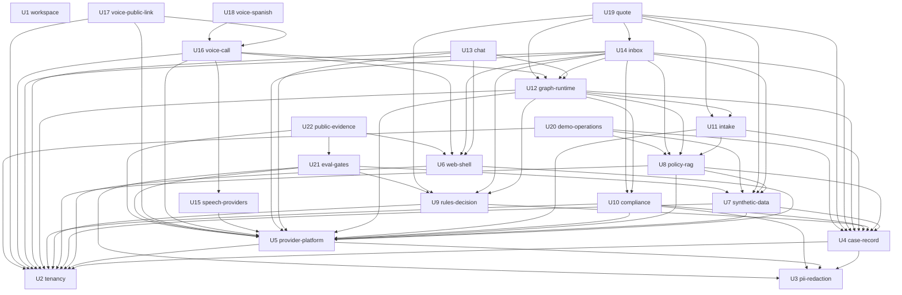

# Dependencias entre unidades — Untangle

El mapa de qué unidad necesita a cuál. Describe la topología y nada más: no
recomienda un orden de construcción ni marca un camino crítico, que son
decisiones económicas de Delivery Planning sobre este mismo mapa.

**Fuentes consumidas.**

- **Componentes** (`../domain-design/components.md`): los 23 componentes, sus
  dependencias, la propiedad de cada entidad, las historias por componente y la
  opción A de los nodos.
- **Decisiones de arquitectura** (`../domain-design/decisions.md`): el monolito
  modular en un solo proceso (ADR-001), los dos lenguajes y el origen único
  (ADR-002), LangGraph (ADR-003), el ritmo de fondo sin broker (ADR-004), los
  proveedores y el experimento 1 (ADR-006 a ADR-009), la evaluación (ADR-014) y
  los adaptadores por uso (ADR-018), que fijan dónde se puede partir y dónde no.
- **Requisitos** (`../requirements-analysis/requirements.md`): los grupos FR1 a
  FR14, los NFR con su valor esperado y la pregunta abierta OQ4 de hospedaje.
- **Historias** (`../user-stories/stories.md`): las 87 historias con su
  prioridad, su rama anticipada, sus módulos, sus relaciones "Construye sobre",
  las cadenas que no se deben separar y las preguntas PA-1 a PA-13.
- **Prácticas del equipo** (`../practices-discovery/team-practices.md`, ya en
  `team.md`): la base sólida y después una pieza completa a la vez, la rama de
  pruebas por unidad, el primer commit con todo el andamiaje y las diez
  convenciones de estilo.
- **Plan de entrega del PRD** (`docs/specs/prd.md`, sección 13): las capas de
  texto, bandeja y chat, voz en inglés y voz en español, y la regla de corte
  S2, S1, C1, S5, S4.
- **Respuestas de esta etapa** (`units-generation-questions.md`): Q1 (A), Q2 (A)
  y la aprobación del plan.

## Qué significa una dependencia

"A depende de B" cuando A importa la interfaz pública de B, o cuando A necesita
datos o herramientas que produce B para probarse con datos sembrados (decisión
UG-8 de `unit-of-work.md`). No sigue el sentido de las llamadas en ejecución:
por eso el chat y la llamada registran su conductor en el corredor de U1 en
lugar de que la evaluación dependa de ellos (UG-4), y cada dueño de datos de
visitante implementa el contrato de U2 en lugar de que la operación de la demo
dependa de cada dueño (UG-3). La aceptación de punta a punta que cruza unidades
no crea aristas: se verifica en Build and Test y se lista en
`unit-of-work-story-map.md`.

**Corrección del 2026-09-19.** Se retiró la arista U11 `intake` → U9
`rules-decision`, que estaba justificada como "US1.4 y US1.12 se aceptan con las
reglas de la aseguradora". Era una arista falsa, por tres razones independientes:

1. `../domain-design/components.md` no la tiene: las dependencias de IntakeNode
   son CaseRecord, PolicyCorpus, ProviderGateway y CopyCatalog, y el catálogo de
   componentes es la autoridad sobre las dependencias entre componentes.
2. El nodo de captura corre **dentro del turno**, y la práctica afirmada manda
   que las reglas corran en el ritmo de fondo. Dentro del turno solo corren tres
   controles baratos de cumplimiento, y las reglas no son uno de ellos.
3. Es exactamente lo que UG-8 prohíbe. Los dos criterios dicen *"cuando **se
   aplican** las reglas, entonces la categoría es derivación"*: lo cumple el
   grafo ejecutando el nodo de decisión de fondo después de que la captura
   escribió el campo, no la captura llamando al motor de reglas.

Las dos historias siguen en U11 y su aceptación de punta a punta con U9 queda
listada en `unit-of-work-story-map.md`, que es donde va.

**Enmienda del 2026-09-21 — aristas de orden de entrega (DP-14).** Por decisión
de Miguel, U17 `voice-public-link`, U20 `demo-operations` y U22 `public-evidence`
se construyen al final, en la pasada de publicación, porque solo sirven para
abrir la demo al público. La herramienta del flujo ordena únicamente por
dependencias, así que cada una lleva una arista hacia U18 `voice-spanish` que
**no es técnica**: ninguna de las tres importa nada de U18. Son exactamente
estas tres —`u17-voice-public-link`, `u20-demo-operations` y
`u22-public-evidence` hacia `u18-voice-spanish`— y esta enmienda es su marca: el
bloque de abajo no admite comentarios, porque la herramienta lo lee como datos.
Son la única excepción admitida a UG-8 (`project.md`, Corrections). Ninguna otra unidad depende de
estas tres, así que moverlas no cambia nada más del mapa. Las aristas técnicas
siguen siendo las de siempre.

## Bloque de aristas

Fuente legible por máquina del mapa. Cada unidad aparece una vez, con el nombre
de su directorio de Construcción (la columna `Directory` de `unit-of-work.md`) y
sus dependencias directas; las unidades sin tipo omiten `kind`.

```yaml
units:
  - name: u1-workspace
    depends_on: []
  - name: u2-tenancy
    kind: library
    depends_on: [u1-workspace]
  - name: u3-pii-redaction
    kind: library
    depends_on: [u1-workspace]
  - name: u4-case-record
    kind: library
    depends_on: [u1-workspace, u2-tenancy, u3-pii-redaction]
  - name: u5-provider-platform
    kind: service
    depends_on: [u1-workspace, u2-tenancy, u3-pii-redaction]
  - name: u06-web-shell
    depends_on: [u1-workspace, u2-tenancy, u5-provider-platform]
  - name: u7-synthetic-data
    kind: library
    depends_on: [u1-workspace, u2-tenancy, u4-case-record, u5-provider-platform]
  - name: u8-policy-rag
    kind: library
    depends_on: [u1-workspace, u2-tenancy, u4-case-record, u5-provider-platform, u7-synthetic-data]
  - name: u9-rules-decision
    kind: library
    depends_on: [u1-workspace, u2-tenancy, u4-case-record]
  - name: u10-compliance
    kind: library
    depends_on: [u1-workspace, u2-tenancy, u3-pii-redaction, u4-case-record, u5-provider-platform]
  - name: u11-intake
    kind: library
    depends_on: [u1-workspace, u4-case-record, u5-provider-platform, u8-policy-rag]
  - name: u12-graph-runtime
    kind: service
    depends_on: [u1-workspace, u2-tenancy, u4-case-record, u5-provider-platform, u8-policy-rag, u9-rules-decision, u10-compliance, u11-intake]
  - name: u13-chat
    depends_on: [u1-workspace, u2-tenancy, u5-provider-platform, u06-web-shell, u12-graph-runtime]
  - name: u14-inbox
    depends_on: [u1-workspace, u2-tenancy, u4-case-record, u5-provider-platform, u06-web-shell, u7-synthetic-data, u8-policy-rag, u9-rules-decision, u10-compliance, u12-graph-runtime]
  - name: u15-speech-providers
    kind: library
    depends_on: [u1-workspace, u5-provider-platform]
  - name: u16-voice-call
    depends_on: [u1-workspace, u2-tenancy, u5-provider-platform, u06-web-shell, u12-graph-runtime, u15-speech-providers]
  - name: u17-voice-public-link
    depends_on: [u1-workspace, u2-tenancy, u5-provider-platform, u16-voice-call, u18-voice-spanish]
  - name: u18-voice-spanish
    kind: service
    depends_on: [u1-workspace, u16-voice-call]
  - name: u19-quote
    kind: library
    depends_on: [u1-workspace, u4-case-record, u7-synthetic-data, u9-rules-decision, u11-intake, u12-graph-runtime, u14-inbox]
  - name: u20-demo-operations
    kind: service
    depends_on: [u1-workspace, u2-tenancy, u4-case-record, u7-synthetic-data, u8-policy-rag, u18-voice-spanish]
  - name: u21-eval-gates
    depends_on: [u1-workspace, u5-provider-platform, u7-synthetic-data, u9-rules-decision]
  - name: u22-public-evidence
    kind: ui
    depends_on: [u1-workspace, u5-provider-platform, u06-web-shell, u21-eval-gates, u18-voice-spanish]
```

## Diagrama de dependencias

Cada flecha va de la unidad que depende a la unidad de la que depende. Para que
el diagrama se lea, omite las 21 flechas hacia U1 `workspace`: todas las
demás unidades dependen de ella.



<!-- Text fallback: 22 unidades y 90 dependencias directas. U1 workspace no depende de nadie y todas las demás dependen de ella. U4 case-record depende de U2, U3; U5 provider-platform depende de U2, U3; U6 web-shell depende de U2, U5; U7 synthetic-data depende de U2, U4, U5; U8 policy-rag depende de U2, U4, U5, U7; U9 rules-decision depende de U2, U4; U10 compliance depende de U2, U3, U4, U5; U11 intake depende de U4, U5, U8; U12 graph-runtime depende de U2, U4, U5, U8, U9, U10, U11; U13 chat depende de U2, U5, U6, U12; U14 inbox depende de U2, U4, U5, U6, U7, U8, U9, U10, U12; U15 speech-providers depende de U5; U16 voice-call depende de U2, U5, U6, U12, U15; U17 voice-public-link depende de U2, U5, U16; U18 voice-spanish depende de U16; U19 quote depende de U4, U7, U9, U11, U12, U14; U20 demo-operations depende de U2, U4, U7, U8; U21 eval-gates depende de U3, U5, U7, U9; U22 public-evidence depende de U5, U6, U21. -->

## Aristas y su razón

| Unidad | Depende de | Por qué |
| --- | --- | --- |
| U2 `tenancy` | U1 `workspace` | andamiaje, corredor y reglas de importación |
| U3 `pii-redaction` | U1 `workspace` | andamiaje y corredor |
| U4 `case-record` | U1 `workspace` | andamiaje y corredor |
| U4 `case-record` | U2 `tenancy` | punto único de sesión y RLS |
| U4 `case-record` | U3 `pii-redaction` | redacta cada turno antes de guardarlo |
| U5 `provider-platform` | U1 `workspace` | andamiaje y reglas de importación |
| U5 `provider-platform` | U2 `tenancy` | sesión para el registro de gasto y los resúmenes de traza |
| U5 `provider-platform` | U3 `pii-redaction` | la exportación de trazas pasa por la redacción |
| U6 `web-shell` | U1 `workspace` | andamiaje de TypeScript, catálogo y raíz de composición |
| U6 `web-shell` | U2 `tenancy` | salud de la base de datos y política de la cookie del navegador |
| U6 `web-shell` | U5 `provider-platform` | telemetría de activación sin datos personales |
| U7 `synthetic-data` | U1 `workspace` | chequeos de contenido y comando del archivo de tareas |
| U7 `synthetic-data` | U2 `tenancy` | carpetas de configuración por aseguradora |
| U7 `synthetic-data` | U4 `case-record` | esquema de los casos sembrados |
| U7 `synthetic-data` | U5 `provider-platform` | redacción única de los textos fuente con el modelo en plan gratuito |
| U8 `policy-rag` | U1 `workspace` | catálogo y corredor |
| U8 `policy-rag` | U2 `tenancy` | sesión, RLS y carpeta del corpus |
| U8 `policy-rag` | U4 `case-record` | respuestas y comprobaciones pertenecen a un caso |
| U8 `policy-rag` | U5 `provider-platform` | embeddings y segunda pasada del modelo |
| U8 `policy-rag` | U7 `synthetic-data` | corpus DS-1 y pólizas emitidas para los casos de DS-3 |
| U9 `rules-decision` | U1 `workspace` | corredor y claves de explicación del catálogo |
| U9 `rules-decision` | U2 `tenancy` | reglas por aseguradora y sesión |
| U9 `rules-decision` | U4 `case-record` | el nodo escribe la categoría y su explicación en el caso |
| U10 `compliance` | U1 `workspace` | catálogo de frases permitidas y corredor |
| U10 `compliance` | U2 `tenancy` | políticas por aseguradora y sesión |
| U10 `compliance` | U3 `pii-redaction` | comprueba que lo exportable esté redactado |
| U10 `compliance` | U4 `case-record` | lee la conversación y cierra o deriva el caso |
| U10 `compliance` | U5 `provider-platform` | clasificación de la revisión completa cuando las reglas no bastan |
| U11 `intake` | U1 `workspace` | catálogo de preguntas y lecturas, y corredor |
| U11 `intake` | U4 `case-record` | lee y escribe campos, partes y confirmaciones |
| U11 `intake` | U5 `provider-platform` | extracción y redacción con el modelo |
| U11 `intake` | U8 `policy-rag` | busca la póliza emitida para identificar a la persona |
| U12 `graph-runtime` | U1 `workspace` | frases de espera y de degradación, y corredor |
| U12 `graph-runtime` | U2 `tenancy` | sesión para puntos de control y configuración |
| U12 `graph-runtime` | U4 `case-record` | crea el caso y aplica transiciones |
| U12 `graph-runtime` | U5 `provider-platform` | tramos por turno y por nodo |
| U12 `graph-runtime` | U8 `policy-rag` | nodo `policy_verification` |
| U12 `graph-runtime` | U9 `rules-decision` | nodo `decision` |
| U12 `graph-runtime` | U10 `compliance` | nodo `compliance` y controles en el punto único de salida |
| U12 `graph-runtime` | U11 `intake` | nodo `intake` |
| U13 `chat` | U1 `workspace` | conductor de texto para el corredor y catálogo |
| U13 `chat` | U2 `tenancy` | clave del navegador, póliza de ejemplo y sesión |
| U13 `chat` | U5 `provider-platform` | límites de mensajes y resúmenes de traza |
| U13 `chat` | U6 `web-shell` | base visual y cliente de la API |
| U13 `chat` | U12 `graph-runtime` | entrega turnos y recibe salidas |
| U14 `inbox` | U1 `workspace` | catálogo y corredor |
| U14 `inbox` | U2 `tenancy` | credenciales, enlaces firmados y sesión |
| U14 `inbox` | U4 `case-record` | lista, vista y corrección |
| U14 `inbox` | U5 `provider-platform` | traza por nodo con costo y latencia |
| U14 `inbox` | U6 `web-shell` | base visual y cliente de la API |
| U14 `inbox` | U7 `synthetic-data` | un caso sembrado en cada estado |
| U14 `inbox` | U8 `policy-rag` | citas verificadas y respuestas de cobertura |
| U14 `inbox` | U9 `rules-decision` | evaluación de reglas con sus insumos |
| U14 `inbox` | U10 `compliance` | resultado de los controles |
| U14 `inbox` | U12 `graph-runtime` | reanuda el grafo con la decisión |
| U15 `speech-providers` | U1 `workspace` | reglas de importación y comando de pruebas de contrato |
| U15 `speech-providers` | U5 `provider-platform` | fábrica por uso, taxonomía de errores, registro de uso y techo |
| U16 `voice-call` | U1 `workspace` | conductor de audio para el corredor y catálogo |
| U16 `voice-call` | U2 `tenancy` | configuración de voz, clave del navegador y sesión |
| U16 `voice-call` | U5 `provider-platform` | eventos de latencia y registro de uso |
| U16 `voice-call` | U6 `web-shell` | base visual de la consola |
| U16 `voice-call` | U12 `graph-runtime` | entrega turnos y emite por el punto único de salida |
| U16 `voice-call` | U15 `speech-providers` | transcripción y síntesis en streaming |
| U17 `voice-public-link` | U1 `workspace` | catálogo |
| U17 `voice-public-link` | U2 `tenancy` | clave del navegador |
| U17 `voice-public-link` | U5 `provider-platform` | cuotas, reserva de la voz principal y techo |
| U17 `voice-public-link` | U16 `voice-call` | la llamada y su consola |
| U18 `voice-spanish` | U1 `workspace` | catálogo y corredor |
| U18 `voice-spanish` | U16 `voice-call` | la llamada, la interrupción y la retoma que se repiten en español |
| U19 `quote` | U1 `workspace` | corredor |
| U19 `quote` | U4 `case-record` | tipo de registro `quote_request` |
| U19 `quote` | U7 `synthetic-data` | casos de DS-4 |
| U19 `quote` | U9 `rules-decision` | reglas de elegibilidad |
| U19 `quote` | U11 `intake` | captura en la misma conversación |
| U19 `quote` | U12 `graph-runtime` | sin nodos nuevos |
| U19 `quote` | U14 `inbox` | decisión con comentario |
| U20 `demo-operations` | U1 `workspace` | comando del archivo de tareas y corredor |
| U20 `demo-operations` | U2 `tenancy` | configuración por aseguradora y contrato de borrado |
| U20 `demo-operations` | U4 `case-record` | siembra de casos |
| U20 `demo-operations` | U7 `synthetic-data` | fixtures y casos sembrados |
| U20 `demo-operations` | U8 `policy-rag` | ingesta del corpus al aprovisionar |
| U21 `eval-gates` | U1 `workspace` | corredor de evaluaciones |
| U21 `eval-gates` | U3 `pii-redaction` | configuración de reconocedores, leída como archivo, para comprobar que los dos detectores no comparten mecanismo (AC4.14.1) |
| U21 `eval-gates` | U5 `provider-platform` | modelo juez y trazas exportadas |
| U21 `eval-gates` | U7 `synthetic-data` | valores personales sembrados para los canarios |
| U21 `eval-gates` | U9 `rules-decision` | la compuerta ante cambios de reglas se prueba con reglas reales |
| U22 `public-evidence` | U1 `workspace` | comando del archivo de tareas |
| U22 `public-evidence` | U5 `provider-platform` | costos y trazas del panel de gasto |
| U22 `public-evidence` | U6 `web-shell` | base visual de los paneles |
| U22 `public-evidence` | U21 `eval-gates` | reporte del que salen las cifras y "Cómo falla" |

## Puntos de integración

| Punto | Forma | Quién lo ofrece | Quién lo usa | Contrato |
| --- | --- | --- | --- | --- |
| Interfaces públicas de cada módulo | Llamadas en proceso, síncronas o como tareas de fondo del mismo proceso (ADR-004) | Cada unidad | Sus dependientes | Una regla de importación impide usar lo que no es interfaz pública |
| Sesión de base de datos con la aseguradora fijada | Datos compartidos en PostgreSQL con RLS; cada tabla tiene un solo dueño y los demás leen por su interfaz | U2 | Toda unidad con tablas | Aserción de esquema de RLS y prueba de aislamiento por tabla |
| Migraciones | Una sola historia de migraciones | Cada unidad con tablas | El proceso único | Cada migración trae su política RLS |
| API HTTP del servidor | OpenAPI de FastAPI, cliente tipado generado y streaming por SSE en el chat, desde el mismo origen | U5, U6, U13, U14, U16, U17 y U22 | Pantallas de U6, U13, U14, U16, U17 y U22 | Contract Design |
| Transporte de audio | WebRTC de la librería elegida en el experimento 1 | U16 | Consola de U16 y U17 | ADR-009 actualizado |
| Interfaz de turnos del grafo | Entregar un turno, retomar un caso y recibir salidas por el punto único de salida | U12 | U13, U16 y U18 | Contract Design |
| Contratos de los nodos | Entrada, salida, conjunto de escritura y política de fallo declarados por cada nodo | U8, U9, U10 y U11 | U12, que compone el estado tipado | FR2.1 y convención 6 |
| Registro de objetivos y conductores de evaluación | Cada unidad evaluada registra sus objetivos; los canales registran sus conductores de texto y de audio | U1 | Unidades evaluadas, U13 y U16 | Formato de casos por archivo con identificador estable |
| Contrato de borrado de datos de visitante | Cada dueño borra lo suyo por origen y clave del navegador; la operación lo ejecuta | U2 | Dueños de datos de visitante y U20 | Definición única de dato de visitante (UG-3) |
| Catálogo de textos | Claves por idioma que cada unidad agrega; módulo tipado para la interfaz | U1 | Todas las unidades | Chequeo de paridad y de claves sin consumidor |
| Fábrica de clientes de proveedor por uso | Clientes con su clave y su tope; registro de uso y consulta del techo | U5 | U7, U8, U10, U11, U15, U21 | Taxonomía cerrada de errores (ADR-018) |
| Configuración por aseguradora | Carpetas versionadas que leen varias unidades | U2 | U9, U10, U12, U13, U15, U16 y U20 | Contract Design |
| Archivos del corpus y pólizas generadas | Datos versionados que produce el generador y que ingiere el corpus | U7 | U8 y U20 | Contract Design |
| Raíz de composición | Cada unidad monta sus rutas y conecta sus adaptadores cuando se construye | U1 | Unidades con rutas | La raíz no importa unidades que todavía no existen |

## Oportunidades de desarrollo en paralelo

Las unidades se agrupan por cuántas dependencias encadenadas tienen debajo como
máximo. Dos unidades del mismo grupo nunca dependen una de otra, así que entre
ellas cualquier orden es válido, y hay muchos órdenes topológicos posibles del
mapa completo. La agrupación describe la forma del mapa, no recomienda un orden.
La práctica del equipo construye una unidad a la vez, así que estos grupos le
sirven a Delivery Planning para elegir, no para trabajar en paralelo.

| Dependencias encadenadas debajo | Unidades que no dependen entre sí |
| --- | --- |
| 0 | U1 `workspace` |
| 1 | U2 `tenancy`, U3 `pii-redaction` |
| 2 | U4 `case-record`, U5 `provider-platform` |
| 3 | U6 `web-shell`, U7 `synthetic-data`, U9 `rules-decision`, U10 `compliance`, U15 `speech-providers` |
| 4 | U8 `policy-rag`, U21 `eval-gates` |
| 5 | U11 `intake`, U20 `demo-operations`, U22 `public-evidence` |
| 6 | U12 `graph-runtime` |
| 7 | U13 `chat`, U14 `inbox`, U16 `voice-call` |
| 8 | U17 `voice-public-link`, U18 `voice-spanish`, U19 `quote` |

## Condiciones externas que afectan a unidades

No son dependencias entre unidades, pero una unidad no puede terminarse sin ellas.

| Condición | Unidades | Qué aporta |
| --- | --- | --- |
| Experimento 1 (librería de voz, transporte y voz de respaldo) | U15 y U16; dato de WebRTC para U6 | Actualiza ADR-008 y ADR-009 |
| Revisión de Miguel de una muestra de textos fuente por idioma | U7 | Textos fuente aceptados para componer el corpus |
| Etiquetas humanas de DS-7 | U21 | Calibración del juez |
| Grabaciones de DS-5 con consentimiento | U16 y U18 | Casos de audio por hito, fuera del repositorio |
| Sesión de escucha de la semana 9 con tres personas de Medellín | U18 | Confirma o cambia la voz principal por configuración |
| Intent `infra` | U6 y U20 | Hospedaje, página de espera con la instancia dormida, disparador nocturno y chequeo periódico (OQ4 y PA-10) |
| Decisión de gasto de Miguel | U5 y U16 | Prepago del plan de voz y medición de latencia en plan de pago (ADR-006) |
