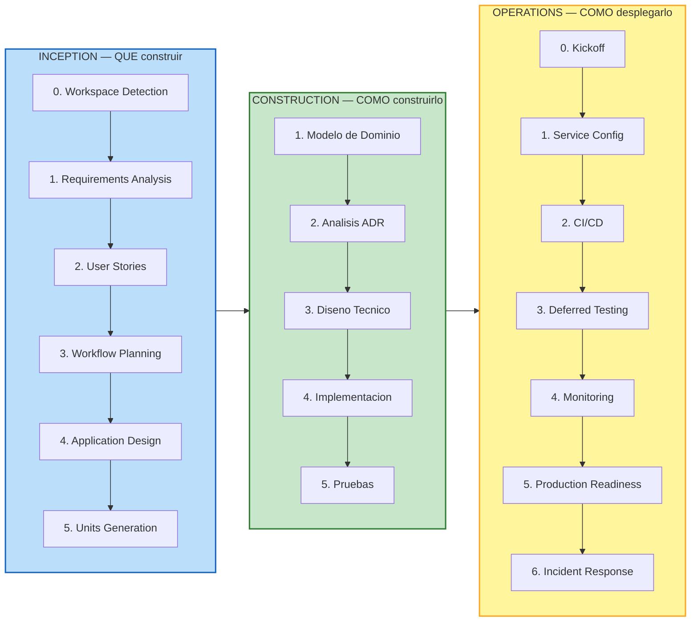
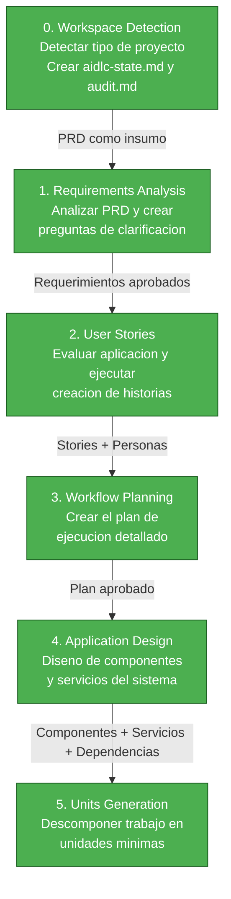
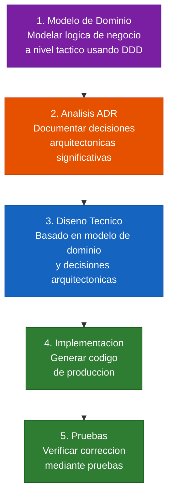
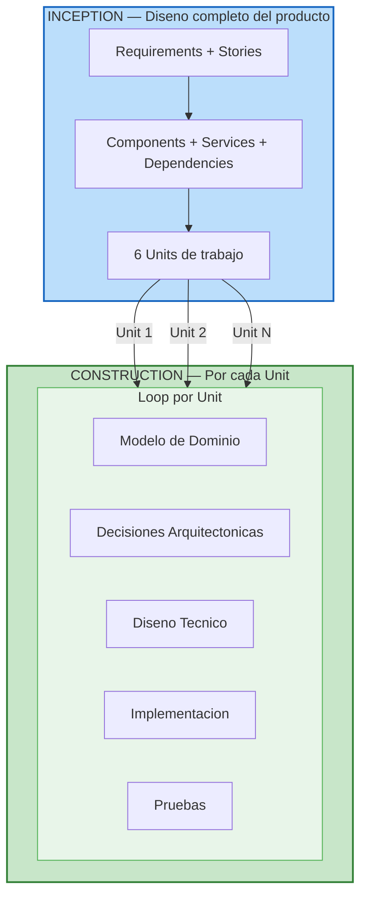

# AI-DLC Guide - Paso a Paso

> Guia personalizada del equipo para implementar el framework AI-DLC.
> Basada en el [runbook de Station 4](https://github.com/hardcore-ai/material/blob/station_4/station_4/ai-dlc/%F0%9F%9A%80station_4_runbook.md).

---

> **Leccion aprendida antes de empezar**: El framework AIDLC asume que `aidlc-docs/` y el codigo fuente viven bajo el mismo `<WORKSPACE-ROOT>/`. En la practica, esto significa que tu repo de GitHub deberia apuntar directamente a la carpeta del proyecto, no a una carpeta padre. Ver Paso 1, seccion 1.6 para el detalle y lo que nos paso en ExpertIA.

---

## Vision General del Framework AI-DLC

AI-DLC (AI Development Lifecycle) es un framework que guia la construccion de productos de software completos mediante un proceso disciplinado, interactivo y asistido por IA. Se compone de **3 fases principales**: Inception (QUE construir), Construction (COMO construirlo), y Operations (COMO desplegarlo).

### Las 3 Fases

### Fase INCEPTION — Que hemos construido

La fase de Inception se enfoca en el **QUE**: que vamos a construir y por que. Genera todo el diseno del producto completo antes de escribir una sola linea de codigo.

| Paso | Actividad | Que produce | Insumo principal |
|------|-----------|-------------|-----------------|
| 0 | **Workspace Detection** | `aidlc-state.md`, `audit.md`, tipo de proyecto (Greenfield/Brownfield) | Carpeta del proyecto |
| 1 | **Requirements Analysis** | Requerimientos funcionales y no funcionales, decisiones tecnicas base | PRD + respuestas a preguntas |
| 2 | **User Stories** | Personas (personificaciones) + historias de usuario con criterios BDD | Requerimientos aprobados |
| 3 | **Workflow Planning** | Plan de ejecucion, analisis de impacto, nivel de riesgo | Todo lo anterior |
| 4 | **Application Design** | Componentes, servicios, dependencias, decisiones arquitectonicas (ADR) | Plan + stories + requirements |
| 5 | **Units Generation** | Unidades de trabajo (bounded contexts DDD) con story mapping | Application Design |

> **Lo mas importante**: Al completar Inception, tienes el **diseno completo del producto** — dominios, contextos, historias, comportamientos, decisiones arquitectonicas, y unidades de trabajo listas para construir. No se ha escrito una sola linea de codigo, pero ya sabes exactamente QUE construir.

### Fase CONSTRUCTION — Que vamos a construir

La fase de Construction se enfoca en el **COMO**: como construirlo. **Ya no se trabaja sobre todo el producto a la vez, sino por unidades**. Cada unidad pasa por su propio loop.

| Paso | Actividad | Que produce | Enfoque |
|------|-----------|-------------|---------|
| 1 | **Modelo de Dominio** | Contextos confirmados, eventos, un solo lenguaje (ubiquitous language) | Puramente negocio — NO tecnico |
| 2 | **Analisis ADR** | Opciones, justificaciones, consecuencias de cada decision arquitectonica | Tener criterio para decidir, entender consecuencias |
| 3 | **Diseno Tecnico** | Patrones, interfaces, estructuras — los mecanismos que resuelven las decisiones | Como implementar las decisiones del ADR |
| 4 | **Implementacion** | Codigo de produccion, patrones y estandares, codigo mantenible | Codificacion real |
| 5 | **Pruebas** | TDD, integracion, aceptacion — cercania entre lo construido y lo que el negocio necesita | Verificacion |

> **DDD Estrategico vs Tactico**: En Inception vimos DDD **estrategico** (identificar contextos, agrupar historias, separar dominios). En Construction bajamos a DDD **tactico** (entidades, value objects, aggregates, eventos de dominio, repositorios). Es la misma disciplina pero a diferente nivel de detalle.

### Como se relacionan las dos fases

**El concepto clave**: Inception genera las Units. Construction ejecuta el loop **por cada Unit de forma independiente**. Esto permite:
- Equipos paralelos (cada equipo trabaja una unit)
- Agentes de IA trabajando por unit
- Foco en un solo contexto a la vez

### Sobre decisiones tecnicas y arquitectonicas

A lo largo de todo el proceso (Inception y Construction), se toman decisiones tecnicas. Hay una metodologia para esto:

1. **El framework presenta opciones** — siempre hay multiples caminos posibles
2. **Cada opcion tiene consecuencias** — positivas y negativas
3. **Tu decides con criterio** — basado en tu contexto (equipo, complejidad, presupuesto, tiempo)
4. **Se documentan como ADR** — Architecture Decision Records con razon y consecuencias

> **Las decisiones tecnicas base** se toman en Inception (Requirements Analysis + Application Design) porque el producto completo necesita una plataforma sobre la cual construir. Pero estas decisiones se **refinan** en Construction a medida que se baja al detalle de cada unit.

---

### Fase OPERATIONS — Como desplegarlo y operarlo

La fase de Operations toma el codigo completo de Construction y lo prepara para produccion. Se ejecuta en **7 stages secuenciales**, cada uno con criterios de cierre verificables.

| Stage | Actividad | Que produce |
|-------|-----------|-------------|
| 0 | **Kickoff** | Branch de operations, Linear epic, plan de ejecucion |
| 1 | **Service Configuration** | Keycloak realm, Docker health checks, env audit, password policies |
| 2 | **Deployment & CI/CD** | GitHub Actions (7 jobs), KrakenD gateway, Docker build |
| 3 | **Deferred Testing** | E2E, security, clinical, performance tests ejecutados contra stack vivo |
| 4 | **Monitoring & Observability** | OTel + LangFuse + Grafana dashboards, log aggregation |
| 5 | **Production Readiness** | Checklist 27/27, backup cron, secrets audit |
| 6 | **Incident Response** | Runbooks, alertas, on-call procedures, maintenance workflows |

> **Resultado en ExpertIA**: 317 tests, CI/CD 7/7 green, Production Readiness 27/27, Harness 16/16 checks. Ver detalle en [11-operations.md](11-operations.md).

Ademas, Operations introduce dos disciplinas transversales:

- **Harness Engineering** (Paso 32): Enforcement programatico con 16 gates que reemplazan reglas de texto. Ver [12-harness-engineering.md](12-harness-engineering.md).
- **Agent Skills** (Paso 33): Unidades de extension que encapsulan conocimiento especializado. Ver [13-skills-agents.md](13-skills-agents.md).

---

## Principio transversal: la jerarquía de prevención (LL-011, LL-013, LL-030)

ExpertIA acumulo 45 lecciones aprendidas en una iteracion. El patron mas importante que emergio es la **jerarquia de prevencion** — 3 niveles con efectividad creciente:

| Nivel | Mecanismo | Efectividad | Ejemplo |
|-------|-----------|-------------|---------|
| 1 | **ADRs** — documentan decisiones | Baja (se olvidan) | "Usamos .env, no .env.local" |
| 2 | **Lessons Learned** — documentan errores | Media (diagnostico, no prevencion) | "LL-010: Claude uso .env.local ignorando el ADR" |
| 3 | **Reglas en CLAUDE.md + harness checks** — obligan comportamientos | Alta (enforcement automatico) | Regla MANDATORY + pre-commit hook que bloquea |

**Solo el nivel 3 es preventivo.** Los niveles 1 y 2 son informativos — utiles para entender el por que, pero no evitan que el error se repita. Cuando se detecte un patron de desviaciones recurrentes (3+ lecciones con la misma causa raiz), no solo capturar las lecciones — crear un mecanismo de enforcement en CLAUDE.md o en el harness que prevenga la causa raiz.

Las lecciones son el diagnostico. Las reglas MANDATORY son el tratamiento.

Adicionalmente, toda feedback memory (correccion del usuario) que pueda verificarse estaticamente DEBE tener un check ejecutable. Las memorias sin enforcement mecanico se olvidan bajo presion de contexto (LL-030).
