## Paso 11: CONSTRUCTION - Actividad 1: Diseno Funcional

El Diseno Funcional es la primera actividad dentro del loop de cada unidad. Es donde se baja del **QUE** (Inception) al **COMO** a nivel de logica de negocio pura — sin tocar tecnologia todavia.

### El viaje de una Unidad de trabajo

Cada unidad recorre estas 6 actividades en secuencia. El Diseno Funcional es la primera:

```mermaid
graph LR
    DF["1. Diseno<br/>Funcional"]
    NFR["2. Requerimientos<br/>No Funcionales"]
    NFRD["3. Diseno de<br/>NFRs"]
    ID["4. Diseno de<br/>Infraestructura"]
    CG["5. Generacion<br/>de Codigo"]
    BT["6. Pruebas"]

    DF -->|"Aprobado"| NFR -->|"Aprobado"| NFRD -->|"Aprobado"| ID -->|"Aprobado"| CG -->|"Aprobado"| BT

    style DF fill:#7B1FA2,stroke:#4A148C,color:#fff
    style NFR fill:#E65100,stroke:#BF360C,color:#fff
    style NFRD fill:#E65100,stroke:#BF360C,color:#fff
    style ID fill:#1565C0,stroke:#0D47A1,color:#fff
    style CG fill:#2E7D32,stroke:#1B5E20,color:#fff
    style BT fill:#2E7D32,stroke:#1B5E20,color:#fff
```

### 11.1 Que genera el Diseno Funcional

El framework genera **3 artefactos** por cada unidad:

| Artefacto | Archivo | Que contiene |
|-----------|---------|-------------|
| **Entidades del dominio** | `domain-entities.md` | Bounded context de la unidad: entidades, objetos de valor, enumeraciones, relaciones y cardinalidades |
| **Reglas de negocio** | `business-rules.md` | Comportamientos y logica de negocio especificos de la unidad: validaciones, constraints, politicas, parametros configurables |
| **Modelo de logica de negocio** | `business-logic-model.md` | Modelo integrado: flujos end-to-end paso a paso, maquinas de estado, secuencias de orquestacion |

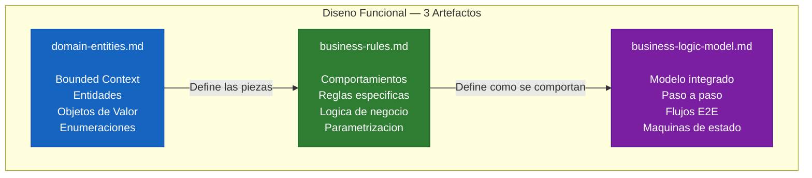

### 11.2 El proceso: preguntas especificas del dominio

Antes de generar los artefactos, el framework genera **preguntas especificas para la unidad**. Estas preguntas son propias del dominio — no son genericas. Cada producto, cada unidad, genera preguntas diferentes.

**Ejemplo**: Para una unidad de autenticacion, las preguntas cubren:
- Multi-tenancy: tenant simple o multitenant
- Roles: cuantos y cual jerarquia
- JWT: claims, tiempo de expiracion, politica de rotacion
- Fuerza bruta: cuantos intentos, en cuanto tiempo, que pasa al bloquearse
- Primer administrador: como se crea (endpoint, script, seed)
- Ciclo de vida del operador: creacion, desactivacion, cambio de password

**Ejemplo**: Para una unidad core de plataforma, las preguntas cubren:
- Provisionamiento de tenant: automatico vs manual
- Desactivacion: borrado logico, retencion, purga
- Estrategia de auditoria: inmutabilidad, hash chain, exportacion
- Rate limiting: tiers, defaults, overrides
- Observabilidad: nivel de detalle, integraciones
- Configuracion: hot-reload vs reinicio

> **Tip**: Muchas de estas preguntas generan **decisiones arquitectonicas** (ADR). En nuestro caso, de 12 preguntas de la Unidad 1, 9 se elevaron a ADRs (ADR-08 a ADR-16) porque eran decisiones cross-cutting que afectan a todo el sistema. Cuando una pregunta del diseno funcional tiene implicaciones mas alla de la unidad, documentala como ADR en `architecture-decisions.md`.

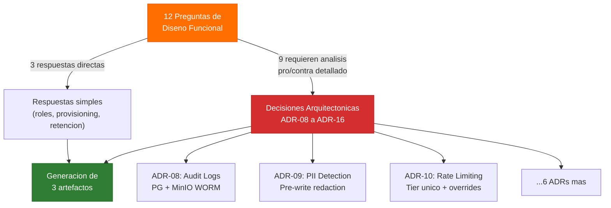

### 11.3 Entidades de dominio — DDD tactico

Este artefacto aplica **DDD tactico** (Domain-Driven Design a nivel de implementacion). Es fundamental entender dos conceptos:

**Entidades**: Un elemento que se define por **quien es**, no por sus atributos. Si le cambias un atributo, sigue siendo la misma entidad.
- Ejemplo: Un operador llamado "Mauricio". Si le cambio el password, sigue siendo Mauricio. El operador no cambia de identidad.
- Las entidades tienen un `id` unico que las identifica.

**Objetos de valor (Value Objects)**: Un elemento que se define por **sus atributos**. Si le cambias un atributo, es otro objeto diferente.
- Ejemplo: Un token JWT con un tiempo de expiracion, un tipo, y claims. Si le cambio el tiempo de expiracion, es otro token — no el mismo con diferente tiempo.
- Ejemplo clasico: Una direccion (calle, complemento, barrio). Si cambio el complemento, es otra direccion.
- Los objetos de valor no necesitan `id`. Se comparan por sus atributos.

> **Error comun**: Crear objetos de valor como entidades. Un token no es una entidad — es un objeto de valor que se usa temporalmente durante un flujo. No tiene identidad propia. No lo guardes como entidad en tu base de datos a menos que realmente necesites rastrearlo como tal.

> **Conexion con Inception**: En Inception hicimos DDD **estrategico** (identificar contextos delimitados, agrupar historias por dominio, separar bounded contexts en unidades). En Construction bajamos a DDD **tactico** (entidades, objetos de valor, aggregates, reglas de negocio, repositorios). Es la misma disciplina pero a diferente nivel de detalle.

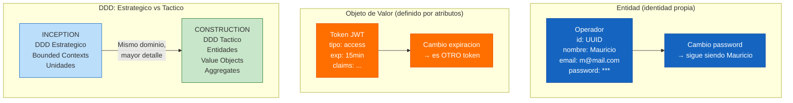

### 11.4 Reglas de negocio — El comportamiento de la unidad

Las reglas de negocio definen **como se comporta** cada componente dentro de la unidad. Son especificaciones que van mas alla del "happy path".

**Que tipo de reglas se generan**:
- **Validaciones**: "Si un operador esta desactivado (active=false) e intenta autenticarse, retornar codigo de error especifico"
- **Politicas**: "Maximo 5 intentos de login fallidos en 15 minutos antes de bloqueo por fuerza bruta"
- **Constraints**: "Un tenant debe tener al menos 1 caso de uso asignado para estar activo"
- **Parametros configurables**: Limites de rate limiting, tiempos de expiracion, periodos de retencion

> **Punto clave sobre parametrizacion**: Las reglas de negocio ayudan a identificar **valores que pueden cambiar en el tiempo** y que frecuentemente terminamos hardcodeando en el codigo. El framework los hace explicitos para que se manejen como configuracion externa, no como constantes en el codigo. Esto es especialmente importante en dominios donde las reglas cambian frecuentemente segun el negocio.

**Cantidad tipica**: No te sorprendas si una sola unidad genera 30-50 reglas de negocio. Para una unidad de autenticacion, por ejemplo, se pueden generar 40+ reglas que cubren: login, refresh token, logout, fuerza bruta, creacion de operador, cambio de password, validacion de token, compliance. Parece mucho, pero es lo que generalmente se deberia considerar — simplemente no lo hacemos porque normalmente solo cubrimos los happy paths.

### 11.5 Modelo de logica de negocio — Flujos paso a paso

Este es el artefacto mas valioso desde la perspectiva de implementacion. Define **exactamente** como debe funcionar cada flujo dentro de la unidad, paso a paso.

**Ejemplo** — Flujo de login de un operador:

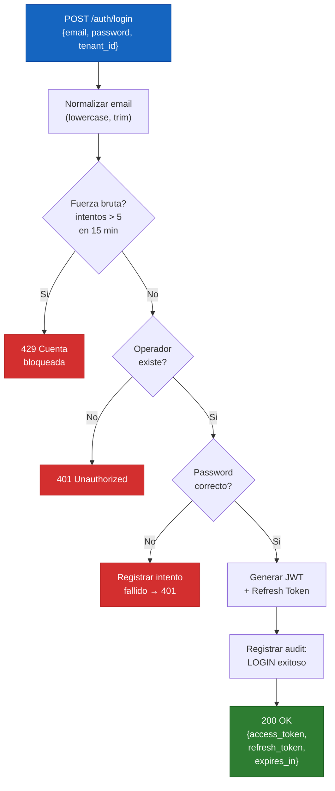

Ese mismo flujo en formato lista (como se ve en el artefacto):
```
1. Recibir POST /auth/login con {email, password, tenant_id}
2. Normalizar email (lowercase, trim)
3. Verificar fuerza bruta: contar intentos fallidos en ultimos 15 min
4. Si intentos > 5 → retornar 429 "Cuenta bloqueada temporalmente"
5. Buscar operador por email + tenant_id
6. Si no existe → retornar 401 (no revelar si el email existe o no)
7. Verificar password (bcrypt compare)
8. Si incorrecto → registrar intento fallido → retornar 401
9. Generar JWT con claims (sub, tenant_id, roles, exp)
10. Generar refresh token
11. Registrar evento de auditoria: LOGIN exitoso
12. Retornar {access_token, refresh_token, expires_in}
```

> **La maravilla de esto**: Le estas pasando al equipo (o al agente de IA) **todo lo que necesita para desarrollar**:
> - Las historias de usuario con criterios de aceptacion en formato Gherkin (que debe hacer)
> - Los componentes que tiene que desarrollar (donde lo hace)
> - El paso a paso tecnico de como lo debe hacer internamente (como lo hace)
>
> No importa quien lo desarrolle — tiene todo el contexto necesario. Puedes comparar el codigo final contra los flujos paso a paso para verificar que hace lo correcto, y contra los criterios de aceptacion Gherkin para verificar que cumple los requisitos de negocio.

### 11.6 Unidad Core vs Unidades funcionales

En muchos proyectos, el framework identifica que necesita construir una **unidad base (core)** antes de las unidades de negocio.

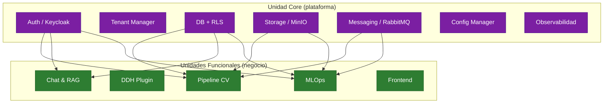

Las preguntas del diseno funcional para una unidad core son mas tecnicas y de plataforma. Las unidades funcionales (negocio) tendran preguntas mas orientadas a logica de dominio.

> **Experiencia**: Es una constante que en proyectos medianos a grandes, el framework genere una unidad core como primera unidad. Si te pasa, es normal y es la forma correcta de hacerlo — las unidades de negocio necesitan esa base para funcionar.

### 11.7 Fases condicionales del loop

Dentro del loop de cada unidad, **no todas las fases se ejecutan siempre**. El framework evalua inteligentemente cuales son necesarias:

| Fase | Cuando se ejecuta | Cuando se omite |
|------|-------------------|----------------|
| **Diseno Funcional** | Condicional — si hay logica de negocio nueva o compleja | Simple CRUD sin logica, o logica ya definida |
| **NFR Requirements** | Condicional — si hay requisitos de performance, seguridad, escalabilidad | Si los NFRs ya estan resueltos (ej: brownfield que ya los tiene) |
| **NFR Design** | Condicional — si se ejecutaron NFR Requirements | Si se omitio NFR Requirements |
| **Infrastructure Design** | Condicional — si hay infraestructura nueva que mapear | Si la infraestructura ya esta definida |
| **Code Generation** | Siempre — es el objetivo final de cada unidad | Nunca se omite |
| **Build and Test** | Siempre — verificacion | Nunca se omite |

> **Tip**: Si quieres saber por que una fase se ejecuto o no en tu caso, revisa los archivos de reglas del framework en `.aidlc-rule-details/construction/`. Cada fase tiene sus condiciones documentadas (Execute IF / Skip IF). Ahi encontraras las razones por las cuales el framework tomo la decision.

### 11.8 El valor real del Diseno Funcional

> **Experiencia del equipo**: "Sacar esto es seis meses de trabajo. Para un proyecto de este tamano serian cuatro o cinco personas dandole tremendamente duro. Es increible lo que puede sacar."
>
> "Los tokens valen muchisimo menos que lo que toca pagar personas que trabajan y que no trabajan bien. Prefiero pagar tokens que personas."
>
> "Cuando algo falla en la implementacion del codigo, lo unico que uno tiene que hacer es seguirle diciendo que siga, porque va comparando contra la especificacion. Pruebe y verifique, pruebe y verifique. Al final el codigo es un fiel reflejo de lo que esta especificado."

El Diseno Funcional traduce la problematica del mundo real para que la maquina la entienda. Es el puente entre lo que el negocio necesita y lo que el codigo debe hacer. El tiempo invertido aqui se ahorra exponencialmente despues — no en encontrar bugs de por que un token expira mal, sino en tener la especificacion correcta desde el principio.

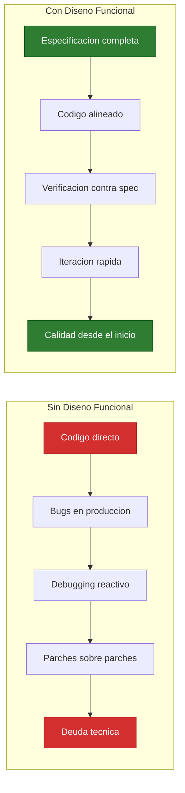

> **Comparativa de esfuerzo**: Lo que con un equipo de 4-5 personas toma 6 meses, el framework lo genera en horas. Y con un nivel de calidad que rara vez se ve en especificaciones hechas manualmente — porque cubre todos los caminos, no solo los happy paths.

---

## Paso 12: CONSTRUCTION - Actividad 2: Requerimientos No Funcionales (NFR)

Despues del Diseno Funcional, el framework evalua los **requerimientos no funcionales** — como debe **comportarse** el sistema mas alla de la funcionalidad pura.

### 12.1 Que son los NFRs y por que importan

Los NFRs definen la **calidad** del sistema en 6 dimensiones:

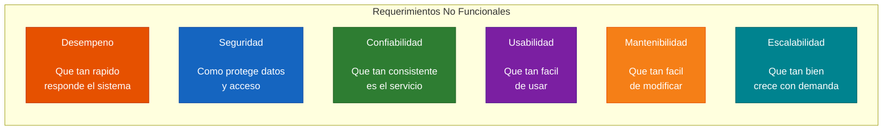

> **El problema clasico**: Cuando eres muy tecnico y le preguntas al negocio "como quiere que sea el rendimiento?", la respuesta siempre es "que sea rapido". Y rapido para el negocio es un concepto vago. La pregunta correcta no es "que tan rapido?" sino presentar opciones con numeros: "500ms, 1s, o 2s? — y esto es lo que implica cada una a nivel de costo y complejidad."
>
> El framework resuelve esto generando **preguntas con opciones cuantificables** y justificaciones, para que tomes decisiones informadas en vez de responder con "lo mas rapido posible".

### 12.2 El proceso: preguntas cuantificables

El framework genera preguntas **especificas para la unidad** con opciones que tienen numeros reales y trade-offs explicitos:

**Ejemplo — Performance**:
- "Cual es el maximo tiempo de respuesta aceptable para la autenticacion?"
  - A) 500ms — experiencia premium, requiere optimizacion agresiva
  - B) 1000ms — balanceo optimo entre rendimiento y complejidad
  - C) 2000ms — aceptable para MVP, menor esfuerzo

**Ejemplo — Disponibilidad**:
- "Que nivel de disponibilidad requiere esta unidad?"
  - A) 99.9% (~43 min downtime/mes) — alta disponibilidad, requiere redundancia
  - B) 99.5% (~3.6h downtime/mes) — balance optimo entre costo y estabilidad
  - C) 99% (~7.3h downtime/mes) — aceptable para MVP

**Ejemplo — Seguridad**:
- "Necesita MFA para cuentas administrativas?"
  - A) TOTP (Google Authenticator)
  - B) Email OTP
  - C) SMS OTP
  - D) No requerido para MVP

> **Trade-offs entre NFRs**: Cuando le metes full seguridad (MFA, cifrado, rate limiting estricto), estas sacrificando rendimiento. Cuando optimizas para performance maxima, puedes comprometer mantenibilidad. El framework te hace consciente de estos trade-offs al presentar las opciones.

> **Solo para la unidad, no para todo el producto**: Los NFRs se evaluan por unidad. No necesitas escalar todo el producto cuando solo algunas unidades lo requieren. Una unidad de autenticacion tiene NFRs de seguridad muy diferentes a una unidad de reportes.

### 12.3 NFRs especificos por tipo de unidad

Las preguntas varian segun el tipo de unidad:

| Tipo de unidad | NFRs tipicos |
|---------------|-------------|
| **Autenticacion** | Latencia de login, MFA, rate limiting, throttling, CORS, disponibilidad DB |
| **Core Platform** | Latencia API, throughput, caching, connection pooling, RLS performance |
| **Pipeline CV** | Tiempo de procesamiento, concurrencia, GPU memory, timeout de inference |
| **Training** | Duracion max de training, checkpointing, GPU utilization, dataset size limits |
| **Chat/RAG** | Latencia LLM, tokens por request, fallback chain, safe-by-design rules |
| **Frontend** | Bundle size, time to interactive, lazy loading, offline support |

### 12.4 El artefacto: `nfr-requirements.md`

A partir de las respuestas, el framework genera un documento con **metricas cuantificables** por categoria:

```
Performance:
  - Latencia p95 < 500ms para consultas
  - Throughput: 50 req/s MVP → 150 req/s a 12 meses

Disponibilidad:
  - SLA: 99.9% uptime
  - RPO: 24h, RTO: 4h

Seguridad:
  - OWASP Top 10 cubierto al 85%
  - Cifrado en transito (TLS 1.2+) + en reposo

Escalabilidad:
  - 10 tenants MVP → 30 a 12 meses
  - Escalado horizontal de workers
```

> **Detalle tecnico que hay que investigar**: Algunas preguntas de NFR son muy tecnicas (algoritmos de hashing, drivers de DB, politicas de retry). No tienes que sabertelas todas. Puedes apoyarte del mismo agente de IA para entender las opciones, investigar, y tomar la mejor decision. El framework no te obliga a saber todo — te guia para que preguntes lo correcto.

### 12.5 Fases condicionales: cuando se omiten los NFRs

El framework **evalua si los NFRs son necesarios** antes de ejecutarlos:

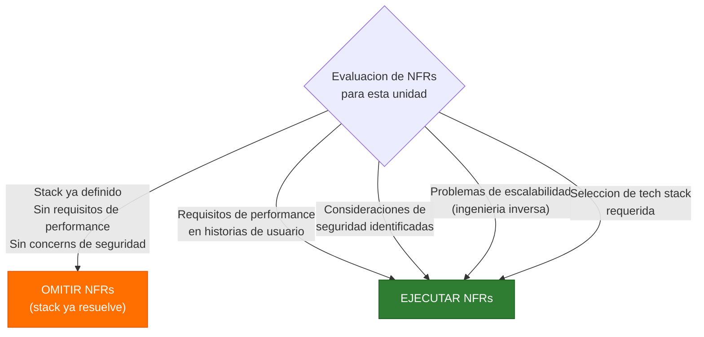

**Cuando se omiten**:
- Stack tecnologico ya determinado (Brownfield con arquitectura seteada)
- NFRs ya resueltos en la arquitectura existente

**Cuando se ejecutan**:
- Requisitos de rendimiento explicitos en historias de usuario
- Consideraciones de seguridad nuevas
- Problemas de escalabilidad identificados en ingenieria inversa
- Seleccion de tech stack requerida

> **Para proyectos Brownfield**: Si ya tienes una arquitectura con NFRs definidos (tiempos de respuesta, disponibilidad, seguridad), el framework puede omitir esta fase. Lo evalua durante la ingenieria inversa. Solo ejecuta NFRs cuando identifica gaps o nuevas necesidades.

---

## Paso 13: CONSTRUCTION - Actividad 3: Diseno de Requerimientos No Funcionales (NFR Design)

Despues de definir **que** NFRs necesitas (actividad 2), el framework define **como** resolverlos con patrones y mecanismos concretos.

### 13.1 De la pregunta al patron: el flujo completo

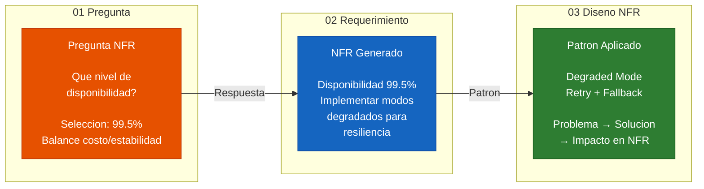

Este es el flujo clave:
1. **Pregunta** (actividad 2): "Que nivel de disponibilidad?" → Seleccion: 99.5%
2. **Requerimiento** (generado): NFR de disponibilidad con metrica objetivo 99.5%, implementar modos degradados
3. **Diseno** (actividad 3): Patron "Degraded Mode" con retry + fallback. Problema → Solucion → Impacto

### 13.2 Que genera el Diseno NFR

El framework genera **2 artefactos**:

| Artefacto | Archivo | Que contiene |
|-----------|---------|-------------|
| **Patrones de diseno** | `nfr-design-patterns.md` | Patrones concretos para resolver cada NFR: retry con backoff, circuit breaker, caching, connection pooling, middleware chain, graceful shutdown |
| **Componentes logicos** | `logical-components.md` | Mapeo de componentes a servicios reales: Docker Compose services, puertos, protocolos, interfaces, orden de startup |

### 13.3 Tipos de patrones que se generan

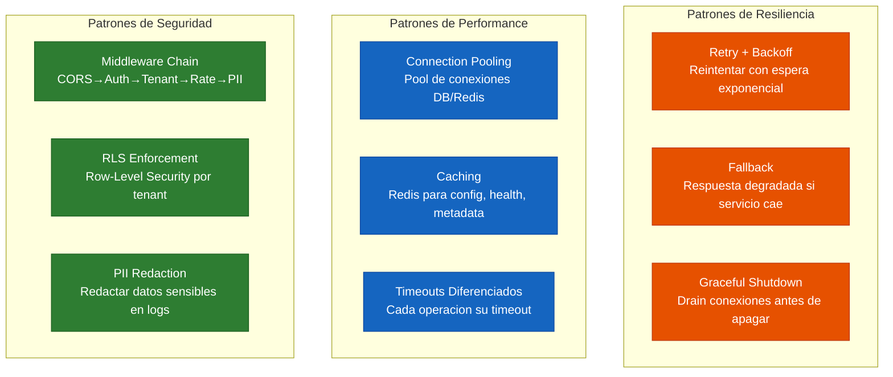

**Cada patron tiene**:
- **Problema**: Que NFR resuelve (ej: "la base de datos puede estar intermitente")
- **Solucion**: Mecanismo concreto (ej: "retry con backoff exponencial, 3 intentos, 0.5s → 1s → 2s")
- **Impacto**: Como garantiza el cumplimiento del NFR (ej: "garantiza disponibilidad del 99.5% ante fallos de infraestructura de cache")

> **Ejemplo real**: En nuestro proyecto, el framework identifico que para resolver el NFR de disponibilidad necesitaba un patron de retry con backoff exponencial para la conexion a la base de datos. Definio: 3 reintentos maximo, delay base de 0.5s con factor exponencial de 2, y los codigos de error especificos que debian activar el retry. Incluso sugirio un patron decorador para la implementacion. Todo esto sin que nosotros tuvieramos que investigar cuales errores de la base de datos son retryables.

### 13.4 Componentes logicos: el mapa de infraestructura

El segundo artefacto mapea **todo** lo que se necesita para que la unidad funcione:

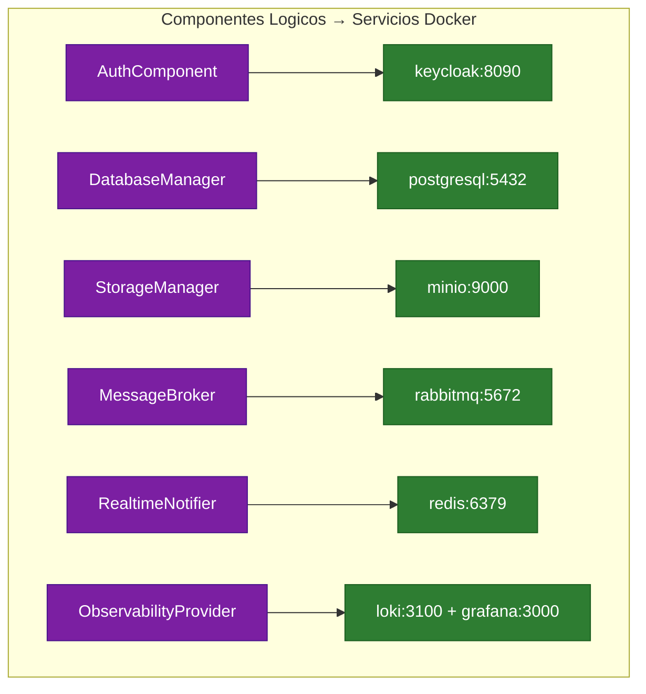

Incluye: servicios Docker con recursos (CPU, RAM, disco), puertos expuestos vs internos, orden de startup, interfaces entre componentes, y variables de entorno.

### 13.5 El Diseno NFR como generador de ADRs

Un hallazgo importante: muchas preguntas de NFR generan **decisiones arquitectonicas** (ADRs) que se documentan permanentemente. En nuestro caso, las actividades 2 y 3 de NFR generaron **10 ADRs adicionales** (ADR-17 a ADR-26) cubriendo: versionado de API, migraciones de base de datos con CI/CD, seguridad OWASP, logging centralizado, resiliencia, caching, timeouts, middleware chain, y networking Docker.

> **Tip**: Si una pregunta de NFR tiene implicaciones cross-cutting (afecta a multiples unidades), documentala como ADR en `architecture-decisions.md`. Las decisiones de NFR de la primera unidad (especialmente si es Core) frecuentemente aplican a todo el sistema.

---

## Paso 14: CONSTRUCTION - Actividad 4: Diseno de Infraestructura

Despues de los patrones NFR, el framework mapea todo a **infraestructura real de deployment**. Es donde los componentes logicos se convierten en servicios desplegables con configuracion concreta.

### 14.1 Que genera el Diseno de Infraestructura

El framework genera **2 artefactos**:

| Artefacto | Archivo | Que contiene |
|-----------|---------|-------------|
| **Diseno de infraestructura** | `infrastructure-design.md` | Mapa de servicios, configuracion por servicio, CI/CD pipeline, volumes, env vars, Dockerfiles |
| **Arquitectura de deployment** | `deployment-architecture.md` | Diagrama de topologia, flujo de trafico, puertos expuestos vs internos, recursos por ambiente |

### 14.2 Los tres pilares del Diseno de Infraestructura

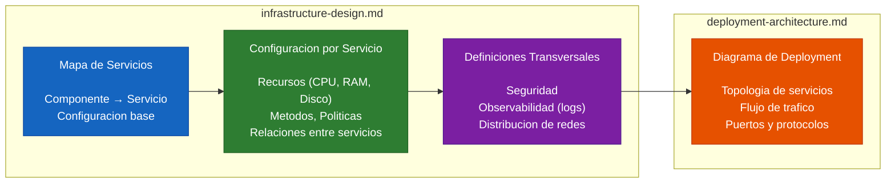

**Mapa de servicios**: Cada componente logico se mapea a un servicio real (Docker container, Lambda, servicio cloud). Incluye: nombre del servicio, imagen Docker, puerto, configuracion base.

**Configuracion por servicio**: Para cada servicio: recursos (CPU, memoria, disco), metodos/endpoints si es API, politicas de comunicacion con otros servicios, drivers y conexiones.

**Definiciones transversales**: Seguridad (que servicios son publicos vs internos), observabilidad (como se recolectan logs de cada servicio), y distribucion de redes (que servicios se ven entre si).

### 14.3 El proceso de CI/CD: Build → Provision → Deploy

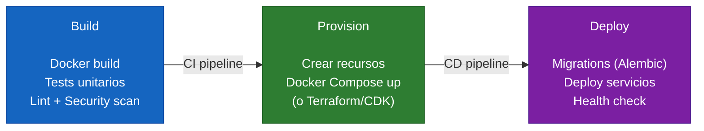

### 14.4 Preguntas tipicas de infraestructura

Antes de generar los artefactos, el framework puede hacer preguntas sobre:

- **Conectividad de base de datos**: VPC Peering, Private Endpoint, acceso publico, o Lambda dentro de VPC
- **Tipo de API Gateway**: HTTP API, REST API, o URL de funcion directa
- **WAF (Web Application Firewall)**: Si incluir desde MVP o posponer
- **Estructura Docker Compose**: archivo unico con profiles vs multiples archivos override
- **Volumes**: named volumes vs bind mounts vs hibrido
- **Distribucion de agentes GPU**: pip package, Docker image, o ambos

> **Sobre el WAF**: Una pregunta frecuente es si incluir WAF desde el inicio. Si tus servicios ya manejan throttling, fuerza bruta, y CORS, el WAF puede posponerse para despues del MVP. Pero si vas a exponer el API directamente a internet, el WAF es recomendable desde el dia 1.

### 14.5 Diagrama de deployment — notacion C4

El framework genera diagramas de deployment que muestran la topologia completa:

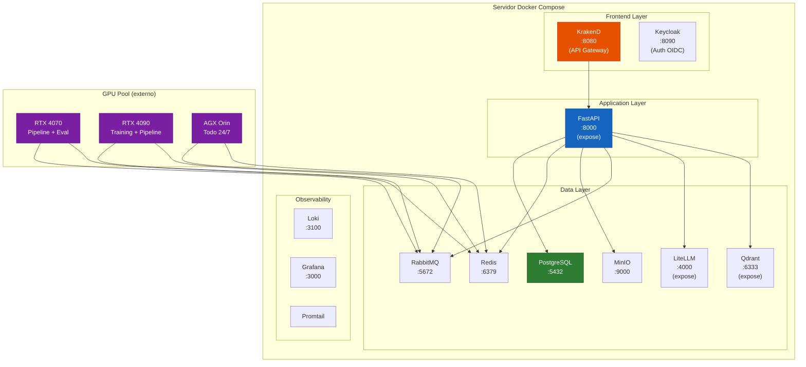

> **Tip sobre diagramas**: El framework genera diagramas en ASCII por defecto. Puedes pedirle que los genere en Mermaid para que se vean mejor. Para presentaciones a stakeholders no tecnicos, herramientas como draw.io o Excalidraw pueden dar un aspecto mas visual, pero para documentacion tecnica, Mermaid es suficiente y se auto-genera.

### 14.6 Puertos: expuestos vs internos

Una decision clave del diseno de infraestructura es **que servicios son accesibles desde fuera**:

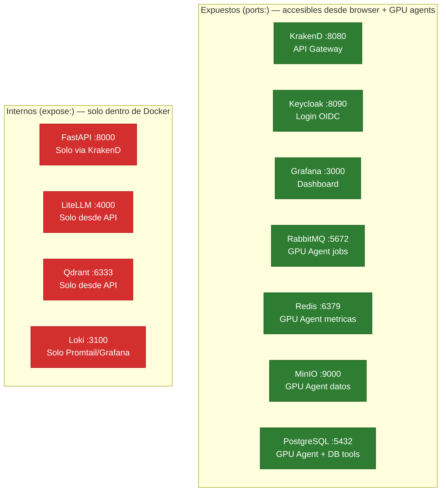

Servicios internos (`expose`) no son accesibles desde fuera de Docker — menos superficie de ataque. Solo los servicios que realmente necesitan acceso externo (browser, GPU agents) exponen puertos (`ports`).

> **Migracion a Kubernetes**: Este patron mapea directamente a K8s: `ports` → Service tipo LoadBalancer (accesible externamente), `expose` → Service tipo ClusterIP (solo dentro del cluster). Si migras a cloud, el diseno se mantiene.

### 14.7 Lo que ya tienes al completar Infrastructure Design

> **Si llegaste hasta aqui con una unidad, ya tienes absolutamente todo lo que necesitas para escribir codigo**:
>
> - Historias de usuario con criterios de aceptacion en Gherkin (que debe hacer)
> - Entidades de dominio, relaciones y enumeraciones (que piezas tiene)
> - Reglas de negocio con validaciones y constraints (como se comporta)
> - Flujos paso a paso para cada operacion (como se ejecuta internamente)
> - NFRs cuantificables: latencia, throughput, disponibilidad, seguridad (cuanto y a que nivel)
> - Patrones de resiliencia, performance y seguridad (como garantiza los NFRs)
> - Componentes logicos mapeados a servicios Docker (donde se despliega)
> - Dockerfiles, volumes, env vars, CI/CD pipelines (como se construye y despliega)
> - Diagrama de deployment con flujo de trafico (como se conecta todo)
> - **27 decisiones arquitectonicas documentadas (ADRs)** con razon, alternativas evaluadas, y ruta de migracion
>
> El proceso es largo y denso — hemos hecho bastante trabajo tecnico. Pero es **exactamente el trabajo que hay que hacer**. La alternativa es saltar al codigo y despues pasar semanas arreglando bugs, re-diseñando arquitectura, y pagando deuda tecnica. Este proceso invierte el esfuerzo al principio para que la construccion sea rapida y con calidad.

> **Sobre el tiempo**: En nuestro caso, la Unidad 1 (Core Platform) genero: 3 artefactos de Diseno Funcional, 2 de NFR Requirements, 2 de NFR Design, 2 de Infrastructure Design — con 30 preguntas analizadas y 27 ADRs documentados. Todo en una sola sesion de trabajo con el framework. Sin el framework, esto seria semanas de trabajo de un equipo de arquitectura.

---
