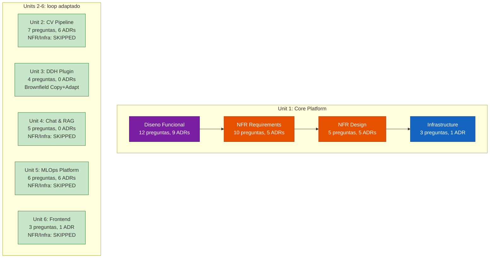
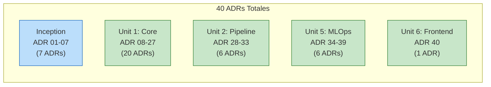
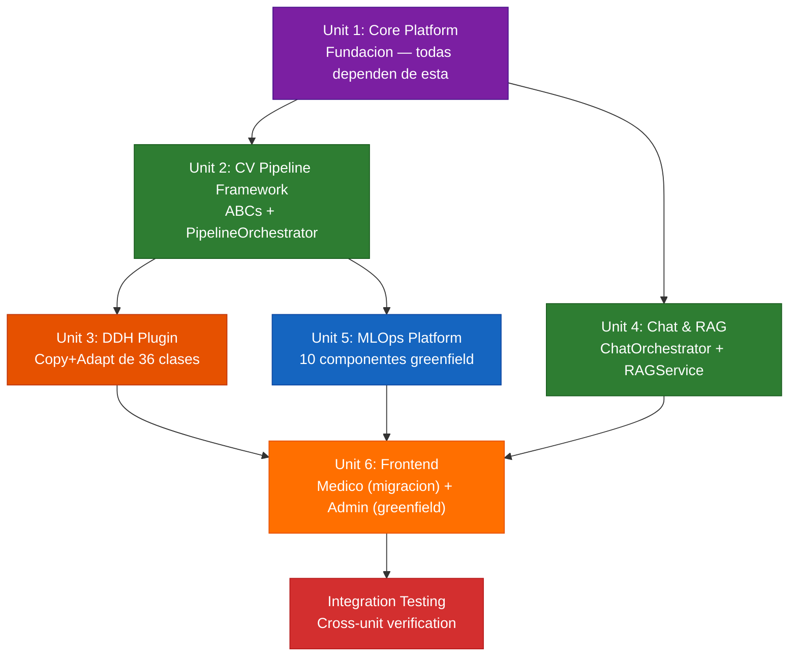
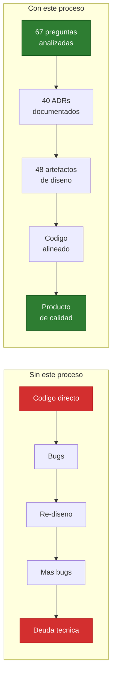

## Paso 15: El Loop de Construction aplicado a las 6 Unidades

### 15.1 Resultado: diseño completo de las 6 unidades

Aplicamos el loop de Construction (Diseno Funcional → NFR → Infrastructure) a cada una de las 6 unidades. El framework adapta la profundidad segun la unidad:



**Observacion clave**: Unit 1 (Core Platform) es la mas profunda porque establece toda la infraestructura cross-cutting (auth, DB, storage, messaging, observabilidad). Las unidades 2-6 reutilizan esas decisiones y solo necesitan Diseno Funcional — NFR y Infrastructure ya estan cubiertos por Unit 1.

### 15.2 Fases condicionales: por que Units 2-6 saltaron NFR/Infrastructure

El framework evalua inteligentemente que fases ejecutar por unidad:

| Unidad | Diseno Funcional | NFR Req | NFR Design | Infrastructure | Razon de skip |
|--------|:----------------:|:-------:|:----------:|:--------------:|--------------|
| **Unit 1: Core** | Si (12 preg) | Si (10 preg) | Si (5 preg) | Si (3 preg) | Base — define todo |
| **Unit 2: Pipeline** | Si (7 preg) | **SKIP** | **SKIP** | **SKIP** | Tech stack, NFRs, infra ya definidos por Unit 1 |
| **Unit 3: DDH** | Si (4 preg) | **SKIP** | **SKIP** | **SKIP** | Brownfield + misma infra |
| **Unit 4: Chat & RAG** | Si (5 preg) | **SKIP** | **SKIP** | **SKIP** | Qdrant ya en stack, mismos patrones |
| **Unit 5: MLOps** | Si (6 preg) | **SKIP** | **SKIP** | **SKIP** | GPU Agent (ADR-21) cubre ejecucion |
| **Unit 6: Frontend** | Si (3 preg) | **SKIP** | **SKIP** | **SKIP** | Turborepo (ADR-03) ya definido |

> **Esto es eficiencia, no pereza**: Las decisiones de NFR (performance, seguridad, resiliencia) y de infraestructura (Docker, networking, CI/CD) son **cross-cutting** — se toman una vez en la primera unidad y aplican a todas. No tiene sentido redefinir "latencia p95 < 500ms" para cada unidad.

### 15.3 ADRs por unidad: las decisiones que importan

Cada unidad genera decisiones arquitectonicas segun sus necesidades especificas:



**Patron**: Unit 1 genera la mayoria (20 ADRs) porque es la base. Units 2 y 5 generan ADRs de logica de negocio especifica (pipeline, MLOps). Units 3, 4 y 6 no necesitan ADRs nuevos — sus decisiones son locales y no cross-cutting.

### 15.4 Cada unidad genera 3 artefactos de Diseno Funcional

Independientemente de la profundidad del loop, cada unidad genera los mismos 3 artefactos:

| Artefacto | Unit 1 | Unit 2 | Unit 3 | Unit 4 | Unit 5 | Unit 6 |
|-----------|:------:|:------:|:------:|:------:|:------:|:------:|
| `domain-entities.md` | 7 entidades, 6 enums | 5 ABCs, 4 enums, 7 value objects | 15 medidas, 8 detectores, 6 criterios | ChatState, RAGResponse, GuardrailResult | ModelVersion 6 estados, Experiment→Run | Zustand stores, rutas, shared components |
| `business-rules.md` | 35 reglas, 9 dominios | 25 reglas, 7 dominios | 22 reglas clinicas DDH | 23 reglas + CDSS guardrails | 30 reglas, 9 dominios | 20 reglas UX + CDSS |
| `business-logic-model.md` | 10 flujos paso a paso | 8 flujos (pipeline, retry, workbench, diagnostico) | 4 flujos (pipeline DDH, integracion, PDF, migracion) | 6 flujos (chat, guardrails, vectorizacion, LLM) | 9 flujos (model lifecycle, training, promotion, workbench) | 5 flujos (medico, training dashboard, workbench, registry, migracion) |

### 15.5 Estadisticas finales de la fase de Construction (Design)

| Metrica | Valor |
|---------|:-----:|
| **Unidades disenadas** | 6 de 6 (100%) |
| **Artefactos generados** | 48 |
| **Preguntas analizadas** | 67 (con analisis pro/contra detallado) |
| **ADRs documentados** | 40 (en 7 archivos por fase/unidad) |
| **Reglas de negocio** | ~155 (sum de todas las unidades) |
| **Flujos de logica** | ~42 flujos paso a paso |
| **Stories cubiertas** | 49 + ~15 scenarios agregados durante construction |

### 15.6 Principios que emergieron durante el proceso

A lo largo de las 6 unidades, surgieron principios que se repiten:

1. **CDSS — No diagnosticar**: El sistema clasifica parametros como "dentro/fuera de rango". NUNCA emite diagnosticos. Esto aplica a: UI, reportes PDF, chat, codigo interno vs externo
2. **Consistencia clinica**: Thresholds globales por use_case (ADR-33). Un paciente recibe el mismo resultado sin importar que clinica lo procese
3. **GPU Local > Cloud**: El hardware ya existe (RTX 4070/4090, AGX Orin, MacBook M1 Max). El ExpertIA Agent unificado ejecuta pipeline, training y evaluacion localmente (ADR-21, ADR-38)
4. **Cada herramienta para su proposito**: REST para queries, RabbitMQ para jobs async, Redis Pub/Sub para real-time, MinIO para storage, Qdrant para RAG
5. **Produccion SIEMPRE manual**: En un CDSS medico, la promocion a produccion requiere aprobacion humana con doble confirmacion (ADR-37). No es configurable — es un constraint etico
6. **Copy + Adapt para brownfield**: Logica clinica probada en produccion se copia literalmente. Solo cambian interfaces (herencia, state). Zero riesgo de perder edge cases clinicos
7. **Framework generico, plugin especifico**: Los ABCs (Unit 2) definen contratos. La logica clinica (Unit 3 DDH) vive en el plugin. Cobb, CTR y futuros use cases implementan los mismos ABCs

---

## Paso 16: CONSTRUCTION - Generacion de Codigo y Pruebas

> **Estado**: Pendiente. El diseno de las 6 unidades esta completo. La generacion de codigo se realizara cuando se este listo para implementar.

### 16.1 Lo que tenemos para empezar a codificar

Para cada unidad, el desarrollador (o agente de IA) tiene:

```
POR CADA UNIDAD:
  ✅ Historias de usuario con criterios de aceptacion en Gherkin (que debe hacer)
  ✅ Entidades de dominio con relaciones y enumeraciones (que piezas tiene)
  ✅ Reglas de negocio con validaciones y constraints (como se comporta)
  ✅ Flujos paso a paso para cada operacion (como se ejecuta internamente)
  ✅ 40 decisiones arquitectonicas con patrones de implementacion (como se resuelve cada problema)

PARA UNIT 1 (base):
  ✅ NFRs cuantificables (latencia, throughput, disponibilidad, seguridad)
  ✅ Patrones de resiliencia, performance y seguridad (retry, cache, middleware chain)
  ✅ Componentes logicos mapeados a 17 servicios Docker
  ✅ Dockerfiles, volumes, env vars, CI/CD pipelines
  ✅ Diagrama de deployment con flujo de trafico y puertos
```

### 16.2 Secuencia recomendada de implementacion



> **Nota importante**: No es necesario completar todo el codigo de una unidad antes de empezar la siguiente. Las dependencias son a nivel de interfaces (ABCs, APIs), no de implementacion completa. Por ejemplo, Unit 3 (DDH Plugin) puede empezar a implementarse en paralelo con Unit 2 (Pipeline Framework) usando mocks de los ABCs.

### 16.3 El valor de haber hecho todo este proceso

> **Experiencia del equipo**: "Sacar esto es seis meses de trabajo. Para un proyecto de este tamano serian cuatro o cinco personas dandole tremendamente duro."
>
> "Los tokens valen muchisimo menos que lo que toca pagar personas que trabajan y que no trabajan bien."
>
> "Cuando algo falla en la implementacion del codigo, lo unico que uno tiene que hacer es seguirle diciendo que siga, porque va comparando contra la especificacion. Pruebe y verifique, pruebe y verifique. Al final el codigo es un fiel reflejo de lo que esta especificado."



El diseno completo de las 6 unidades tomo aproximadamente 2 sesiones intensivas de trabajo con el framework. Esto genero una especificacion que tradicionalmente tomaria **meses** con un equipo de arquitectura. Y lo mas importante: cada decision esta **documentada, analizada, y con ruta de migracion** — no hay "yo creo que esto era asi" ni "no me acuerdo por que elegimos esta tecnologia".

### Resultados del Code Generation (actualizado post-ejecucion)

El Code Generation se completo exitosamente para las 6 units:

| Unit | Tests | ADRs | Branch |
|------|-------|------|--------|
| 1: Core Platform (Greenfield) | 84 | ADR-08 a ADR-26 | unit/1-core-platform |
| 2: CV Pipeline (Hybrid) | 34 | ADR-28 a ADR-33 | unit/2-cv-pipeline |
| 3: DDH Plugin (Brownfield) | 17 | — (Copy+Adapt) | unit/2-cv-pipeline |
| 4: Chat & RAG (Hybrid) | 31 | — | unit/4-chat-rag |
| 5: MLOps (Greenfield) | 26 | ADR-34 a ADR-39 | unit/5-mlops |
| 6: Frontend (Hybrid) | 46 TS/TSX | ADR-40 | unit/6-frontend |
| **Total** | **271 tests** | **40 ADRs** | — |

**Metricas finales de Construction**:
- 192 unit tests + 47 integration + 32 contract = 271 total
- Docker Compose: 16 servicios validados
- Hexagonal architecture: enforced via AST import analysis
- Pre-commit hooks: ruff + gitleaks activos

**Lecciones clave del Code Gen**:
- **LL-006**: Siempre verificar que `.venv` esta activo antes de generar codigo
- **LL-007**: No marcar Build & Test como COMPLETE sin ejecutar tests realmente
- **LL-011**: El quality gate hexagonal (AST) es OBLIGATORIO — los unit tests NO detectan violaciones de dependencia
- **LL-012**: Infrastructure design decia que archivos debian existir; code gen no los genero. Verificar siempre con `test -f {path}`
