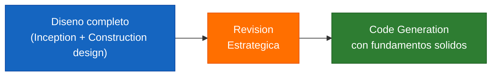
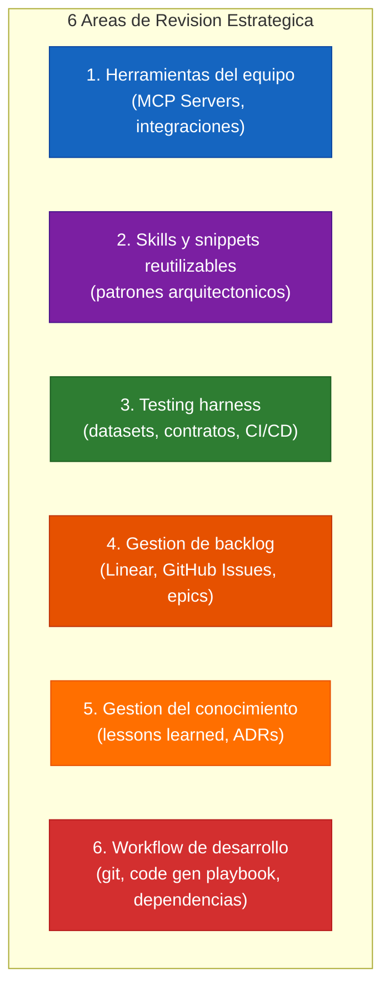
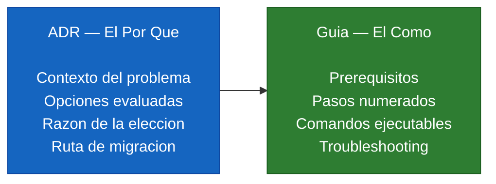
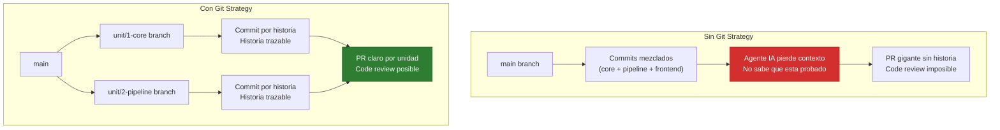
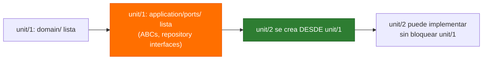
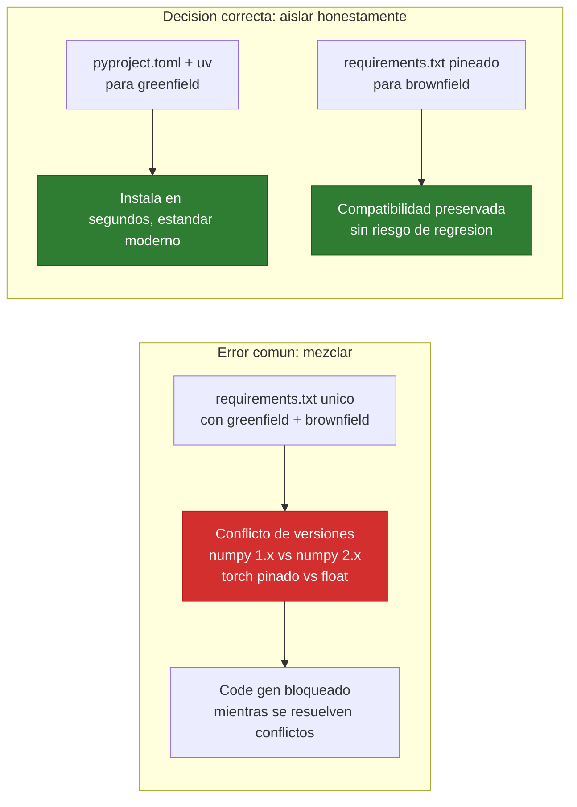
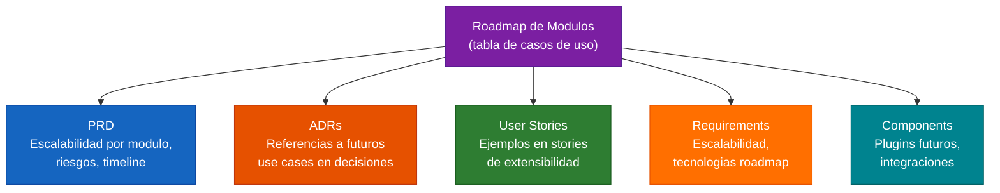
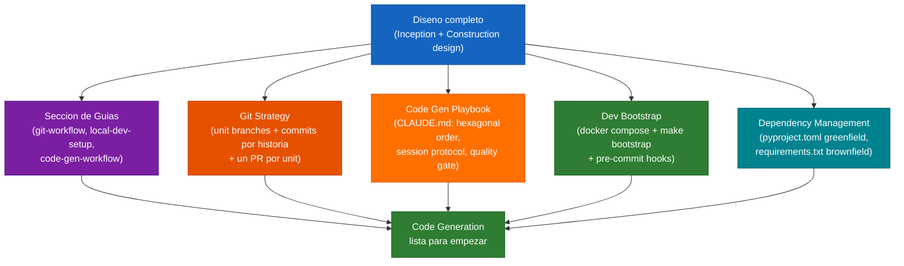

## Paso 17: Revision Estrategica Pre-Code-Generation

### 17.1 El momento critico entre diseno y codigo

Antes de empezar a generar codigo existe un momento de alto valor que muchos equipos ignoran: la **revision estrategica pre-code-generation**. Es el espacio entre "el diseno esta completo" y "vamos a escribir la primera linea de codigo".

Este es el momento ideal porque:
- Ya tienes todo el contexto del producto (requisitos, ADRs, unidades, dependencias)
- Aun no hay presion de entrega de codigo
- Los cambios de proceso son baratos — no hay que refactorizar nada



> **Por que aqui y no despues**: Si configuras el workflow de git despues de haber generado codigo en main, tendras que reorganizar commits. Si defines el entorno local despues, cada dev tendra una configuracion diferente. Si documentas el playbook de code gen cuando ya llevas 3 unidades, las primeras quedaron inconsistentes. El momento correcto es antes.

### 17.2 Las 6 areas de mejora que siempre aparecen

A lo largo de proyectos con el framework, surgen 6 areas que casi siempre tienen oportunidades de mejora antes del code gen:



No es necesario abordar las 6. Evalua cuales aportan valor real en tu proyecto. Cada idea es independiente — puedes implementar solo las que tienen retorno claro.

### 17.3 Como ejecutar la revision

**Prompt ejemplo — iniciar la revision estrategica**:
```
Antes de pasar a code generation, quiero hacer una revision estrategica.
Evalua estas areas en el contexto de nuestro proyecto y dime cuales tienen
mayor potencial de mejora:

1. Herramientas colaborativas (MCP servers, integraciones de equipo)
2. Skills/snippets para patrones arquitectonicos recurrentes
3. Testing harness: datasets, contratos de API, CI/CD gates
4. Gestion de backlog: trazabilidad historia-codigo
5. Captura de conocimiento: lessons learned, ADRs en tiempo real
6. Workflow de desarrollo: git strategy, entorno local, dependencias

Para cada area: dime si aplica a este proyecto y que ganariamos.
No necesito implementar todo — priorizemos las 3 de mayor impacto.
```

**Prompt ejemplo — evaluar una idea especifica**:
```
Quiero evaluar [descripcion de la idea].
Dame 2-3 opciones con pros y contras para este proyecto especifico.
Considera: tamano del equipo, complejidad del proyecto, riesgo.
Cual es tu recomendacion y por que?
```

**Prompt ejemplo — formalizar como ADR**:
```
Aprobamos la opcion [X] para [area].
Formaliza esto como ADR-{N}: [titulo].
Sigue el formato del archivo architecture-decisions-cross-cutting.md.
Incluye: contexto, opciones evaluadas, razon de la eleccion, ruta de migracion.
```

### 17.4 Criterio para decidir si una idea vale la pena

| Factor | Implementar | Posponer |
|--------|-------------|----------|
| **Impacto en calidad** | Previene bugs o inconsistencias en code gen | Solo mejora estetica |
| **Costo de implementar despues** | Alto (requiere refactorizar) | Bajo (se puede agregar en cualquier momento) |
| **Friccion en el equipo** | Bajo (automatico o un solo setup) | Alto (requiere disciplina manual constante) |
| **Seguridad/compliance** | Relevante para el dominio | Opcional |

> **Regla practica**: Si implementarla tarde cuesta el doble, implementala ahora. Si se puede agregar despues sin costo extra, es backlog.

---

## Paso 18: Guias de Desarrollo — La Seccion de Guides

### 18.1 Por que separar guias de ADRs

Los ADRs explican el **por que** de cada decision arquitectonica. Las guias explican el **como** ejecutar esas decisiones en el dia a dia. Son complementarios y ninguno reemplaza al otro.



Un dev nuevo no necesita leer el ADR de git strategy para crear su primera rama. Necesita la guia. El ADR es para quien quiere entender por que se tomo esa decision o quiere cambiarla.

### 18.2 Anatomia de una buena guia

Cada guia sigue esta estructura para que sea accionable:

```
1. Cuando usar esta guia — situacion concreta que la activa
2. Prerequisitos — que debe estar listo antes de empezar
3. Procedimiento — pasos numerados y ejecutables
4. Verificacion — como saber que funcio
5. Troubleshooting — problemas comunes y soluciones
```

### 18.3 Guias tipicas de un proyecto AI-DLC

| Guia | Cuando se necesita |
|------|-------------------|
| `git-workflow.md` | Iniciar una sesion de code gen o incorporar un dev nuevo |
| `local-dev-setup.md` | Dia 1 — levantar el entorno desde cero |
| `code-gen-workflow.md` | Iniciar cada sesion de code gen con el agente IA |
| `testing.md` | Correr el testing harness completo |
| `deployment.md` | Desplegar a staging o produccion |

> **Tip**: No crees todas las guias antes de necesitarlas. La primera que siempre se necesita es `local-dev-setup.md` — antes de que otro dev toque el repo. La segunda es `git-workflow.md`. El resto se crea cuando el proceso se estabiliza.

### 18.4 Crear la seccion de guias

**Prompt ejemplo — crear la seccion de guides**:
```
Crea la seccion de guias de desarrollo en aidlc-docs/guides/.
Empieza con:
1. README.md — indice de guias con estado (Lista/Pendiente/Placeholder)
2. git-workflow.md — procedimiento completo basado en ADR-{N}
3. local-dev-setup.md — setup del entorno local desde cero

Para cada guia, sigue la estructura estandar:
Cuando usar / Prerequisitos / Procedimiento / Verificacion / Troubleshooting.

Las guias deben ser accionables — alguien que no leyo los ADRs puede seguirlas.
Incluye comandos exactos, no descripciones vagas.
```

**Prompt ejemplo — agregar una guia nueva**:
```
Agrega [nombre].md a aidlc-docs/guides/.
Esta guia cubre: [descripcion del proceso].
Se activa cuando: [situacion concreta].
Los pasos clave son: [lista de pasos en lenguaje natural].
Sigue la estructura estandar de la seccion de guides.
```

---

## Paso 19: Estrategia Git para Code Generation con IA

### 19.1 Por que git strategy importa en proyectos con IA

En proyectos tradicionales, la estrategia git es principalmente un problema de coordinacion entre desarrolladores humanos. En proyectos con code generation asistida por IA, hay una dimension adicional: **el agente de IA necesita contexto claro de donde esta y que historia de codigo tiene**.



### 19.2 El patron recomendado: Unit Branches

La estrategia que funciona mejor para proyectos AI-DLC es **unit branches con commits por historia**:

```
main
├── unit/1-core-platform
│   ├── commit: feat(core): tenant provisioning - Closes LIN-001
│   ├── commit: feat(core): auth JWT + refresh tokens - Closes LIN-002
│   └── commit: feat(core): rate limiting middleware - Closes LIN-003
├── unit/2-cv-pipeline  (se crea desde unit/1 cuando ports estables)
│   ├── commit: feat(pipeline): PipelineState + ABCs - Closes LIN-010
│   └── commit: feat(pipeline): DDH plugin registration - Closes LIN-011
└── unit/3-ddh-plugin   (se crea desde unit/2 cuando ABCs estables)
```

**Principios clave**:
- Una historia = un commit (nunca mezclar)
- Un PR por unidad (no por historia)
- Ramas dependientes se crean desde el parent cuando los **puertos (ABCs/interfaces)** estan estables
- `main` siempre deployable

### 19.3 Convencion de commits

```
feat({unit}): descripcion corta - Closes LIN-{id}
fix({unit}): descripcion del bug - Closes LIN-{id}
test({unit}): agrega tests para X
refactor({unit}): descripcion del cambio
```

**Ejemplos**:
```bash
feat(core): tenant provisioning con RLS - Closes LIN-001
feat(pipeline): PipelineState con serializacion nativa - Closes LIN-010
fix(core): refresh token expiry incorrecto - Closes LIN-007
test(core): coverage completo para AuthService
```

### 19.4 El PR por unidad — estructura recomendada

```markdown
## [Unit N: Nombre] — PR Description

### Historias implementadas
- Closes LIN-001: Tenant provisioning
- Closes LIN-002: Auth JWT
- Closes LIN-003: Rate limiting

### Cambios principales
- Nueva capa: `expertia/core/domain/`, `expertia/core/application/`
- Migraciones: `001_create_tenants.py`, `002_create_operators.py`
- Tests: 45 tests, 82% coverage

### Como verificar
1. `docker compose up --profile dev -d`
2. `make bootstrap`
3. `pytest tests/unit/core/ -v`

### ADRs aplicados
ADR-08, ADR-09, ADR-18, ADR-25
```

### 19.5 Cuando crear la rama de una unidad dependiente

La regla critica: **no crear la rama de una unidad dependiente hasta que el parent tenga sus puertos (interfaces) estables**.



> **Por que puertos y no implementacion completa**: La implementacion puede cambiar (un adapter puede refactorizarse). Los puertos son el contrato — si cambias el ABC, rompes el dependiente. Esperar a que los puertos esten estables (no los adapters) es el balance correcto entre evitar bloqueos y evitar retrabajos.

### 19.6 Prompts para configurar git strategy

**Prompt ejemplo — crear la primera rama de code gen**:
```
Voy a iniciar code generation para Unit {N}: {nombre}.
Crea la rama unit/{N}-{nombre} desde {rama-base}.
Luego dame el checklist de la guia git-workflow.md para iniciar
esta sesion de code generation correctamente.
```

**Prompt ejemplo — completar una historia y commitear**:
```
La historia {US-XXX} esta implementada y los tests pasan.
Genera el mensaje de commit siguiendo la convencion:
feat({unit}): {descripcion} - Closes LIN-{id}
Luego dime cual es la proxima historia a implementar segun
el functional design de esta unidad.
```

**Prompt ejemplo — preparar el PR de una unidad**:
```
La implementacion de Unit {N}: {nombre} esta completa.
Genera la descripcion del PR con:
- Lista de historias implementadas (con sus LIN-ids)
- Cambios principales (capas hexagonales, migraciones, tests)
- Instrucciones de verificacion local
- ADRs aplicados en esta unidad
Sigue el template de git-workflow.md.
```

---

## Paso 20: Code Generation Playbook — El CLAUDE.md como Protocolo

### 20.1 El problema sin un playbook

Sin un protocolo explicito, cada sesion de code gen con el agente IA puede producir codigo inconsistente:

| Sin playbook | Con playbook |
|-------------|-------------|
| El agente empieza desde cualquier capa | Siempre empieza por `domain/` |
| Mezcla 2-3 historias en un commit | Una historia = un commit |
| Genera `infrastructure/` antes de `domain/` | Orden hexagonal obligatorio |
| No sabe que esta pendiente al retomar | Lee `git log` + `aidlc-state.md` |
| Importa `infrastructure/` desde `domain/` | Detecta violation y detiene |

### 20.2 El orden hexagonal — no negociable

La capa mas importante del playbook es el **orden de generacion de codigo**:

```
domain/           ← PRIMERO
  entities.py     — entidades con identidad
  value_objects.py — objetos de valor
  aggregates.py   — aggregates root
  events.py       — domain events
  repository.py   — ABC del repositorio (interfaz, NO implementacion)

application/      ← SEGUNDO
  commands/       — casos de uso (write)
  queries/        — casos de uso (read)
  ports/          — ABCs de servicios externos

infrastructure/   ← TERCERO
  postgresql/     — implementaciones de repositorio
  redis/          — adapters de cache
  rabbitmq/       — publishers/consumers

api/              ← ULTIMO
  routes/         — FastAPI endpoints
  schemas/        — Pydantic I/O models

tests/            ← JUNTO CON cada capa
  unit/domain/    — junto con domain/
  unit/infra/     — junto con infrastructure/
  integration/    — junto con api/
```

> **La regla de oro**: Si `domain/` necesita importar algo de `infrastructure/`, el diseno esta mal. El dominio no sabe que existe una base de datos. Lo que necesita el dominio es un **puerto** (ABC en `application/ports/`) que la infrastructure implementa. Si el agente viola esto, hay que detener y revisar el ADR de arquitectura hexagonal antes de continuar.

### 20.3 Protocolo de inicio de sesion

Al iniciar cada sesion de code gen, el agente debe ejecutar estos pasos en orden:

```
1. git log unit/{N} --oneline      → que historias ya tienen commit
2. git status                       → hay trabajo sin commitear?
3. Leer aidlc-state.md              → confirmar unit activo
4. Leer functional design del unit  → entidades, reglas, flujos
5. Identificar siguiente historia   → la que no tiene commit
```

Este protocolo evita: duplicar trabajo ya hecho, sobreescribir codigo en progreso, y perder contexto al retomar una sesion interrumpida.

### 20.4 Configurar el playbook en CLAUDE.md

El playbook se agrega a `CLAUDE.md` (o el archivo de instrucciones de tu herramienta) como una seccion mandatory que el agente debe seguir en cada sesion.

**Prompt ejemplo — crear el playbook**:
```
Agrega a CLAUDE.md una seccion "MANDATORY: Code Generation Playbook".
Esta seccion debe incluir:

1. Protocolo de inicio de sesion (5 pasos con comandos git)
2. Orden de generacion hexagonal (domain → application → infrastructure → api → tests)
   con la regla de oro: domain NO importa infrastructure
3. Granularidad: una historia = un commit, nunca mezclar
4. Protocolo de retomar sesion interrumpida
5. Como manejar historias que tocan 2 unidades (via puertos, no imports directos)
6. Quality gate antes de commitear (checklist de 5 items)

El tono debe ser imperativo — el agente debe seguir esto, no es sugerencia.
```

**Prompt ejemplo — agregar quality gate**:
```
Agrega al playbook de CLAUDE.md un quality gate de pre-commit con estos checks:
- [ ] domain/ no importa infrastructure/ ni api/
- [ ] application/ no importa infrastructure/
- [ ] pytest tests/unit/{unit}/ pasa sin errores
- [ ] Si toca el contrato principal del sistema: pytest tests/contracts/ pasa
- [ ] Si toca logica critica: test de integracion relevante pasa

Formatealo como checklist markdown que el agente revisa antes de cada commit.
```

### 20.5 Granularidad de sesion

Una guia practica para decidir cuantas historias cubre una sesion:

```
Una sesion puede cubrir:
  1 historia compleja (muchas entidades, flujos complejos)
  2-3 historias simples relacionadas (mismo agregado)

Nunca en una sesion:
  - Mezclar historias de diferentes agregados en un commit
  - Commitear sin tests que acompanen el codigo
  - Continuar si hay tests fallando del sprint anterior
```

---

## Paso 21: Entorno Local de Desarrollo — Dev Bootstrap

### 21.1 El problema del "funciona en mi maquina"

Sin un procedimiento de bootstrap estandarizado, cada dev pasa 2-4 horas configurando su entorno la primera vez — y frecuentemente queda en un estado diferente al de los demas. Esto genera bugs que solo aparecen en la maquina de alguien, migraciones que corrieron en un lugar pero no en otro, y datos de prueba inconsistentes.

### 21.2 El patron recomendado: dos comandos

El objetivo es que cualquier dev llegue a un estado funcional con exactamente dos comandos:

```bash
# Paso 1: levantar toda la infraestructura
docker compose --profile dev up -d

# Paso 2: sembrar datos iniciales (una sola vez)
make bootstrap
```

`make bootstrap` tipicamente hace:
- Crea el tenant demo con configuracion inicial
- Crea el usuario admin con credenciales de dev
- Carga fixtures de datos de prueba
- Aplica migraciones si hay pendientes

### 21.3 Docker Compose con profiles

El patron de profiles permite levantar diferentes subconjuntos de servicios segun el contexto:

```yaml
services:
  postgres:   # siempre activo
  redis:      # siempre activo
  rabbitmq:   # siempre activo

  api:
    profiles: [dev, test]    # solo en dev/test

  frontend:
    profiles: [dev]          # solo en dev completo

  gpu-agent:
    profiles: [gpu]          # solo cuando hay GPU disponible

  loki:
    profiles: [observability]  # solo cuando se necesita observabilidad
```

Uso:
```bash
docker compose --profile dev up -d          # dev completo
docker compose --profile test up -d         # solo para tests
docker compose up -d                        # solo infraestructura base
```

> **Ventaja**: El `docker compose up` sin flags funciona para los devs que solo necesitan la base de datos y mensajeria. El `--profile dev` levanta todo lo necesario para desarrollo completo. Nadie tiene que recordar que servicios necesita.

### 21.4 Pre-commit hooks — la primera linea de defensa

Los hooks de pre-commit son controles automaticos que corren antes de cada commit. Son la diferencia entre descubrir un problema en el PR (tarde) vs descubrirlo antes del commit (temprano).

```yaml
# .pre-commit-config.yaml
repos:
  - repo: https://github.com/astral-sh/ruff-pre-commit
    rev: v0.x.x
    hooks:
      - id: ruff           # lint: import order, unused vars, style
        args: [--fix]
      - id: ruff-format    # format: reemplaza black

  - repo: https://github.com/gitleaks/gitleaks
    rev: vX.X.X
    hooks:
      - id: gitleaks       # secrets scan: nunca commitear credenciales
```

Para proyectos Python, **ruff** reemplaza black + isort + flake8 en un solo comando — es ~100x mas rapido y tiene configuracion unificada en `pyproject.toml`.

**gitleaks** es no negociable en cualquier proyecto con datos sensibles: escanea cada commit antes de que llegue al repo y detiene el commit si encuentra un secret hardcodeado (API key, password, token).

```bash
# Instalar hooks (una sola vez por dev)
pip install pre-commit
pre-commit install

# Verificar que funcionan
pre-commit run --all-files
```

### 21.5 Prompts para configurar el entorno local

**Prompt ejemplo — crear local-dev-setup.md**:
```
Crea aidlc-docs/guides/local-dev-setup.md — la guia de setup del entorno local.

El entorno usa: [lista de tecnologias: Docker, Python, etc.]
El comando principal es: docker compose --profile dev up -d
El bootstrap es: make bootstrap

La guia debe cubrir:
1. Prerequisites con versiones minimas
2. Clonar y configurar variables de entorno (.env.example → .env.local)
3. Levantar servicios y verificar que estan healthy
4. Ejecutar make bootstrap (que hace, como verificar que funciono)
5. Instalar dependencias de desarrollo (uv sync --dev, pre-commit install)
6. Comandos del dia a dia
7. Troubleshooting de los 5 problemas mas comunes

Incluye comandos exactos y salida esperada para cada verificacion.
```

**Prompt ejemplo — crear el Makefile de bootstrap**:
```
Crea un Makefile en la raiz del proyecto con el target 'bootstrap'.
El target debe:
1. Crear el tenant demo con nombre "{nombre}" y slug "{slug}"
2. Crear el usuario admin con email "{email}" y password "{password}" de dev
3. Mostrar confirmacion de cada paso
4. Ser idempotente (si el tenant ya existe, no falla)

Tambien agrega los targets: test, lint, migrate, clean.
```

**Prompt ejemplo — configurar pre-commit**:
```
Configura los hooks de pre-commit para este proyecto.
Incluye:
- ruff (lint + format, reemplaza black + isort + flake8)
- gitleaks (secrets scan)
- [otros hooks relevantes para el stack]

Crea .pre-commit-config.yaml con las versiones correctas.
Agrega la seccion [tool.ruff] a pyproject.toml con la configuracion base.
Documenta como instalar los hooks en local-dev-setup.md.
```

---

## Paso 22: Gestion de Dependencias — Aislamiento Honesto

### 22.1 El problema de mezclar brownfield y greenfield

En proyectos hibridos (brownfield + greenfield), uno de los errores mas costosos es intentar unificar prematuramente el sistema de dependencias. El codigo brownfield tiene dependencias pineadas por buenas razones (compatibilidad probada en produccion). El codigo greenfield puede usar el estandar moderno.



### 22.2 El patron: pyproject.toml + uv para greenfield

Para codigo greenfield en proyectos Python modernos, el stack recomendado es:

```toml
# pyproject.toml
[project]
name = "{proyecto}"
version = "0.1.0"
requires-python = ">=3.11"
dependencies = [
    "fastapi>=0.110",
    "pydantic>=2.6",
    "sqlalchemy>=2.0",
    # ... dependencias principales
]

[project.optional-dependencies]
dev = [
    "pytest>=8.0",
    "ruff>=0.3",
    "mypy>=1.9",
    "pre-commit>=3.7",
]

[tool.ruff]
line-length = 88
target-version = "py311"
select = ["E", "F", "I", "N", "W"]  # PEP8, imports, naming, warnings

[tool.mypy]
python_version = "3.11"
strict = true
```

```bash
# Instalar uv (gestor de paquetes ultrarapido)
pip install uv

# Crear entorno virtual e instalar dependencias
uv sync --dev

# Agregar una dependencia
uv add requests

# Agregar dependencia de dev
uv add --dev pytest-asyncio
```

> **Por que uv**: Es 10-100x mas rapido que pip, resuelve dependencias correctamente, genera lockfile reproducible, y es el estandar emergente en el ecosistema Python. El tiempo de instalacion pasa de minutos a segundos.

### 22.3 Brownfield: requirements.txt pineado

El codigo brownfield (legado en produccion) debe mantener su sistema de dependencias pineado:

```
# plugins/ddh/requirements.txt
# PINEADO — no actualizar sin testing completo en produccion
numpy==1.26.4
opencv-python==4.9.0.80
pydicom==2.4.4
# ... exactamente las versiones que estan en produccion
```

**Regla de oro**: Las versiones en `requirements.txt` del brownfield deben coincidir con las de produccion. Un `pip freeze > requirements.txt` tomado del ambiente de produccion es la fuente de verdad.

La migracion del brownfield a `pyproject.toml + uv` es un proyecto aparte — planificalo como tarea dentro de la unidad que adapta ese codigo.

### 22.4 Separacion fisica en el repositorio

```
proyecto/
├── pyproject.toml          ← greenfield (todas las unidades nuevas)
├── plugins/
│   └── ddh/
│       ├── requirements.txt  ← brownfield pineado
│       └── ...
```

Cada ambiente se instala independientemente:
```bash
# Greenfield (todas las unidades nuevas)
uv sync --dev

# Brownfield DDH (aislado en su directorio)
cd plugins/ddh && pip install -r requirements.txt
```

### 22.5 Prompts para configurar dependencias

**Prompt ejemplo — crear pyproject.toml**:
```
Crea pyproject.toml para el proyecto greenfield.
El stack es: Python 3.11+, FastAPI, Pydantic v2, SQLAlchemy 2.0.
Incluye:
- Dependencias principales con rangos de version seguros
- Grupo [dev] con pytest, ruff, mypy, pre-commit
- Configuracion [tool.ruff] con reglas estandar
- Configuracion [tool.mypy] con strict mode
- Configuracion [tool.pytest.ini_options] con paths y markers

Referencia el ADR de dependency management para las decisiones tomadas.
```

**Prompt ejemplo — preparar brownfield para aislamiento**:
```
El codigo brownfield en {directorio} tiene dependencias que pueden
conflictuar con el greenfield.
Crea {directorio}/requirements.txt pineado con las versiones exactas
del ambiente de produccion.

Agrega instrucciones en local-dev-setup.md para instalar este ambiente
separado del principal.

Documenta en un comentario al inicio del requirements.txt:
- Fecha del pinning
- Ambiente de origen (produccion/staging)
- Como actualizar (proceso, no automatico)
```

---

## Paso 23: Roadmap de Modulos — Definir el Pipeline de Casos de Uso

### 23.1 Por que definir el roadmap antes de code gen

Si tu producto es una **plataforma modular** (soporta multiples casos de uso, plugins, o dominios clinicos/de negocio), necesitas definir el pipeline de modulos futuros **antes** de empezar a generar codigo. No porque vayas a construirlos ahora, sino porque:

1. **Valida que la arquitectura modular funcione** — si no puedes nombrar 2-3 modulos futuros con sus metricas, tu arquitectura "modular" es teorica
2. **Informa las ADRs** — decisiones como "el DiagnosticEngine no contiene logica de negocio, solo ejecuta criterios" solo se justifican si hay multiples casos de uso
3. **Da vision al equipo** — el MVP no es el producto. El roadmap muestra hacia donde crece
4. **Alimenta las user stories de extensibilidad** — historias como "registrar un nuevo caso de uso" necesitan ejemplos concretos para los criterios de aceptacion

> **Tip**: No necesitas disenar los modulos futuros. Solo necesitas nombrarlos, definir que miden, y confirmar que la arquitectura los soporta sin rediseno.

### 23.2 Estructura del roadmap de modulos

Cada modulo futuro debe tener al minimo:

| Campo | Descripcion | Ejemplo |
|-------|------------|---------|
| **Nombre clinico/de negocio** | Nombre formal del caso de uso | "Hip Arthroplasty Component Orientation" |
| **Sigla(s)** | Abreviatura estandar del dominio | THA / THR |
| **Que mide** | Metricas o outputs principales | Angulos de anteversion, inclinacion, offset femoral |
| **Relacion con MVP** | Como se conecta con el primer modulo | Misma region anatomica, diferente patologia |

**Formato recomendado en tu documentacion**:

```markdown
| # | Modulo | Sigla(s) | Que mide |
|---|--------|----------|----------|
| MVP | {Tu primer caso de uso} | {sigla} | {metricas principales} |
| Caso 1 | {Segundo modulo} | {sigla} | {metricas principales} |
| Caso 2 | {Tercer modulo} | {sigla} | {metricas principales} |
| Caso 3 | {Cuarto modulo} | {sigla} | {metricas principales} |
```

### 23.3 Donde impacta el roadmap en la documentacion existente

Al definir o cambiar el roadmap de modulos, estas son las secciones que se actualizan:



> **Advertencia**: Cambiar el roadmap de modulos es una operacion de **alto impacto documental**. Puede afectar 10+ archivos. Usa grep para encontrar todas las referencias antes de modificar:
> ```bash
> grep -rn "nombre_modulo_viejo" aidlc-docs/
> ```

### 23.4 Criterios para elegir los modulos del roadmap

No todos los modulos posibles son buenos candidatos para el roadmap inmediato. Evalua cada candidato contra:

| Criterio | Pregunta clave |
|----------|---------------|
| **Reutilizacion de infraestructura** | Usa la misma plataforma base (auth, storage, MLOps)? |
| **Complejidad incremental** | Agrega complejidad nueva o replica el patron del MVP? |
| **Mercado** | Hay demanda validada para este caso de uso? |
| **Datos disponibles** | Existen datasets para entrenar/evaluar? |
| **Sinergia con MVP** | Los usuarios del MVP tambien necesitan este modulo? |

### 23.5 Prompts para definir el roadmap de modulos

**Prompt ejemplo — definir roadmap inicial**:
```
El MVP del producto es {descripcion del primer modulo}.
La arquitectura es modular (plugin-based) y soporta multiples casos de uso.

Necesito definir el roadmap de 3-4 modulos futuros que:
1. Reutilicen la infraestructura existente (auth, storage, MLOps pipeline)
2. Sean clinicamente/comercialmente relevantes para el mismo mercado
3. Tengan complejidad incremental (no repliquen exactamente el MVP)

Para cada modulo dame:
- Nombre formal del caso de uso
- Sigla(s) estandar del dominio
- Que mide o que outputs genera
- Relacion con el MVP (misma region, diferente patologia, etc.)
```

**Prompt ejemplo — actualizar roadmap en toda la documentacion**:
```
El roadmap de modulos ha cambiado. Los nuevos modulos son:
- Caso 1: {nombre} ({sigla})
- Caso 2: {nombre} ({sigla})
- Caso 3: {nombre} ({sigla})

Busca TODAS las referencias a los modulos anteriores ({nombres viejos})
en la documentacion del proyecto y actualiza con los nuevos.

Archivos a revisar:
- PRD (escalabilidad, riesgos, timeline)
- ADRs (contexto, tablas de compatibilidad, razones de decision)
- User stories (ejemplos en acceptance criteria)
- Requirements (escalabilidad, tecnologias roadmap)
- Components / component-methods (plugins futuros)

IMPORTANTE: Manten las referencias a metricas clinicas que siguen siendo
validas (ej: "angulo de Cobb" como medicion sigue existiendo aunque
ya no sea un modulo independiente).
```

**Prompt ejemplo — validar que la arquitectura soporta el roadmap**:
```
Revisa las ADRs de arquitectura del proyecto y valida que cada
modulo del roadmap ({lista de modulos}) se puede implementar
sin redisenar:

1. El plugin system (ADR de plugin architecture)
2. El diagnostic engine (ADR de integracion diagnostica)
3. Los quality gates de MLOps (ADR de promotion engine)
4. La estructura de datos (entidades, thresholds, measurements)

Para cada modulo, indica:
- Puede usar el framework actual? Si/No y por que
- Necesita extensiones? Cuales?
- Hay algo que requiera rediseno? Flag it.
```

---

## Resumen del Proceso Pre-Code-Generation

Una vez que el diseno de todas las unidades esta completo, la revision estrategica convierte el repo en un entorno profesional y reproducible antes de tocar codigo:



> **El costo de esta fase**: 1-2 sesiones de trabajo. El beneficio: cada sesion de code gen posterior tiene contexto claro, el equipo comparte el mismo entorno, los commits son trazables a historias, y el agente IA sigue un protocolo reproducible. No es overhead — es la inversion que hace que el code gen no colapse en la unidad 3.

**Checklist de la revision estrategica pre-code-gen**:
- [ ] `aidlc-docs/guides/` creada con README.md, git-workflow.md, local-dev-setup.md, code-gen-workflow.md
- [ ] Git strategy documentada como ADR y guia practica
- [ ] CLAUDE.md (o equivalente) tiene el playbook de code gen con hexagonal order
- [ ] `docker compose --profile dev up -d && make bootstrap` funciona desde cero
- [ ] `.pre-commit-config.yaml` configurado e instalado
- [ ] `pyproject.toml` (greenfield) y separacion de dependencias brownfield (si aplica)
- [ ] Roadmap de modulos futuros definido y reflejado en PRD, ADRs, stories, requirements

---

### Nota: Enforcement Programatico (post-Construction)

Los pasos 17-23 definen la estrategia pre-codegen. Durante y despues de Construction, esta estrategia evoluciono hacia **Harness Engineering** — enforcement programatico con 16 gates que reemplazan las reglas de texto.

Conceptos clave que complementan estos pasos:
- **Progressive Disclosure**: El CLAUDE.md se refactorizo de ~370 lineas a ~100, apuntando a `.claude/rules/` con 5 archivos por contexto (ADR-056). Ver Paso 32.
- **harness-check.sh**: Script maestro que ejecuta los 16 checks automaticamente al inicio de sesion, antes de commit, y al final de sesion. Ver Paso 32.
- **Agent Skills**: Las guias de desarrollo (Paso 18) evolucionaron a Skills formales en `.claude/skills/`. Ver Paso 33.

---

## Lecciones adicionales de ExpertIA para la fase Pre-Code-Gen

### Claude DEBE leer los ADRs antes de implementar (LL-010, LL-011)

El patron mas recurrente en ExpertIA fue: Claude toma decisiones "razonables" sin consultar los ADRs que el propio proyecto ya habia definido. Ejemplos: usar `.env.local` en vez de `.env` (ADR existente decia `.env`), no usar el `.venv` del proyecto (ADR-48 lo definia), hardcodear credenciales (el Setup Operativo lo prohibia). Cada desviacion silenciosa genero retrabajo.

**Prevencion**: agregar dos reglas MANDATORY en CLAUDE.md antes de code gen:

1. **ADR Compliance Check**: antes de cualquier decision de implementacion, buscar en `architecture-decisions*.md` y `guides/` si ya existe una decision. Si existe, seguirla. Si no, preguntar.
2. **Setup Operativo Gate**: antes de code gen, verificar .env, .venv, pre-commit, y dependencias. Si falla, completar antes de generar codigo.

### Checkpoint parcial para units foundation (LL-004)

Para units que son dependencia de otras (Core Platform, frameworks base), ejecutar un checkpoint parcial (migrations + DI wiring + lint + hexagonal check) ANTES de avanzar a la siguiente unit. En ExpertIA, un checkpoint de 3 puntos despues de Unit 1 (~80 archivos) descubrio 3 problemas que se habrian propagado a 5 units. Costo: ~15 min. Ahorro estimado: horas de debugging.

Para units aisladas (Chat, MLOps), el checkpoint final es suficiente.

### Smoke tests HTTP detectan lo que unit tests no ven (LL-005)

192 unit tests pasaban, ruff limpio, hexagonal limpio. Pero los smoke tests HTTP descubrieron que 3 endpoints autenticados retornaban 500 porque `app.state` no tenia handlers registrados. Los unit tests usaban mocks y nunca tocaban el wiring real de FastAPI.

**Regla**: antes de crear un PR, correr smoke tests HTTP contra la app real (uvicorn). Minimo: endpoints publicos (200), endpoints protegidos sin auth (401), endpoints protegidos con auth (no 500), OpenAPI schema (rutas presentes).

### El quality gate hexagonal es obligatorio (LL-002)

En arquitectura hexagonal, las violaciones de dependencia (application importando de infrastructure) son silenciosas — los unit tests no las detectan porque ellos mismos replican la violacion. Solo un check AST de imports las encuentra. Este check debe ser pre-commit hook, no verificacion manual.

### DI wiring debe ser paso explicito del plan (LL-003)

Si se generan routes FastAPI como stubs, el plan de code gen DEBE incluir un paso explicito "Wire DI" despues de generar routes y handlers. Sin DI wiring, la API parece funcional (tests pasan, Swagger muestra rutas) pero cada request real retorna 500. Los smoke tests son la red de seguridad que atrapa este gap.
