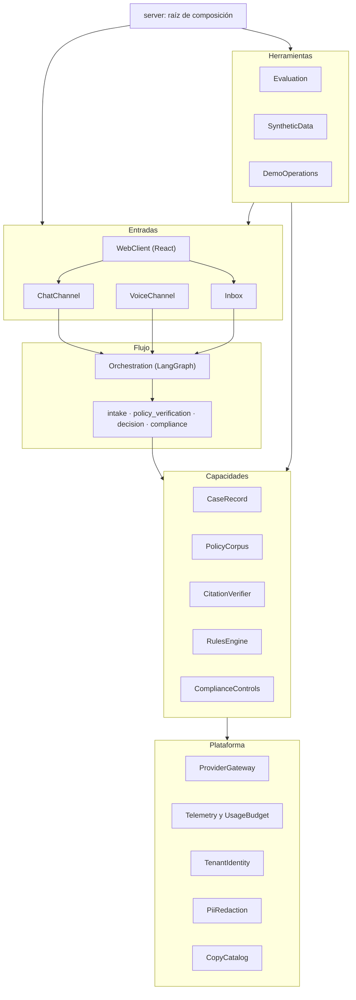

# Cómo se construye Untangle: arquitectura, tecnologías y prácticas

**Pregunta de Miguel (2026-09-17), antes de Contract Design:** para la parte de IA, ¿lo correcto es LangGraph u otra tecnología? Pasar por varios agentes podría volver lento cada intercambio. ¿Hay que usar skills, tools, MCP, FalkorDB, RAG, LiteLLM, sistemas de seguridad, sistemas multiagente o multimodales, harness, jueces, Redis o Celery? ¿Qué arquitectura, qué patrones de diseño y qué papel tienen los grafos? ¿Se aplican SOLID, DRY, YAGNI? ¿Monorepo con contratos que se respetan? ¿Dónde entra Playwright? La vara: es un proyecto para demostrar que se hacen bien las cosas con IA, ante quien contrata.

**Respuesta corta:** la base aprobada aguanta y no se reabre:
- monolito modular;
- Python con FastAPI y React con TypeScript;
- LangGraph;
- sin Redis ni Celery;
- PostgreSQL para todo.

La investigación sí encontró **incoherencias y huecos** que habrían costado caro en Construcción, **tecnologías que conviene nombrar y rechazar por escrito** y **precisiones** que convierten las buenas prácticas en comprobaciones automáticas. Casi nada de lo que se preguntó entra al producto. Lo que un evaluador senior premia es ver cada tecnología considerada, con la razón por la que no entró y la prueba que sostiene lo que sí entró.

**Estado:** decidido y aplicado el 2026-09-17. Miguel eligió la opción recomendada en las cuatro decisiones de la sección 15, y los cambios de la sección 14 ya están en los documentos aprobados.

---

## 0. Cómo se hizo

- **Cuatro investigaciones en paralelo**, una por tema: runtime de IA, datos, seguridad y evaluación, y arquitectura.
  - Cada una recibió el contexto del proyecto y las 18 decisiones aprobadas.
  - Tenían la consigna de **poner a prueba lo aprobado en lugar de confirmarlo** y de marcar lo que sería tecnología puesta para lucir.
  - Suman más de 300 fuentes fechadas: documentación oficial, notas de versión, papers y registros de paquetes consultados el 2026-09-17.
- **Anexos con la evidencia completa:**
  - [01 · Runtime de IA y orquestación](investigacion-tecnica/01-ia-runtime-y-orquestacion.md)
  - [02 · Datos, recuperación y trabajo de fondo](investigacion-tecnica/02-datos-recuperacion-y-trabajo-de-fondo.md)
  - [03 · Seguridad, evaluación y pruebas](investigacion-tecnica/03-seguridad-evaluacion-y-pruebas.md)
  - [04 · Arquitectura, patrones y contratos](investigacion-tecnica/04-arquitectura-patrones-y-contratos.md)
- **Verificación propia** de las afirmaciones que cambian decisiones, contra la fuente primaria o el registro de paquetes:

| Afirmación | Comprobación |
| --- | --- |
| Starlette < 1.0.1 tiene una evasión de autorización por cabecera Host (CVE-2026-48710), y afecta a FastAPI | Starlette 1.0.1 publicada el 2026-05-21; CISA la agregó a vulnerabilidades explotadas el 2026-09-02 |
| LiteLLM publicó versiones maliciosas en PyPI en marzo de 2026 | 1.82.7 y 1.82.8 ya no existen en PyPI; 1.82.6 (2026-03-22) y 1.83.0 (2026-03-31) sí |
| Gemini aplica los límites por proyecto, no por clave | Página oficial de límites: "Rate limits are applied per project, not per API key" |
| Existe la edición 2026 del OWASP Top 10 para LLM | Publicada a inicios de agosto de 2026; "System Prompt Leakage" pasa a "Hidden Context Exposure" |
| LLM Guard está archivado y no instala en Python 3.13 | Repositorio archivado; su última versión exige Python < 3.13 |
| DeepEval arrastra `posthog` y `pytest-rerunfailures` | 29 dependencias base en PyPI, con ambas |
| pnpm ya no va por la 10 | La versión actual es la 12.4.2 (2026-09-15); la 11.0.0 salió el 2026-04-28 |
| Versiones actuales de las piezas del núcleo | `langgraph` 1.2.11, `langgraph-checkpoint` 4.2.0, `fastapi` 0.141.1, `import-linter` 2.15, `@hey-api/openapi-ts` 0.99.0, `@playwright/test` 1.63.0 |
| `import-linter` ofrece los contratos `layers`, `forbidden`, `protected`, `independence` y `acyclic_siblings`, y `forbidden` revisa imports indirectos salvo `allow_indirect_imports` | Instalado en un entorno aparte y leído en su código |

---

## 1. Lo esencial en una página

**Se mantiene, con evidencia de 2026:**
- **Arquitectura y lenguajes:** monolito modular (ADR-001); Python y FastAPI, React y TypeScript (ADR-002).
- **Runtime:** LangGraph (ADR-003).
- **Trabajo de fondo:** en el mismo proceso, sin Redis ni Celery (ADR-004).
- **Datos:** búsqueda híbrida en PostgreSQL (ADR-010); verificador exacto de citas (ADR-011); aislamiento con RLS (ADR-012).
- **Evaluación y proveedores:** corredor de evaluaciones propio (ADR-014); adaptadores propios en lugar de un intermediario de modelos (ADR-018); Playwright con axe.

**Se rechaza y queda escrito por qué:**
- **Grafos y datos:** FalkorDB, Neo4j y GraphRAG.
- **Intermediarios de modelos:** LiteLLM.
- **Protocolos:** MCP y A2A dentro del producto.
- **Arquitectura y orquestación:** multiagente; skills en el runtime; microservicios.
- **Infraestructura:** Redis, Celery y bases vectoriales dedicadas; voz nativa de Gemini (speech-to-speech).
- **Seguridad:** guardas de ML dentro del turno.
- **Herramientas de trabajo:** contenedor de inyección de dependencias; Nx o Turborepo.

**Seis hallazgos que habrían salido caros después:**
1. **La bandeja rompe la regla de capas de ADR-001.** Está en "dominio", pero depende del grafo.
2. **LangGraph vuelve a ejecutar el nodo completo al reanudar tras `interrupt()`.** Un nodo que escribe en la base de datos, como hoy el de verificación de póliza, duplica filas y paga dos veces la llamada al modelo.
3. **El checkpointer oficial de LangGraph trabaja en autocommit.** La aseguradora fijada por el punto único de sesión no lo cubre, así que PA-3 necesita un diseño explícito.
4. **Las pruebas de aislamiento pueden pasar sin aislamiento.** Con testcontainers, el usuario por defecto de Postgres es superusuario y se salta RLS; el dueño de una tabla también, salvo con `FORCE ROW LEVEL SECURITY`.
5. **Gemini limita por proyecto, no por clave.** Las "claves separadas por uso" solo separan cuotas si cada uso vive en su propio proyecto.
6. **La guardia de salida puede llegar tarde.** Si el texto del modelo va en streaming a la voz o al chat, la frase prohibida sale antes de que la guardia la vea.

**Cuatro decisiones fueron de Miguel** (sección 15). Todo lo demás son correcciones técnicas que aplican reglas ya aprobadas.

---

## 2. Tema por tema: lo que preguntaste

| Tema | Veredicto | Por qué, en una línea | Sección |
| --- | --- | --- | --- |
| LangGraph | **Se mantiene**, con enmienda | Resuelve puntos de control, pausa humana y streaming; su sobrecosto ronda los 14 ms, frente a segundos del modelo | 7.1 |
| Latencia "por pasar por varios agentes" | **No la pone el grafo**: la pone el modelo | El turno ejecuta un solo paso con el modelo; verificación, reglas y cumplimiento van de fondo | 7.2 |
| Multiagente | **No lo es, y conviene decirlo así** | Es un flujo determinista con pasos de IA; Anthropic, Cognition y el paper MAST respaldan justo ese diseño | 3.3 |
| Tools (function calling) | **No en el turno ni para decidir** | Cada llamada a herramienta es otra vuelta al modelo, y P3 prohíbe que el modelo elija acciones | 7.3 |
| MCP | **Solo en desarrollo** (ya se usa); fuera del producto | Sin herramienta externa que el producto necesite; exponer pólizas por MCP sería lo más "de currículum" del alcance | 7.3 |
| Skills | **Solo en desarrollo** | En el producto, cada nodo tiene prompts fijos; las skills sirven a agentes abiertos que eligen qué cargar | 7.3 |
| Harness | **Ya se practica en el desarrollo**; se cuenta con precisión | Guías (reglas, AGENTS.md) y sensores (pruebas, linters, contratos) en la taxonomía de Böckeler | 7.3 |
| LiteLLM | **Rechazado** | Paquete comprometido en PyPI, dos vulnerabilidades críticas en 2026 y un solo proveedor de modelo | 7.4 |
| RAG | **Se mantiene** la búsqueda híbrida, con cuatro precisiones | Búsqueda exacta sin índice aproximado a este tamaño, contexto estructural sin LLM y cierre por relaciones | 8.1 |
| Grafos de conocimiento (FalkorDB, Neo4j, GraphRAG) | **Rechazados**; se usan **relaciones entre cláusulas** en tablas | En QA legal ganan pocos puntos a cambio de mucho costo; las relaciones ya las conoce el generador | 8.2 |
| "Tener presente los grafos" | **Tres grafos del sistema**, cada uno comprobado por herramienta | Dependencias entre módulos, flujo del caso en LangGraph y ciclo de vida del caso | 3.4 |
| Redis | **Rechazado hoy**, con cinco señales medibles para reconsiderarlo | Un proceso, tráfico de demo y techo de 5 USD; Postgres cubre caché, límites y colas | 8.3, 8.5 |
| Celery | **Rechazado** | Exige broker y worker aparte; se resuelve con un arrendamiento sobre `NodeRun` en Postgres | 8.3 |
| Sistemas de seguridad | **Defensa por diseño** más guardas deterministas; **sin guardas de ML** | Los clasificadores caen ante ataques adaptativos; lo que protege es que un modelo engañado no pueda hacer nada importante | 9 |
| Sistema de jueces | **Juez propio, calibrado con TPR y TNR** (decisión 15.1) | El 85 % de acuerdo sobre 20 casos no distingue un juez bueno de uno que deja pasar la mitad de los fallos | 10 |
| Multimodal | **Voz en cascada** (ya aprobada); speech-to-speech rechazado; documentos diferidos | La voz nativa de Gemini no admite voz propia y entrega audio antes de que la guardia lea el texto | 7.6 |
| Playwright | **Se mantiene**, con axe y cuatro a seis recorridos críticos | Incluye la prueba de que la salida del modelo se muestra como texto plano | 12 |
| Arquitectura | **Monolito modular por componentes**, con nombre preciso | Núcleo funcional donde se decide; puertos y adaptadores solo en las fronteras con proveedores | 3.1 |
| Patrones de diseño | **14 patrones que aplican y 3 que se descartan**, cada uno con dónde sí y dónde no | Adapter, Strategy, Factory, Repository concreto, máquina de estados explícita, bulkhead y otros | 4 |
| SOLID, DRY, YAGNI y otros | **Cada principio con su herramienta**, o declarado como criterio de revisión | Regla del equipo: una convención que no comprueba una herramienta no cuenta | 5 |
| Monorepo | **Sí, sin herramientas de monorepo**: un proyecto uv, uno pnpm y `mise` | Nx o Turborepo resuelven decenas de paquetes; aquí hay dos proyectos | 6.1 |
| Contratos que se respetan | **Contratos ejecutables** en `verify.sh` | `import-linter`, cliente generado desde OpenAPI con chequeo de deriva y JSON Schema de archivos | 6.2 |

---

## 3. Arquitectura

### 3.1 Estilo, con su nombre

**Nombre para ADR-001 y el README:**
- monolito modular por componentes, con reglas de dependencia verificadas por herramienta;
- un flujo de trabajo determinista (LangGraph) en el centro;
- núcleo funcional en los módulos que deciden;
- puertos y adaptadores solo en las fronteras con proveedores externos.

**Versión para el README (inglés):**

> Untangle is a modular monolith: one deployable, organized as package-by-component modules whose dependency rules are enforced in CI by import-linter. At its center is a deterministic LangGraph workflow, not an autonomous agent: code decides every transition. Decision logic (rules, citation checks, case lifecycle) is a pure functional core; I/O lives in thin shells. Ports & adapters appear only where the outside world is swappable (LLM, speech, voice transport); we deliberately did not apply Clean Architecture rings, microservices, an event bus or a DI container.

**Dónde aplica cada estilo:**

| Estilo | Dónde sí | Dónde no, y por qué |
| --- | --- | --- |
| Monolito modular, *package by component* (Simon Brown, Kamil Grzybek, Shopify) | Todo el servidor: un proceso, cada componente con su lógica y su persistencia detrás de su API | — |
| Núcleo funcional con cáscara imperativa (Gary Bernhardt) | Transición del grafo, tabla de estados del caso, reglas, verificador de citas, guardia de salida, completitud por campo | E/S de base de datos, SDK y streaming: van en la cáscara |
| Hexagonal (puertos y adaptadores, Alistair Cockburn) | Proveedores de modelo, embeddings, transcripción y síntesis; librería de voz; conductor del corredor de evaluaciones | Delante de PostgreSQL: permitiría "probar" RLS con un repositorio falso, y RLS debe probarse contra Postgres real |
| DDD táctico, selectivo | Agregado `Case` con sus invariantes; objetos de valor congelados (`CaseNumber`, `TenantId`, `ClauseRef`); lenguaje ubicuo | Fábricas, bus de eventos de dominio, repositorio genérico por entidad |
| Vertical slice (Jimmy Bogard) | Endpoints de chat, voz y bandeja; módulos del frontend | Como estilo principal: reglas, citas y redacción son núcleo compartido por diseño |
| Clean Architecture u Onion por módulo | — | 17 módulos por tres anillos serían unas 50 carpetas de ceremonia para una persona |
| Microservicios | — | Ya rechazados en ADR-001; Fowler aconseja empezar por el monolito |

"Dominio" en ADR-001 significa **módulos de capacidad con su persistencia**, no el anillo interior de Clean Architecture. Decirlo evita que un revisor lea como violación que `CaseRecord` hable con la base de datos.

### 3.2 Capas corregidas

La corrección: **la bandeja pasa a la capa de entradas**, junto al chat y la voz. Una persona controla el sistema desde ahí, igual que el asegurado desde el chat, y reanudar el grafo es exactamente lo que hace una entrada.



Texto alternativo:
- La raíz de composición (`server`) conecta todo.
- Las entradas (interfaz web, chat, voz y bandeja) llaman al flujo; el flujo ejecuta los cuatro nodos, y los nodos usan las capacidades.
- Las capacidades (caso, corpus, verificador de citas, reglas y controles de cumplimiento) usan la plataforma: proveedores, telemetría y gasto, aseguradoras e identidad, redacción y catálogo de textos.
- Las herramientas (evaluación, datos sintéticos y operación de la demo) usan las entradas y las capacidades.
- Ninguna capa importa una superior, y `import-linter` lo comprueba.

### 3.3 No es multiagente, y eso es una virtud

| Nodo | ¿Decide algo el modelo? | Qué es en la taxonomía de Anthropic |
| --- | --- | --- |
| `intake` | Extrae campos y redacta la siguiente frase; el orden de las preguntas lo fija la guía | Paso de IA dentro de un flujo |
| `policy_verification` | Recupera por código; el modelo redacta la respuesta y el verificador exacto la acota | Paso de IA acotado por un verificador determinista |
| `decision` | No: motor de reglas | Código |
| `compliance` | Controles por código; la revisión completa usa el modelo y solo puede bloquear o derivar | Revisor que aporta criterio, no escribe el caso |
| Transiciones | Función pura sobre el estado | Ruteo por código |

**Evidencia:**
- **Anthropic** (2026-01-23): varios agentes gastan de 3 a 10 veces más tokens, y conviene empezar por un agente bien diseñado. Con el techo de 5 USD, un sistema multiagente real no cabe.
- **Cognition** (2026-04-22): siguen funcionando las escrituras de un solo hilo y los agentes que "aportan inteligencia, no acciones". Es la convención 6 de `team.md` y el papel de `compliance`.
- **MAST** (NeurIPS 2025): 14 modos de fallo en tres familias, cada una con su control aquí:
  - **especificación:** contrato y conjunto de escritura por nodo;
  - **desalineación entre agentes:** un solo estado tipado con un escritor por campo;
  - **verificación:** verificador exacto y compromisos duros.

**Cambios propuestos:**
- En README, landing y video se habla de "una agente conversacional sobre un flujo de cuatro nodos". En código y ADR, "nodo", nunca "agente".
- Se agrega una sección del README, "Why this is not multi-agent", con la evidencia de arriba.
- La palabra "agentes" de P1 en el PRD se corrige. **Decisión 15.3.**

### 3.4 Los tres grafos del sistema

"Tener presente los grafos" tiene aquí tres respuestas concretas, y las tres se comprueban por herramienta.

| Grafo | Qué es | Cómo se comprueba |
| --- | --- | --- |
| **Dependencias entre módulos** | Qué módulo puede importar a cuál | Contratos de `import-linter` (capas, `protected`, `forbidden`, `acyclic_siblings`); su comando `drawgraph` dibuja el grafo real |
| **Flujo del caso** | Nodos y transiciones de LangGraph | La transición es una función pura con pruebas por tabla; el diagrama se genera desde el grafo compilado y se compara con el versionado |
| **Ciclo de vida del caso** | Estados y transiciones permitidas (ADR-005) | Tabla `(estado, evento) → estado` con pruebas por tabla y pruebas de propiedades (Hypothesis `RuleBasedStateMachine`); diagrama generado desde la tabla |

Hay un cuarto grafo pequeño: las **relaciones entre cláusulas** (qué endoso modifica qué exclusión). Vive en una tabla con RLS y se recorre con una consulta recursiva, sin base de datos de grafos (sección 8.2).

### 3.5 Contraste con 12-factor agents

La tesis de 12-factor agents (HumanLayer) es que los buenos agentes son sobre todo código determinista con pasos de IA en el lugar justo, y el diseño ya la sigue. Quedan tres brechas, las tres baratas de cerrar:

| Factor | Brecha | Cierre comprobable |
| --- | --- | --- |
| 5. Unificar estado de ejecución y de negocio | Checkpoint de LangGraph, `CaseRecord`, `HumanReviewRequest` y `NodeRun` guardan estado del mismo caso | ADR-005 declara el caso como fuente de verdad del negocio y el checkpoint solo como ejecución reanudable; una prueba reanuda dos veces sin duplicar nada |
| 8. Ser dueño del flujo de control | Un nodo podría rutear con `Command(goto=...)` de LangGraph | Contrato `forbidden`: los nodos no importan `langgraph`; los nodos son funciones normales |
| 12. Agente como reductor sin estado | El nodo de verificación escribe `CoverageAnswer` en la base de datos | El nodo es puro y devuelve la actualización; la persistencia la hace la capacidad con clave idempotente; hay una prueba de pureza |

---

## 4. Patrones de diseño

| Patrón | Dónde aplica | Dónde no | Cómo se verifica |
| --- | --- | --- | --- |
| **Adapter / Port** | `providers/ports.py` con `typing.Protocol` pequeños (`TextGenerator`, `Embedder`, `SpeechToText`, `TextToSpeech`) y un adaptador por proveedor; conductor del corredor; contrato de borrado (UG-3) | Delante de PostgreSQL en módulos con RLS; interfaces con una sola implementación sin necesidad de doble de prueba | Contrato `protected`; adaptadores que heredan del `Protocol` para que mypy verifique; suite de contrato con respuestas grabadas |
| **Strategy** | Política de fallo por nodo como dato; voz principal o de respaldo; subconjunto declarado de evaluaciones | Jerarquías de clases: basta un `dataclass` o una función | mypy estricto |
| **Factory** | Un cliente por uso (ADR-018), construido solo en la raíz de composición | Registros dinámicos por nombre en texto | `protected` sobre la fábrica |
| **Repository** concreto | Un `store.py` por módulo con las consultas de ese dueño | `BaseRepository[T]` genérico o puertos abstractos por tabla (Cosmic Python lo desaconseja en dominios simples) | Solo `store.py` importa SQLAlchemy |
| **Unit of Work** | El punto único de sesión ya lo es: abre la transacción, fija la aseguradora con alcance de transacción y confirma o revierte | Una clase propia encima de la sesión del ORM | Prueba de que fuera de `tenant_session` no hay sesión |
| **Máquina de estados explícita** | Ciclo de vida del caso como tabla más función pura | Librerías de máquinas de estado; mezclarla con el grafo de LangGraph (conversación y negocio son dos máquinas) | mypy `exhaustive-match`; diagrama generado igual al versionado |
| **Pipeline / Chain of Responsibility** | Redacción (reconocedores en cadena); guardia de salida (controles ordenados que devuelven `Pass` o `Replace(clave_del_catálogo)`) | Cadenas configurables en tiempo de ejecución | Prueba por eslabón y prueba de orden |
| **Decorator** | Ejecutor de la política de fallo; spans de telemetría alrededor de nodos y adaptadores | Decoradores que esconden reintentos dentro del dominio | Ruff `BLE001` y `S110` |
| **Specification / Interpreter** | Motor de reglas: reglas como datos versionados con operadores cerrados y función pura | Motores de reglas generales o con encadenamiento hacia delante | JSON Schema de las reglas y una prueba por regla (ya obligatoria) |
| **Retry con backoff y Timeout** | En los adaptadores: tiempo máximo y un reintento; `rate_limited` no se reintenta dentro del turno | Reintentos ante cuota agotada (ADR-018 ya lo prohíbe) | Prueba con puerto falso que falla N veces |
| **Bulkhead** | Semáforos por uso (voz, chat, fondo) y trabajo de CPU (redacción, fusión) fuera del event loop | Pools de procesos por componente | Ruff `ASYNC`; medición en el experimento 1 |
| **Idempotencia** | Reanudar con la decisión, enviar mensaje, escrituras derivadas de nodos: claves naturales y actualizaciones condicionales | Almacén genérico de `Idempotency-Key` | Prueba: doble reanudación da una sola `AdjusterDecision` |
| **Resultados como valores** | Uniones cerradas congeladas (`Verified`, `NoClause`, `CouldNotVerify`) con `match`; excepciones solo para errores de programación y dentro de adaptadores | La librería `returns` y su estilo monádico | mypy `exhaustive-match` |
| **Inyección de dependencias manual** | Raíz de composición en `server/`; los nodos reciben sus puertos por *closure*; `Depends` de FastAPI solo como getter fino | Contenedores (dishka, dependency-injector) | `protected`: solo `server` importa adaptadores |
| **Circuit breaker** | **No.** El corte de gasto de UsageBudget ya funciona como interruptor | Librería de circuit breaker: Microsoft la desaconseja cuando el reintento basta | — |
| **Observer / bus de eventos** | **No.** La bandeja lee la base de datos por SSE | ADR-004 ya rechazó el bus sin segundo consumidor | Grep: no existe módulo `events` ni `bus` |
| **Transactional outbox** | **No.** Resuelve publicar a un broker, y no hay broker | — | — |

**Antipatrones que se vigilan:**
1. **Carpetas cajón de sastre.** `utils/`, `helpers/` o `common/` no existen (grep).
2. **Ruteo desde un nodo.** Ningún nodo rutea con `Command(goto=...)` (contrato `forbidden`).
3. **Fallos tragados.** Un nodo no captura su propio fallo (Ruff `BLE001`, `S110`).
4. **Mutación del estado.** Nadie modifica el estado compartido en el lugar (prueba de pureza; Ruff `B006`, `RUF012`).
5. **RLS con mocks.** En módulos con RLS no se simula la base de datos: se prueba contra Postgres real.
6. **Módulos con demasiadas dependencias** (`inbox`, `demo_operations`). Contrato `acyclic_siblings` y revisión del número de dependencias por unidad.

---

## 5. Principios y cómo se verifican

Regla del equipo: una convención que no comprueba una herramienta o un grep no cuenta. Por eso la última columna dice cuándo **no** se puede.

| Principio | Qué significa aquí | Herramienta | ¿Verificable? |
| --- | --- | --- | --- |
| **S** · responsabilidad única | Cada componente cambia por una razón, la de su fila del catálogo | Solo aproximaciones: Ruff `C901` y `PLR09xx` | Parcial: catálogo y revisión |
| **O** · abierto/cerrado | Proveedor nuevo = adaptador y configuración; regla nueva = archivo de datos | `import-linter` (el núcleo no importa adaptadores) | Parcial |
| **L** · Liskov | Todo adaptador cumple el contrato de su puerto | Herencia explícita del `Protocol`, más suite de contrato parametrizada | Sí |
| **I** · segregación de interfaces | Puertos pequeños por capacidad | mypy y revisión | Parcial |
| **D** · inversión de dependencias | El núcleo depende de puertos; solo la raíz conoce adaptadores | `import-linter` `layers`, `protected` y `forbidden` | Sí |
| **DRY** con regla de tres (AHA, Sandi Metz) | Se duplica hasta la tercera aparición; la abstracción equivocada cuesta más | Ninguna confiable | No: criterio de revisión, excepto los textos visibles (catálogo único) |
| **YAGNI** | No se construye lo que ninguna de las 85 historias pide | `deptry` (dependencias sin uso), `knip` (exports sin uso en TS), `vulture` como advertencia | Parcial |
| **KISS** | Funciones cortas y planas | Ruff `C901` (complejidad ≤ 10) y `PLR09xx`; ESLint `complexity`, `max-depth` | Sí, con aproximaciones |
| **Separación de responsabilidades** | Entradas, flujo, capacidades, plataforma y herramientas no se mezclan | `import-linter`; `eslint-plugin-boundaries` en el frontend | Sí |
| **Ley de Demeter** | No encadenar `a.b.c.d` entre módulos | Ruff `SLF001` cubre una parte | No: revisión |
| **Composición sobre herencia** | Solo se hereda de `BaseModel`, `Protocol`, `Exception` y `Enum` | Script opcional sobre el AST | Sí, si se quiere |
| **Fallar rápido** | La app no arranca con configuración inválida; ningún `except` genérico | `pydantic-settings` validado al crear la app; Ruff `BLE001`, `TRY` | Sí |
| **Parse, don't validate** (Alexis King) | Toda frontera produce un modelo tipado; dentro no circulan `dict` ni `Any` | Pydantic `strict`, `extra="forbid"`, `frozen`; Ruff `ANN401`; mypy estricto | Sí |
| **Inmutabilidad** | Estado, valores y eventos congelados; el nodo devuelve una actualización | `frozen=True`; prueba de pureza | Sí |
| **CQS** | Las consultas no escriben; los `GET` no cambian estado | Sin herramienta directa | No: revisión y pruebas de endpoints |
| **12-factor app** | Configuración en el entorno, logs a stdout, cierre limpio | Prueba de que `Settings` coincide con `.env.example` | Sí |
| **Mínimo privilegio** | El rol del aplicativo no es dueño de las tablas ni tiene `BYPASSRLS`, y las tablas llevan `FORCE ROW LEVEL SECURITY` | Aserción de esquema extendida | Sí |
| **Seguro por defecto** | Toda ruta exige identidad salvo una lista explícita de rutas públicas | Prueba que recorre `app.routes` | Sí |

---

## 6. Monorepo y contratos

### 6.1 Estructura del repositorio

```text
app/
  backend/     un proyecto uv (un pyproject.toml, un uv.lock); fronteras con import-linter
  frontend/    un proyecto pnpm (sin workspace mientras no exista un paquete TS compartido)
  contracts/   artefactos GENERADOS y versionados: openapi.json y schemas/*.schema.json
  config/  data/  evals/
mise.toml      versiones de Python, uv, Node y pnpm, y tareas con nombre (archivo de tareas único)
scripts/verify.sh   compuerta única y ordenada; `mise run verify` la invoca
```

- **Un solo proyecto uv, no uno por módulo.** La documentación de uv dice que los workspaces no impiden que un miembro importe dependencias de otro: veinte `pyproject.toml` no crean fronteras reales en Python. Las fronteras las pone `import-linter`.
- **Grupos de dependencias** (`dev`, `evals`, `synthetic`), para que la imagen de ejecución no cargue lo de evaluación.
- **`mise` como archivo de tareas y fijador de herramientas.** `mise install && mise run verify` deja Python, uv, Node y pnpm en la versión exacta, lo que sostiene la meta NFR21 (de clonar a ver el reporte en menos de 15 minutos). La alternativa es `just`, más conocido, pero deja las versiones repartidas en tres archivos. `mise` publica muy seguido, así que su versión se fija en CI.
- **Sin Nx, Turborepo ni moon.** Resuelven caché y grafos de tareas entre decenas de paquetes JavaScript. Aquí hay dos proyectos, y un evaluador lo leería como elección de currículum.
- **pnpm en su versión actual (12.x), no 10.** Desde la 11 trae por defecto una espera de 24 horas antes de instalar versiones recién publicadas, que es justo la defensa contra incidentes como el de LiteLLM. Compatibilidad con Node 24: se comprueba al crear el andamiaje.

### 6.2 Contratos

| Contrato | Mecanismo | Chequeo en `verify.sh` | ¿Vale la pena? |
| --- | --- | --- | --- |
| Servidor → interfaz (HTTP) | FastAPI genera `app/contracts/openapi.json`; `@hey-api/openapi-ts` en versión exacta genera el cliente con TanStack Query, el mismo generador del template oficial de FastAPI; el cliente solo se importa desde `frontend/src/shared/api` | Regenerar y `git diff --exit-code`, más `tsc --noEmit` | Sí |
| Eventos en tiempo real (SSE) | Unión discriminada de modelos Pydantic con `EventSourceResponse` nativo de FastAPI (≥ 0.135.0), documentada en el esquema | El mismo diff | Sí |
| Archivos versionados (casos de golden set, configuración de aseguradora, reglas, catálogo de textos, proveedores) | Modelos Pydantic como fuente; `model_json_schema()` genera `app/contracts/schemas/`, y los editores validan con `$schema` | Diff del esquema, más una prueba que carga cada archivo con su modelo estricto | Sí |
| Contratos dentro del proceso | `typing.Protocol` en `ports.py` y API pública en `api.py` de cada módulo | mypy estricto y suite de contrato | Sí |
| Dependencias entre módulos | Contratos de `import-linter` en `pyproject.toml` | `lint-imports` | Sí |
| Cambios incompatibles | La API es interna: el contrato es el commit y servidor y cliente cambian juntos | `oasdiff` solo el día que exista un consumidor externo | Hoy no |
| AsyncAPI y Pact | — | — | **No**: un solo consumidor en el mismo repositorio |

**Borrador de contratos de `import-linter`** (los nombres exactos salen del árbol final de U1):

```toml
[tool.importlinter]
root_package = "untangle"
include_external_packages = true

[[tool.importlinter.contracts]]
name = "Capas: entradas > flujo > capacidades > plataforma"
type = "layers"
layers = [
  "untangle.server",
  "untangle.demo_operations : untangle.evals",
  "untangle.chat | untangle.voice | untangle.inbox",
  "untangle.orchestration",
  "untangle.compliance.controls",
  "untangle.case_record | untangle.policy_rag | untangle.rules",
  "untangle.providers",
  "untangle.telemetry",
  "untangle.tenancy | untangle.compliance.redaction | untangle.copy_catalog",
]

[[tool.importlinter.contracts]]
name = "Solo la raíz de composición conoce adaptadores y fábricas"
type = "protected"
protected_modules = ["untangle.providers.adapters", "untangle.providers.factory"]
allowed_importers = ["untangle.server"]

[[tool.importlinter.contracts]]
name = "SDK solo en su adaptador; LangGraph solo en el runtime"
type = "forbidden"
source_modules = ["untangle.orchestration.nodes", "untangle.case_record", "untangle.policy_rag", "untangle.rules", "untangle.compliance", "untangle.chat", "untangle.inbox"]
forbidden_modules = ["langgraph", "google.genai", "deepgram", "cartesia"]
allow_indirect_imports = true

[[tool.importlinter.contracts]]
name = "Capacidades y plataforma no conocen la web"
type = "forbidden"
source_modules = ["untangle.orchestration", "untangle.case_record", "untangle.policy_rag", "untangle.rules", "untangle.compliance", "untangle.tenancy", "untangle.telemetry", "untangle.providers.ports"]
forbidden_modules = ["fastapi", "starlette"]
allow_indirect_imports = true

[[tool.importlinter.contracts]]
name = "El código de producción no importa evaluación"
type = "forbidden"
source_modules = ["untangle.chat", "untangle.voice", "untangle.inbox", "untangle.orchestration"]
forbidden_modules = ["untangle.evals"]

[[tool.importlinter.contracts]]
name = "Los nodos no se importan entre sí"
type = "independence"
modules = ["untangle.orchestration.nodes.*"]

[[tool.importlinter.contracts]]
name = "Sin ciclos entre módulos hermanos"
type = "acyclic_siblings"
ancestors = ["untangle"]
```

`allow_indirect_imports = true` hace falta porque `forbidden` revisa por defecto también las cadenas indirectas: la bandeja importa la API del runtime, que a su vez importa LangGraph, y eso es legítimo. Los nombres de los paquetes de SDK se confirman al instalarlos.

**Funciones de aptitud** (*fitness functions*, de *Building Evolutionary Architectures*). Todas corren en `verify.sh` y sostienen los contratos en el tiempo:
1. Contratos de `import-linter`.
2. Deriva de OpenAPI, cliente y JSON Schema.
3. Aserción de esquema RLS, ampliada con `FORCE ROW LEVEL SECURITY` y un rol sin `BYPASSRLS`.
4. Rutas seguras por defecto.
5. Pureza de los cuatro nodos.
6. Diagramas generados desde el código (flujo y ciclo de vida del caso), iguales a los versionados.
7. Cada ADR nuevo lleva una sección **"Confirmación"** (MADR 4) que nombra la función que lo vigila.

### 6.3 Organización dentro de un módulo

Plano por defecto, con subcarpetas solo cuando hay motivo:

```text
untangle/case_record/
  __init__.py   vacío (UG-10)
  api.py        API pública: lo único que importan otros módulos
  model.py      tipos congelados, enums y tabla enum → término del PRD
  lifecycle.py  tabla de transiciones y funciones puras
  store.py      SQL; recibe la sesión de tenancy
untangle/providers/
  ports.py      Protocols pequeños y ProviderError(kind)
  factory.py    clientes por uso; protegido
  adapters/gemini/  adapters/deepgram/  adapters/cartesia/   único lugar con SDK
untangle/orchestration/
  api.py        start_case, get_status, resume
  state.py      estado tipado y conjuntos de escritura (lo único que importan los nodos)
  graph.py      build_graph(deps) y la transición pura; único import de langgraph
  nodes/intake/node.py ...   funciones normales: make_intake_node(ports) -> nodo
untangle/server/
  app.py  wiring.py  deps.py   raíz de composición
```

- **Privacidad acotada.** La privacidad estricta solo protege lo que tiene riesgo real: adaptadores, fábrica, driver de base de datos y salida de logs. Ruff `TID251` prohíbe `logging` y `print` fuera del punto de redacción. Shopify retiró de Packwerk los chequeos de privacidad generales porque llevaban a mover archivos sin mejorar las APIs.
- **Frontend.**
  - Estructura: `src/routes/` delgado, `src/modules/<funcionalidad>/` y `src/shared/{ui,api,copy}`.
  - `eslint-plugin-boundaries` fija que un módulo solo importa `shared`, que ningún módulo importa a otro y que el cliente generado solo pasa por `shared/api`.
  - Además, `typescript-eslint` `strict-type-checked` con `switch-exhaustiveness-check` y `no-floating-promises`.

---

## 7. Inteligencia artificial: runtime, latencia y protocolos

### 7.1 LangGraph se mantiene, con enmienda de ADR-003

**Por qué se mantiene:**
- Resuelve puntos de control en PostgreSQL, `interrupt()` con reanudación y streaming.
- La 1.x no tiene rupturas declaradas; la versión actual es la 1.2.11.
- Aparece en el 22,6 % de 1.135 vacantes de agentes analizadas entre marzo y mayo de 2026 (fuente secundaria). Más de la mitad no nombra ningún framework: lo que se repite son evaluaciones y números de operación.
- Las alternativas pierden por razones verificables, no por moda:

| Alternativa | Por qué no |
| --- | --- |
| Pydantic AI v2 | Sin persistencia de grafos en Postgres; la durabilidad se delega a un motor externo; ventana sin rupturas de 3 meses |
| Google ADK 2.0 | Acopla al proveedor del modelo; rupturas en la 2.0 |
| OpenAI Agents SDK | Anterior a 1.0; bucle de agente sin grafo tipado |
| Microsoft Agent Framework | Sin checkpoint en Postgres para Python |
| LlamaIndex Workflows | Modelo por eventos, menos legible para P3 |
| Temporal | Un servidor más, sin plan gratuito en la nube |
| Máquina de estados propia | Reimplementa pausa, reanudación y streaming |

La razón "no lo nombra el PRD" sale de ADR-003: ante un Staff es débil.

**Enmienda:**
1. **Versiones mínimas por las vulnerabilidades de 2026 en la lectura de puntos de control.**
   - `langgraph` ≥ 1.0.10 (en la práctica 1.2.x) y `langgraph-checkpoint` ≥ 4.1.1.
   - Deserialización estricta con `LANGGRAPH_STRICT_MSGPACK=true`.
   - `get_state_history()` nunca recibe filtros del usuario.
   - El checkpointer de Postgres no estaba afectado por la cadena de Check Point Research, pero la versión mínima aplica igual.
2. **Nada de lo que está en beta** (`DeltaChannel`, streaming v3).
3. **`timeout=` y `error_handler=` nativos de la 1.2** detrás de la política de fallo como dato. El "ejecutor común" traduce la política a esas primitivas en lugar de duplicarlas.
4. **Efectos laterales separados de `interrupt()`.** Lo que llama al modelo o escribe fuera del grafo antes de pausar va en un nodo anterior o queda en el estado. Si no, reanudar repite la llamada: costo doble y resultado distinto.
5. **La función de transición no importa LangGraph.** Se prueba sin el framework, y "¿y si LangGraph desaparece?" tiene respuesta de una línea.
6. **PA-3 con evidencia.** El checkpointer oficial toma conexiones del pool en autocommit, así que la aseguradora fijada por transacción no lo cubre. Opciones, que decide Functional Design de U12 con una prueba que intente leer un checkpoint de otra aseguradora:
   - un pool por aseguradora, que fija la variable de sesión al crear la conexión;
   - un checkpointer propio que envuelve cada operación en una transacción.

   En los dos casos, las tablas llevan columna de aseguradora, RLS y `FORCE ROW LEVEL SECURITY`.
7. **Interrupción del asegurado en voz.** El estado guarda solo lo que efectivamente sonó: el canal de voz notifica el texto truncado. Si no, el caso recuerda una respuesta que la persona no oyó.
8. **Retiro del modelo.** Se anota en ADR-006 que `gemini-3.1-flash-lite` se retira el 2027-05-07, después del proyecto.

### 7.2 Latencia: de dónde viene y cómo se contiene

- **El grafo pesa milisegundos.** Un benchmark independiente midió unos 14 ms de orquestación por consulta con LangGraph.
- **El modelo pesa segundos.** El experimento 2 midió el primer token de `gemini-3.1-flash-lite` en 1,1 a 2,4 s en el plan gratuito, con colas de más de 10 s.
- **El número de nodos no suma latencia al turno**, porque verificación, reglas y cumplimiento ya van de fondo (P4, ADR-004). Lo que sí la suma, y se vuelve regla:

| Riesgo | Regla |
| --- | --- |
| Una segunda llamada al modelo dentro del turno (extracción más respuesta, herramienta, guardia hecha con LLM) | **Una sola llamada al modelo por turno de voz, en streaming, sin herramientas.** La forma exacta de sacar frase y campos en una llamada la mide Functional Design con el experimento 1 |
| Trabajo de CPU en el mismo event loop del audio (spaCy de la redacción, fusión, serialización) | CPU fuera del event loop (`asyncio.to_thread` o pool) y semáforos por uso |
| Escrituras síncronas a Postgres en el turno, con base gratuita que se duerme | Durabilidad `async` en el turno; el turno lee del estado precargado y no toca la base en frío |
| Invocar el grafo completo en cada turno | El turno entra por un punto que ejecuta solo `intake` |
| Frases fijas sintetizadas en cada llamada | Divulgación, apertura, espera y derivación pre-sintetizadas por voz e idioma (verificar los términos de Cartesia) |
| Colas del proveedor de más de 10 s | La frase de espera se dispara por reloj, no por evento del modelo |

**Honestidad de la meta:**
- Se mantiene publicada la meta p50 < 500 ms y p95 < 800 ms.
- NFR deja escrito que la evidencia externa apunta a 600 a 1.200 ms típicos en cascada, y a un primer token de Flash-Lite de segundos.
- Se publica la cifra real por idioma aunque no cumpla (P4, P7). ADR-006 ya prevé revisar el diseño del turno antes que el modelo.

### 7.3 Herramientas, MCP, A2A, skills y harness

| Tecnología | Veredicto | Razón |
| --- | --- | --- |
| Function calling en los nodos | Rechazado en el turno y para decidir | Cada llamada a herramienta es otra vuelta al modelo; P3 prohíbe que el modelo elija acciones; amplía la superficie de inyección (RT-1, RT-2, RT-5). `intake` usa salida estructurada y `policy_verification` recupera por código |
| Consumir servidores MCP en el producto | Rechazado | No hay herramienta externa que el producto necesite; suma envenenamiento de herramientas (36,5 % de éxito medio en MCPTox) y la especificación cambió su núcleo el 2026-07-28 |
| Exponer las pólizas como servidor MCP | Diferido, con aviso | Lo más "de currículum" del alcance: un Staff preguntará quién es el cliente; exigiría autorización por aseguradora y otra superficie pública |
| MCP en desarrollo | Ya se usa (`context7`) | Se declara en una línea: el asistente de código usa MCP; el producto no |
| A2A | Rechazado | No hay agente de otra organización con quien hablar |
| Skills en el producto | Rechazadas | Los nodos tienen prompts fijos y pequeños; que el modelo elija qué instrucciones cargar va contra P3 |
| Skills, `AGENTS.md` y harness en el desarrollo | Adoptados, contados con precisión | Se agrega un `AGENTS.md` breve y neutral que apunta a las reglas, los ADR y el archivo de tareas. La sección "How this was built" usa la taxonomía de Böckeler: guías (reglas, skills del flujo AI-DLC) y sensores (pruebas, linters, contratos, compuertas), y dice qué revisó una persona |

**Un ADR nuevo y corto, "Protocolos de agentes y herramientas fuera del producto",** responde por adelantado "¿por qué no MCP?".

### 7.4 Intermediario de modelos: LiteLLM rechazado

**Tres incidentes en seis meses:**
- **2026-03-24:** versiones 1.82.7 y 1.82.8 publicadas en PyPI con robo de credenciales. Una de ellas se ejecutaba al arrancar Python aunque no se importara el paquete.
- **CVE-2026-42208:** inyección SQL sin autenticación en el proxy, explotada unas 36 horas después del aviso.
- **CVE-2026-42271:** encadenada con la de Starlette, da ejecución remota sin credenciales.

**Veredicto:**
- Con un solo proveedor de modelo, los adaptadores propios de ADR-018 dan lo mismo sin ese riesgo, y dejan visibles los topes y los errores de cada proveedor.
- any-llm, Bifrost, Portkey y OpenRouter también se rechazan: con un proveedor, un intermediario más no aporta.
- Si se activa el respaldo con Groq (ADR-006), entra como segundo adaptador.

**Hallazgo colateral para ADR-002:** fijar **Starlette ≥ 1.0.1**. CVE-2026-48710 afecta a toda app FastAPI y está en el catálogo de vulnerabilidades explotadas de CISA desde el 2026-09-02.

### 7.5 Salida estructurada y prompts

- **Salida estructurada nativa de Gemini, validada con Pydantic dentro del adaptador.**
  - Gemini garantiza JSON válido, no su significado.
  - Un fallo de validación se traduce a `invalid_response`, con un reintento según la política del nodo y después degradación honesta.
  - Cada campo de extracción es opcional con su estado por campo (ADR-005), para que el esquema no empuje al modelo a inventar.
- **Instructor, BAML y Pydantic AI** para la salida: rechazados. Duplican lo nativo, y BAML suma un lenguaje.
- **DSPy/GEPA:** diferido. Optimizar prompts gasta cuota y vuelve los prompts menos legibles para quien revisa.
- **Prompts versionados:** un archivo por nodo e idioma, con identificador y hash. El hash va en la traza y en el reporte de evaluaciones, y cambiarlo dispara la compuerta. El repositorio es la fuente de verdad.

### 7.6 Multimodal

- **Voz nativa de Gemini** (Gemini 3.8 Live, publicado el 2026-09-15): **rechazada para la v1**. Razones:
  - Solo admite voces precargadas, así que no puede ser Catalina (P10).
  - Entrega audio directamente; el texto llega a la par, así que la guardia no puede revisarlo antes de que suene.
  - Cuesta unas 4,6 veces la meta de costo D7 solo en audio.
  - Tiene dos días de publicada.
  - Queda como experimento honesto después de la v1: cascada frente a voz nativa sobre DS-5.
- **Documentos e imágenes** (subir un estimado sintético, C1): **diferido**. Cabe en el mismo adaptador, pero C1 está entre lo primero que se corta.

---

## 8. Datos

### 8.1 Recuperación: la búsqueda híbrida se mantiene, con cuatro precisiones (ADR-010)

1. **Sin índice aproximado (HNSW) a este tamaño.**
   - Unas 1.500 a 4.000 cláusulas en total, y unas 100 a 400 candidatas tras filtrar por aseguradora y póliza (estimación a medir).
   - La búsqueda exacta da recall perfecto y resultados deterministas, lo que protege la reproducibilidad de DS-3.
   - Con HNSW, el filtro y RLS se aplican después de recorrer el índice, y una consulta puede devolver menos cláusulas de las pedidas.
   - Umbral para reabrir la decisión: p95 de la subconsulta vectorial mayor que 20 ms, o más de 50.000 filas por aseguradora. Si se reabre: índice parcial por aseguradora y `hnsw.iterative_scan = strict_order`.
2. **Búsqueda de texto por idioma** con `unaccent` y stemmer español o inglés; **RRF con k = 60 y desempate estable** por identificador de cláusula.
3. **Contexto estructural sin LLM.** Se antepone a cada cláusula lo que el generador ya sabe: aseguradora, formulario, versión, parte, sección, términos definidos y endoso que la modifica. Reproduce la "recuperación contextual" de Anthropic sin costo y de forma determinista.
4. **Embeddings.** Se normalizan los vectores truncados a 768 y se usa `task_type` distinto para documento y consulta. pgvector ≥ 0.8.2.

**Rechazadas:**
- **Extensiones BM25** (ParadeDB, `pg_textsearch`, VectorChord): licencia AGPL o retirada en Neon, y con RLS mezclan estadísticas entre aseguradoras.
- **Reordenador local:** un modelo de 0,6B no cabe con holgura en una instancia gratuita y compite con la voz.
- **Recuperación contextual generada por LLM:** costo y no determinismo sin necesidad.

**Diferido:** reordenador por API, solo si DS-3 muestra la cláusula correcta en el top-20 pero fuera del top-k.

**Medición en DS-3:**
- Recall@k y MRR por idioma.
- Cierre@k: están en el contexto los endosos y definiciones que la respuesta necesita.
- Intrusión de distractores: debe ser cero entre aseguradoras.
- Subconjunto entre idiomas.
- Ablación por hito: solo léxico, solo vectorial, híbrido, e híbrido con cierre.

### 8.2 Relaciones entre cláusulas, no base de datos de grafos

**Evidencia contra las bases de datos de grafos:**
- **En QA legal multilingüe** (RAGE-KG, ISWC 2025), un RAG simple sacó 0,82 de exactitud y LightRAG 0,86. Indexar tomó 5,9 s frente a 397 s, y cada consulta 1,76 s frente a 9,31 s.
- **"When to use Graphs in RAG"** (2026) concluye que GraphRAG queda a menudo por debajo de un RAG simple en tareas reales.
- **Microsoft GraphRAG** se declara en modo mantenimiento.
- **Planes gratuitos:**
  - FalkorDB: 100 MB, sin TLS, sin persistencia, y se borra a los 7 días de inactividad.
  - Neo4j AuraDB: se pausa a los 3 días.
  - Ninguno de los dos tiene RLS.

**Lo que sí ayuda es seguir relaciones conocidas.** Un estudio de 2026 sobre QA de cumplimiento normativo ("Citation-Closure Retrieval") recorre las referencias explícitas para cerrar el conjunto de evidencia. Es justo el riesgo de Untangle: citar una exclusión sin el endoso que la reabre produce una respuesta falsa con una cita "verificada".

**Propuesta:**
- **Entidad `ClauseRelation` de PolicyCorpus** (tabla `clause_relation`):
  - Columnas: aseguradora, cláusula origen, cláusula destino, tipo y versión.
  - Tipos cerrados: `modifies_exclusion`, `reopens`, `restricts`, `replaces`, `defines_term_used_by`, `references`.
  - RLS igual que el resto; la genera el generador sintético junto al corpus.
- **Cierre tras la fusión.** Una consulta recursiva de profundidad ≤ 2 con detección de ciclos, restringida a los endosos vigentes de la póliza emitida. El contexto llega anotado, por ejemplo "D.EXCL.7, modificada por END.SUN.03.2".
- **Nombre honesto:** "relaciones entre cláusulas", nunca "GraphRAG" ni "knowledge graph".
- **Cambio de conducta del verificador:** decisión 15.2.

### 8.3 Trabajo de fondo: sin broker, pero con durabilidad explícita (ADR-004)

**ADR-004 dice que "la reanudación relanza lo pendiente", pero no dice quién la dispara ni cómo se evita ejecutar dos veces.** Hay cuatro hechos que lo vuelven urgente:
- Python solo guarda referencias débiles a las tareas asíncronas: una tarea sin referencia puede desaparecer a mitad de camino.
- Render gratuito puede reiniciar el servicio "en cualquier momento".
- Cloud Run, con facturación por petición, no da CPU fuera de una petición.
- `BackgroundTasks` de FastAPI no es durable.

**Diseño, sin servicio nuevo:**
1. **Registro pendiente en la misma transacción.** El `NodeRun` pendiente se inserta en la misma transacción que la actualización que lo origina.
2. **Supervisor en proceso.** Guarda referencias fuertes, registra la excepción en el `NodeRun` y limita la concurrencia de fondo con un semáforo para proteger la voz.
3. **Arrendamiento con latido.** Columnas en `NodeRun`: `lease_owner`, `lease_expires_at`, `heartbeat_at`, `attempt`, `max_attempts`, `idempotency_key`. Reclamo con `FOR UPDATE SKIP LOCKED`.
4. **Barrido al arrancar y periódico, por aseguradora.** Relanza desde el checkpoint lo que tenga el arrendamiento vencido, sin un rol que se salte RLS.
5. **Idempotencia.** `SpendEntry` único por ejecución e intento, para que un reintento no duplique gasto. Durabilidad `sync` en los pasos de fondo cuyo resultado ve una persona.
6. **Agotamiento.** Al superar los intentos, el resultado es `unverifiable` y el caso se deriva: visible en "Cómo falla".
7. **Prueba de fallo.** Matar el proceso con `SIGKILL` a mitad de un trabajo: se relanza, termina una sola vez y el gasto no se duplica.
8. **Trabajos programados** (reinicio nocturno): no pueden depender de un proceso dormido. Disparador externo autenticado o puesta al día al despertar; lo decide el intent `infra`.

**Alternativas:**
- **Procrastinate** con worker en proceso: diferido, si el código propio pasa de unas 200 líneas.
- **DBOS y Absurd:** rechazados, porque duplican la durabilidad de LangGraph.
- **Hatchet, Temporal, Celery, RQ, arq, Taskiq y Dramatiq:** rechazados, porque exigen un servicio o un broker.

**Señales medibles que justificarían Redis más adelante:**
1. Más de un proceso con estado caliente compartido, cuando el chequeo de límites en Postgres agregue más de 5 a 10 ms al p95 del turno.
2. La voz separada en un proceso que exija estado de sesión en submilisegundos.
3. Contención por `LISTEN/NOTIFY` con muchos escritores.
4. Horas de cómputo del Postgres gratuito agotadas por contadores de alta frecuencia.
5. Trabajos de fondo que el sondeo con `SKIP LOCKED` no despache dentro del presupuesto.

### 8.4 Caché

**Adoptado:**
- **Prompts con prefijo estable:** instrucciones y catálogo primero, datos del caso al final. En el plan de pago aprovecha la caché implícita sin trabajo extra, y los tokens cacheados se registran en la traza.
- **Caché de embeddings en Postgres, solo para textos curados:** preguntas de los golden sets, preguntas sugeridas y corpus. Ahorra cuota en cada corrida de CI, y el reporte dice qué vino de caché.

**Rechazado:**
- **Caché semántica de respuestas:** dos preguntas casi iguales pueden tener respuestas opuestas según aseguradora o endoso, y la respuesta cacheada se saltaría el verificador.
- **Caché explícita de Gemini:** no existe en el plan gratuito y cobra almacenamiento por hora.
- **Guardar embeddings de mensajes libres de visitantes:** un embedding permite reconstruir el texto (el 92 % exacto en frases de 32 tokens, EMNLP 2023), así que equivale a guardar el mensaje.

### 8.5 Límites de uso en las superficies públicas

**Límites del aplicativo:**
- **Contadores atómicos en Postgres:** entidad `QuotaCounter` de UsageBudget, que ya existía, por sesión, origen y día, aseguradora y día, total del día y llamada de voz, con `INSERT … ON CONFLICT DO UPDATE … RETURNING` antes de cada uso del modelo. Son correctos con varios procesos y sobreviven a reinicios. Un límite en memoria se pone a cero en cada reinicio y deja abierto el límite diario.
- **Origen:** la IP es dato personal. Se guarda como hash con sal que rota cada noche.
- **Límite diario:** por debajo de la cuota diaria de Gemini, que se reinicia a medianoche del Pacífico, para que la degradación sea el mensaje honesto del catálogo y no un error 429.
- **Librerías:** `slowapi` y `limits` quedan rechazadas como autoridad, porque no tienen almacenamiento en SQL.

**Proveedor:**
- **Un proyecto de Gemini por uso, no solo una clave.** Los límites son por proyecto. ADR-006 ya lo dice para chat y evaluaciones; `team.md` y ADR-018 dicen "claves separadas", y se precisan.
- **Topes de gasto de Gemini:** solo existen en el plan de pago, son mensuales y reaccionan en ventanas de 10 minutos. No expresan el techo acumulado de 5 USD en 90 días. El techo sigue siendo del aplicativo (ADR-015), y el tope del proveedor es la segunda red.

### 8.6 Tiempo real

- **Chat con SSE nativo de FastAPI** (≥ 0.135.0), en dos pasos: `POST` guarda el mensaje y `GET` abre el stream con `EventSource`. La reconexión la hace el navegador y la reanudación usa `Last-Event-ID`.
- **Bandeja por SSE** sobre una tabla de eventos con identificador creciente y RLS, con una consulta de respaldo cada 5 a 10 segundos.
- **WebSocket para el chat y pub/sub de Redis:** rechazados. No hay tráfico bidireccional que los justifique; la voz usa el transporte de su librería.
- **`LISTEN/NOTIFY`:** diferido. Solo tiene sentido con varios procesos, y se pierde cuando Neon suspende la base.

### 8.7 Acceso a datos y trampas de RLS (precisa ADR-012)

**Pila:**
- **SQLAlchemy 2 asíncrono con psycopg 3 como único driver.** El checkpointer de LangGraph ya exige psycopg 3; asyncpg obligaría a mantener dos drivers.
- **Rechazados:** SQLModel, que sigue en 0.0.x, y `alembic_utils`, sin versiones desde 2025.

**Migraciones:** Alembic con SQL explícito para `ENABLE`, `FORCE` y `CREATE POLICY`.

**Trampas verificadas:**
1. **Quién se salta RLS.** El dueño de una tabla se la salta salvo con `FORCE ROW LEVEL SECURITY`, y los superusuarios y los roles con `BYPASSRLS` siempre. El rol que migra es el dueño; el rol del aplicativo no es dueño y tiene `NOBYPASSRLS`.
2. **Pruebas con el rol equivocado.** La imagen oficial de Postgres crea un superusuario, así que una prueba de aislamiento conectada con ese usuario pasa aunque no haya aislamiento. Las pruebas de DS-8 se conectan con el rol del aplicativo.
3. **Variable de aseguradora.** Al terminar la transacción vuelve a cadena vacía, no a `NULL`. Las políticas usan `NULLIF(current_setting('app.tenant_id', true), '')`, envuelto en `(select …)`.
4. **Consultas fuera de transacción.** Una prueba falla si una consulta del aplicativo corre en autocommit fuera del punto único.
5. **El checkpointer de LangGraph** (sección 7.1, punto 6).

**Postgres gratuito** (elección del intent `infra`, con estos datos):
- **Neon:** se suspende a los 5 minutos y agrega cientos de ms al despertar. Mantenerlo despierto agota las 100 horas de cómputo del mes, lo que choca con el "ping periódico" si el ping llega a la base.
- **Supabase:** la conexión directa es solo IPv6, y hay que desactivar su API de datos.
- **Render:** su Postgres gratuito expira a los 30 días.

---

## 9. Seguridad de IA

### 9.1 Marco de referencia

- **OWASP Top 10 for LLM Applications 2026**, la edición vigente. Tabla "inspirado en" con una fila por riesgo y tres columnas obligatorias:
  - control en código;
  - caso o prueba que lo verifica;
  - estado.

  Las filas que no aplican van `N/A` con su razón; por ejemplo, LLM05 (envenenamiento) no aplica porque no hay entrenamiento ni ajuste fino.
- **OWASP Top 10 for Agentic Applications 2026**, solo lo aplicable:
  - **ASI01**, secuestro del objetivo;
  - **ASI06**, envenenamiento del contexto en puntos de control y retoma;
  - **ASI08**, fallos en cascada;
  - **ASI09**, confianza del ajustador.

  El resto va `N/A` con razón. Esa franqueza puntúa.
- **NIST AI 600-1:** rechazado para el README. Es gobernanza organizacional sin controles técnicos que un proyecto de una persona pueda sostener, así que nombrarlo sería el antipatrón que se castiga.
- **MITRE ATLAS:** diferido, como columna opcional de DS-6 con su versión, porque cambia cada mes.

### 9.2 Defensa por diseño

El diseño ya aplica los patrones buenos de la literatura: "Design Patterns for Securing LLM Agents against Prompt Injections" (2025), CaMeL y la "Rule of Two" de Meta.

| Decisión aprobada | Patrón | Qué no garantiza todavía |
| --- | --- | --- |
| El modelo nunca rutea | Code-Then-Execute con programa escrito por personas | Los **valores** que extrae el modelo sí entran al programa |
| Las reglas deciden la categoría | Action-Selector sobre un conjunto cerrado | Las reglas valen lo que valen sus entradas |
| Verificador exacto de citas | Validación de salida por referencia | La segunda pasada del modelo sigue siendo probabilística |
| Texto externo como campo delimitado | Spotlighting (delimitación) | No es una frontera de seguridad; no se presenta así |
| Pausa humana antes de cobertura o montos | Persona en el bucle (Rule of Two) | La persona puede ser manipulada por lo que ve |
| RLS y enlace limitado al caso | Mínimo privilegio | Nada: es el control más fuerte |

**Huecos encontrados, con su cierre:**

| # | Hueco | Cierre |
| --- | --- | --- |
| G1 | La guardia de salida llega tarde si el texto va en streaming a la voz o al chat | Búfer por frase: la guardia aprueba cada frase completa antes de enviarla a TTS o al navegador, con presupuesto de latencia medido; caso en DS-5 y DS-6 |
| G2 | Las reglas se alimentan de campos que el modelo extrajo de texto no confiable | Solo campos tipados (enum o formato) alimentan reglas, nunca texto libre; lo declarado por el asegurado se marca `declared` y la vigencia viene de la base (`verified`); caso de DS-6 que intenta fijar un campo que cambia la categoría |
| G3 | Un resumen del modelo en la bandeja puede persuadir al ajustador (ASI09) | La bandeja muestra primero campos, reglas y transcripción literal con procedencia; todo texto del modelo va etiquetado y después de los hechos; caso RT dirigido al ajustador |
| G4 | Exfiltración por markdown o enlaces en la salida (LLM10) | La salida del modelo se muestra como texto plano; CSP `img-src 'self'`; prueba de Playwright |
| G5 | La respuesta de cobertura parafrasea la cláusula | A evaluar en Functional Design: el modelo elige identificadores y la cláusula se cita literal desde la base con plantilla del catálogo |
| G6 | Presentar la delimitación como defensa | El README la describe como reducción de riesgo medida por RT-2 |
| G7 | RT-5 ("extracción del prompt") no se puede ganar nunca, y el repositorio será público | **Decisión 15.4** |
| G8 | Pasar DS-6 solo prueba resistencia a ataques conocidos | El README lo dice; el red team por hito usa estrategias adaptativas de varios turnos |
| G9 | El techo cuenta mensajes, no el inflado de contexto | El límite cuenta también los tokens de entrada de conversaciones largas |
| G10 | Evasión de la guardia léxica cambiando de idioma (RT-15) | Léxico por idioma, patrones independientes del idioma (cifras, monedas, porcentajes, números en letras) y normalización (NFKD, tildes, homoglifos); pruebas con Hypothesis |

**CaMeL:** se cita como fuente de la idea y no se implementa. El grafo ya fija el flujo de control en código, y el producto no tiene herramientas con efectos que proteger.

### 9.3 Guardas: deterministas y sin ML dentro del turno

**Dentro del turno:**
- Los tres controles aprobados (guardia de salida, petición de persona y emergencia) se implementan con código determinista bilingüe, en milisegundos.
- Cada control tiene su span con latencia.
- La meta propuesta para la guardia es p95 ≤ 5 ms por frase, a medir.

**Guardas rechazadas, con razón escrita en un ADR nuevo, "Defensa contra inyección por diseño":**

| Herramienta | Por qué no |
| --- | --- |
| NeMo Guardrails | Segundo orquestador y llamadas extra al modelo; choca con P3 |
| Guardrails AI | Comprada por Harvey el 2026-09-09; muchos validadores remotos |
| LLM Guard | Archivado; no instala en Python 3.13 |
| Llama Guard 4, ShieldGemma, Qwen3Guard | Clasifican violencia u odio, no "prometer cobertura"; necesitan GPU |
| Google Model Armor | Facturación, datos a un tercero, latencia de red; evadido con más del 90 % de éxito en ataques adaptativos |
| Llama Prompt Guard 2 | Diferido, solo fuera del turno como señal para análisis; sin cifras de latencia en CPU y también evadible |

El argumento central es el mismo con el que abre el OWASP 2026: el diseño no depende de **detectar** la inyección, sino de que un modelo engañado no pueda hacer nada importante.

### 9.4 Red team

- **Una sola herramienta: promptfoo red team, por hito** (semanas 6, 9 y 12), no en cada push.
  - Versión exacta, telemetría desactivada y configuración versionada.
  - Presets `owasp:llm` y `owasp:agentic`, y estrategias adaptativas de varios turnos.
  - Es de OpenAI desde marzo de 2026 y sigue con licencia MIT.
  - La generación remota de ataques se decide por escrito.
  - Cada ataque exitoso se convierte en caso de DS-6 con `source: redteam`, herramienta, versión y estrategia.
- **PyRIT, garak y DeepTeam a la vez:** rechazados. Cuatro herramientas de red team son riesgo de currículum.

---

## 10. Evaluación y jueces

**Se mantiene el corredor propio sobre pytest (ADR-014).** La lógica de la compuerta (compuertas duras, regresión por caso, "no comparable", "no medida", calibración) no la expresa ningún framework, y es la mejor señal para quien evalúa.

**Hallazgos sobre el juez:**
- **El umbral del 85 % de acuerdo no mide lo que promete:**
  - **Muestra pequeña:** con 17 de 20 aciertos, el intervalo de confianza del 95 % va de 64 % a 95 %.
  - **Desbalance:** si 18 turnos son buenos y 2 malos, un juez que acierta 17 buenos y 1 malo tiene 90 % de acuerdo y deja pasar la mitad de los fallos. Un juez que siempre dice "pasa" también tiene 90 %.
  - **Sobreajuste:** si la rúbrica se ajusta mirando los desacuerdos con DS-7 y se mide contra el mismo DS-7, la cifra queda inflada.
- **DeepEval es un riesgo en este proyecto:**
  - 46 versiones en 2026 y una 4.0 reposicionada hacia agentes de programación.
  - 29 dependencias base, entre ellas `posthog` y `pytest-rerunfailures`. Este complemento reintenta pruebas hasta que pasan, lo contrario de la regla de marcar los casos inestables.
  - Sus métricas genéricas son las que la literatura de 2025-2026 desaconseja.
- **Ragas no tiene commits desde febrero de 2026.**

**Propuesta** (decisión 15.1):
1. **Juez propio** detrás de la interfaz que ADR-014 ya previó: prompt versionado por criterio, salida estructurada y parser, unas 150 a 300 líneas con pruebas. Un Staff valora ver el prompt del juez con su TPR y su TNR por idioma, más que una llamada a `GEval(...)`.
2. **Calibración por criterio y por idioma.** TNR ≥ 0,90 y TPR ≥ 0,85 sobre una partición de prueba de DS-7, con intervalo de Wilson. Si el límite inferior queda bajo el umbral, el criterio se reporta "no medida": la mecánica del juez descalibrado ya está aprobada. Valores iniciales a fijar en `nfr-requirements`.
3. **Etiquetas por turno, no por transcripción.** Unas 200 etiquetas por idioma sin grabar nada nuevo, con particiones fijas y versionadas, y fallos sembrados marcados cuando falten negativos reales.
4. **Corrección de la tasa reportada** con TPR y TNR, en unas diez líneas propias.
5. **Análisis de errores antes de congelar rúbricas** (semanas 3 y 4), sobre las primeras corridas de DS-2.
6. **pass^k con k = 3 por hito** sobre DS-2 y DS-6. Un caso que pasa algunas veces se marca inestable automáticamente.
7. **Segundo juez de otra familia solo para calibrar**, no en CI: `gpt-oss-120b` en el plan gratuito de Groq, que alcanza para DS-7. Mide si el juez de Gemini favorece las salidas de Gemini, y se publica.

**Inspect AI:** se cita como alternativa reconocible descartada, porque duplicaría el corredor y trae 41 dependencias.

---

## 11. Observabilidad (precisa ADR-015)

- **OpenTelemetry con atributos `gen_ai.*`.**
  - Las convenciones siguen en estado *Development*, así que se fija su versión.
  - Los spans llevan nombres propios (`intake`, `policy_verification`, …), que aíslan de renombres.
  - El contenido de los mensajes es opcional y **solo se captura después de redactar**, nunca con la captura automática de una instrumentación de terceros. Una prueba con canarios comprueba que ningún span lleva texto sin redactar.
- **Langfuse en local se mantiene** por sus colas de anotación, que usan la revisión semanal y DS-7. El rechazo de Phoenix se reescribe con el trade-off real, sin "el PRD eligió Langfuse":
  - Langfuse tiene licencia MIT y anotación rica, pero son 6 servicios con 4 núcleos y 16 GiB.
  - Phoenix es un solo contenedor, con licencia Elastic-2.0 y anotación más simple.
- **En CI no hay Langfuse:** no cabe en 2 vCPU y 8 GB. Las trazas de cada corrida se exportan a un archivo OTLP que se sube como artefacto, y el reporte enlaza a ese artefacto y al identificador de traza, no a un Langfuse inexistente.
- **Rechazados:** OpenInference y OpenLLMetry. Mezclarían dos convenciones de atributos.
- **Despliegue público:** lo decide el intent `infra`. La preferencia es exportar solo `TraceSummary` y una muestra redactada.

---

## 12. Pruebas

Pirámide para una persona, con el criterio "¿protege una compuerta dura o una convención comprobable?":

| Capa | Qué | Herramienta | Frecuencia |
| --- | --- | --- | --- |
| Estática | Formato, lint con reglas `S`, tipos, frases prohibidas, paridad de claves, contratos de dependencias | Ruff, mypy, ESLint, tsc, `import-linter` | Cada push |
| Unitarias y de propiedades | Reglas, transición, normalizadores, resultados del verificador; **reconocedores de PII generados por formato e idioma** y **máquina de estados del caso** | pytest e **Hypothesis** | Cada push |
| Integración con Postgres real | RLS y políticas en cada tabla, rol sin `BYPASSRLS`, aseguradora por transacción, fixtures de colisión de DS-8 | **testcontainers** con imagen pgvector, conectando con el rol del aplicativo | Cada push |
| Contrato de API | Esquema OpenAPI, ausencia de errores 5xx y ninguna respuesta con identificadores de otra aseguradora | **Schemathesis** en proceso | Cada push, con presupuesto acotado |
| Adaptadores de proveedor | Respuestas grabadas e inyección de errores (tiempo máximo, 429, 5xx, JSON inválido) hacia la taxonomía cerrada | **vcrpy** (filtrando claves) y **respx** | Cada push |
| Golden sets | DS-2, DS-3 y DS-6 con compuertas duras | Corredor propio | Cada push (subconjunto declarado si hace falta) |
| Extremo a extremo | 4 a 6 recorridos: aviso por chat con divulgación, petición de persona, aprobación en la bandeja, el enlace de una hora no abre la lista, salida en texto plano; axe en cada pantalla, en claro y oscuro | **Playwright** con axe, traza en el primer reintento, solo Chromium en CI | Cada push |
| Mutación | Solo motor de reglas, verificador de citas, transición y punto de sesión | **mutmut** | Por hito, con puntuación publicada |
| Latencia | Latencias por etapa desde los spans sobre DS-5; límites de RT-13 con pruebas concurrentes | Arnés propio | Por hito; RT-13 en cada push |
| Voz | Pruebas en modo texto de la librería elegida y repetición de DS-5 inyectando audio | Librería de ADR-009 y arnés propio | Por hito |

**Diferidos:** regresión visual (frágil entre entornos y duplicada por los dos temas), Locust y k6 (la meta es latencia por turno, no carga) y pytest-recording (sin versiones desde 2025).

**Rechazados:** cosmic-ray (mutmut basta) y plataformas comerciales de evaluación de voz.

---

## 13. Cadena de suministro y CI

- **Primer trabajo de CI: gitleaks** sobre el diff y, por hito, sobre todo el historial. La protección de inserción de GitHub **no está disponible** en repositorios privados de cuenta personal. `team.md` ya la condiciona a "si está disponible", y se activa gratis al publicar en la semana 12, junto a una pasada única de trufflehog `--only-verified` para saber si algún secreto filtrado sigue vivo.
- **GitHub Actions:**
  - fijadas por SHA completo, con la política del repositorio que lo exige;
  - `permissions: {}` por defecto y `persist-credentials: false`;
  - **zizmor** audita los workflows.

  En marzo de 2026 reescribieron 76 de 77 etiquetas de `trivy-action` (CVE-2026-33634).
- **Espera de versiones:**
  - Dependabot con `cooldown` de 7 días para uv, pnpm y Actions; las actualizaciones de seguridad no esperan;
  - `exclude-newer = "7 days"` en uv;
  - `minimumReleaseAge` en pnpm.

  Frena justo la ventana de horas de los incidentes de LiteLLM y Trivy.
- **SBOM CycloneDX sin firma, por hito.** Alimenta el registro de licencias obligatorio, no es para lucir.
- **Diferido y rechazado:** OpenSSF Scorecard se difiere hasta publicar; Sigstore y las atestaciones siguen rechazados, porque no se distribuyen artefactos.
- **Minutos de CI.** El repositorio privado tiene 2.000 minutos al mes, y GitHub bloquea al agotarlos si no hay medio de pago. Con unos 15 minutos por push caben unos 130 pushes al mes.
  - `concurrency` cancela la corrida anterior.
  - Los filtros de rutas aplican solo a trabajos que no son la compuerta de evaluaciones, que nunca se apaga.
  - Al publicar, los minutos son gratis y los runners tienen el doble de recursos.

---

## 14. Qué cambia en lo aprobado

**Tipo A:** corrección técnica que aplica una regla, una práctica o un requisito ya aprobados; se registra sin pedir visto bueno.
**Tipo B:** cambia una frase, un criterio o la aplicación de un principio aprobados; necesita la decisión de Miguel (sección 15).

| Documento | Cambio | Tipo |
| --- | --- | --- |
| ADR-001 | Nombre preciso del estilo; "dominio" definido como capacidades con persistencia; la bandeja pasa a entradas | A |
| ADR-002 | Starlette ≥ 1.0.1; pnpm en la versión actual; `mise` como archivo de tareas; herramientas de pruebas (Hypothesis, testcontainers, Schemathesis, vcrpy, respx, mutmut); cadena de suministro (SHA, zizmor, espera de versiones); SQLAlchemy 2 con psycopg 3 | A |
| ADR-003 | Versiones mínimas y deserialización estricta; reejecución tras `interrupt()`; primitivas nativas; transición sin LangGraph; PA-3 con evidencia del autocommit; interrupción del asegurado en voz; alternativas reescritas con evidencia de 2026 | A |
| ADR-004 | Arrendamiento, barrido e idempotencia sobre `NodeRun`; CPU fuera del event loop; restricciones del hospedaje; alternativas nuevas | A |
| ADR-005 | El caso es la fuente de verdad del negocio y el checkpoint solo ejecución | A |
| ADR-006 | Fecha de retiro de `gemini-3.1-flash-lite`; un proyecto por uso | A |
| ADR-009 | Speech-to-speech rechazado para la v1 | A |
| ADR-010 | Búsqueda exacta sin HNSW con umbral; FTS con `unaccent`; RRF con desempate; contexto estructural; relaciones entre cláusulas; alternativas rechazadas | A |
| ADR-011, `requirements.md` (FR5.4) y `stories.md` (AC2.2.5) | El verificador rechaza la cita si un endoso vigente la modifica y no está considerado | **B (15.2)** |
| ADR-012 | `FORCE ROW LEVEL SECURITY`, rol sin `BYPASSRLS`, `NULLIF`, pruebas con el rol del aplicativo | A |
| ADR-013 | Contenido en trazas solo después de redactar; reconocedores probados con Hypothesis por formato e idioma | A |
| ADR-014 | Juez propio; TPR y TNR con intervalo; etiquetas por turno; pass^k; promptfoo como única herramienta de red team | **B (15.1)** |
| ADR-015 | Convenciones en estado *Development*; contenido solo redactado; trazas de CI como artefacto; rechazo de Phoenix reescrito | A |
| ADR-018 | Incidentes de LiteLLM; salida estructurada validada; proyecto de Gemini por uso | A |
| ADR nuevos | "Protocolos de agentes y herramientas fuera del producto"; "Defensa contra inyección por diseño"; "Tiempo real con SSE" | A |
| Todos los ADR nuevos y los que protegen compuertas | Sección "Confirmación" que nombra la función de aptitud que los vigila | A |
| `components.md` | La bandeja pasa a entradas; `CoverageAnswer` pasa a CitationVerifier con clave idempotente y el nodo queda puro (83 dependencias); entidades nuevas `ClauseRelation` e `InboxEvent`, y arrendamiento en `NodeRun` (41 entidades); nota que remite a UG-3 para las dependencias de DemoOperations | A |
| `unit-of-work.md` (UG-4, UG-10) | Los conductores de evaluación viven en `evals/drivers/`; `api.py` por módulo, `providers/ports.py`, `orchestration/state.py`, `app/contracts/`, `mise.toml` | A |
| PRD P1 y 3.1 | "Los agentes capturan…" pasa a describir un flujo de nodos; la respuesta a la objeción del evaluador dice que no es multiagente | **B (15.3)** |
| PRD 11 y 11.3; `team.md` (Testing Posture); `project.md` (Mandated del juez) | Juez propio en lugar de "promptfoo o DeepEval"; TPR y TNR en lugar del 85 % de acuerdo | **B (15.1)** |
| PRD 11.4 (RT-5) y `stories.md` (AC4.15.3) | Revelar las instrucciones pasa a severidad baja; bloquea que el contexto lleve secretos o datos de otra aseguradora | **B (15.4)** |
| `team.md`, convención 5 | Sin editar `team.md`: el ADR-001 enmendado declara que las reglas de dirección se hacen cumplir con los contratos de `import-linter`, y la regla se propone como aprendizaje en la compuerta de Contract Design | A |
| README futuro | "Why this is not multi-agent", tabla OWASP 2026, "What we deliberately didn't build", "How this was built" | A |

Qué **no** cambia:
- el monolito;
- Python y React;
- LangGraph;
- el trabajo de fondo sin broker;
- PostgreSQL con pgvector;
- los adaptadores propios;
- el corredor de evaluaciones propio;
- Playwright;
- las 22 unidades y su orden de dependencias.

---

## 15. Decisiones de Miguel (2026-09-17)

Miguel eligió la opción A en las cuatro.

### 15.1 El juez de las evaluaciones

- **A (recomendada, **elegida**):** juez propio con prompts versionados, y calibración con TPR y TNR por criterio e idioma, con intervalo. Cambia el 85 % de acuerdo del PRD y de `project.md`, y reemplaza "promptfoo o DeepEval" de `team.md`.
- **B:** mantener DeepEval con versión exacta, en un grupo de dependencias aislado y con su complemento de reintentos desactivado, pero calibrar con TPR y TNR.
- **C:** dejarlo como está aprobado: DeepEval y 85 % de acuerdo.

### 15.2 Citas y endosos

- **A (recomendada, **elegida**):** el verificador rechaza la cita cuando un endoso vigente modifica la cláusula y la respuesta no lo considera. El caso se deriva.
- **B:** la cita pasa, pero la bandeja muestra el aviso del endoso.
- **C:** sin cambio.

### 15.3 Cómo se presenta el sistema

- **A (recomendada, **elegida**):** "una agente conversacional sobre un flujo de cuatro nodos". Se corrige la palabra "agentes" en P1 del PRD, y el README explica por qué no es multiagente.
- **B:** mantener "agentes" en el PRD y aclararlo solo en el README.

### 15.4 El escenario de red team RT-5

- **A (recomendada, **elegida**):** revelar las instrucciones del sistema pasa a severidad baja y a métrica informativa, porque el repositorio será público. Lo que bloquea es que el contexto contenga secretos, configuración de otra aseguradora o datos de otro caso.
- **B:** mantener RT-5 como compuerta que bloquea cualquier revelación del prompt.

---

## 16. Lo que no se pudo verificar

- **Voz y latencia:**
  - la latencia en CPU de Llama Prompt Guard 2;
  - si los términos de Cartesia permiten guardar audio pre-sintetizado.
- **Proveedores:**
  - los límites exactos del plan gratuito de Gemini para `gemini-3.1-flash-lite`, que se miden antes de fijar qué parte del juez corre en CI;
  - si promptfoo envía las respuestas del objetivo a su servicio remoto en las estrategias de varios turnos.
- **Herramientas del repositorio:**
  - si `@hey-api/openapi-ts` tipa los eventos SSE desde `itemSchema`;
  - la gobernanza exacta de Tach (hay versiones de 2026, pero su propio issue dice que no se mantiene), por la que se recomienda evitarlo;
  - la compatibilidad de pnpm 12 con Node 24, que se comprueba al crear el andamiaje.
- **LangGraph:**
  - el modo de durabilidad por defecto;
  - la forma exacta de exportar su diagrama en texto.
- **Hospedaje:** si un stream SSE abierto evita que Render duerma el servicio, que resuelve el intent `infra`.

---

## 17. Fuentes principales

La lista completa, con fecha y lo que respalda cada una, está en los cuatro anexos.

**Arquitectura y agentes**
- Anthropic, *Building effective agents* (2024-12-19): https://www.anthropic.com/engineering/building-effective-agents
- Anthropic, *When to use multi-agent systems (and when not to)* (2026-01-23): https://claude.com/blog/building-multi-agent-systems-when-and-how-to-use-them
- Cognition, *Multi-Agents: What's Actually Working* (2026-04-22): https://cognition.com/blog/multi-agents-working
- Cemri et al., *Why Do Multi-Agent LLM Systems Fail?* (NeurIPS 2025): https://arxiv.org/abs/2503.13657
- HumanLayer, *12-factor agents*: https://github.com/humanlayer/12-factor-agents
- Böckeler, *Harness engineering for coding agent users* (2026-04-02): https://martinfowler.com/articles/harness-engineering.html
- Percival y Gregory, *Architecture Patterns with Python*: https://www.cosmicpython.com/book/
- Shopify Engineering sobre el monolito modular y Packwerk; Kamil Grzybek, *Modular Monolith* (detalle en el anexo 04)
- import-linter 2.15: https://github.com/seddonym/import-linter
- MADR 4.0.0: https://adr.github.io/madr/

**Runtime, datos y proveedores**
- LangGraph, *Interrupts*: https://docs.langchain.com/oss/python/langgraph/interrupts
- Check Point Research, *From SQLi to RCE: Exploiting LangGraph's Checkpointer* (2026-06-11): https://research.checkpoint.com/2026/from-sqli-to-rce-exploiting-langgraphs-checkpointer/
- pgvector README (búsqueda exacta, filtros e índices): https://github.com/pgvector/pgvector
- PostgreSQL 18, *Row Security Policies*: https://www.postgresql.org/docs/current/ddl-rowsecurity.html
- Google, límites de la API de Gemini: https://ai.google.dev/gemini-api/docs/rate-limits
- Google, *Build real-time voice applications with Gemini 3.8 Live* (2026-09-15): https://blog.google/innovation-and-ai/technology/developers-tools/build-real-time-voice-applications-gemini-audio/
- LiteLLM, aviso de seguridad de marzo de 2026: https://docs.litellm.ai/blog/security-update-march-2026
- Datadog Security Labs sobre LiteLLM en PyPI: https://securitylabs.datadoghq.com/articles/litellm-compromised-pypi-teampcp-supply-chain-campaign/
- CVE-2026-48710 (Starlette), aviso de GitLab: https://advisories.gitlab.com/pypi/starlette/CVE-2026-48710/
- MCP, especificación 2026-07-28: https://blog.modelcontextprotocol.io/posts/2026-07-28/

**Seguridad, evaluación y pruebas**
- OWASP Top 10 for LLM Applications 2026, cobertura de Help Net Security (2026-08-06): https://www.helpnetsecurity.com/2026/08/06/owasp-2026-llm-top-10-released/
- Beurer-Kellner et al., *Design Patterns for Securing LLM Agents against Prompt Injections* (2025): https://arxiv.org/abs/2506.08837
- Nasr et al., *The Attacker Moves Second* (2025): https://arxiv.org/abs/2510.09023
- Meta, *Agents Rule of Two* (2025-10-31), detalle en el anexo 03
- Husain y Shankar, preguntas frecuentes sobre evaluación de LLM (actualizadas 2026-09-13), detalle en el anexo 03
- Shankar et al., *Who Validates the Validators?* (UIST 2024): https://arxiv.org/abs/2404.12272
- Yao et al., *τ-bench* (pass^k): https://arxiv.org/abs/2406.12045
- Playwright, *Best practices*: https://playwright.dev/docs/best-practices
- Aqua Security, aviso de `trivy-action` (CVE-2026-33634), detalle en el anexo 03
